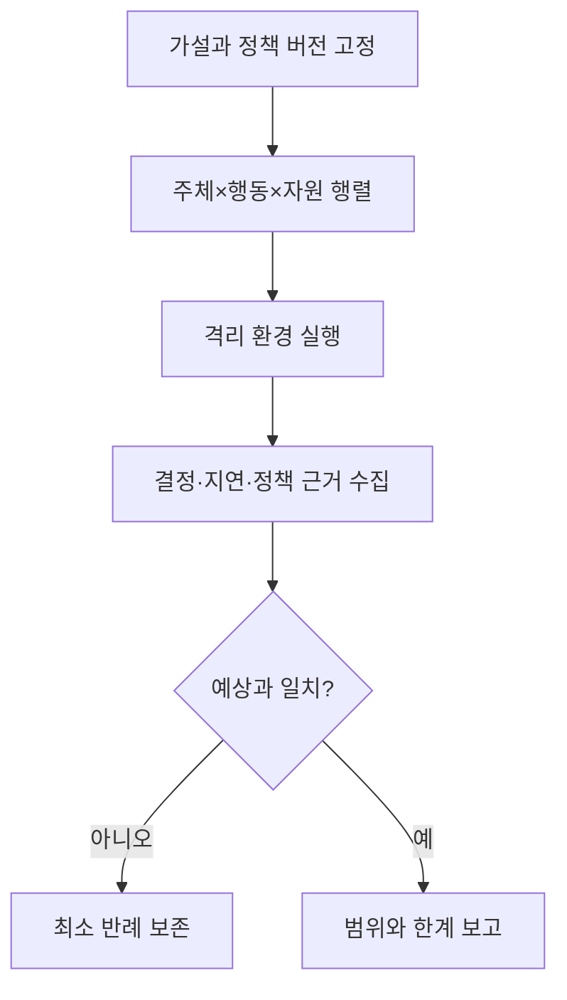

# 14. 실험과 연구 방법

보안 연구는 공격 화면을 한 번 보여 주는 일과 통제가 어떤 조건에서 어떤 효과를 냈는지 검증하는 일을 구분해야 한다. 한 번 성공한 공격은 가능성을 보여 줄 수 있지만 성공 확률, 필요한 권한, 다른 버전에서의 재현성까지 말해 주지는 않는다. 반대로 scanner가 아무것도 찾지 못했다는 결과도 취약점이 없다는 증명이 아니다.

이 장은 연구 질문을 검증 가능한 가설로 바꾸고, 독립·종속·통제 변수를 정하며, 비교군과 반복 측정으로 결과를 해석하고, 어떤 결과가 가설을 기각하는지 미리 쓰는 방법을 설명한다.

## 1. 연구 질문과 가설

**연구 질문(research question)**은 알고 싶은 관계를 구체적으로 묻는 문장이다. `키 교체가 빠른가?`보다 `동시 업무 부하가 있는 100만 객체에서 worker 수가 교체 완료 시간과 API p99 지연에 어떤 영향을 주는가?`가 측정 가능하다.

**가설(hypothesis)**은 관찰로 반박할 수 있는 예상이다. 좋은 가설에는 조건, 조작할 변수, 측정할 결과, 판단 기준이 있다.

예를 들어 다음과 같다.

> 정책 버전 17에서 test-reader는 test namespace의 pods/get만 허용되고, 준비한 24개 다른 주체·행동·자원 조합은 모두 거부된다.

`RBAC가 안전하다`는 가설이 아니다. 안전의 범위와 반례가 정의되지 않았기 때문이다.

**기각 조건(rejection criterion)**은 어떤 결과가 예상과 모순인지 미리 적은 것이다. 위 가설에서는 허용 case가 하나라도 거부되거나 24개 negative case 중 하나라도 허용되면 기각한다.

## 2. 변수와 실험 단위

**독립 변수(independent variable)**는 연구자가 의도적으로 바꾸는 조건이다. key rotation worker 수 2·4·8이 예다.

**종속 변수(dependent variable)**는 변화 효과를 측정하는 결과다. 완료 시간, 실패율, API p95·p99 지연, KMS 호출률이 예다.

**통제 변수(control variable)**는 비교를 공정하게 하기 위해 고정하거나 기록하는 조건이다. 객체 수와 크기 분포, node 종류, CPU quota, database 상태, network, software version을 포함한다.

**실험 단위(experimental unit)**는 독립적으로 조건을 적용하고 결과를 얻는 최소 단위다. 요청 하나, user account 하나, cluster run 하나가 될 수 있다. 같은 cluster에서 연속 측정한 요청 10만 개를 서로 완전히 독립인 10만 회 실험으로 보면 공통 cache와 부하 상태를 무시하게 된다.

## 3. 비교군과 baseline

**baseline**은 새 통제와 비교할 현재 또는 단순 조건이다. 예를 들어 password hashing 비용을 올리기 전 설정, rate limit이 없는 조건, rotation worker 2개 조건이다.

**대조군(control group)**은 실험 처치를 적용하지 않은 비교 집단이다. 보안 실험에서는 생산 사용자를 무방비로 두는 대조군이 위험할 수 있어 격리된 합성 환경에서 구성한다.

비교할 때 한 번에 여러 설정을 바꾸면 원인을 분리하기 어렵다. worker 수를 바꾸면서 object size와 KMS cache도 바꾸면 어느 변화가 완료 시간을 바꿨는지 알 수 없다.

반복 순서도 결과에 영향을 준다. 항상 2 worker, 4 worker, 8 worker 순으로 실행하면 cache warm-up이나 storage compaction이 뒤 조건에 유리할 수 있다. 가능한 경우 순서를 무작위화하거나 각 run 전 환경을 동일 상태로 되돌리고 순서 효과를 기록한다.

## 4. 측정값과 분위수

평균은 모든 값의 합을 개수로 나눈 값이다. 소수의 매우 느린 요청이 있어도 평균만 보면 사용자 꼬리 지연을 숨길 수 있다.

**분위수(percentile)**는 관측값을 정렬했을 때 일정 비율이 그 값 이하인 지점이다. p95 200ms는 약 95% 요청이 200ms 이하이고 약 5%는 더 느리다는 뜻이다. p99는 더 긴 꼬리를 본다.

성능 측정에는 처리량, latency 분포, timeout, error rate, CPU·memory·I/O, queue depth를 함께 기록한다. 보안 측정에는 허용해야 할 case의 성공률, 거부 case의 차단률, false positive, false negative, 탐지 지연을 기록한다.

요청 수만 크게 늘려도 독립 run이 하나라면 환경 변동에 대한 불확실성을 알기 어렵다. 여러 run과 날짜, 조건에서 반복하고 run별 결과를 보존한다.

## 5. 통계적 불확실성과 효과 크기

**효과 크기(effect size)**는 새 조건이 baseline과 얼마나 다른지 나타낸다. worker 4개가 2개보다 완료 시간을 10% 줄였다는 차이가 예다. 통계적 유의성만 보고 운영적으로 미미한 차이를 크게 해석하지 않는다.

**신뢰 구간(confidence interval)**은 반복 표본으로 계산한 추정값의 불확실성 범위를 표현하는 방법이다. 그 의미는 사용한 통계 방법의 가정에 따라 달라지므로 `95%라서 실제 값이 반드시 이 안에 있다`고 단순화하지 않는다.

요청 latency는 독립·정규 분포가 아닐 수 있다. 시간에 따른 부하, cache, retry가 상관을 만든다. bootstrap 같은 비모수 방법을 쓸 수 있지만 run 구조를 무시하고 개별 요청을 무작위로 재표집하면 cluster 수준 변동을 과소평가할 수 있다.

연구 보고서는 사용한 단위, 반복 수, 요약 통계와 원시 분포를 명시한다. 표본이 작아 결론이 불확실하면 그대로 보고한다.

## 6. 안전한 실험 경계

생산 자격 증명과 고객 데이터를 사용하지 않는다. 격리된 cloud account, namespace, network와 합성 데이터를 사용한다. 실험 계정 권한은 가설에 필요한 범위로 제한한다.

트래픽, storage 비용, KMS 호출, egress의 상한을 둔다. 예상 비용과 종료 조건을 미리 적는다. 자동 중단과 수동 kill switch의 주체를 정한다.

외부 시스템을 허가 없이 scan하거나 공격하지 않는다. 실험 대상 소유자의 명시적 권한과 시간·주소·기법 범위를 기록한다.

실패 시 격리 경계를 넘지 않는지 검토한다. 공격 payload, token, 고객 정보가 결과 파일과 화면 녹화, CI log에 남지 않게 한다. 실험 뒤 계정·key·network rule·데이터를 정리하고 정리 확인을 증거로 남긴다.

## 7. 인가 정책 실험

정책 행렬의 행은 주체, 열은 행동·자원·namespace 조합으로 만든다. positive case와 negative case를 모두 포함한다.

행렬에는 다음 경계를 넣는다.

- 존재하는 주체와 없는 주체
- 유효·만료·다른 audience token
- 같은 resource의 get·list·create·delete
- 다른 namespace와 cluster scope
- pods와 pods/log 같은 subresource
- wildcard가 새 resource에 미치는 영향
- Pod create를 통한 간접 ServiceAccount 사용

각 case는 예상 결정과 정책 근거를 가진다. 실제 결과뿐 아니라 평가한 정책 version과 audit event를 수집한다. 한 case가 실패하면 전체 평균 99% 성공으로 숨기지 않고 최소 반례를 보존한다.

정책 변경 전후 같은 행렬을 실행해 의도한 추가 권한과 의도하지 않은 증가를 구분한다.

## 8. key rotation 실험

가설 예시는 다음과 같다.

> 합성 객체 100,000개를 V7에서 V8로 바꿀 때 worker 8개 조건은 worker 4개보다 완료 시간을 줄이면서 정상 읽기 API p99를 baseline 대비 20% 이상 악화시키지 않고, run 종료 시 V7 새 쓰기와 잔여 객체가 모두 0이다.

독립 변수는 worker 수다. 종속 변수는 완료 시간, 처리량, 실패율, p50·p95·p99, KMS calls/s, database CPU다. 객체 크기 분포, tenant 수, node type, 정상 traffic, software digest는 통제한다.

실험 순서는 다음과 같다.

1. 고정 seed로 크기 분포를 만든 합성 객체 100,000개를 V7에 쓴다.
2. 정상 읽기·쓰기 traffic generator를 시작하고 baseline을 측정한다.
3. 시각 T0에 V8 새 쓰기와 re-encryption을 시작한다.
4. 중간에 worker 10%를 종료해 retry와 lease 복구를 시험한다.
5. 완료 뒤 V7 object count와 T0 이후 V7 write event가 0인지 확인한다.
6. 같은 조건을 독립 환경 초기화 뒤 여러 번 반복한다.

p99 악화가 25%이거나 V7 객체 하나가 남으면 가설을 기각한다. backup restore를 시험하지 않았다면 V7 key 폐기 안전성은 결론 범위에서 제외한다.

## 9. password 작업 비용 실험

목표는 `가장 큰 숫자 선택`이 아니라 정상 peak load에서 인증 서비스를 운영하면서 공격자의 후보 계산 비용을 높이는 설정을 찾는 것이다.

독립 변수는 Argon2id memory·time·parallelism 설정이다. 종속 변수는 단일 검증 latency, 동시 로그인 p95·p99, throughput, process RSS, CPU, timeout·error rate다. server hardware, container limit, password 길이 분포, 동시성, library version을 고정한다.

정상 부하와 공격 부하를 분리한다. rate limit 전후를 비교하고, 계정 잠금이 공격자에 의한 denial of service를 만드는지 본다. 한 요청 latency가 150ms여도 100 concurrent request에서 memory가 고갈될 수 있다.

기각 조건 예시는 `정상 peak의 p99가 1초를 넘거나 error rate가 0.1%를 넘는 설정은 채택하지 않는다`다. 이 숫자는 예시이며 서비스 SLO와 위험 분석으로 정한다.

## 10. 탐지 규칙 실험

**ground truth**는 시험에서 어떤 event가 공격이고 정상인지 미리 아는 정답 label이다. 합성 login과 Secret 접근 event를 만들어 rule 결과와 비교한다.

True positive는 공격을 alert한 경우, false positive는 정상을 alert한 경우, false negative는 공격을 놓친 경우다. **precision**은 alert 중 실제 공격 비율이고 **recall**은 실제 공격 중 탐지한 비율이다.

threshold를 낮추면 recall이 늘지만 false positive도 늘 수 있다. 분석가가 하루 처리 가능한 alert 수와 자산 심각도를 함께 본다. 전체 정확도는 정상 event가 매우 많을 때 99.9%처럼 보여도 공격을 전부 놓칠 수 있어 적절하지 않을 수 있다.

탐지 시간, 필요한 log field의 missing rate, collector drop을 측정한다. 완전한 합성 event는 실제 공격자의 회피와 사용 패턴을 대표하지 못한다는 한계를 쓴다.

## 11. 장애 주입과 경쟁 조건

정상 경로만 반복하면 부분 실패를 찾지 못한다. worker 종료, network 지연, KMS quota, stale cache, clock drift, duplicate message, snapshot rollback을 통제된 시점에 주입한다.

장애 주입 시각과 영향을 자동 기록한다. 여러 장애를 동시에 넣기 전에 하나씩 원인을 확인한다. 종료 조건을 넘으면 실험을 중단한다.

경쟁 조건은 실행 순서에 따라 결과가 달라진다. thread 수만 늘리지 않고 barrier와 고정된 scheduler hook으로 위험한 interleaving을 반복한다. 한 번 재현되지 않았다고 race가 없다고 결론 내리지 않는다.

cryptographic 안전성은 자체 benchmark로 증명하지 않는다. 표준 분석과 검토된 implementation을 근거로 하고 실험은 우리 deployment의 성능·설정·운영 조건을 검증한다.

## 12. 재현성과 증거

실험 code commit, container image digest, 구성 파일 digest, 입력 seed, software·kernel version, hardware, 실행 시각을 기록한다. 원시 결과와 분석 code를 분리 보존한다.

실패 run을 조용히 삭제하지 않고 제외 이유를 기록한다. 성공한 run만 고르면 결과가 편향된다. 사전에 정한 제외 기준을 사용한다.

그래프의 축을 잘라 작은 효과를 과장하지 않고 sample 수와 단위를 표시한다. 평균 선만 그리지 않고 분포와 오류, 독립 run을 보여 준다.

다른 사람이 같은 조건에서 재현하지 못하면 환경 차이, 숨은 입력, code와 analysis error를 조사한다. 재현 실패도 연구 결과다.

## 13. 음성 결과와 한계

**음성 결과(negative result)**는 예상한 효과나 취약점을 관찰하지 못한 결과다. 이것을 `취약점이 없다`로 바꾸면 안 된다.

도구, rule, 입력, 시간, 권한, version이 탐지 범위를 정한다. 정적 분석은 runtime configuration을 놓치고, 동적 시험은 실행하지 않은 path를 놓치며, 형식 검증은 model 가정 밖 구현·운영 error를 놓칠 수 있다.

정확한 표현은 `tool X version Y, rule set Z로 artifact digest D를 scan했으며 실행은 성공했고 알려진 matching 항목을 발견하지 못했다`처럼 쓴다.

## 14. 사전 실험 계획 표

실행 전에 다음 표를 채우면 결과를 본 뒤 기준을 바꾸는 일을 줄일 수 있다.

| 항목 | key rotation 예 |
|---|---|
| 질문 | worker 수가 완료 시간과 API tail latency에 미치는 영향 |
| 가설 | 8 worker가 4 worker보다 빠르고 p99 악화는 20% 이내 |
| 독립 변수 | worker 4, 8 |
| 종속 변수 | 완료 시간, p99, 실패율, KMS calls/s |
| 통제 변수 | 100,000 객체, 크기 seed, node·software digest, 정상 부하 |
| 반복 | 조건별 독립 초기화 5회 |
| 기각 | V7 잔여 1개 이상 또는 p99 악화 20% 초과 |
| 중단 | error 5%, KMS quota 90%, 비용 상한 도달 |
| 제외 | 사전 정의한 환경 준비 실패만, 결과 보고에 횟수 포함 |

분석 방법도 미리 정한다. 각 run의 완료 시간과 p99를 하나의 관측 단위로 보고 median과 범위를 제시할 수 있다. 요청 수백만 개를 모두 독립 표본처럼 취급하지 않는다. 결과를 본 뒤 가장 좋아 보이는 시간 구간만 고르지 않는다.

## 15. confounder와 외부 타당성

**교란 변수(confounder)**는 독립 변수와 함께 바뀌어 결과 원인을 혼동하게 하는 조건이다. worker 8개 run만 더 빠른 node에서 실행되면 worker 수 효과와 hardware 효과가 섞인다. run metadata로 찾고 동일 node class, random order, paired comparison을 사용한다.

**내적 타당성**은 관찰 차이가 실험한 원인 때문이라고 말할 수 있는 정도다. **외적 타당성**은 그 결과가 다른 cluster, workload, 공격자에도 적용되는 정도다. 격리 lab은 내적 통제가 좋을 수 있지만 production 규모와 traffic을 대표하지 않을 수 있다.

연구 보고서는 일반화 범위를 software version, hardware, workload, 권한과 함께 쓴다. 한 cloud region 결과를 모든 platform의 보장으로 확대하지 않는다.

## 16. 보안 실험의 중단과 공개

실험이 예상 밖 egress, 실제 credential 접근, 다른 tenant 영향, 비용 상한 초과를 보이면 자동 중단하고 owner에게 알린다. 중단 run도 원인과 영향을 기록한다.

새 취약점을 찾았다면 대상 소유자와 조정된 공개 절차를 따른다. 재현에 필요한 핵심은 제공하되 실제 secret, 고객 data, 즉시 악용 가능한 production 세부 정보는 보호한다. 수정 version과 완화책, 영향을 받는 조건을 구분한다.

연구 artifact를 공유할 때 공격 code 실행 권한과 network 기본값을 안전하게 두고, 합성 data와 예상 비용을 명시한다. 연구 재현성이 허가 없는 외부 공격을 허용한다는 뜻은 아니다.

## 17. 결과 보고서의 최소 구조

보고서는 질문과 가설, 환경, 입력 생성, 변수, 반복과 제외, 원시 결과 위치, 분석 방법, 결과, 기각 여부, 한계 순서로 작성할 수 있다. 결과가 가설과 다르면 실패로 숨기지 않고 어떤 조건에서 달랐는지 설명한다.

예를 들어 worker 8개가 평균 완료 시간은 줄였지만 두 run에서 KMS quota로 실패했다면 성공한 run만 평균내지 않는다. 실패율과 quota 시계열을 함께 제시하고 가설을 기각한다. worker 4개와 8개의 software digest가 달랐다면 직접 비교의 교란으로 보고 재실험한다.

그래프 하나마다 x·y 단위, sample·run 수, error bar 의미를 쓴다. p99가 개별 request에서 계산됐는지 run별 p99의 분포인지 구분한다. 분석 code가 원시 결과를 어떻게 filtering했는지 재현 가능하게 보존한다.

결론은 관찰 범위를 넘지 않는다. 격리 환경의 100,000 object 결과는 동일하지 않은 production 10억 object의 완료 시간을 직접 보증하지 않는다. 다음 실험에서 확인할 불확실성을 남긴다.

실험 종료 뒤 생성한 계정, key, network rule, object를 목록과 대조해 정리한다. 정리 실패 자체도 비용과 운영 위험 결과에 포함한다. 후속 연구자는 같은 이름의 남은 상태를 새 입력으로 오해하지 않게 run별 namespace와 만료를 사용한다.

보고서의 모든 시간과 크기 단위를 명시하고, 측정 도구 자체의 overhead와 clock resolution도 한계로 기록한다.

## 18. 오해와 반례

**“공격 demo가 한 번 성공해 항상 성공한다.”** version, 권한, timing 조건이 달라질 수 있다.

**“scanner 0건은 안전 인증이다.”** rule에 없는 취약점과 업무 logic이 남는다.

**“평균 latency가 같아 비용이 없다.”** p99, CPU saturation, error rate가 악화될 수 있다.

**“sample이 많으면 편향이 사라진다.”** 같은 잘못된 환경에서 반복한 큰 표본도 외부 타당성을 주지 않는다.

## 19. 연습 문제와 자세한 풀이

### 문제 1. MFA 가설

시험 가능한 문장으로 바꿔라.

**풀이:** `비밀번호만 탈취한 격리 계정의 30개 login은 등록된 두 번째 요소 없이 모두 실패하고 성공 session은 0개다`처럼 조건·입력·결과를 정한다. phishing 저항성은 별도 범위다.

### 문제 2. rotation 변동

run마다 처리량이 다르다.

**풀이:** 객체 수·크기, 정상 부하, KMS quota·cache, worker CPU, network, storage compaction, retry를 고정·기록한다. run 순서 효과도 확인한다.

### 문제 3. scanner 0건 보고

정확히 어떻게 쓰는가?

**풀이:** 도구·DB version, artifact digest, 설정, 범위, 실행 성공을 쓰고 그 범위에서 알려진 match를 발견하지 못했다고 한다.

### 문제 4. 평균 100ms

p99가 4초라면 통제 비용이 작은가?

**풀이:** 평균은 긴 꼬리를 숨긴다. timeout, p95·p99, 사용자 SLO, CPU·queue와 함께 평가한다. 사전 기준을 넘으면 가설을 기각한다.

### 문제 5. policy 24 case

23개가 맞고 delete 하나가 잘못 허용됐다.

**풀이:** 평균 성공률로 통과시키지 않는다. negative case 하나의 허용은 security invariant 위반이며 가설을 기각한다. 최소 반례와 정책 경로를 보존한다.

### 문제 6. worker 8개가 가장 빠름

바로 채택할 수 있는가?

**풀이:** API tail latency, failure, KMS·DB saturation, 독립 run 불확실성을 확인한다. 완료 시간 하나만 최적화하지 않는다.

### 문제 7. 취약점 재현 실패

안전하다고 결론 내리는가?

**풀이:** 사용 version, 권한, 입력, timing과 도구가 원 보고와 같은지 확인한다. 관찰 범위에서 재현하지 못했다고 보고하고 미관찰 경로를 한계로 남긴다.

## 공식 근거

- [NIST SP 800-115: Technical Guide to Security Testing](https://csrc.nist.gov/pubs/sp/800/115/final)
- [NIST SP 800-53A Rev. 5: Assessing Security and Privacy Controls](https://csrc.nist.gov/pubs/sp/800/53/a/r5/final)

---

[이전: 로컬 교육 모형](13-local-models.md) · [목차](README.md) · [다음: 종합 문제·용어집·출처](15-exercises-glossary-and-sources.md)
