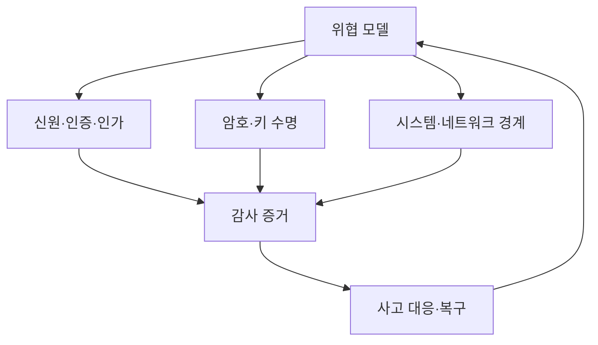

# 15. 종합 문제·개념 연결·출처

보안 용어는 한 줄 정의를 외우면 실제 상황에서 서로 섞이기 쉽다. 암호화와 인코딩, 인증과 인가, namespace와 Kubernetes namespace, nonce와 request ID는 각각 해결하는 문제가 다르다. 이 장은 용어를 독립 목록으로 나열하지 않고 하나의 요청과 사고 수명에서 어떤 객체와 상태를 가리키는지 연결한다.

## 1. 전체 지도

위협 모델은 자산, 공격자, 진입점, 신뢰 경계와 가정을 정한다. 신원·인증·인가는 주체와 행동을 판정하고, 암호는 특정 바이트의 기밀성·무결성을 보호한다. Linux와 network 통제는 실행과 연결 경로를 줄인다. 감사 로그는 이 결정과 결과의 증거를 남기고 사고 대응은 실패한 통제와 영향 범위를 찾아 복구한다. 회고 결과는 다시 위협 모델과 정책을 바꾼다.

## 2. 자산에서 위험까지 이어지는 개념

**자산(asset)**은 잃거나 노출되거나 바뀌면 손해가 생기는 데이터, 기능, 자원, 시간이다. model weight, API key, GPU time, service availability가 모두 자산이다.

**주체(subject)**는 행동을 요청하는 사용자나 프로그램의 시스템 표현이고 **객체(object)**는 그 행동의 대상이다. 정책 문장은 `주체 u-1842가 객체 model-7에 delete를 할 수 있는가`처럼 세 요소를 모두 가져야 한다.

**정책(policy)**은 허용·거부 기준이고 **통제(control)**는 그 기준을 예방·탐지·복구로 실행하는 장치다. RBAC rule은 정책 표현이고 API server 판정은 집행이다. backup은 복구 통제이며 encryption과 역할이 다르다.

**신뢰 경계(trust boundary)**는 입력에 대한 가정과 책임이 바뀌어 다시 검증해야 하는 지점이다. 외부 network뿐 아니라 Gateway가 만든 identity header를 backend가 받는 곳, application이 database 결과를 쓰는 곳도 경계다.

**위협(threat)**은 손해를 만들 수 있는 행위자나 사건이고 **취약점(vulnerability)**은 이용 가능한 약점이다. **위험(risk)**은 특정 조건에서 위협이 취약점을 이용할 가능성과 영향의 조합이다. `공격자 존재`만으로 risk가 완성되지 않고 어떤 자산에 어떤 결과가 생기는지 써야 한다.

## 3. 기밀성·무결성·가용성은 독립 목표다

**기밀성(confidentiality)**은 허용되지 않은 열람을 막는다. encryption과 access control이 돕는다.

**무결성(integrity)**은 허용되지 않은 변경을 막거나 탐지한다. AEAD tag, MAC, signature, database constraint가 서로 다른 경계에서 이를 돕는다.

**가용성(availability)**은 허용된 사용자가 필요한 때 기능과 데이터를 사용할 수 있는 성질이다. backup, redundancy, quota, tested restore가 필요하다.

AES-GCM으로 파일을 암호화해도 공격자가 ciphertext를 삭제하면 가용성이 깨진다. 세 backup이 있어도 모두 공개 read라면 기밀성이 깨진다. signature가 변경을 탐지해도 정상 copy가 없으면 복구할 수 없다.

## 4. 신원, credential, session, 인증과 인가

**신원(identity)**은 시스템이 사람이나 workload를 구별하는 안정된 ID와 속성 묶음이다. **자격 증명(credential)**은 그 신원을 주장하는 비밀번호, 개인키, token 같은 증거다.

**인증(authentication)**은 credential을 검증해 주체를 만든다. **인가(authorization)**는 그 주체가 특정 객체에 특정 행동을 할 수 있는지 정책으로 결정한다. 인증 성공은 모든 행동 허용이 아니다.

**session**은 한 번의 인증 결과를 후속 요청에 연결하는 상태다. 생성, 만료, 갱신, 폐기 수명을 가진다. 짧은 access token이어도 장기 refresh token이 탈취되면 새 token을 계속 얻을 수 있다.

**MFA**는 서로 다른 종류의 인증 요소를 둘 이상 요구한다. 비밀번호 두 개는 둘 다 지식 요소다. **RBAC**는 권한을 role에 묶고, **ABAC**는 주체·자원·환경 attribute 식으로 판단한다. 실제 정책은 role에 project 일치와 만료 조건을 결합할 수 있다.

**최소 권한**은 필요한 행동·객체·기간만 허용한다. **방어 깊이**는 실패 원인이 다른 통제를 여러 경계에 둔다. 같은 관리자 password를 믿는 방화벽 두 개는 독립 방어가 아니다.

## 5. 표현, 요약, 인증, 암호화의 차이

**인코딩(encoding)**은 바이트를 다른 문자 표현으로 바꾼다. Base64는 누구나 복원하므로 기밀성이 없다.

**해시(hash)**는 임의 길이 입력을 고정 길이 digest로 바꾸는 key 없는 함수다. 신뢰한 예상 digest와 비교하면 바이트 일치를 확인하지만 공격자가 파일과 digest를 모두 바꾸는 상황에서 출처를 인증하지 못한다.

**MAC**은 공유 비밀키로 message tag를 만들고 같은 key 보유자가 검증한다. 키 없는 공격자의 변조를 탐지하지만 참여자 모두 tag를 만들 수 있다.

**전자서명**은 private key로 서명하고 public key로 검증한다. 검증 성공은 대응 private key가 그 바이트에 서명했다는 근거다. public key가 누구 것인지와 signer가 정직한지는 별도다.

**암호화(encryption)**는 key 없이 plaintext를 알기 어렵게 ciphertext로 바꾼다. **AEAD**는 encryption과 authentication tag를 결합하고 숨기지 않는 metadata인 AAD도 함께 인증한다.

## 6. random, salt, nonce, IV, key 수명

**entropy**는 관찰자의 불확실성 양을 나타낸다. **CSPRNG**는 내부 상태로 예측하기 어려운 bytes를 만드는 cryptographic generator다. 현재 시각과 process ID를 seed로 직접 만드는 방식은 key 생성에 충분하지 않다.

**salt**는 같은 password가 같은 저장 결과를 만들지 않도록 사용자별 password hash에 넣는 공개 고유값이다. **pepper**는 DB 밖에서 관리하는 추가 비밀이다. 둘 다 Argon2id 같은 work factor를 대신하지 않는다.

**nonce**는 정한 key 범위에서 반복되지 않게 관리하는 값이다. **IV**는 암호 mode의 초기 상태 값이며 mode마다 요구가 다르다. 모두 random 문자열이라고 부르면 unique 범위와 수명을 잃는다.

**DEK**는 실제 data를 암호화하고 **KEK**는 DEK를 감싼다. envelope encryption은 ciphertext, nonce, tag, wrapped DEK, key version을 함께 저장한다. **KMS**는 key와 연산 권한을 관리·감사한다.

key rotation은 새 쓰기 전환, dual read, re-encryption, old use 0 확인, backup·cache 검토, 폐기의 상태 전이다. alias 변경 한 번이 아니다.

## 7. TLS와 certificate 연결

**TLS**는 network 두 endpoint가 version과 algorithm을 합의하고 key exchange, 상대 인증, record 보호를 수행하는 protocol이다. HTTP를 TLS 위에서 보내는 것이 HTTPS다.

**certificate**는 이름과 public key, 기간, 용도를 issuer signature로 묶는다. **PKI**는 CA, trust store, 발급·갱신·폐기 절차 전체다. chain signature만 아니라 접속 hostname, 기간, key usage와 private key 증명을 검증한다.

**ECDHE**는 임시 private value와 public value로 session shared secret을 만드는 key exchange 계열이다. 임시값을 폐기하면 장기 인증키가 미래에 유출돼도 과거 session이 자동 복원되지 않는 **전방향 안전성**을 제공할 수 있다.

**replay**는 과거 유효 message를 다시 보내는 공격이다. TLS와 AEAD가 변조를 막아도 application의 같은 payment를 새 연결에서 다시 보낼 수 있다. request ID와 원자적 처리 상태가 필요하다.

## 8. Linux와 Kubernetes 경계

Linux **namespace**는 process가 보는 PID, mount, network 같은 이름 공간을 분리한다. **cgroup**은 CPU·memory·I/O 사용을 회계·제한한다. **capability**는 root 권한을 기능별로 나눈다. **seccomp**는 system call 종류를 filter한다. 네 기능은 서로 대신하지 않는다.

Kubernetes **namespace**는 API 객체 이름과 정책 범위이며 Linux namespace와 다른 객체다. network와 kernel이 자동 분리되지 않는다.

**Admission**은 인증·인가 뒤 Kubernetes 객체가 저장되기 전 field를 검증·변경한다. RBAC가 pods/create를 허용해도 Admission이 privileged, hostPath, ServiceAccount를 제한할 수 있다.

**ServiceAccount**는 workload의 Kubernetes API 신원이다. token이 Pod file로 mount되므로 침해 process가 만료 전 권한을 사용할 수 있다. 짧은 수명과 최소 RBAC, mount 제한이 함께 필요하다.

## 9. application과 공급망 연결

**SSRF**는 공격자가 server의 request destination을 조종하는 취약점이다. DNS 재해석과 redirect, IPv6를 고려해 실제 연결 지점에서 allowlist와 egress policy를 집행한다.

**XSS**는 입력이 browser code로 실행되는 문제다. output context별 encoding이 필요하다. **CSRF**는 browser가 자동 첨부하는 credential로 의도하지 않은 state change를 보내게 한다. CORS는 browser response 공개 정책이며 server authorization이 아니다.

**SBOM**은 artifact 구성 요소 목록이다. **provenance**는 source, dependency, builder, output digest의 출처 기록이다. **attestation**은 주체가 사실을 구조화해 서명한 진술이다. signature가 성공해도 악성 builder가 정식으로 만든 artifact일 수 있어 source와 builder policy를 검증한다.

## 10. 관찰, 사고와 복구

**audit log**는 주체, 행동, 객체, 정책 결정, 결과를 남긴 증거다. request ID와 trace ID는 service 기록을 연결하지만 내용의 진실을 자동 보증하지 않는다.

탐지는 관찰 signal과 rule로 침해 가능성을 찾고 alert를 만든다. triage는 실제 사고 가능성과 심각도를 평가한다. containment는 확산을 줄이고, eradication은 root access path와 persistence를 제거하며, recovery는 신뢰 상태와 핵심 transaction을 복원한다.

**RPO**는 허용할 data loss 시점 범위이고 **RTO**는 목표 복구 시간이다. backup 성공 message보다 격리 restore와 application invariant 검증이 필요하다.

**TOCTOU**는 검사와 사용 사이에 대상 상태가 바뀌는 경쟁이다. file path를 검사한 뒤 같은 path가 다른 bytes로 바뀌는 사례다. immutable version과 conditional update로 검사 대상과 사용 대상을 묶는다.

## 11. 비슷해 보이는 값의 수명을 비교한다

| 값 | 누가 생성 | 어디에 존재 | 핵심 규칙 | 끝나는 시점 |
|---|---|---|---|---|
| password salt | 인증 서비스 | password hash 레코드 | 사용자별 고유 | 레코드 삭제 |
| AEAD nonce | 암호화 writer | ciphertext 옆 metadata | 같은 key에서 재사용 금지 | ciphertext와 함께 보존 |
| request ID | Gateway·client | log와 업무 상태 | 요청 상관, 필요하면 멱등성 | 추적·중복 창 뒤 |
| session token | 신원 서비스 | client와 검증 상태 | audience·expiry·폐기 | 만료·logout·사고 폐기 |
| DEK | app 또는 KMS | memory와 wrapped form | data 범위와 key version | data·backup 수명 뒤 |
| trace ID | 관찰 SDK | 여러 service log | span 인과 연결 | log retention 뒤 |

nonce와 request ID가 둘 다 unique해 보여도 목적이 다르다. nonce는 cryptographic key 사용 안전성이고 request ID는 업무 상관과 중복 상태다. 하나를 다른 것으로 재사용하려면 생성·범위·노출·영속 요구가 모두 맞는지 검토해야 한다.

salt와 nonce도 공개될 수 있지만 salt는 password hash별 구분, nonce는 같은 encryption key의 연산 구분이다. salt 중복은 password 방어를 약화시키지만 GCM nonce 재사용처럼 같은 방식의 기밀성 붕괴라고 말하지 않는다.

## 12. 통제를 선택하는 질문 순서

새 시스템에서 먼저 보호 자산과 공격자 능력을 적는다. 그 다음 데이터와 권한이 지나는 경계를 그린다. 경계마다 주체 인증, 객체 인가, 입력 구조, cryptographic 보호, 감사 증거를 누가 담당하는지 적는다.

통제를 고른 뒤 실패 조건을 거꾸로 묻는다. key가 유출되면 어떤 ciphertext가 영향받는가, collector가 멈추면 audit가 드롭되는가, proxy를 우회해 backend에 직접 갈 수 있는가, backup key를 폐기하면 restore가 가능한가를 본다.

마지막으로 현재 배포의 증거를 찾는다. 설정 파일의 의도, runtime의 실제 상태, 독립 test 결과를 구분한다. 문서에 TLS 1.3이라고 적혀 있는 것과 endpoint 협상 결과는 서로 다른 증거다.

운영 결정에는 한 통제가 아니라 이 질문 순서와 서로 독립적인 증거가 필요하다.

같은 용어도 적용 범위와 관리 주체가 다르면 보장이 달라지므로 실제 객체와 수명을 항상 함께 기록한다.

## 13. 종합 문제와 완전한 풀이

### 문제 1. encrypted data 삭제

AES-GCM data를 storage 관리자가 삭제할 수 있고 key 관리자도 같은 사람이다.

**풀이:** storage 기밀성은 높아질 수 있지만 삭제 가용성은 부족하다. 한 사람이 ciphertext와 key policy를 바꿔 역할 분리도 약하다. immutable backup, restore 시험, storage·key·recovery 승인 분리, audit를 둔다.

### 문제 2. token 검증

signature와 exp는 맞지만 iss는 test, aud는 다른 API다.

**풀이:** 거부한다. trusted issuer, 현재 audience, algorithm, time, session 상태를 함께 검증한다. test issuer를 production trust에 넣지 않는다.

### 문제 3. authorization과 보존 잠금

models/delete 권한은 있지만 객체가 법적 hold다.

**풀이:** authorization 뒤 business state invariant가 삭제를 거부한다. subject, object, policy version, hold reason을 audit한다. 권한은 모든 상태에서 성공한다는 뜻이 아니다.

### 문제 4. nonce restart

64-bit memory counter가 배포마다 0이고 prefix와 key가 같다.

**풀이:** restart마다 same key·nonce가 반복된다. atomic persistent counter, unique prefix allocation, 또는 new key를 사용하고 replica·snapshot rollback을 포함한다.

### 문제 5. TLS 0-RTT payment

AEAD 성공이면 한 번만 처리됐는가?

**풀이:** 아니다. early data는 replay될 수 있다. state change를 0-RTT에서 거부하거나 payment ID와 database unique state를 한 transaction에 묶는다.

### 문제 6. Pod create 간접 상승

Secret get은 없지만 arbitrary ServiceAccount와 hostPath가 가능하다.

**풀이:** Pod가 높은 token이나 node file을 읽을 수 있다. Admission으로 ServiceAccount·volume·privileged·capability를 제한하고 create 권한의 효과를 다시 분석한다.

### 문제 7. signed malicious image

침해 CI가 정상 key로 악성 image를 서명했다.

**풀이:** signature는 CI key와 bytes 관계를 올바르게 보였다. CI가 정직하다는 가정이 깨졌다. key 폐기, 영향 digest 차단, source·dependency·builder 조사, clean rebuild와 runtime 탐지가 필요하다.

### 문제 8. incident timeline

service clock 12:04, identity clock 12:00이고 request ID가 같다.

**풀이:** 하나를 임의로 고르지 않는다. event·ingest time, clock offset을 보존하고 request ID의 인과로 연결해 약 12:00~12:04 불확실 구간을 표시한다.

## 14. 출처를 읽는 세 층

규격은 algorithm과 protocol 요구를 설명한다. 제품 문서는 그 요구를 특정 implementation에서 설정하는 법을 설명한다. 운영 측정은 현재 endpoint와 workload가 실제 사용하는 version·setting을 보여 준다.

TLS 1.3 RFC가 존재해도 우리 endpoint가 TLS 1.3과 hostname 검증을 사용한다는 뜻은 아니다. Kubernetes 문서에 Pod Security가 있어도 cluster label과 exception이 실제로 enforce됐다는 뜻은 아니다. 세 층의 증거를 연결한다.

### 암호와 신원

- [NIST SP 800-38D: GCM](https://csrc.nist.gov/pubs/sp/800/38/d/final)
- [RFC 8446: TLS 1.3](https://www.rfc-editor.org/rfc/rfc8446.html)
- [NIST SP 800-57 Part 1 Rev. 5](https://csrc.nist.gov/pubs/sp/800/57/pt1/r5/final)
- [NIST Digital Identity Guidelines](https://pages.nist.gov/800-63-4/)

### application과 platform

- [OWASP Application Security Verification Standard](https://owasp.org/www-project-application-security-verification-standard/)
- [Kubernetes Security](https://kubernetes.io/docs/concepts/security/)
- [Kubernetes RBAC](https://kubernetes.io/docs/reference/access-authn-authz/rbac/)

### 공급망·사고·검증

- [SLSA Specification](https://slsa.dev/spec/)
- [NIST Secure Software Development Framework](https://csrc.nist.gov/projects/ssdf)
- [NIST SP 800-61 Rev. 2](https://csrc.nist.gov/pubs/sp/800/61/r2/final)
- [NIST SP 800-115](https://csrc.nist.gov/pubs/sp/800/115/final)

## 15. 마지막 점검

새 시스템을 볼 때 자산과 주체·객체·행동을 먼저 적는다. 데이터와 권한이 지나는 신뢰 경계를 그린다. 각 경계에서 인증, 인가, 입력 검증, 암호, log의 담당 주체와 실패 모드를 찾는다.

key와 token은 생성부터 폐기까지, data는 수집부터 backup 만료까지 추적한다. 정상 흐름뿐 아니라 retry, restart, rollback, clock drift, duplicate, partial failure를 넣는다.

각 통제에 `무엇을 보장하는가`, `무엇을 보장하지 않는가`, `어떤 증거로 현재 배포에서 확인하는가`를 쓴다.

---

[이전: 실험과 연구](14-experiments-and-research.md) · [목차](README.md) · [학습 자료 목차](../README.md)
