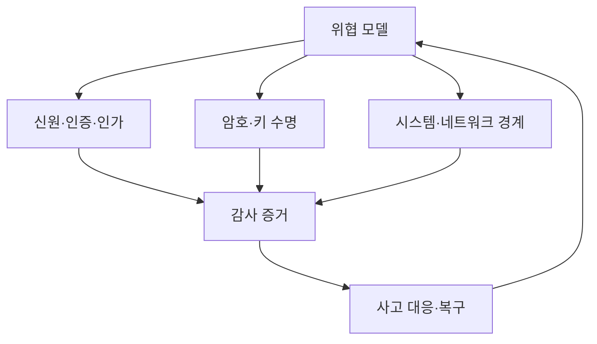

# 15. 종합 문제·용어집·출처

이 장은 여러 경계를 한 시나리오에서 연결한다. 먼저 직접 답하고 해설에서 빠진 주체, 상태, 실패 조건을 확인한다.

## 1. 전체 지도

## 2. 종합 문제와 완전한 해설

### 문제 1. 목표 분리

연구 데이터는 AES-GCM으로 암호화됐지만 객체 저장소 관리자 누구나 암호문을 삭제할 수 있고 키 서비스 관리자도 같다. 보안 목표와 역할 분리를 평가하라.

**해설:** 키 접근이 통제된다면 저장 데이터 기밀성은 향상된다. 하지만 저장소 관리자가 삭제할 수 있어 가용성은 부족하다. 같은 사람이 암호문과 키 정책을 모두 바꿀 수 있어 직무 분리가 약하다. 저장 관리자, 키 관리자, 복구 승인자를 분리하고 삭제 보호·불변 백업·복원 시험·감사 로그를 둔다. GCM은 삭제 복구를 제공하지 않는다.

### 문제 2. 토큰 검증

서명과 만료 시간은 맞지만 `iss`는 시험 발급자이고 `aud`는 다른 API다. 생산 API가 받을 수 있는가?

**해설:** 거부한다. 인증은 서명만이 아니라 신뢰한 발급자, 현재 서비스 대상, 시간, 알고리즘, 폐기 상태를 묶어 검증한다. 시험 발급자를 생산 trust store에 넣지 않고 audience가 현재 API와 정확히 맞아야 한다.

### 문제 3. 인가와 객체 상태

사용자에게 `models/delete` 권한이 있지만 모델은 법적 보존 잠금 상태다. 결과는?

**해설:** 인증과 인가는 통과해도 업무 불변조건이 삭제를 거부한다. API는 충돌 상태를 반환하고 주체, 객체, 보존 정책 버전, 거부 이유를 감사한다. 권한은 모든 상태에서 행동이 성공한다는 보장이 아니다.

### 문제 4. nonce 재시작

서비스가 96비트 nonce의 마지막 64비트를 메모리 카운터로 쓰고 배포마다 0으로 시작한다. 앞 32비트는 항상 같다. 위험과 수정은?

**해설:** 같은 키를 유지한 재시작에서 nonce가 반복돼 GCM 안전성이 심각하게 깨질 수 있다. 원자적으로 영속되는 카운터, 재시작마다 절대 겹치지 않는 prefix 할당, 또는 새 키 발급을 사용한다. 여러 replica와 snapshot rollback까지 같은 키 범위에서 분석한다.

### 문제 5. 비밀번호 저장

DB에 `SHA256(password || global_salt)`를 저장한다. 두 가지 문제와 개선을 적어라.

**해설:** SHA-256은 빠르므로 오프라인 대량 추측이 싸다. 모든 사용자가 global salt를 공유해 같은 비밀번호가 같은 결과를 만들고 공격 재사용이 쉽다. 사용자별 고유 salt와 Argon2id 같은 적응형 비밀번호 해시, 운영 장비에서 측정한 비용을 사용한다. 온라인 rate limit과 MFA도 별도다.

### 문제 6. TLS 검증

사설 테스트 환경에서 인증서 호스트명 검사를 끈 클라이언트를 그대로 생산에 배포했다. 암호화는 되었는데 왜 위험한가?

**해설:** 클라이언트는 연결 상대가 원하는 호스트인지 확인하지 않는다. 공격자가 다른 유효 인증서나 가로챈 경로로 중간자 역할을 할 수 있다. 신뢰 체인, 호스트명, 기간, 키 사용을 검증하고 테스트용 신뢰 설정을 생산과 분리한다.

### 문제 7. 0-RTT와 결제

TLS 1.3 0-RTT로 `POST /pay`를 받는다. AEAD 검증 성공이면 한 번만 처리됐다고 볼 수 있는가?

**해설:** 아니다. early data는 replay를 고려해야 하며 AEAD는 유효 레코드의 재전송을 자동 구분하지 않는다. 상태 변경 요청을 0-RTT에서 거부하거나, 결제 ID와 서버의 원자적 중복 처리 기록으로 멱등성을 보장한다.

### 문제 8. Kubernetes 권한 상승

개발자에게 Secret get은 없지만 Pod create, 임의 ServiceAccount 선택, hostPath 사용이 가능하다. 직접 읽기 권한이 없으니 안전한가?

**해설:** 안전하지 않다. 권한 높은 ServiceAccount 토큰을 mount하거나 hostPath로 노드 파일을 읽는 간접 상승이 가능하다. Admission으로 ServiceAccount, volume, privileged와 capability를 제한하고 Pod create 권한 범위를 재검토한다.

### 문제 9. SSRF

URL fetcher가 문자열 `localhost`와 `127.0.0.1`만 막는다. 우회와 개선을 설명하라.

**해설:** DNS 이름이 내부 주소로 해석되거나 IPv6, 다른 숫자 표기, redirect로 내부에 도달할 수 있다. 허용 scheme·host·port를 좁히고 각 DNS 해석과 redirect에서 실제 목적지 주소를 검사한다. egress proxy와 cloud metadata 차단, 크기·시간 제한도 둔다.

### 문제 10. 서명된 악성 코드

공식 CI가 침해돼 악성 이미지를 정상 키로 서명했다. 배포 검증은 성공했다. 서명 체계가 쓸모없다는 뜻인가?

**해설:** 서명은 바이트와 CI 신원을 올바르게 증명했지만 CI가 정직하다는 가정이 깨졌다. source review, 격리 builder, provenance 조건, 키 최소 권한, 독립 재현 빌드, 런타임 제한과 탐지를 함께 사용한다. 키를 폐기하고 영향 artifact digest를 차단하며 재발급한다.

### 문제 11. 키 교체 완료

KMS alias를 V8로 바꾸고 팀이 교체 완료를 선언했다. V7 사용이 계속되는 원인은 무엇이며 완료 기준은?

**해설:** 옛 프로세스·큐·캐시가 V7으로 쓰거나, 레코드와 backup이 V7을 필요로 할 수 있다. 새 V7 쓰기 0, 온라인 V7 객체 0, 소비자 V8 호환, cache와 장기 작업 정리, backup 보존 결정, 감사된 폐기 승인을 완료 기준으로 둔다.

### 문제 12. 사고 타임라인

애플리케이션 시계는 12:04, 신원 시스템은 12:00을 표시하고 요청 ID는 같다. 어느 시간이 진실인가?

**해설:** 하나를 근거 없이 고르지 않는다. 각 clock offset, 수집 시간, NTP 상태를 기록하고 요청 ID와 세션의 인과 연결로 사건을 묶는다. 타임라인에 `약 12:00~12:04` 불확실 구간을 표시한다. 이후 시간 동기화와 drift 경보를 개선한다.

## 3. 용어집

1. **자산(asset)**: 조직이 보호할 가치가 있는 데이터, 기능, 시간 또는 자원.
2. **주체(subject)**: 행동을 요청하는 사용자나 프로그램.
3. **객체(object)**: 주체가 읽거나 바꾸려는 대상.
4. **정책(policy)**: 허용할 행동과 조건을 기술한 규칙.
5. **통제(control)**: 정책을 예방·탐지·복구로 집행하는 수단.
6. **신뢰 경계(trust boundary)**: 입력에 대한 가정이 바뀌어 재검사가 필요한 지점.
7. **위협(threat)**: 손해를 일으킬 수 있는 행위자나 사건.
8. **취약점(vulnerability)**: 위협이 이용할 수 있는 약점.
9. **위험(risk)**: 가능성과 영향을 함께 고려한 손실 평가.
10. **위협 모델(threat model)**: 자산, 공격자, 경계, 통제를 명시한 분석.
11. **기밀성(confidentiality)**: 허용되지 않은 정보 열람을 막는 성질.
12. **무결성(integrity)**: 허용되지 않은 변경을 막거나 탐지하는 성질.
13. **가용성(availability)**: 필요할 때 서비스를 이용할 수 있는 성질.
14. **인증(authentication)**: 신원 주장을 증거로 확인하는 과정.
15. **인가(authorization)**: 특정 주체의 특정 행동을 허용할지 판단하는 과정.
16. **자격 증명(credential)**: 신원 주장을 뒷받침하는 비밀번호, 키, 토큰.
17. **세션(session)**: 인증 결과를 후속 요청과 연결하는 상태.
18. **MFA**: 서로 다른 종류의 인증 요소를 둘 이상 요구하는 방식.
19. **RBAC**: 역할에 권한을 묶어 주체에게 부여하는 접근 통제.
20. **ABAC**: 주체·자원·환경 속성 식으로 판단하는 접근 통제.
21. **최소 권한(least privilege)**: 필요한 행동과 기간만 허용하는 원칙.
22. **방어 깊이(defense in depth)**: 독립 통제를 여러 경계에 배치하는 원칙.
23. **엔트로피(entropy)**: 결과에 대한 불확실성의 양.
24. **CSPRNG**: 예측하기 어려운 바이트를 생성하는 암호학적 난수 생성기.
25. **대칭키**: 암호화와 복호화 양쪽이 공유하는 비밀키.
26. **개인키**: 비대칭 키 쌍에서 소유자가 보호하는 부분.
27. **공개키**: 검증이나 키 합의에 공개할 수 있는 키 부분.
28. **키 ID**: 키를 조회하고 버전을 구분하는 식별자.
29. **KDF**: 키 재료에서 목적별 키를 파생하는 함수.
30. **인코딩(encoding)**: 데이터를 전송·저장 가능한 다른 표현으로 바꾸는 것.
31. **해시(hash)**: 임의 길이 입력을 고정 길이 digest로 바꾸는 함수.
32. **digest**: 해시 함수의 출력 요약값.
33. **충돌(collision)**: 서로 다른 두 입력이 같은 digest를 갖는 경우.
34. **MAC**: 공유 비밀키로 메시지 무결성과 출처를 확인하는 태그.
35. **HMAC**: 해시 함수를 정해진 구조로 사용하는 MAC.
36. **전자서명**: 개인키로 만들고 공개키로 검증하는 메시지 증거.
37. **평문(plaintext)**: 암호화 전 원래 데이터.
38. **암호문(ciphertext)**: 암호화 뒤 결과 데이터.
39. **AEAD**: 기밀성과 무결성을 함께 제공하는 인증 암호화 방식.
40. **AAD**: 숨기지 않지만 AEAD가 무결성을 확인하는 부가 데이터.
41. **nonce**: 같은 키 아래 정한 규칙에 따라 한 번 쓰는 값.
42. **IV**: 암호 모드의 연산을 시작하는 초기화 값.
43. **salt**: 같은 비밀번호의 같은 저장 결과를 막는 공개 고유값.
44. **pepper**: 비밀번호 DB 밖에서 관리하는 추가 비밀.
45. **작업 비용(work factor)**: 비밀번호 검증 한 번에 들도록 설정한 계산 자원.
46. **envelope encryption**: DEK로 데이터를 암호화하고 KEK로 DEK를 감싸는 구조.
47. **DEK**: 실제 데이터 바이트를 암호화하는 키.
48. **KEK**: DEK를 암호화해 보호하는 키.
49. **TLS**: 전송 연결의 인증·키 합의·레코드 보호 프로토콜.
50. **인증서(certificate)**: 공개키와 신원 정보를 발급자 서명으로 묶은 구조.
51. **PKI**: 인증서 발급, 검증, 폐기를 위한 공개키 기반 체계.
52. **ECDHE**: 임시 타원곡선 Diffie–Hellman 키 합의 방식.
53. **전방향 안전성**: 장기키 유출이 과거 세션 키 복원으로 곧 이어지지 않는 성질.
54. **replay**: 과거의 유효한 메시지를 다시 보내는 공격.
55. **namespace**: Linux 자원 관점을 프로세스 집단별로 나누는 기능.
56. **cgroup**: 프로세스 집단의 자원을 제한하고 회계하는 Linux 기능.
57. **capability**: 전통적 root 권한을 나눈 개별 능력.
58. **seccomp**: 허용할 Linux system call을 필터링하는 기능.
59. **Admission**: Kubernetes 객체 저장 전 변경하거나 검증하는 단계.
60. **ServiceAccount**: Kubernetes 안 워크로드의 API 신원.
61. **SSRF**: 서버가 공격자가 고른 대상으로 요청하게 만드는 취약점.
62. **XSS**: 공격자 입력이 브라우저 코드로 실행되는 취약점.
63. **CSRF**: 브라우저 자격 증명으로 의도하지 않은 요청을 보내게 하는 공격.
64. **SBOM**: 소프트웨어에 포함된 구성 요소 목록.
65. **provenance**: 아티팩트의 입력, builder, 절차를 기록한 출처 정보.
66. **attestation**: 어떤 사실을 주체가 서명해 진술한 문서.
67. **감사 로그(audit log)**: 주체, 행동, 정책 판정, 결과를 남긴 증거.
68. **RPO**: 복구 시 허용하는 데이터 손실 시점 범위.
69. **RTO**: 서비스 복구까지 목표 시간.
70. **TOCTOU**: 검사 시점과 사용 시점 사이 상태가 바뀌는 경쟁 문제.

## 4. 출처를 읽는 순서

규격은 알고리즘이나 프로토콜의 요구를 설명한다.

제품 문서는 그 규격을 특정 구현에서 설정하는 방법을 설명한다.

운영 측정은 현재 배포가 실제로 어떤 버전과 설정을 쓰는지 보여 준다.

세 층을 섞지 않는다. 최신 TLS 규격이 존재해도 현재 endpoint가 TLS 1.3과 올바른 인증서 검증을 쓴다는 뜻은 아니다.

교육 모형은 개념을 드러내지만 실제 배포 검증을 대신하지 않는다.

### 암호와 신원

- [NIST SP 800-38D: GCM](https://nvlpubs.nist.gov/nistpubs/Legacy/SP/nistspecialpublication800-38d.pdf)
- [RFC 8446: TLS 1.3](https://www.rfc-editor.org/rfc/rfc8446.html)
- [NIST SP 800-57 Part 1 Rev. 5](https://csrc.nist.gov/pubs/sp/800/57/pt1/r5/final)
- [NIST SP 800-63 Digital Identity Guidelines](https://pages.nist.gov/800-63-3/)

### 애플리케이션과 비밀번호

- [OWASP Password Storage Cheat Sheet](https://cheatsheetseries.owasp.org/cheatsheets/Password_Storage_Cheat_Sheet.html)
- [OWASP Cryptographic Storage Cheat Sheet](https://cheatsheetseries.owasp.org/cheatsheets/Cryptographic_Storage_Cheat_Sheet.html)
- [OWASP Application Security Verification Standard](https://owasp.org/www-project-application-security-verification-standard/)

### 플랫폼과 공급망

- [Kubernetes Security 문서](https://kubernetes.io/docs/concepts/security/)
- [Kubernetes RBAC](https://kubernetes.io/docs/reference/access-authn-authz/rbac/)
- [SLSA 사양](https://slsa.dev/spec/)
- [NIST Secure Software Development Framework](https://csrc.nist.gov/projects/ssdf)

### 사고와 검증

- [NIST SP 800-61 Rev. 2](https://csrc.nist.gov/pubs/sp/800/61/r2/final)
- [NIST SP 800-115](https://csrc.nist.gov/pubs/sp/800/115/final)
- [OWASP Logging Cheat Sheet](https://cheatsheetseries.owasp.org/cheatsheets/Logging_Cheat_Sheet.html)

## 5. 마지막 점검

새 시스템을 볼 때 자산과 주체를 먼저 적는다.

데이터와 권한이 지나는 신뢰 경계를 그린다.

각 경계에서 인증, 인가, 입력 검증, 암호, 로그의 담당 주체를 찾는다.

키와 token의 생성부터 폐기까지 추적한다.

정상 흐름뿐 아니라 재시도, 재시작, rollback, clock drift, 부분 장애를 넣는다.

통제의 보장과 보장하지 않는 것을 한 문장씩 쓴다.

검증 결과에는 버전, 입력, 범위, 한계를 함께 남긴다.

---

[이전: 실험과 연구](14-experiments-and-research.md) · [목차](README.md) · [학습 자료 목차](../README.md)
