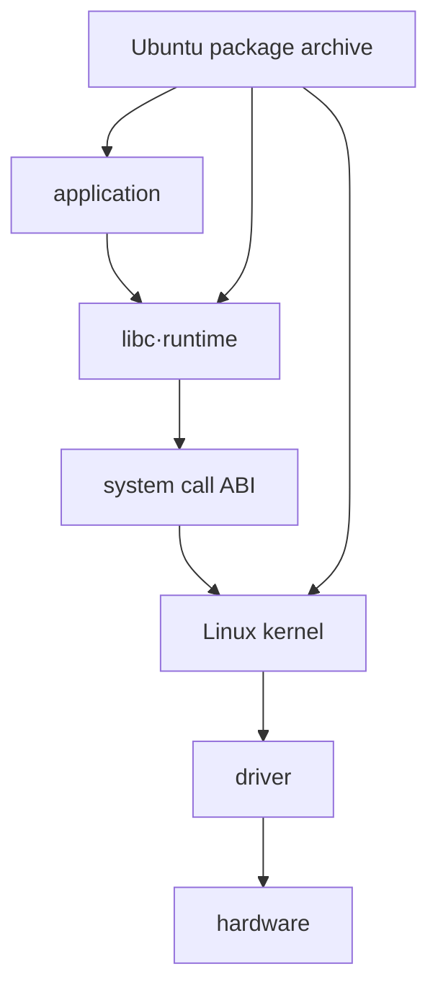

# 00. Ubuntu·Linux kernel·version 지도

[← 목차](README.md) · [다음: boot·package·systemd →](01-boot-packages-and-systemd.md)

## 이름부터 분리하기

Linux는 kernel을 가리킨다.
Ubuntu는 Linux kernel에 installer, package, library, service, 정책을 묶은 distribution이다.
GNOME, shell, systemd, glibc는 kernel과 같은 물건이 아니다.




## version이 여러 개인 이유

| 대상 | 예시 형태 | 답하는 질문 |
|---|---|---|
| Ubuntu release | 24.04 LTS 같은 이름 | userland와 archive 기준은? |
| kernel release | 6.x.y 계열 | 실행 kernel 계열은? |
| Ubuntu kernel package | linux-image-... | 어떤 build/package인가? |
| package version | upstream+Ubuntu revision | 어떤 source/patch 조합인가? |
| ABI string | package 이름 일부 | module 호환 build 경계는? |

숫자가 크다고 모든 subsystem 동작이 upstream 최신과 같다는 뜻은 아니다.
distribution은 fix를 backport할 수 있다.
기능 존재 여부는 config, package, architecture에도 달린다.

## GA와 HWE

GA kernel은 Ubuntu release의 기본 장기 지원 kernel 계열을 뜻한다.
HWE는 새 hardware enablement를 위해 더 새로운 kernel/X stack을 제공하는 경로다.
어떤 image가 설치되는지는 release, flavour, meta-package, upgrade 경로에 따라 달라진다.

Ubuntu 공식 자료 기준으로 24.04 LTS의 GA kernel 계열은 6.8이다.
Desktop 설치는 기본적으로 HWE rolling stack을 따르고, Server는 기본 GA이며 HWE를 선택할 수 있다.
HWE는 point release를 따라 더 새로운 kernel 계열로 이동할 수 있다.
2026-10-11에 확인한 공식 kernel 문서의 표는 다음과 같다. 표의 날짜는 문서에 표시된 release·kernel 수명 정보이며 현재 host를 조사한 결과는 아니다.

| Ubuntu와 kernel 경로 | kernel 계열 | 공식 표의 release 시점 | 표에 표시된 kernel EOL |
| --- | --- | --- | --- |
| 24.04.0 LTS의 GA | 6.8 | 2024년 4월 | 2029년 4월 |
| 24.04.5 LTS의 HWE | 7.0 | 2026년 8월 | 2029년 4월 |
| 26.04.0 LTS의 기본 kernel | 7.0 | 2026년 4월 | 2031년 4월 |

같은 7.0 계열이어도 Ubuntu release, package build와 지원 경로는 다르다. 개별 HWE의 전환, 보안 유지 서비스와 cloud·OEM variant의 조건은 각각 확인한다. 날짜를 읽었다는 이유로 모든 package나 out-of-tree driver가 그날까지 같은 조건으로 지원된다고 확대하지 않는다.

이 숫자는 이 문서를 작성한 시점의 공식 lifecycle 정보다.
실제 host는 설치 경로와 boot 선택이 다를 수 있으므로 `uname -r`과 package 상태를 확인한다.

HWE가 항상 필요하거나 항상 더 안정적이라는 결론은 없다.
새 hardware 지원과 driver 변화의 trade-off를 본다.
지원 수명과 전환 시점은 해당 Ubuntu release 공식 문서로 확인한다.

## read-only 관측 명령

다음은 설명용이며 이 교재에서는 실행하지 않는다.

```bash
uname -r
cat /etc/os-release
dpkg-query -W 'linux-image*' 'linux-generic*'
apt-cache policy linux-generic linux-generic-hwe-24.04
```

예상 출력 형태:

```text
$ uname -r
6.x.y-zz-generic

$ cat /etc/os-release
NAME="Ubuntu"
VERSION_ID="..."
```

`uname -r`은 지금 boot한 kernel을 말한다.
`/etc/os-release`는 user space distribution identity를 말한다.
설치 package 목록과 현재 boot kernel도 다를 수 있다.

## 작은 상태 추적

kernel image A와 B가 모두 설치돼 있고 현재 A로 boot했다고 하자.

| 시점 | 설치 image | bootloader 선택 | `uname -r` |
|---:|---|---|---|
| t0 | A | A | A |
| t1 | A+B 설치 | 아직 reboot 전 | A |
| t2 | reboot | B 선택 | B |
| t3 | B 문제로 reboot | A 선택 | A |

package 설치만으로 running kernel code가 즉시 B로 바뀌지 않는다.
reboot와 bootloader 선택이 필요하다.
livepatch는 일부 fix를 runtime에 적용할 수 있지만 전체 image 교체와 같지 않다.

## 누가 무엇을 결정하는가

| 주체 | 입력 | 중간 상태 | 결과 |
|---|---|---|---|
| archive maintainer | upstream source·patch | package build | kernel package |
| package manager | repository·policy | installed set | filesystem image |
| bootloader | boot entry | selected image/initrd | kernel load |
| kernel | hardware·config | driver init | running system |
| administrator | support policy | GA/HWE 선택 | lifecycle |

## flavour와 architecture

`generic`, cloud, low-latency 등 flavour는 config와 target이 다를 수 있다.
amd64와 arm64 package는 다른 instruction architecture용이다.
version 문자열 일부가 같아도 binary를 섞을 수 없다.
out-of-tree module은 해당 kernel ABI/build와 맞아야 한다.

## support를 읽는 법

Ubuntu release 지원 기간, kernel stack 지원 기간, package update 제공 범위는 같은 문장이 아니다.
Ubuntu Pro/ESM 같은 별도 서비스 조건도 구분한다.
공식 lifecycle 표를 확인하고 “LTS니까 모든 package가 같은 날까지 지원”이라고 단정하지 않는다.
LTS 5년을 하나의 kernel ABI가 5년 동안 고정된다는 뜻으로 읽지 않는다.
특히 HWE의 개별 kernel 계열 EOL은 Ubuntu OS LTS 종료보다 이를 수 있다.
meta-package가 다음 지원 stack으로 이동하게 하는지까지 확인한다.

## 반례와 관측 함정

container의 `/etc/os-release`는 container image를 말할 수 있지만 `uname -r`은 host kernel을 보일 수 있다.
WSL과 VM은 kernel 공급 방식이 일반 bare metal Ubuntu와 다를 수 있다.
package version이 옛 upstream 번호처럼 보여도 security fix가 backport됐을 수 있다.
재부팅하지 않았다면 새 image가 설치돼도 running kernel은 옛것이다.

## 문제

## package·ABI·backport를 한 update에서 따라가기

upstream이 security fix를 새 release에 넣으면 Ubuntu maintainer는 기존 지원 kernel source에 필요한 patch를 backport할 수 있다.
package build는 Ubuntu revision과 ABI 식별을 포함한 image/module 묶음을 만든다.
APT는 package를 disk에 설치하지만 running kernel은 그대로다.
reboot 때 bootloader가 새 image를 고르면 새 build가 실행된다.
backport 때문에 upstream 기본 숫자가 오래돼 보여도 fix가 포함될 수 있다.
반대로 version 문자열만 보고 특정 upstream 기능 전체가 있다고 단정할 수 없다.

1. `uname -r`과 `/etc/os-release`가 답하는 질문은?
2. image package 설치 직후 running kernel이 바뀌지 않는 이유는?
3. container에서 Ubuntu userland와 host kernel version이 다를 수 있는 이유는?

## 해설

1. 전자는 running kernel release, 후자는 userland distribution identity다.
2. bootloader가 다음 boot에 image를 load해야 전체 kernel이 교체되기 때문이다.
3. container는 host kernel을 공유하면서 별도 root filesystem/userland를 사용하기 때문이다.

## 공식 자료

- [Ubuntu kernel lifecycle and enablement stack](https://ubuntu.com/kernel/lifecycle)
- [Ubuntu HWE kernels](https://documentation.ubuntu.com/kernel/reference/hwe-kernels/)
- [Ubuntu release cycle](https://ubuntu.com/about/release-cycle)
- [Linux kernel documentation](https://docs.kernel.org/)

[← 목차](README.md) · [다음: boot·package·systemd →](01-boot-packages-and-systemd.md)
