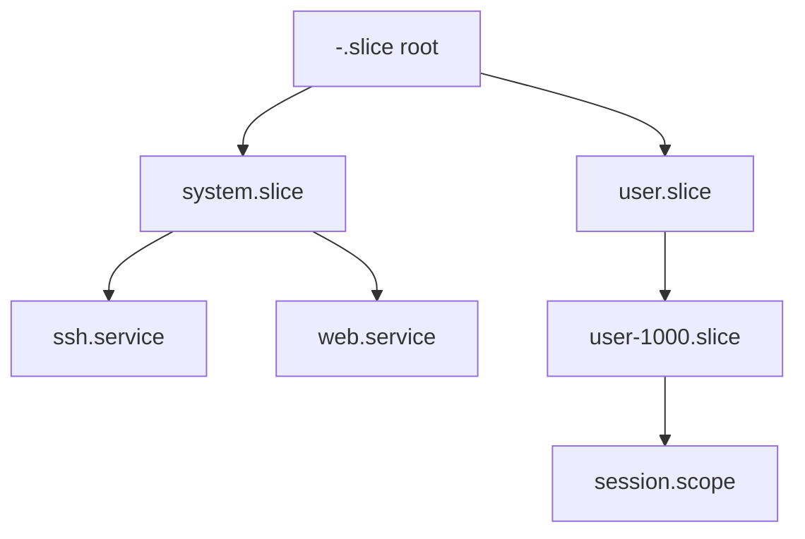

# 01. Boot·package·systemd

[이 책 목차](README.md)

[← 이전: Ubuntu와 kernel 지도](00-ubuntu-kernel-and-version-map.md) · [다음: process·namespace·credential →](02-processes-namespaces-and-credentials.md)

## 전원부터 user service까지


firmware는 hardware 초기화와 boot entry를 시작한다.
bootloader는 kernel image와 initramfs를 memory에 load한다.
kernel은 CPU, memory, driver를 초기화한다.
initramfs는 real root filesystem에 도달하기 위한 임시 user space다.
root 전환 뒤 PID 1이 service graph를 시작한다.

## package는 실행 process가 아니다

deb package는 file, metadata, dependency, maintainer script의 배포 단위다.
package를 설치했다고 service가 반드시 실행 중인 것은 아니다.
설치 file, enabled state, active process를 따로 본다.

| 질문 | 대표 객체 |
|---|---|
| file이 어느 package에서 왔나 | dpkg database |
| package 후보 version은 | APT policy |
| boot 때 시작하도록 연결됐나 | systemd enablement |
| 지금 실행 중인가 | unit active state와 process |

## systemd PID 1

PID 1은 초기 user-space process다.
systemd는 unit dependency와 lifecycle을 관리한다.
unit은 systemd가 다루는 선언 객체다.

| unit | 뜻 |
|---|---|
| service | daemon/process lifecycle |
| socket | socket activation |
| mount | mount point |
| target | unit 묶음과 synchronization point |
| slice | cgroup resource 계층 |
| scope | 외부에서 만들어진 process 묶음 |

## service·scope·slice

service는 systemd가 시작·감시하는 service process 집합이다.
scope는 login session이나 container처럼 외부에서 생성된 process 집합을 등록할 때 쓴다.
slice는 service/scope를 resource hierarchy로 묶는다.



unit dependency와 process parent-child tree는 같은 구조가 아니다.
service process가 child를 만들어도 unit cgroup 소속으로 추적될 수 있다.

## 작은 boot 상태 추적

`network.target` 뒤 `app.service`를 시작하고 app이 database socket을 필요로 한다고 하자.

| 시점 | PID 1 입력 | 상태 | 결과 |
|---:|---|---|---|
| 1 | target activation | dependency graph 계산 | 필요한 job queue |
| 2 | network units 완료 | app start 조건 일부 만족 | app 대기/시작 |
| 3 | app exec | service activating | main PID 추적 |
| 4 | readiness 조건 | active | dependent unit 진행 |
| 5 | main process exit | restart policy 평가 | failed/restart/inactive |

`After=`는 순서 관계이고 service가 성공했음을 자동 보장하지 않는다.
`Wants=`와 `Requires=`도 failure propagation 의미가 다르다.

## read-only 관측

아래 명령은 실행하지 않은 예시다.

```bash
systemctl status example.service
systemctl show example.service -p ActiveState -p SubState -p MainPID
systemctl list-dependencies example.service
systemd-cgls
journalctl -u example.service --no-pager
```

예상 읽기:

```text
ActiveState=active
SubState=running
MainPID=1234
```

active는 application request가 성공한다는 보장이 아니다.
process가 살아 있어도 port, dependency, health가 실패할 수 있다.

## package update 시간축

| 단계 | 상태 |
|---|---|
| archive metadata 갱신 | 후보 version 인지 |
| package download/install | disk file 교체 |
| service restart/reload | running process가 새 file 사용 가능 |
| reboot | kernel·early boot component 교체 |

library file을 바꿔도 이미 load한 process는 옛 mapping을 계속 쓸 수 있다.
어떤 service를 restart할지는 package와 운영 정책을 따른다.

## journal

journald는 service와 boot의 log를 수집할 수 있다.
log는 관측 evidence이지 health 자체가 아니다.
clock, boot ID, unit, PID를 함께 보아야 사건을 연결할 수 있다.

## 반례

enabled인데 inactive일 수 있다.
active인데 readiness가 실패할 수 있다.
package가 설치돼도 unit file이 없을 수 있다.
unit file을 편집해도 daemon-reload 전 manager가 옛 정의를 쓸 수 있다.
이 교재는 host unit이나 cgroup을 변경하지 않는다.

## 문제

## unit가 process를 다시 만드는 과정

PID 1은 service unit 정의에서 executable, dependency, restart 정책을 읽는다.
조건이 만족되면 child를 만들고 credential과 cgroup을 준비한 뒤 executable을 실행한다.
main process가 exit하면 PID 1은 exit status와 unit 정책을 비교한다.
restart가 허용되면 delay 뒤 새 PID로 다시 시작한다.
unit identity는 같아도 process PID와 memory state는 새것이다.
따라서 “service가 재시작됐다”와 “같은 process가 회복됐다”를 구분한다.

1. service와 slice의 차이는?
2. package 설치와 running process 교체가 다른 이유는?
3. `After=`가 health 보장이 아닌 이유는?

## 해설

1. service는 process lifecycle, slice는 resource hierarchy 묶음이다.
2. disk file과 이미 실행 중 memory image는 별도 상태이기 때문이다.
3. 시작 순서만 정하고 상대 unit의 application readiness를 검증하지 않기 때문이다.

## 공식 자료

- [systemd unit manual](https://www.freedesktop.org/software/systemd/man/latest/systemd.unit.html)
- [systemd resource control](https://www.freedesktop.org/software/systemd/man/latest/systemd.resource-control.html)
- [Ubuntu package management](https://documentation.ubuntu.com/server/how-to/software/package-management/)

[← 이전: Ubuntu와 kernel 지도](00-ubuntu-kernel-and-version-map.md) · [다음: process·namespace·credential →](02-processes-namespaces-and-credentials.md)
