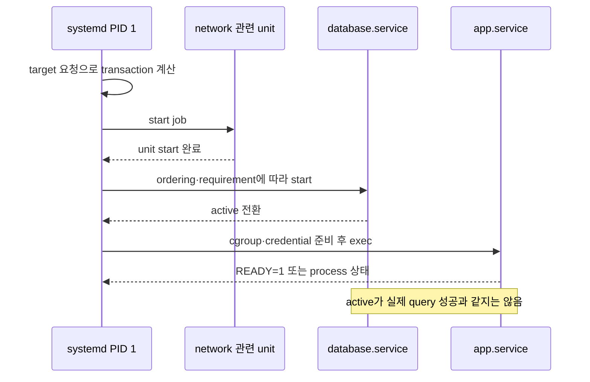
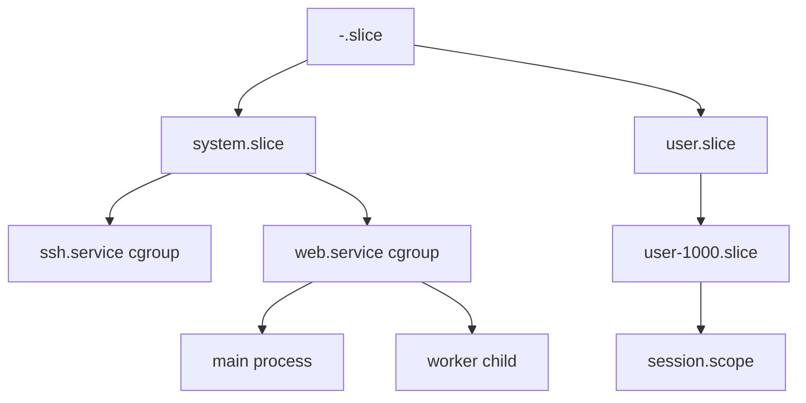

# 01. Boot·package·systemd

[이 책 목차](README.md)

[← 이전: Ubuntu와 kernel 지도](00-ubuntu-kernel-and-version-map.md) · [다음: process·namespace·credential →](02-processes-namespaces-and-credentials.md)

전원 버튼을 누른 순간에는 웹 서버도, `/` 디렉터리도, systemd도 실행되고 있지 않다. CPU가 처음 실행할 firmware 코드에서 시작해 bootloader, Linux kernel, 임시 root filesystem, 실제 root filesystem, PID 1 순서로 책임이 넘어간다. 이 장의 목적은 이름을 외우는 것이 아니라 “누가 다음 단계를 메모리에 올리고 어떤 상태가 성공해야 서비스 process가 생기는가”를 시간순으로 이해하는 것이다.

## 1. 전원에서 PID 1까지 객체와 책임

**firmware**는 전원이 들어온 뒤 CPU와 memory, 필수 장치를 초기화하고 부팅 가능한 항목을 찾는 초기 소프트웨어다. PC의 UEFI가 대표적이다. firmware 설정과 보안 부팅 정책은 어느 bootloader를 신뢰해 실행할지 결정할 수 있다.

**bootloader**는 부팅할 kernel image와 initramfs, kernel command line을 선택해 메모리에 올리고 커널의 시작 지점으로 제어를 넘긴다. GRUB이 흔한 예다. bootloader 메뉴에서 이전 kernel을 고를 수 있는 이유는 `/boot`에 여러 image와 entry가 남아 있기 때문이다.

**initramfs(initial RAM filesystem)**는 kernel이 실제 root filesystem에 도달하기 전에 사용하는 작은 임시 사용자 공간이다. root disk가 암호화됐거나 RAID·LVM·네트워크 storage·특정 driver가 필요하면 관련 module과 도구를 initramfs에서 실행한다. 실제 root를 찾으면 mount하고 root를 전환한 뒤 최종 init process를 실행한다.

**PID 1**은 초기 PID namespace에서 첫 사용자 공간 process다. Ubuntu의 일반 system에서는 systemd가 이 역할을 맡는다. PID는 process identifier이며 커널이 실행 중 task 집단을 구분하는 숫자다. PID 1이라는 숫자는 systemd package 파일 자체가 아니라 지금 실행 중인 systemd process의 식별자다.


커널은 CPU scheduler와 memory manager, driver를 초기화한 뒤 첫 사용자 process를 만든다. 이 지점부터 service를 시작하는 정책은 대체로 systemd가 담당하지만 실제 CPU 시간과 process 자원은 계속 kernel이 관리한다.

## 2. kernel package 설치부터 첫 service까지 한 요청 추적

관리자가 kernel package를 업데이트하고 재부팅했다고 하자. APT와 dpkg는 새 image와 module을 디스크에 설치한다. initramfs 생성 도구는 부팅 초기에 필요한 module과 script를 묶는다. bootloader 설정은 새 entry를 알게 된다. 이 시점까지 실행 중인 kernel은 옛 버전이다.

재부팅 뒤 firmware가 bootloader를 실행하고 bootloader가 새 image와 그에 맞는 initramfs를 메모리에 놓는다. kernel은 command line에 적힌 root 식별자를 읽는다. initramfs 사용자 공간이 저장장치를 준비하고 실제 root를 mount한다. kernel이 `/sbin/init`에 해당하는 systemd를 실행하면 PID 1은 자신의 unit 정의를 읽고 기본 target으로 가는 transaction을 만든다.

| 시각 | 주체 | 입력 | 중간 상태 | 실패하면 보이는 현상 |
| ---: | --- | --- | --- | --- |
| t0 | APT·dpkg | repository 후보와 package | image·module이 디스크에 설치 | 설치 오류, 옛 kernel 계속 실행 |
| t1 | initramfs 도구 | kernel version·필수 module | 임시 root image 생성 | 새 kernel이 root를 못 찾을 수 있음 |
| t2 | bootloader | boot entry | kernel과 initramfs 메모리 load | 이전 entry로 복구 가능 |
| t3 | kernel | command line·hardware | driver 초기화·init 실행 준비 | panic 또는 emergency 경로 |
| t4 | initramfs | root UUID·암호 키·module | 실제 root mount | 암호 prompt·root 대기·timeout |
| t5 | systemd PID 1 | unit graph·기본 target | start job queue | dependency 실패·rescue target |
| t6 | service manager | executable·credential·cgroup | daemon process 실행 | unit failed/restart |

이 표에서 “부팅 성공”은 하나의 원자적 사건이 아니다. kernel 시작은 성공했지만 root mount가 실패할 수 있고, PID 1이 실행됐지만 필수 mount unit이나 service가 실패할 수 있다. journal의 boot ID와 kernel log, unit 상태를 연결해 어느 경계에서 멈췄는지 찾는다.

## 3. package·파일·process의 서로 다른 수명

**deb package**는 설치 파일, dependency, version metadata와 maintainer script를 묶은 배포 단위다. **APT**는 repository metadata를 이용해 후보 version과 dependency 해법을 고르고 package를 내려받는다. **dpkg**는 개별 package를 unpack하고 구성 상태를 기록한다. APT와 dpkg를 같은 이름으로 부르기도 하지만 전자는 높은 수준의 의존성·저장소 작업을, 후자는 로컬 package database와 설치 작업을 맡는다.

package의 파일이 교체되어도 이미 실행 중인 process의 code가 자동으로 모두 바뀌지는 않는다. process의 주소 공간에는 실행 시점에 mapping한 executable과 shared library page가 있다. 디스크 경로가 새 inode나 새 내용으로 바뀌어도 기존 mapping은 process가 종료하거나 새 code를 다시 load할 때까지 남을 수 있다.

예를 들어 `libexample.so`를 보안 업데이트했다고 하자. 새로 시작한 service는 새 library를 mapping한다. 업데이트 전에 실행되던 service는 옛 mapping을 계속 사용할 수 있다. 그래서 package 설치 성공과 취약 code의 실행 종료 사이에 service restart 또는 reboot 정책이 필요하다. 어떤 process가 옛 library를 쓰는지는 package 설치 여부만으로 완전히 판단할 수 없다.

| 질문 | 저장되거나 실행되는 객체 | 대표 관측 |
| --- | --- | --- |
| 이 경로는 어느 package 소유인가? | dpkg database의 file 목록 | `dpkg-query` 계열 |
| 설치 가능한 후보는 무엇인가? | APT repository와 pin 정책 | `apt-cache policy` |
| unit이 다음 boot에 연결됐는가? | enablement symlink와 unit graph | `systemctl is-enabled` |
| 지금 manager가 어떤 정의를 읽었는가? | systemd가 load한 unit 상태 | `systemctl show` |
| 실제 process는 어느 PID인가? | kernel task와 unit cgroup | `MainPID`, `/proc` |

## 4. systemd unit은 process가 아니라 선언 객체다

**unit**은 systemd가 dependency와 lifecycle을 관리하는 객체다. 이름의 suffix가 종류를 나타낸다. `.service`는 process lifecycle, `.socket`은 수신 socket과 activation, `.mount`는 mount point, `.timer`는 시간 기반 activation, `.target`은 여러 unit을 묶는 동기화 지점, `.slice`는 cgroup 자원 계층, `.scope`는 systemd 밖에서 생성된 process 집단을 나타낸다.

service unit 파일은 “항상 살아 있는 service 그 자체”가 아니다. executable 경로, 시작 전후 명령, 환경, 사용자, 재시작 정책과 dependency를 선언한다. PID 1이 이 선언을 load하고 start job을 실행할 때 실제 child process가 생긴다. process가 죽고 재시작되면 unit 이름은 같지만 PID, 주소 공간, 열린 연결과 메모리 상태는 새것이다.

**systemd manager**는 system instance에서는 PID 1이고, 사용자 instance에서는 해당 사용자의 별도 manager process다. `systemctl --user`가 다루는 unit과 system `systemctl` unit은 manager와 권한 경계가 다르다.

## 5. dependency와 ordering은 다른 축이다

`After=B.service`는 A의 start job이 B의 start job 뒤에 순서 잡히도록 한다. B를 자동으로 끌어오거나 B의 업무 health가 성공했음을 뜻하지 않는다. B가 transaction에 없다면 ordering만으로 시작시킬 대상이 없다.

`Wants=B.service`는 B를 함께 시작하려는 약한 요구다. B가 실패해도 A가 반드시 중단되는 강한 결합은 아니다. `Requires=B.service`는 더 강한 requirement dependency지만 이것만으로 “B의 HTTP `/ready`가 200이 될 때까지 A를 기다림”이라는 애플리케이션 의미가 생기지는 않는다.

service의 **readiness**는 “업무 요청을 받을 준비가 됐다”는 애플리케이션 상태다. systemd의 `Type=`과 notification 계약에 따라 active 전환 시점을 더 정확히 표현할 수 있지만, 잘못 구현된 notify나 외부 dependency 상태까지 자동 증명하지 않는다.



조건을 바꾸어 `After=network.target`만 두면 network 설정이 충분히 끝나기 전 app이 외부 연결을 시도할 수 있다. 또 database service가 process만 살아 있고 복구 중이라면 active여도 첫 query가 실패할 수 있다. 재시도, 명시적 readiness protocol과 timeout을 업무 특성에 맞게 설계한다.

## 6. service·scope·slice와 cgroup

**service**는 systemd가 직접 시작하고 감시하는 process 집단의 lifecycle 단위다. **scope**는 login session이나 container처럼 다른 주체가 이미 만든 process 집단을 systemd 자원 계층에 등록할 때 사용한다. **slice**는 service와 scope의 cgroup 상위 계층을 구성한다.

**cgroup(control group)**은 kernel이 process 집단의 CPU, memory, I/O 같은 자원을 계정하고 제한하기 위한 계층 객체다. systemd는 unit을 cgroup과 연결해 daemon이 fork한 child도 unit 단위로 추적한다. process의 부모-자식 tree와 unit dependency graph, cgroup hierarchy는 서로 목적이 다른 구조다.



web main process가 worker를 fork하면 process tree에서 parent-child 관계가 생긴다. 두 process가 같은 service cgroup에 남으면 PID 1은 unit stop 시 집단을 다룰 수 있다. worker가 double-fork했다는 사실만으로 unit 관리에서 반드시 벗어나는 것은 아니다.

## 7. timer와 socket activation을 요청으로 이해하기

`.timer` unit은 일정 시각이나 마지막 실행 후 간격 조건이 만족되면 대응 service를 start하도록 job을 만든다. timer 자체가 업무 코드를 실행하는 process는 아니다. system이 꺼져 있던 동안 놓친 시각을 처리할지는 `Persistent=` 같은 설정과 시간 조건에 달린다.

`.socket` unit은 PID 1이 먼저 socket을 만들고 기다리다가 연결이 오면 service를 시작할 수 있게 한다. service가 시작될 때 listening file descriptor를 전달받는다. 이 구조는 service 시작 전 요청을 kernel socket queue가 받아 둘 수 있지만 queue 한도, timeout, service 실패를 없애지는 않는다.

두 번째 구체 예로 02:00 backup timer를 보자. timer가 02:00에 elapsed 상태가 되고 `backup.service` start job을 만든다. PID 1은 service용 cgroup과 credential을 준비하고 executable을 실행한다. process가 exit code 0으로 끝나면 service 결과가 success로 기록될 수 있다. 하지만 backup 파일이 원격 저장소에서 실제 복구 가능하다는 뜻은 아니다. unit 성공은 명령의 계약, 데이터 복구 검증은 별도 계약이다.

## 8. read-only 관측과 출력 해석

다음 명령은 설명용이며 이 교재에서는 host에 실행하지 않았다.

```bash
systemctl status example.service
systemctl show example.service -p LoadState -p ActiveState -p SubState -p MainPID -p Result
systemctl list-dependencies example.service
systemd-cgls
journalctl -u example.service --no-pager
```

```text
LoadState=loaded
ActiveState=active
SubState=running
MainPID=1234
Result=success
```

`loaded`는 manager가 unit 정의를 읽었다는 뜻이다. `active/running`은 systemd의 상태 기계에서 process가 실행 중이라는 뜻이지 HTTP 요청이 성공한다는 뜻이 아니다. `MainPID`는 manager가 main process로 추적하는 PID이고 worker 전체 목록과 같지 않을 수 있다. `Result=success`도 마지막 lifecycle 결과를 해석해야 하며 업무 데이터의 정확성을 보증하지 않는다.

unit 파일을 편집한 뒤 manager가 자동으로 새 정의를 다시 읽는다고 가정하지 않는다. `daemon-reload`는 manager 정의를 다시 load하는 동작이고 service restart는 실행 process를 교체하는 동작이다. 둘은 서로 다른 상태 전이다. 이 교재는 실제 unit, cgroup이나 boot 설정을 변경하지 않는다.

## 9. 장애를 상태로 나누기

`enabled`인데 `inactive`일 수 있다. enabled는 특정 target 등의 wants 디렉터리에 연결되어 미래 activation 경로가 있다는 뜻이고, active는 현재 unit 상태다. 사용자가 수동 stop했거나 조건이 맞지 않을 수 있다.

`active`인데 요청은 실패할 수 있다. main process가 살아 있어도 port bind 실패를 worker가 숨겼거나 dependency가 업무 준비 전일 수 있다. 반대로 oneshot service는 성공 후 process가 없어도 설정에 따라 active/exited로 남을 수 있다.

restart loop에서는 unit 이름은 하나지만 PID가 계속 바뀐다. 1초마다 실패하면 journal에 여러 invocation과 exit status가 쌓인다. restart limit에 도달하면 failed가 될 수 있다. 관찰 시각, invocation ID, PID와 boot ID를 함께 보지 않으면 서로 다른 실행의 log를 한 process 이야기로 잘못 합칠 수 있다.

## 10. 문제와 해설

### 문제 1

firmware, bootloader, initramfs, systemd가 각각 다음 단계에 무엇을 넘기는가?

**해설:** firmware는 실행할 bootloader entry를 고른다. bootloader는 kernel image, initramfs와 command line을 메모리에 올린다. initramfs는 실제 root에 필요한 driver·storage 상태를 준비하고 root를 전환한다. kernel이 systemd를 PID 1로 실행하면 systemd가 unit graph에서 service process를 만든다.

### 문제 2

library package를 업데이트했지만 service PID가 그대로다. 새 code를 실행한다고 단정할 수 있는가?

**해설:** 없다. 기존 process는 옛 library mapping을 유지할 수 있다. 어떤 process가 어떤 파일을 mapping했는지와 restart 정책을 확인해야 한다.

### 문제 3

`After=database.service`만 추가했는데 database가 자동 시작되지 않았다. 이유는?

**해설:** `After=`는 두 job이 transaction에 있을 때의 순서 관계다. 시작을 끌어오는 requirement는 `Wants=`나 `Requires=` 등 별도 관계로 표현해야 한다.

### 문제 4

`app.service`가 `active (running)`인데 readiness probe가 실패한다. 두 관측은 모순인가?

**해설:** 아니다. systemd는 unit의 process lifecycle 계약을 보고, probe는 애플리케이션 요청 처리 계약을 본다. port, dependency, 내부 초기화가 준비되지 않았을 수 있다.

### 문제 5

timer가 backup service를 성공으로 끝냈다. 복구 가능성이 증명됐는가?

**해설:** 아니다. 정해진 명령이 성공 exit를 반환했다는 증거다. 결과 파일의 완전성, 원격 보존, 키와 실제 복원 시험을 별도로 검증해야 한다.

## 공식 자료

- [systemd unit manual](https://www.freedesktop.org/software/systemd/man/latest/systemd.unit.html)
- [systemd service manual](https://www.freedesktop.org/software/systemd/man/latest/systemd.service.html)
- [systemd resource control](https://www.freedesktop.org/software/systemd/man/latest/systemd.resource-control.html)
- [Ubuntu package management](https://documentation.ubuntu.com/server/how-to/software/package-management/)

[← 이전: Ubuntu와 kernel 지도](00-ubuntu-kernel-and-version-map.md) · [다음: process·namespace·credential →](02-processes-namespaces-and-credentials.md)
