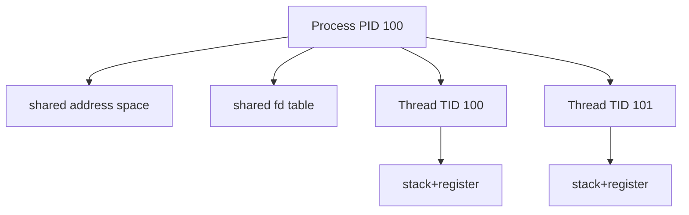

# 02. Process·task·namespace·credential

[이 책 목차](README.md)

[← 이전: boot와 systemd](01-boot-packages-and-systemd.md) · [다음: CPU scheduling과 pressure →](03-cpu-scheduling-and-pressure.md)

## program, process, task

program은 disk의 실행 file이다.
process는 실행 중 address space, file, credential, signal 상태의 묶음이다.
thread는 같은 process 자원을 공유할 수 있는 실행 흐름이다.
Linux kernel은 scheduling 가능한 실행 흐름을 task 객체로 표현한다.

PID는 process 관점 식별자다.
TID는 개별 thread 식별자다.
single-thread에서는 PID와 TID가 같아 보일 수 있다.



## syscall과 context switch

syscall은 user task가 kernel service를 요청하는 privilege transition이다.
context switch는 CPU가 실행 task를 바꾸는 일이다.
syscall이 항상 context switch를 만들지 않는다.

```text
getpid()
user task A → kernel → 같은 A user 복귀

blocking read()
A → kernel → A blocked → B로 context switch
→ I/O completion → A ready → 나중에 A 복귀
```

## 작은 상태표

| tick | A | B | CPU |
|---:|---|---|---|
| 0 | running, read syscall | ready | A |
| 1 | blocked | running | B |
| 2 | blocked | running | B |
| 3 | ready, I/O 완료 | running | B |
| 4 | running | ready | A |

wakeup은 A를 ready로 만든다.
즉시 CPU를 준다는 뜻은 아니다.

## credential

credential은 kernel이 access 판단에 사용하는 identity와 권한 상태다.

| 항목 | 의미 |
|---|---|
| real UID/GID | 호출 주체 identity 배경 |
| effective UID/GID | 많은 permission 검사에 쓰는 identity |
| supplementary groups | 추가 group membership |
| capabilities | root 권한을 기능 단위로 나눈 bit 집합 |
| security label | LSM 정책 입력 가능 |

UID 0이라는 숫자만으로 모든 namespace와 LSM에서 무제한이라는 결론은 없다.
capability는 어느 user namespace에 대한 것인지도 중요하다.

## namespace

namespace는 process가 보는 resource 이름과 관점을 분리한다.

| 종류 | 분리 관점 |
|---|---|
| PID | process ID tree |
| mount | mount table |
| network | interface, route, port 공간 |
| UTS | hostname/domain |
| IPC | System V IPC/POSIX message queue |
| user | UID/GID와 capability 해석 |
| cgroup | cgroup view |
| time | 일부 clock offset |

namespace는 resource 양을 제한하지 않는다.
CPU/RAM accounting은 cgroup이 맡는다.

## PID namespace 예

host PID 4200인 process가 container 안에서 PID 1로 보일 수 있다.

| 관찰자 | 같은 task의 PID |
|---|---:|
| host namespace | 4200 |
| child PID namespace | 1 |

process가 두 개가 된 것이 아니다.
namespace마다 ID mapping/view가 다르다.
child namespace의 PID 1은 signal 처리와 child 수거에서 특별한 책임이 있다.

## user namespace

container 안 UID 0이 host UID 100000에 mapping될 수 있다.
container 안 root라는 이름이 host global root 권한과 같지 않다.

```text
inside UID 0..65535
→ host UID 100000..165535
```

mapping과 capability scope를 확인해야 한다.
device access, mount, network operation은 추가 정책에 막힐 수 있다.

## file access 시간순서

| 순서 | 주체 | 입력 | 결과 |
|---:|---|---|---|
| 1 | task | pathname·flags | syscall entry |
| 2 | VFS | mount namespace·cwd | object 탐색 |
| 3 | kernel | credential·mode/ACL/LSM | allow/deny |
| 4 | filesystem | inode | open file |
| 5 | task | fd | read/write 가능 |

namespace는 어느 object를 찾는지 바꾼다.
credential은 찾은 object에 무엇을 할 수 있는지 바꾼다.

## read-only 관측

실행하지 않은 예:

```bash
ps -eLo pid,tid,stat,comm
cat /proc/self/status
readlink /proc/self/ns/pid
readlink /proc/self/ns/mnt
id
```

`/proc` 값은 관측 시점 snapshot이며 빠르게 바뀔 수 있다.

## 반례

thread 수가 늘어도 CPU core가 자동으로 늘지 않는다.
mount namespace가 달라도 같은 underlying inode를 공유할 수 있다.
network namespace가 분리돼도 physical NIC와 bandwidth는 공유할 수 있다.
capability 하나가 모든 operation을 허용하지 않는다.

## 문제

## process·thread·task·credential의 실제 위치

process는 user가 보는 자원 묶음이고 thread는 그 안의 실행 흐름이다.
kernel은 각 실행 흐름의 register·scheduler 상태를 task 객체로 추적한다.
여러 task가 같은 memory descriptor와 file table을 참조하면 같은 process의 thread로 동작할 수 있다.
credential 객체는 UID, groups, capabilities 같은 access 판단 입력을 담는다.
syscall entry에서 kernel은 현재 task를 통해 credential과 namespace를 찾는다.
pathname 해석에는 mount namespace를, permission 판단에는 credential과 LSM policy를 사용한다.
즉 PID 숫자 하나가 이 모든 객체 자체인 것은 아니다.

1. PID와 TID가 다른 경우는?
2. namespace와 cgroup의 핵심 역할 차이는?
3. container UID 0이 host root와 같지 않을 수 있는 이유는?

## 해설

1. multi-thread process에서 thread마다 TID가 있고 thread-group leader PID를 공유 관점으로 쓴다.
2. namespace는 view/name 분리, cgroup은 resource 계층·accounting·control이다.
3. user namespace UID mapping과 capability scope가 host global identity와 다르기 때문이다.

## 공식 자료

- [Linux namespaces](https://man7.org/linux/man-pages/man7/namespaces.7.html)
- [Linux credentials](https://man7.org/linux/man-pages/man7/credentials.7.html)
- [Linux capabilities](https://man7.org/linux/man-pages/man7/capabilities.7.html)

[← 이전: boot와 systemd](01-boot-packages-and-systemd.md) · [다음: CPU scheduling과 pressure →](03-cpu-scheduling-and-pressure.md)
