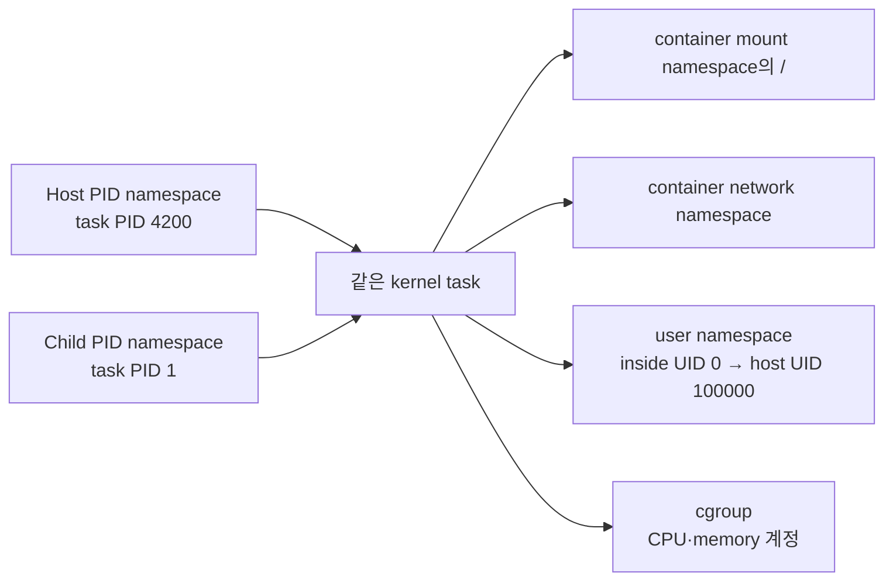

# 02. Process·task·namespace·credential

[이 책 목차](README.md)

[← 이전: boot와 systemd](01-boot-packages-and-systemd.md) · [다음: CPU scheduling과 pressure →](03-cpu-scheduling-and-pressure.md)

명령 하나를 실행하면 흔히 “프로세스가 생겼다”고 말한다. 커널 안에서는 실행 흐름을 나타내는 task, 공유 주소 공간과 열린 파일, 접근 판단에 쓰는 credential, 자원을 바라보는 namespace가 연결된다. PID 숫자는 이 객체들을 찾는 식별자일 뿐 그 모든 상태 자체가 아니다. 이 장은 파일 읽기와 다중 thread 실행을 따라가며 객체가 언제 공유되고 언제 분리되는지 설명한다.

## 1. program·process·thread·task를 객체로 이해하기

**program**은 아직 실행되지 않아도 존재하는 명령과 데이터의 표현이다. 보통 disk의 ELF 실행 파일이나 interpreter가 읽는 script다. 파일에는 code와 초기 data, 필요한 library 정보가 있지만 현재 CPU register 값이나 열린 socket 같은 실행 상태는 없다.

**process**는 program이 실행되면서 생긴 자원 묶음을 사용자 관점에서 부르는 말이다. 가상 주소 공간, 열린 file descriptor table, signal 처리 설정, credential과 하나 이상의 실행 흐름을 포함한다. 같은 program 파일을 두 번 실행하면 code 파일은 같아도 서로 다른 주소 공간과 PID를 가진 두 process가 생긴다.

**thread**는 한 process 안의 실행 흐름이다. 같은 process의 thread는 보통 주소 공간과 열린 파일을 공유하므로 한 thread가 heap 데이터를 바꾸면 다른 thread가 볼 수 있다. 그러나 각 thread는 자기 CPU register, stack, scheduling 상태와 TID를 가진다. 공유가 성능과 통신을 쉽게 하지만 동시 접근에는 lock이나 atomic 같은 동기화가 필요하다.

**task**는 Linux kernel이 scheduling 가능한 실행 흐름을 추적하는 핵심 단위다. kernel 내부의 task 구조에는 실행 상태, register 저장 위치, scheduling 정보와 다른 자원 객체를 가리키는 참조가 있다. 여러 task가 같은 memory descriptor와 file table을 공유하면 사용자에게 같은 process의 thread로 보인다. “kernel은 process가 아니라 task를 schedule한다”는 문장은 CPU에 올릴 실행 흐름의 단위가 task라는 의미다.

```mermaid
flowchart TD
    E[/usr/bin/server 실행 파일] --> P[Process 관점: TGID 100]
    P --> MM[공유 주소 공간<br/>code·heap·mapping]
    P --> FT[공유 file descriptor table]
    P --> CR[공유 또는 복사된 credential 참조]
    P --> T1[Task/Thread TID 100]
    P --> T2[Task/Thread TID 101]
    T1 --> S1[register·stack·scheduler state]
    T2 --> S2[register·stack·scheduler state]
```

**PID(process ID)**라는 말은 도구와 문맥에 따라 thread group의 대표 ID를 뜻한다. **TID(thread ID)**는 각 task의 ID다. single-thread process에서는 대표 task의 PID와 TID가 같아 구분이 보이지 않는다. 다중 thread에서는 leader의 TID가 process PID처럼 사용되고 다른 thread는 별도 TID를 가진다. `/proc/PID/task/` 아래에서 thread 목록을 볼 수 있다.

## 2. 주소 공간과 가상 주소의 뜻

**주소 공간(address space)**은 process가 사용하는 가상 주소에서 memory object로 가는 mapping의 집합이다. 가상 주소 `0x...`는 RAM 칩의 고정 물리 위치 이름이 아니다. CPU의 MMU와 kernel page table이 현재 process의 mapping을 따라 물리 page나 file-backed page로 변환한다.

두 process가 같은 숫자 가상 주소를 사용해도 서로 다른 물리 page를 가리킬 수 있다. 반대로 shared memory mapping은 서로 다른 process가 같은 물리 page를 보게 할 수 있다. kernel은 각 mapping의 읽기·쓰기·실행 권한을 검사한다. 잘못된 주소나 권한 위반 접근은 page fault를 일으키고 해결할 mapping이 없으면 process에 `SIGSEGV` 같은 signal이 전달될 수 있다.

**stack**은 함수 호출 frame과 지역 상태가 쌓이는 thread별 영역이다. **heap**은 allocator가 동적 객체를 제공하는 process 공유 영역이다. 이 설명은 일반적 배치이며 정확한 주소와 성장 방식은 architecture, ABI, runtime과 보안 무작위화에 달린다.

| 객체 | 보통 같은 process thread 사이 | `fork()` 직후 parent-child | `execve()` 성공 뒤 |
| --- | --- | --- | --- |
| 가상 주소 공간 | 공유 | copy-on-write 기반 별도 관점 | 새 program mapping으로 교체 |
| file descriptor table | 공유 설정 가능 | descriptor가 같은 open file description 참조 | close-on-exec가 아니면 유지 |
| register·stack | thread별 | child 실행 상태 별도 | 새 entry와 stack 구성 |
| PID/TID | task별 | 새 task ID | PID는 process 교체가 아니므로 유지 |
| credential | 참조·규칙에 따라 공유 | 상속된 상태에서 시작 | exec 권한 규칙에 따라 변화 가능 |

`fork()`는 실행 중 상태에서 child process를 만들고, `execve()`는 현재 process의 주소 공간을 새 program으로 바꾼다. shell이 외부 명령을 실행할 때 흔히 child를 만든 뒤 그 child가 `execve()`로 program을 바꾼다. exec가 “새 PID를 만드는 호출”은 아니다.

## 3. system call과 context switch는 같은 사건이 아니다

**system call(syscall)**은 user task가 kernel 기능을 요청하는 권한 전환 인터페이스다. CPU는 정해진 instruction과 ABI를 통해 kernel entry로 이동한다. 커널은 현재 task의 register에서 system call 번호와 인자를 읽고, user pointer가 접근 가능한지와 호출 권한을 검증한다.

**context switch**는 CPU가 실행 중인 task를 다른 task로 교체하는 일이다. 이전 task의 register와 scheduling 상태를 저장하고 다음 task 상태를 복원한다. system call이 짧게 끝나면 같은 task가 kernel mode에서 처리한 뒤 user mode로 돌아오므로 다른 task로의 context switch가 없을 수 있다.

반대로 `read()`가 disk I/O를 기다려야 하면 현재 task는 sleeping 또는 blocked 상태가 되고 scheduler가 다른 runnable task를 CPU에 올린다. I/O 완료 interrupt와 kernel completion 처리가 기다리던 task를 runnable로 바꾼다. **wakeup**은 실행 자격을 되돌리는 상태 변화이지 즉시 CPU를 준다는 보장이 아니다.

| 시간 | task A | task B | CPU에서 실제 실행 | 사건 |
| ---: | --- | --- | --- | --- |
| 0 µs | running | runnable | A user code | A가 `read()` 준비 |
| 2 µs | kernel에서 검사 | runnable | A kernel code | syscall 진입, context switch 아님 |
| 8 µs | blocked | runnable | scheduler→B | I/O 대기로 switch |
| 60 µs | blocked | running | B | 장치 작업 진행 |
| 90 µs | runnable | running | B | completion이 A wakeup |
| 110 µs | running | runnable | A | scheduler가 나중에 A 선택 |

조건을 바꿔 데이터가 page cache에 이미 있다면 A의 `read()`는 block 없이 같은 A로 돌아올 수 있다. 따라서 system call 횟수만 세어 context switch 횟수를 추정하면 틀린다. 반대로 timer interrupt나 선점 때문에 user code 실행 중에도 다른 task로 switch할 수 있다.

## 4. 파일 열기 요청을 주체별로 끝까지 추적하기

task가 `openat()`으로 `reports/today.txt`를 읽기 전용으로 연다고 하자. 입력은 directory 기준 fd, pathname pointer, flags다. kernel은 user memory에서 pathname을 안전하게 가져온다. 현재 task가 연결된 mount namespace의 root와 mount table, 현재 working directory를 기준으로 path component를 따라간다.

**VFS(virtual filesystem switch)**는 서로 다른 filesystem 구현 위에 공통 파일 연산을 제공하는 커널 계층이다. VFS는 directory entry와 inode 같은 객체를 찾아간다. **inode**는 파일 내용과 metadata를 나타내는 filesystem 객체이며 pathname 문자열 자체와 같지 않다. hard link 두 개가 같은 inode를 가리킬 수 있다.

대상을 찾은 뒤 kernel은 task의 credential, inode mode와 ACL, capability, LSM 정책을 사용해 접근을 판단한다. 허용되면 open file description을 만들고 task의 file descriptor table에 작은 정수 fd를 연결한다. 이후 `read(fd, ...)`는 pathname을 다시 전달하지 않고 fd를 통해 열린 객체와 현재 offset을 찾는다.

| 순서 | 판단 주체 | 사용하는 입력 | 만들어지는 상태 | 실패 예 |
| ---: | --- | --- | --- | --- |
| 1 | syscall entry | user pathname 주소·flags | 안전한 kernel 쪽 인자 | 잘못된 pointer → `EFAULT` |
| 2 | VFS path walk | mount namespace·cwd·root | dentry·inode 후보 | 경로 없음 → `ENOENT` |
| 3 | 권한 계층 | credential·mode·ACL·LSM | allow 또는 deny | 권한 거부 → `EACCES` |
| 4 | filesystem | inode·flags | open file description | 읽기 전용 FS 등 오류 |
| 5 | fd table | 사용 가능한 slot | 정수 fd | 한도 초과 → `EMFILE` |

이 흐름은 namespace와 credential의 차이를 보여 준다. mount namespace는 같은 pathname이 어느 mount와 inode로 해석되는지 바꾼다. credential과 LSM은 찾아낸 객체에 어떤 동작이 허용되는지 판단한다. cgroup은 이 파일을 “보이게” 만드는 장치가 아니라 I/O 자원 계정과 제한 같은 다른 축이다.

## 5. credential은 접근 판단용 상태 묶음이다

**credential**은 kernel이 현재 task의 권한을 판단할 때 사용하는 identity와 권한 상태다. real UID/GID는 process를 시작한 신원 배경에 쓰이고, effective UID/GID는 많은 접근 검사에서 현재 권한 신원으로 사용된다. supplementary group은 추가 group membership을 제공한다.

**capability**는 전통적인 root 특권을 기능별 bit로 나눈다. 예를 들어 네트워크 설정과 process 신호 권한은 서로 다른 capability 검사를 사용할 수 있다. capability 하나가 모든 동작을 허용하지 않으며 permitted, effective, inheritable, bounding, ambient처럼 여러 집합과 exec 전이 규칙이 있다.

**LSM(Linux Security Modules)**은 SELinux, AppArmor, Landlock 같은 보안 정책 구현이 kernel의 보안 hook에서 추가 결정을 하도록 하는 틀이다. Unix mode bit가 허용해도 LSM 정책이 거부할 수 있다. Landlock는 비특권 process가 자신과 자식에게 filesystem 등 접근 제한을 추가하는 userspace API다. namespace처럼 이름 관점을 만들거나 cgroup처럼 자원량을 제한하는 기능과 목적이 다르다.

credential이 process 시작 시 영원히 고정되는 것은 아니다. 권한 있는 호출, user namespace, exec 대상 file 속성과 보안 정책에 따라 전이가 생길 수 있다. 다중 thread process에서 credential 변경은 kernel이 정한 공유와 동기화 규칙을 따라야 하므로 “한 thread의 단순 정수 변수”로 생각하면 안 된다.

## 6. namespace는 무엇이 보이는지를 바꾼다

**namespace**는 kernel 자원 이름과 관점을 task 집단별로 분리한다. PID namespace는 PID tree, mount namespace는 mount table, network namespace는 interface·route·port 공간, UTS namespace는 hostname, IPC namespace는 일부 IPC 객체, user namespace는 UID/GID mapping과 capability 범위, cgroup namespace는 cgroup 경로 관점을 분리한다. time namespace는 일부 clock의 offset 관점을 다룬다.

namespace는 객체를 항상 완전히 복제하지 않는다. 서로 다른 mount namespace가 같은 underlying inode를 다른 경로로 볼 수 있고, network namespace가 달라도 같은 physical NIC와 CPU·memory bandwidth를 공유할 수 있다. 격리의 이름과 공유되는 하부 자원을 함께 적어야 한다.



같은 task가 host에서는 PID 4200, child PID namespace에서는 PID 1로 보일 수 있다. task가 두 개 생긴 것이 아니라 namespace별 ID mapping이 다르다. child namespace의 PID 1은 그 namespace 안 signal 기본 처리와 orphan child 수거에서 특별한 책임을 갖는다.

user namespace에서 내부 UID 0이 host UID 100000에 mapping될 수 있다. 내부에서 `root`라는 이름과 숫자 0을 보아도 initial user namespace의 host root와 같은 capability 범위가 아니다. mount나 device, network 동작은 capability scope, LSM, seccomp와 장치 접근 정책에 추가로 막힐 수 있다.

## 7. namespace·cgroup·seccomp·LSM의 경계를 비교한다

| 장치 | 주 질문 | 예시 | 자동으로 해결하지 않는 것 |
| --- | --- | --- | --- |
| namespace | 어떤 이름과 관점을 보는가? | 별도 PID·mount·network view | CPU·memory 양 제한 |
| cgroup | 자원을 얼마나 쓰고 어떻게 계정하는가? | CPU weight·memory limit | pathname과 UID mapping |
| seccomp | 어떤 system call을 허용하는가? | 위험 syscall 거부 | 허용 syscall의 객체별 정책 전체 |
| LSM | 이 주체가 이 객체에 이 동작을 해도 되는가? | AppArmor·SELinux·Landlock | CPU quota와 별도 network namespace 생성 |
| capability | 특정 특권 검사를 통과할 능력이 있는가? | `CAP_NET_ADMIN` 범위 | 모든 root 권한 또는 업무 인가 |

컨테이너는 이 기능들을 조합해 process 관점과 권한을 줄이지만 별도 guest kernel을 갖는 VM과 같은 경계가 아니다. 컨테이너 process의 system call은 host Linux kernel이 처리한다. 커널 취약점, 과도한 mount와 capability, 노출된 credential은 경계를 약하게 할 수 있다.

## 8. 다중 thread server 요청을 끝까지 추적하기

PID 100 server에 TID 100과 101이 있다고 하자. TID 100이 listening socket에서 연결을 받아 fd 7을 만든다. file descriptor table을 공유하므로 TID 101도 fd 7을 사용할 수 있다. TID 100이 queue에 “fd 7 처리” 작업을 넣고 condition variable로 worker를 깨운다.

TID 101은 runnable이 되고 scheduler가 CPU를 주면 fd 7에서 요청을 읽는다. 읽기가 block되면 TID 101만 sleeping이 되고 TID 100은 다른 연결을 받을 수 있다. 둘은 heap의 request queue를 공유하므로 lock 없이 head pointer를 동시에 바꾸면 손상될 수 있다. TID 101이 fd 7을 닫으면 공유 fd table에서 entry가 사라져 TID 100이 같은 번호를 계속 유효하다고 가정하면 경쟁이 생긴다.

| 시각 | TID 100 acceptor | TID 101 worker | 공유 상태 |
| ---: | --- | --- | --- |
| 0 | `accept()` 실행 | sleep | listen fd 3 |
| 1 | 새 fd 7 생성 | sleep | fd table에 7 추가 |
| 2 | queue에 7 기록 | wakeup | heap queue `[7]` |
| 3 | 다음 accept | fd 7 read | 각 thread 별 stack, fd table 공유 |
| 4 | running | I/O blocked | process는 살아 있고 한 task만 대기 |
| 5 | fd 8 accept | fd 7 응답 후 close | 동기화 없으면 fd 재사용 경쟁 가능 |

thread 수를 2개에서 200개로 늘려도 CPU core가 200개로 늘지 않는다. runnable task가 core보다 많으면 scheduler가 CPU 시간을 나눈다. block되는 I/O 동시성은 늘 수 있지만 lock 경쟁, cache와 memory 사용도 증가한다.

## 9. read-only 관측과 출력 해석

다음 명령은 실행하지 않은 관측 예시다.

```bash
ps -eLo pid,tid,tgid,stat,comm
cat /proc/self/status
ls /proc/self/task
readlink /proc/self/ns/pid
readlink /proc/self/ns/mnt
id
```

`ps`의 PID·TID·TGID 열은 도구의 정의와 옵션을 확인해 읽는다. `STAT`의 `R`은 실행 중이거나 runnable, `S`는 interruptible sleep 같은 상태를 나타낼 수 있지만 관측 순간의 snapshot이다. 명령을 읽는 사이 task가 상태를 바꾸거나 종료할 수 있다.

`/proc/self/status`의 `Uid`, `Gid`, `Groups`, capability mask는 현재 process 관점 정보다. 숫자 mask를 권한 이름으로 해석하려면 해당 header·도구와 user namespace 범위를 확인한다. `/proc/self/ns/*` symlink의 식별자가 같으면 같은 namespace 객체를 참조한다는 단서가 되지만 그것만으로 전체 보안 정책이 같다는 뜻은 아니다.

## 10. 조건을 바꾸면 생기는 실패와 오해

mount namespace만 분리하고 host root filesystem을 쓰기 가능 bind mount하면 process는 분리된 mount table 안에서도 host 파일을 바꿀 수 있다. network namespace를 만들었어도 veth와 route, firewall가 넓으면 다른 workload와 통신할 수 있다. UID 0을 user namespace에 mapping하지 않은 privileged container는 host 권한 영향이 더 클 수 있다.

seccomp에서 `openat`을 허용했다고 모든 파일 열기가 허용되는 것은 아니다. pathname 해석, mode/ACL, capability와 LSM 검사가 계속 적용된다. 반대로 `openat`만 막아도 이미 열린 fd나 다른 system call 경로를 고려해야 한다. 한 통제 이름으로 전체 정책을 대신하지 않는다.

thread 하나가 crash signal을 일으키면 기본 동작이 process 전체 종료로 이어질 수 있다. “thread는 독립 실행 흐름”이라는 말이 독립 주소 공간이나 독립 장애 경계를 뜻하지 않는다.

## 11. 문제와 해설

### 문제 1

같은 program을 두 번 실행한 process가 같은 가상 주소 `0x400000`을 보인다. 같은 memory인가?

**해설:** 숫자만으로는 아니다. 각 process page table mapping이 다른 물리 page를 가리킬 수 있다. shared mapping인지 `/proc/PID/maps`와 생성 방식을 확인해야 한다.

### 문제 2

`getpid()` system call이 실행되면 반드시 다른 task로 context switch하는가?

**해설:** 아니다. 같은 task가 user mode에서 kernel mode로 진입했다가 즉시 돌아올 수 있다. 권한 전환과 task 교체를 구분한다.

### 문제 3

container 안 PID 1과 host PID 4200이 동시에 보인다. process가 두 개인가?

**해설:** 같은 kernel task가 서로 다른 PID namespace에서 다른 ID로 보일 수 있다. `/proc`를 어느 namespace에서 관찰했는지 기록한다.

### 문제 4

namespace와 cgroup의 차이를 파일 열기와 CPU 사용 예로 설명하라.

**해설:** mount namespace는 `reports/a`가 어느 mount와 inode로 해석되는지 바꾼다. cgroup CPU controller는 그 task 집단이 경쟁 중 얼마의 CPU 시간을 얻는지 계정·제어한다. 하나가 다른 역할을 자동 수행하지 않는다.

### 문제 5

container 내부 UID 0이고 `CAP_NET_ADMIN`도 보인다. host 모든 network를 바꿀 수 있는가?

**해설:** 단정할 수 없다. capability가 어느 user namespace에 유효한지, 어느 network namespace를 보는지, bounding set·LSM·seccomp와 runtime 설정을 확인해야 한다. 내부 root 이름은 host initial namespace root와 같은 뜻이 아니다.

## 공식 자료

- [Linux namespaces](https://man7.org/linux/man-pages/man7/namespaces.7.html)
- [Linux credentials](https://man7.org/linux/man-pages/man7/credentials.7.html)
- [Linux capabilities](https://man7.org/linux/man-pages/man7/capabilities.7.html)
- [clone(2)](https://man7.org/linux/man-pages/man2/clone.2.html)
- [execve(2)](https://man7.org/linux/man-pages/man2/execve.2.html)
- [Landlock userspace API](https://kernel.org/doc/html/latest/userspace-api/landlock.html)

[← 이전: boot와 systemd](01-boot-packages-and-systemd.md) · [다음: CPU scheduling과 pressure →](03-cpu-scheduling-and-pressure.md)
