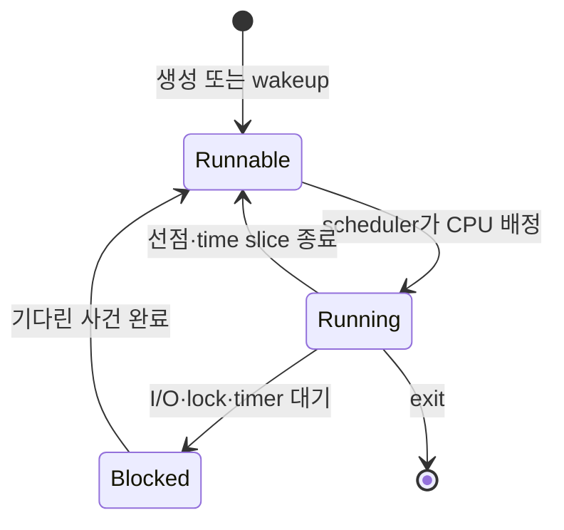

# 03. CPU scheduling과 pressure

[이 책 목차](README.md)

## 처음부터 다시 잇는 실행 흐름: task 하나가 CPU를 얻고 잃는 과정

Linux scheduler가 고르는 직접 대상은 **task**다. 하나의 process에 thread가 네 개면 보통 scheduler 입장에서는 독립적으로 실행 가능한 task 네 개다. **logical CPU**는 한 순간에 instruction stream 하나를 실행하는 scheduler 단위다. physical core가 SMT를 제공하면 logical CPU가 둘 이상일 수 있지만 execution resource를 일부 공유하므로 physical core 두 개와 같은 성능이라고 가정할 수 없다.

| 시각 | API worker W | run queue와 CPU |
|---:|---|---|
| 0µs | socket data를 기다려 sleeping | CPU 2는 batch task B 실행 |
| 40µs | NIC 처리에서 wakeup되어 runnable | W가 CPU 2 run queue 후보가 됨 |
| 55µs | 아직 runnable | virtual deadline과 eligibility 비교 |
| 60µs | running | B가 preempt되고 W의 register 상태 복원 |
| 90µs | mutex에서 block | W가 wait queue로 이동 |
| 180µs | mutex unlock으로 runnable | 즉시 running이 아니라 다시 경쟁 |

**run queue**는 실행 가능한 task를 관리하는 scheduler 자료구조다. runnable은 경쟁 자격이 있다는 뜻이고 running은 실제 CPU를 받았다는 뜻이다. sleeping은 I/O, timer, mutex 같은 사건 전에는 CPU를 줘도 진전하지 못하는 상태다.

**preemption(선점)**은 현재 task가 자발적으로 놓기 전에 다른 task가 CPU를 차지할 수 있게 하는 것이다. **context switch**는 register·stack pointer·instruction 위치를 저장하고 다음 task 문맥을 복원한다. scheduler code의 직접 시간뿐 아니라 새 task의 code/data가 cache와 TLB를 다시 채우는 간접 비용도 있다.

## CFS에서 EEVDF까지 숫자로 이해하기

과거 CFS 설명의 핵심인 **vruntime(가상 실행 시간)**은 실제 CPU 시간을 weight로 보정한 회계 값이다. 높은 weight task는 같은 1ms를 실행해도 vruntime이 덜 증가해 장기적으로 더 많은 CPU 몫을 얻는다.

Linux는 6.6부터 fair class를 EEVDF 쪽으로 전환하기 시작했다. **EEVDF(Earliest Eligible Virtual Deadline First)**는 공정한 몫보다 덜 받았는지를 나타내는 **lag**, 선택 후보가 될 수 있는 **eligible**, 후보 사이 순서를 정하는 **virtual deadline**을 사용한다. distribution kernel은 backport와 설정이 다르므로 Ubuntu의 실제 kernel version과 trace를 확인한다.

같은 weight의 A와 B가 20ms 동안 모두 runnable인데 A가 14ms, B가 6ms 실행됐다고 하자. 공정한 몫은 10ms씩이다. 몫에서 받은 시간을 뺀 단순 모형이면 A lag는 -4ms, B는 +4ms다. B가 CPU service를 덜 받았다. 실제 kernel 값은 virtual time과 entity hierarchy를 포함하므로 이 산술은 개념 모형이다.

짧은 slice 요청은 virtual deadline을 앞당겨 반응성을 도울 수 있지만 real-time deadline 보장은 아니다. task가 I/O나 lock으로 blocked면 고를 수 없고 cgroup quota가 고갈되면 runnable이어도 throttled될 수 있다.

## CPU utilization과 CPU pressure의 다른 질문

utilization은 CPU가 얼마나 busy했는지 묻는다. CPU PSI는 runnable task가 CPU를 받지 못해 진전이 지연된 시간을 묻는다.

```text
CPU 1개, runnable task 1개
→ utilization 약 100%, 대기 task가 거의 없어 pressure는 낮을 수 있음

CPU 1개, runnable task 8개
→ utilization 약 100%, 여러 task가 기다려 some pressure가 높을 수 있음

task가 모두 storage I/O에서 sleeping
→ utilization 낮음, CPU pressure 낮음, IO pressure는 높을 수 있음
```

PSI의 avg10, avg60, avg300은 10·60·300초 이동 평균이고 total은 누적 stall time을 microsecond로 제공한다. 10초 동안 CPU some total이 3,000,000µs 늘었다고 “서비스가 정확히 30% 느려졌다”고 번역하면 안 된다. 일부 task의 aggregate stall이며 요청 latency와 task 수를 함께 본다. CPU full은 system-wide와 cgroup 범위·kernel version의 의미를 공식 문서로 확인한다.

## affinity, topology, IRQ가 pressure에 미치는 영향

**CPU affinity**는 task가 실행할 수 있는 logical CPU 집합이다. {0}에 묶인 task 20개가 CPU 0에서 기다려도 CPU 1은 idle일 수 있다. affinity는 cache locality와 jitter를 줄일 수 있지만 너무 좁으면 load balancing을 막는다.

NUMA에서는 task를 다른 CPU node로 옮길 때 memory page가 원래 node에 남아 remote access가 늘 수 있다. scheduler는 CPU load와 locality 사이 tradeoff를 다룬다. NIC interrupt와 network softirq가 CPU 0에 몰리면 application task가 적어도 run queue와 cache가 바쁠 수 있다. application utilization만 보지 말고 IRQ/softirq 시간과 affinity도 본다.

## 한 장애를 원인→기작→결과→관측→응용으로 풀기

상황: API p99가 매 100ms 주기로 튄다.

1. 원인 후보를 CPU 부족, cgroup quota throttle, lock, page fault, NIC softirq로 나눈다.
2. quota가 40ms/100ms이고 worker들이 period 초반 40ms를 쓰면 남은 period 동안 runnable이어도 실행할 수 없다.
3. host CPU가 idle해 보여도 해당 cgroup 요청은 기다릴 수 있다.
4. cpu.stat의 throttling 변화, cgroup cpu.pressure, scheduler wakeup-to-run 지연을 같은 시간축에서 본다.
5. limit 조정, concurrency 제한, workload 분리 중 SLA와 capacity에 맞는 방식을 실험한다.

PSI가 높지만 throttle counter가 늘지 않으면 단순 quota 원인이 아니다. 좁은 cpuset이나 host contention일 수 있다. throttle이 있어도 요청이 I/O bound라면 p99의 지배 원인이 아닐 수 있다.

## scheduling class와 priority를 한 숫자로 합치지 않는다

Linux에는 일반 application이 주로 쓰는 fair scheduling class 외에 real-time과 deadline 계열 class가 있다. **scheduling class**는 runnable task 중 누구를 먼저 고려할지 정하는 정책 가족이다. **priority**는 그 class 안에서의 순서를 정하는 값이다. nice 값, real-time priority, cgroup weight는 범위와 의미가 서로 달라 숫자를 직접 비교하면 안 된다.

SCHED_FIFO task가 실행 가능하고 더 높은 class 규칙이 적용되면 fair task의 weight를 아무리 높여도 CPU를 받지 못할 수 있다. 반대로 RT task가 I/O에서 sleeping이면 실행 후보가 아니다. SCHED_DEADLINE은 runtime, deadline, period라는 admission 조건을 사용하며 EEVDF의 virtual deadline과 같은 값이 아니다.

priority inversion도 구분한다. 낮은 priority L이 mutex를 가진 상태에서 높은 priority H가 그 mutex를 기다리고, 중간 priority M이 L의 CPU를 계속 빼앗으면 H가 오래 기다린다. priority inheritance를 지원하는 lock protocol은 L의 effective priority를 일시적으로 올려 critical section을 끝내도록 도울 수 있지만 모든 lock과 user-space protocol에 자동 적용되는 것은 아니다.

## scheduler 관측값을 같은 clock 구간에 맞춘다

10초 구간에서 다음을 같이 모은다고 하자.

| 관측 | 구간 변화 | 해석 후보 |
|---|---:|---|
| request p99 | 4ms→35ms | 실제 사용자 영향 |
| cpu.pressure some | 급증 | runnable CPU 대기 |
| throttled time | 변화 없음 | quota 단독 가설 약화 |
| context switch | 3배 | lock/wakeup 또는 oversubscription 후보 |
| softirq CPU | CPU0에서 급증 | network 처리 집중 후보 |

상관관계만으로 원인을 확정하지 않는다. IRQ affinity를 바꾸거나 worker concurrency를 제한하는 한 번의 통제 실험으로 p99와 pressure가 함께 변하는지 본다.

## 추가 해설 문제

1. CPU 2개에 runnable task가 하나뿐이고 한 core가 100%다. pressure도 반드시 높은가?
   - 아니다. task가 기다리지 않고 실행하면 busy해도 run-queue 대기는 낮을 수 있다.
2. wakeup에서 running까지 700µs가 걸렸다. context switch가 700µs였나?
   - 아니다. run queue 대기와 scheduler 선택이 포함된다.
3. 같은 weight A/B가 각각 15ms/5ms를 받았다. 단순 lag는?
   - 공정 몫 10ms 기준 A -5ms, B +5ms다.
4. affinity가 {2}인 task를 idle CPU 3으로 옮길 수 있는가?
   - 허용 mask 밖이면 옮길 수 없다.
5. CPU PSI가 낮고 IO PSI가 높다. CPU를 늘리면 해결되는가?
   - storage·writeback·I/O queue 원인을 먼저 본다.

[← 이전: process와 namespace](02-processes-namespaces-and-credentials.md) · [다음: memory·reclaim·PSI →](04-memory-pages-reclaim-and-psi.md)

CPU는 instruction을 실제로 실행하는 장치이고, task는 실행할 register·stack·상태를 가진 커널 scheduling 단위다. 실행 가능한 task가 CPU보다 많으면 kernel scheduler가 “다음에 어느 task를 어느 CPU에서 얼마나 실행할지” 반복해서 고른다. CPU 사용률은 장치가 바빴는지를 말하지만, pressure는 실행할 일이 CPU를 기다렸는지를 말한다.


## 1. task 상태와 run queue

**running**은 task가 지금 CPU에서 instruction을 실행한다는 뜻이다. **runnable**은 실행 조건은 갖췄지만 CPU를 기다릴 수 있는 상태다. **blocked** 또는 sleeping은 I/O 완료, lock, timer 같은 사건 전에는 CPU를 받아도 진행할 수 없는 상태다. CPU마다 runnable task를 관리하는 run queue가 있고 scheduler는 topology와 affinity를 고려해 task를 배치·이동한다.



`read()`가 page cache에서 즉시 끝나면 같은 task가 계속 실행할 수 있다. disk I/O가 필요하면 task는 blocked가 되고 다른 runnable task로 context switch한다. I/O 완료는 task를 runnable로 만들 뿐 즉시 running을 보장하지 않는다.

## 2. EEVDF를 용어부터 읽기

Linux의 일반 fair scheduling은 오랫동안 CFS와 virtual runtime으로 설명됐다. 현재 kernel 문서는 **EEVDF(earliest eligible virtual deadline first)**를 설명한다. **weight**는 경쟁 중 장기적으로 받아야 할 CPU service의 상대 비율이다. **lag**는 이상적으로 받아야 할 service와 실제 받은 service의 차이를 표현한다. **eligible**은 현재 보상받을 자격이 있는 후보 집합이고, **virtual deadline**은 그 후보 안 선택 순서를 정하는 가상 시간 값이다.

virtual deadline은 사용자가 정한 실제 업무 마감 시각이 아니다. EEVDF가 deadline이라는 단어를 쓴다고 hard real-time 완료를 보장하지 않는다. 실제 선택은 kernel version, scheduling class, wakeup, affinity와 topology의 영향을 받는다.

A weight 100, B weight 300이고 한 CPU에서 둘 다 계속 runnable이라고 단순화하면 총 weight는 400이다. 긴 구간의 이상적 share는 A 25%, B 75%다. 10초 CPU service라면 약 2.5초와 7.5초다. 짧은 구간에는 slice, wakeup과 migration 때문에 정확히 매 100ms마다 이 비율이 나오지 않는다. B가 sleep하면 weight는 cap이 아니므로 A가 CPU 전체를 쓸 수 있다.

## 3. 요청 두 개의 실제 시간표

CPU 하나에서 API task A는 3ms 계산 뒤 disk를 5ms 기다리고, batch task B는 계속 계산한다고 하자.

| wall time | A 상태 | B 상태 | CPU | 중간 사건 |
| ---: | --- | --- | --- | --- |
| 0~3ms | running | runnable | A | A가 request parsing |
| 3ms | `read()` 후 blocked | runnable | scheduler | disk 요청 제출 |
| 3~8ms | blocked | running | B | B가 CPU 사용 |
| 8ms | wakeup→runnable | running | B | disk completion |
| 8~10ms | runnable | running | B | A가 CPU를 아직 기다림 |
| 10~12ms | running | runnable | A | response 계산 |

A의 I/O는 8ms에 끝났지만 응답 계산은 10ms에 재개됐다. 2ms는 CPU 대기다. storage latency만 측정하면 이 지연을 놓친다. B를 다른 CPU로 옮길 수 있다면 줄어들 수 있지만 A의 affinity가 CPU0 하나로 좁혀져 있으면 CPU1이 idle이어도 기다린다.

두 번째 예로 thread 4개가 CPU 2개에서 동시에 20ms CPU를 요구하면 총 CPU demand는 80ms다. 이상적으로 40ms wall time이 필요하다. utilization은 거의 100%이고 항상 일부 runnable task가 기다리므로 CPU pressure도 생긴다. thread를 40개로 늘려도 계산량이 같다면 context switch와 cache 경쟁만 늘 수 있다.

## 4. affinity·migration·NUMA

**CPU affinity**는 task가 실행될 수 있는 CPU 집합이다. 집합을 좁히면 cache locality가 좋아질 수 있지만 다른 CPU의 여유를 못 쓸 수 있다. **migration**은 task를 다른 CPU run queue로 옮기는 일이다. load balance를 돕지만 이전 CPU cache와 TLB의 warm state를 잃을 수 있다.

NUMA system에서는 CPU와 memory node 거리가 다르다. task만 CPU1로 옮기고 page는 먼 node에 남으면 memory access가 느려질 수 있다. scheduler 관측에는 실행 CPU뿐 아니라 cpuset, memory placement, interrupt와 device queue 위치를 함께 본다.

## 5. CPU PSI를 시간으로 읽기

**PSI(pressure stall information)**는 CPU·memory·I/O 자원 부족 때문에 workload가 진행하지 못한 시간을 집계한다. CPU `some`은 범위 안 적어도 일부 non-idle task가 CPU를 기다린 시간이다. system 전체 CPU `full`은 정의되지 않아 호환상 0일 수 있으며 cgroup 범위 의미와 구별한다.

```text
some avg10=12.34 avg60=5.67 avg300=2.00 total=1500000
```

`avg10`은 10초 시간 척도의 지수 이동 평균이다. 정확히 직전 10초 대기 시간을 역산하는 값이나 CPU utilization이 아니다. 정확한 관측 구간은 두 시점 `total` 차이를 쓴다. 10초 동안 `total`이 1,500,000µs 증가했다면 some 조건이 성립한 wall time은 1.5초, 구간 비율은 15%다. task별 대기 시간을 모두 더한 합과도 다르다.

```bash
cat /proc/pressure/cpu
ps -eLo pid,tid,psr,stat,ni,comm
cat /proc/schedstat
```

위 명령은 읽기 전용 예이며 실행하지 않았다. `psr`은 snapshot 순간 CPU다. 다음 순간 migration될 수 있다. load average에는 CPU runnable 외 일부 uninterruptible task도 영향을 줄 수 있어 CPU queue 길이와 동일하지 않다.

## 6. 실패 조건과 진단

CPU utilization 50%인데 지연이 높다면 전체 평균에 숨은 한 CPU affinity 포화, quota throttling, lock 대기를 본다. utilization 100%라도 runnable이 정확히 core 수와 같고 각 task가 진행하면 pressure가 낮을 수 있다. 반대로 짧은 burst는 avg60에서 작게 보여도 p99 latency를 해칠 수 있다.

weight를 높이는 것은 deadline 예약이 아니다. real-time class는 별도 정책이며 오용하면 일반 task를 굶길 수 있다. scheduler 이름만으로 성능을 주장하지 않고 runnable 시간, 실제 CPU service와 tail latency를 같은 시간축에서 측정한다.

## 7. 문제와 해설

### 문제 1
running, runnable, blocked의 차이는?

**해설:** running은 현재 CPU를 사용한다. runnable은 실행 가능하지만 CPU를 기다릴 수 있다. blocked는 기다린 사건 전에는 CPU를 받아도 진행할 수 없다.

### 문제 2
weight 100과 300의 장기 share는 언제 25%와 75%인가?

**해설:** 같은 CPU 자원을 놓고 둘 다 계속 runnable인 단순 경쟁 조건이다. 한쪽이 sleep하거나 quota·affinity가 개입하면 달라진다.

### 문제 3
wakeup 직후 task가 바로 실행되지 않는 이유는?

**해설:** wakeup은 blocked에서 runnable로 바꾼다. scheduler가 현재 task, 우선순위·lag·CPU affinity를 보고 나중에 CPU를 배정한다.

### 문제 4
CPU가 40% idle인데 한 service의 CPU PSI가 높을 수 있는가?

**해설:** 가능하다. service cpuset이나 affinity가 포화 CPU 하나로 제한됐거나 cgroup quota로 throttled될 수 있다.

### 문제 5
`avg10=20`을 정확히 2초 stall이라고 말해도 되는가?

**해설:** 안 된다. 지수 평균이다. 구간 시간을 계산하려면 실제 10초 간격의 `total` 증가량을 사용한다.

## 공식 자료

- [Linux EEVDF scheduler](https://docs.kernel.org/scheduler/sched-eevdf.html)
- [Linux PSI](https://docs.kernel.org/accounting/psi.html)

[← 이전: process와 namespace](02-processes-namespaces-and-credentials.md) · [다음: memory·reclaim·PSI →](04-memory-pages-reclaim-and-psi.md)
