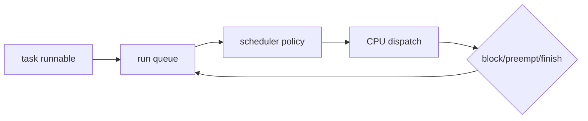

# 03. CPU scheduling과 pressure

[이 책 목차](README.md)

[← 이전: process와 namespace](02-processes-namespaces-and-credentials.md) · [다음: memory·reclaim·PSI →](04-memory-pages-reclaim-and-psi.md)

## scheduler의 입력과 결과

scheduler는 runnable task 중 CPU에 올릴 task를 고른다.
입력은 runnable 상태, policy/class, priority/weight, affinity와 CPU topology다.
결과는 다음 task와 실행 시간이다.




## runnable과 running

running은 지금 CPU에서 실행 중이다.
runnable은 실행 가능하지만 CPU를 기다릴 수 있다.
blocked는 I/O나 condition을 기다려 CPU를 받아도 진행할 수 없다.

CPU 1개에 runnable task A,B,C가 있으면 한 순간에는 하나만 running이다.
나머지는 run queue에서 기다린다.

## CFS라는 말과 EEVDF

오랫동안 Linux 일반 fair class 설명은 CFS와 virtual runtime 중심으로 알려졌다.
현재 kernel 문서는 EEVDF를 eligible virtual deadline first로 설명한다.
과거 CFS 문구를 현재 선택 알고리즘 전체와 동일시하지 않는다.

EEVDF의 입문 직관:

1. weight에 따라 받아야 할 service를 계산한다.
2. lag가 음수가 아닌 eligible task를 본다.
3. eligible 중 virtual deadline이 이른 task를 고른다.

이는 교육용 RR, SJF, MLFQ와 다르다.
kernel version과 config에 따른 실제 구현은 해당 source/docs를 확인한다.

## weight 작은 계산

A weight 100, B weight 300이고 둘 다 계속 runnable이라고 단순화한다.
총 weight는 400이다.

```text
A share ≈ 100/400 = 25%
B share ≈ 300/400 = 75%
```

10초 관측이면 이상적 장기 CPU time은 A 2.5초, B 7.5초다.
짧은 구간은 wakeup, latency, granularity로 정확히 이 비율이 아닐 수 있다.

weight는 CPU가 남을 때 절대 cap이 아니다.
A만 runnable이면 CPU 전체를 쓸 수 있다.

## context switch

timer, blocking syscall, wakeup, explicit yield가 scheduling point를 만들 수 있다.
context switch는 register와 address-space 관련 상태를 저장·복원한다.
cache와 TLB locality 비용도 생길 수 있다.

## CPU PSI

PSI(Pressure Stall Information)는 resource 부족 때문에 task가 지연된 시간을 본다.
CPU pressure의 `some`은 적어도 일부 non-idle task가 CPU를 기다린 시간 비율이다.
System 전체의 CPU `full`은 정의되지 않으며 호환성을 위해 0으로 보고될 수 있다. cgroup 범위의 CPU pressure와는 구별한다. Memory·I/O의 `full`은 해당 범위의 모든 non-idle task가 동시에 그 자원 때문에 진행하지 못하는 시간이다.

예상 형식의 읽기 전용 명령이며 실행하지 않는다.

```bash
cat /proc/pressure/cpu
```

예상 형태:

```text
some avg10=12.34 avg60=5.67 avg300=2.00 total=...
```

avg10 12.34는 최근 pressure를 10초 시간 척도로 평균한 추세 값이며 CPU utilization 12.34%가 아니다. 정확히 직전 10초의 대기 시간을 역산하는 값으로도 사용하지 않는다. 구간의 시간을 계산하는 방법은 [메모리 PSI 해석](04-memory-pages-reclaim-and-psi.md)에서 `total` 차이로 이어 설명한다.
idle이 0이어도 run queue가 길면 pressure가 높을 수 있다.

## 시간표

CPU 하나, A/B가 각각 4 tick을 원한다.

| tick | running | runnable waiting |
|---:|---|---|
| 0 | A | B |
| 1 | A | B |
| 2 | B | A |
| 3 | B | A |
| 4 | A | B |
| 5 | A 완료 | B |
| 6 | B | 없음 |
| 7 | B 완료 | 없음 |

총 CPU utilization은 100%다.
동시에 상당 시간 한 task가 기다린다.
utilization과 pressure가 다른 질문인 이유다.

## affinity와 migration

CPU affinity는 task가 실행 가능한 CPU 집합이다.
집합이 좁으면 locality는 좋아질 수 있지만 idle CPU를 못 쓸 수 있다.
migration은 load balance를 돕지만 cache warm state를 잃을 수 있다.
NUMA memory 위치와 CPU 위치도 함께 본다.

## 관측

실행하지 않은 예:

```bash
ps -eLo pid,tid,psr,stat,ni,comm
cat /proc/schedstat
cat /proc/pressure/cpu
```

한 snapshot의 CPU 번호는 다음 순간 migration될 수 있다.

## 반례

load average가 높아도 일부 task는 I/O 상태일 수 있다.
CPU utilization이 낮아도 affinity 때문에 한 CPU만 포화될 수 있다.
높은 weight가 deadline 보장을 주지 않는다.
PSI가 낮은 짧은 평균도 순간 tail latency를 숨길 수 있다.

## 문제

## lag·eligible·deadline의 연결

weight가 정한 이상 service보다 덜 실행된 task는 양의 lag 쪽으로 이동해 보상받을 필요가 생긴다.
EEVDF는 lag 조건을 만족한 eligible task 집합을 먼저 만든다.
그 안에서 virtual deadline이 가장 이른 task를 선택한다.
짧은 요청 latency를 표현하는 slice가 deadline 계산에 영향을 줄 수 있다.
weight는 장기 service 비율, lag는 받은 service의 빚/앞섬, eligibility는 지금 선택 후보인지, deadline은 후보 사이 순서를 나타낸다.
이 네 단어를 실제 wall-clock deadline이나 고정 CPU quota와 같은 것으로 읽지 않는다.

1. running과 runnable 차이는?
2. weight 1:3의 장기 share 모형은?
3. CPU PSI와 CPU utilization이 다른 이유는?

## 해설

1. running은 CPU 사용 중, runnable은 실행 가능하지만 기다릴 수 있다.
2. 둘 다 계속 runnable이면 약 25%와 75%다.
3. utilization은 CPU busy, PSI는 runnable task가 resource를 기다린 지연을 본다.

## 공식 자료

- [Linux EEVDF scheduler](https://docs.kernel.org/scheduler/sched-eevdf.html)
- [Linux PSI](https://docs.kernel.org/accounting/psi.html)

[← 이전: process와 namespace](02-processes-namespaces-and-credentials.md) · [다음: memory·reclaim·PSI →](04-memory-pages-reclaim-and-psi.md)
