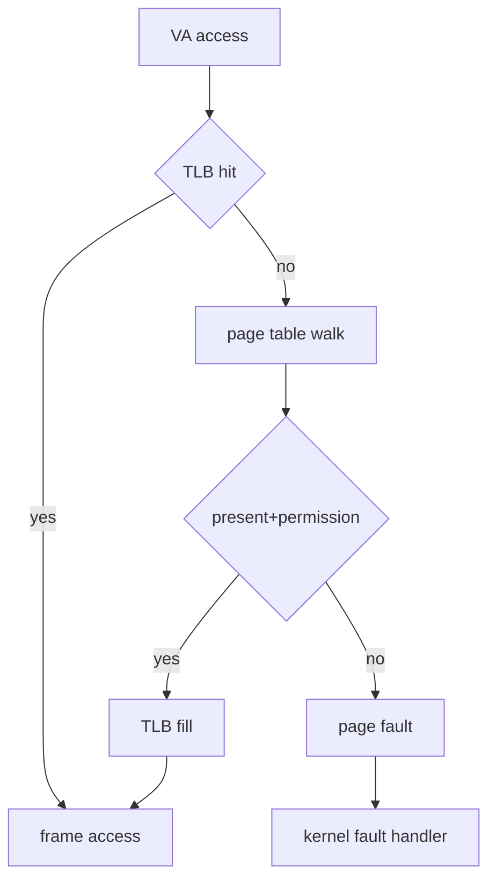
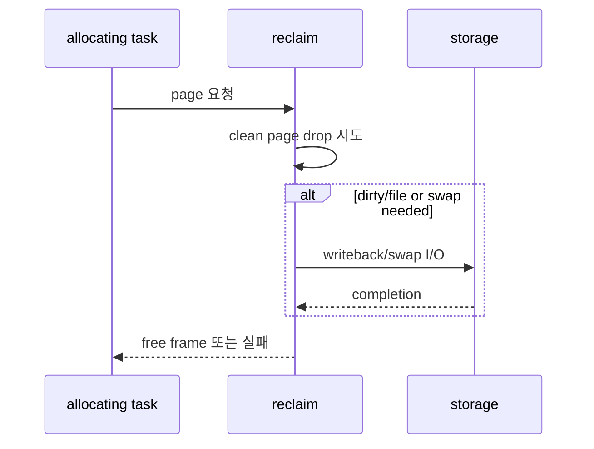

# 04. Memory page·reclaim·PSI

[이 책 목차](README.md)

[← 이전: CPU scheduling](03-cpu-scheduling-and-pressure.md) · [다음: cgroup v2 hierarchy →](05-cgroup-v2-hierarchy-and-delegation.md)

## virtual memory

process는 virtual address를 본다.
page table이 virtual page를 physical frame과 permission에 연결한다.
TLB는 최근 변환을 cache한다.
page fault는 mapping/permission으로 access를 완료할 수 없을 때 kernel로 들어가는 사건이다.



## RSS와 VSZ

VSZ/VIRT는 process가 가진 virtual mapping 범위의 크기다.
RSS는 현재 RAM에 resident한 page 크기의 근사다.
둘은 실제 고유 physical memory와 같지 않다.

shared page는 여러 process RSS에 각각 보일 수 있다.
PSS는 shared page를 나누어 귀속하는 관점이다.

10GiB address를 `mmap`했지만 100MiB만 touch했다면 VSZ는 크게, RSS는 작게 보일 수 있다.
reservation과 physical allocation 시점이 다르기 때문이다.

## anonymous와 file page

anonymous page는 heap/stack처럼 원본 file이 없는 memory다.
file page는 executable, mapped file, page cache와 연결될 수 있다.

| page | clean일 때 | dirty일 때 |
|---|---|---|
| file | 원본에서 재읽을 수 있어 drop 가능 | writeback 뒤 회수 |
| anonymous | 일반적으로 그냥 drop 불가 | swap backing이 있으면 swap-out 가능 |

## reclaim

free frame이 부족하면 kernel이 reclaim 후보를 scan한다.
kswapd가 background에서 움직일 수 있다.
allocation task가 direct reclaim을 수행해 지연을 맞을 수도 있다.



## 1GiB memcg 예

현재 상태:

```text
anonymous 600MiB
file cache clean 250MiB
file dirty 100MiB
기타 50MiB
합계 1000MiB
```

새 120MiB allocation이 오면 limit을 넘는다.
clean file 120MiB를 drop할 수 있다면 allocation이 진행될 수 있다.
곧 같은 file을 읽으면 storage I/O가 다시 발생한다.

clean cache가 20MiB뿐이고 swap도 없으며 dirty writeback이 느리면 reclaim이 막혀 OOM 위험이 커진다.

## memory PSI

memory PSI `some`은 적어도 일부 task가 memory pressure로 stall한 시간이다.
`full`은 모든 non-idle task가 동시에 stall한 시간 관점이다.

실행하지 않은 read-only 예:

```bash
cat /proc/pressure/memory
cat /sys/fs/cgroup/memory.pressure
```

system PSI와 cgroup PSI는 범위가 다르다.
`memory.current`가 limit 근처라는 사실과 PSI가 높은 사실도 같은 말이 아니다.
reclaim이 쉽게 끝나면 limit 근처여도 stall이 작을 수 있다.

## memcg

memory cgroup은 범위 안 memory를 charge하고 control한다.
host 전체 free RAM이 있어도 `memory.max`에 닿으면 그 cgroup에서 reclaim/OOM이 날 수 있다.
shared page charge 규칙과 kernel memory accounting은 세부 문서를 확인한다.

## read-only 관측

```bash
cat /proc/meminfo
cat /proc/self/status
cat /sys/fs/cgroup/memory.current
cat /sys/fs/cgroup/memory.events
cat /proc/pressure/memory
```

실행하지 않은 예이며 file 존재와 permission은 환경에 따라 다르다.

## 반례

free가 적어도 reclaimable cache가 많으면 즉시 OOM이 아닐 수 있다.
RSS가 같아도 anonymous와 file 비율에 따라 reclaim 비용이 다르다.
swap 사용량이 있어도 지금 swap I/O 중이라는 뜻은 아니다.
PSI 평균이 낮아도 짧은 reclaim spike가 tail latency를 만들 수 있다.

## PSI 수치를 시간으로 바꾸어 읽기

memory `some avg10=20.00`이라고 가정하자.
이는 최근 memory stall의 10초 시간 척도 평균이 약 20%라는 뜻이다. Kernel의 평균은 시간에 따라 이전 값의 영향이 줄어드는 추세 값이므로 정확히 직전 10초의 stall이 2초였다고 역산하지 않는다.
어떤 task가 몇 초 멈췄는지도 직접 알려 주지 않는다.

정확한 구간 비율을 직접 계산하려면 두 시점의 `total` 차이와 실제 관측 시간을 사용한다. 예를 들어 10초 동안 `some total`이 1,500,000 µs 증가했다면 그 구간의 some stall 비율은 `1.5/10=15%`다. 이는 task별 대기 시간을 모두 더한 값이 아니라, 그 범위에서 some 조건이 성립한 시간이다.

`full avg10=5.00`이면 모든 non-idle task가 동시에 stall한 영향도 있었다.
이는 RAM 사용률 5%나 swap 사용률 5%가 아니다.
같은 시각의 `memory.current`, `memory.events`, I/O와 task latency를 함께 본다.
반례로 짧은 500ms 심한 stall은 avg60/avg300에서 작게 보일 수 있다.

## 문제

## VMA에서 frame과 memcg charge까지

VMA는 process address 범위와 read/write/execute, file backing 같은 정책을 기록한다.
task가 VMA 안의 아직 없는 page를 touch하면 page fault handler가 접근이 합법인지 확인한다.
allocator가 physical frame을 얻고 memcg에 charge한 뒤 page 내용을 zero-fill하거나 file에서 가져온다.
page table entry가 virtual page를 frame에 연결하면 instruction을 재시도한다.
RSS는 resident page 관점이고 PSS는 shared page 비용을 process들에 나누어 본다.
anonymous page는 file 원본이 없으므로 reclaim 시 swap 같은 backing이 필요할 수 있다.
PSI는 이 과정의 stall 영향을 말하며 page 개수 자체를 말하지 않는다.

1. VSZ 10GiB, RSS 100MiB가 가능한 이유는?
2. clean file page와 dirty file page 회수 차이는?
3. host free RAM이 남아도 memcg OOM이 가능한 이유는?

## 해설

1. virtual mapping 범위와 resident physical page가 다르기 때문이다.
2. clean은 drop 가능하지만 dirty는 최신 data를 writeback해야 한다.
3. `memory.max`는 cgroup 범위의 독립 charge limit이기 때문이다.

## 공식 자료

- [Linux memory concepts](https://docs.kernel.org/admin-guide/mm/concepts.html)
- [cgroup v2 memory controller](https://docs.kernel.org/admin-guide/cgroup-v2.html)
- [Linux PSI](https://docs.kernel.org/accounting/psi.html)

[← 이전: CPU scheduling](03-cpu-scheduling-and-pressure.md) · [다음: cgroup v2 hierarchy →](05-cgroup-v2-hierarchy-and-delegation.md)
