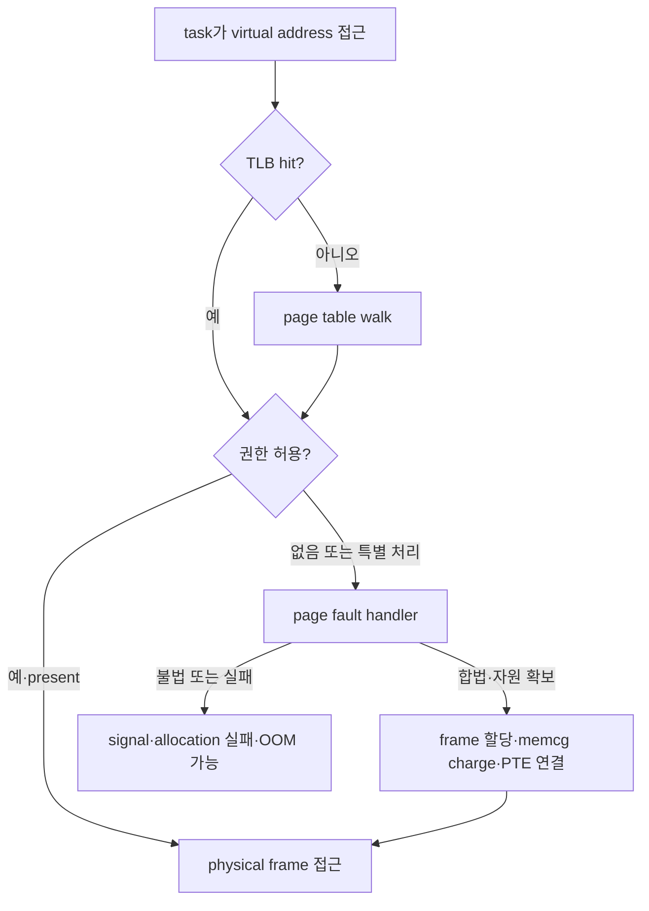

# 04. Memory page·reclaim·PSI

[이 책 목차](README.md)

[← 이전: CPU scheduling](03-cpu-scheduling-and-pressure.md) · [다음: cgroup v2 hierarchy →](05-cgroup-v2-hierarchy-and-delegation.md)

프로그램이 보는 주소와 RAM 칩의 위치는 같은 것이 아니다. kernel은 process마다 가상 주소 공간을 만들고 page 단위 mapping과 권한을 관리한다. 메모리가 부족하면 단순히 “free가 0이 됐다”고 죽이는 대신 cache를 회수하고 dirty page를 writeback하며, 이 과정의 지연이 memory pressure로 나타난다.

## 1. 가상 주소에서 page까지

**가상 주소(virtual address)**는 process가 load/store instruction에 사용하는 주소다. **page table**은 virtual page를 physical frame과 읽기·쓰기·실행 권한에 연결한다. **TLB**는 최근 주소 변환을 CPU 안에 cache한다. TLB miss면 page table walk가 필요하다.

**page fault**는 CPU가 현재 translation·permission만으로 접근을 완료하지 못해 kernel handler로 들어가는 사건이다. 합법적인 file mapping의 아직 안 읽은 page라면 kernel이 storage에서 가져와 mapping한 뒤 instruction을 재시도할 수 있다. 존재하지 않는 주소나 금지된 쓰기라면 signal로 process를 종료할 수 있다. page fault라는 이름이 항상 오류를 뜻하지 않는다.



## 2. VSZ·RSS·PSS가 다른 이유

**VSZ/VIRT**는 process의 virtual mapping 범위다. `mmap()`으로 10GiB 범위를 예약해도 실제 touch가 100MiB면 VSZ는 10GiB, RSS는 약 100MiB일 수 있다. **RSS(resident set size)**는 현재 RAM에 resident한 page 관점이지만 shared page가 여러 process RSS에 반복 계산될 수 있다. **PSS(proportional set size)**는 shared page 비용을 공유 process에 나눠 귀속한다.

따라서 RSS 두 개를 더한 값과 host 물리 사용량이 항상 같지 않다. copy-on-write page, shared library, page cache와 kernel memory를 구별한다.

## 3. anonymous·file·dirty page

**anonymous page**는 heap·stack처럼 다시 읽을 원본 file이 없는 memory다. 회수하려면 swap backing이 있거나 내용을 버려도 되는 특별 상태여야 한다. **file page**는 executable, mapped file과 buffered I/O page cache처럼 file에 연결된다. clean file page는 필요하면 원본에서 다시 읽을 수 있어 drop하기 쉽다. dirty file page는 RAM 내용이 storage보다 새로워 먼저 writeback해야 한다.

| page 종류 | clean/dirty 의미 | reclaim 시 필요한 일 | 다시 접근할 때 |
| --- | --- | --- | --- |
| clean file | storage와 같음 | mapping에서 회수 가능 | storage read로 fault |
| dirty file | RAM이 더 최신 | filesystem·device writeback | 완료 뒤 clean 가능 |
| anonymous | file 원본 없음 | swap-out 또는 유지 | swap-in 필요 가능 |
| pinned/unevictable | 이동·회수 제한 | 즉시 회수 곤란 | 사용 목적 종료 필요 |

## 4. 1GiB cgroup의 allocation을 끝까지 추적하기

현재 anonymous 600MiB, clean file 250MiB, dirty file 100MiB, 기타 50MiB로 총 1000MiB라고 하자. worker가 새 주소 120MiB를 처음 touch한다. CPU가 page fault를 내고 kernel allocator가 frame과 memory cgroup charge를 시도한다.

limit을 넘으므로 reclaim이 clean file cache 120MiB를 drop할 수 있다면 allocation은 성공하고 application은 계속된다. 곧 같은 file을 읽으면 storage I/O가 다시 발생한다. clean cache가 20MiB뿐이고 swap이 없으며 dirty writeback이 느리면 allocation task가 direct reclaim과 I/O를 기다려 latency가 크게 늘고 hard limit에서는 OOM 가능성이 생긴다.

| 단계 | `memory.current` 성격 | task 상태 | 외부 관측 |
| ---: | --- | --- | --- |
| touch 전 | 약 1000MiB | running | RSS 증가 전 |
| fault·charge 시도 | 1120MiB 필요 | kernel 실행 | minor/major fault 증가 가능 |
| reclaim scan | limit 초과 | reclaim 또는 대기 | PSI some, `memory.events` |
| clean 120MiB drop | 공간 확보 | runnable 복귀 | file cache 감소 |
| 재접근 | file page 없음 | storage blocked 가능 | read latency·I/O 증가 |

`malloc()` 성공과 physical page charge 시점도 다를 수 있다. allocator가 virtual 범위만 제공하고 실제 touch 때 fault·charge가 일어나기 때문이다.

## 5. background와 direct reclaim

**reclaim**은 kernel이 재사용할 frame을 확보하는 작업이다. `kswapd` 같은 kernel thread가 background에서 미리 움직일 수 있고, allocation한 task가 직접 scan·writeback을 수행하는 direct reclaim도 있다. 후자는 업무 thread 지연으로 바로 보인다.

회수 성공 여부는 page 종류, 최근 사용, dirty 상태, swap, filesystem과 device 속도에 달린다. free memory가 적어도 회수 가능한 cache가 많으면 즉시 OOM은 아니다. 반대로 host free가 있어도 cgroup hard limit에 갇힌 workload는 자기 범위에서 reclaim·OOM을 겪을 수 있다.

## 6. memory PSI와 일관된 단위

`memory.pressure`의 `some`은 범위 안 적어도 일부 non-idle task가 memory pressure로 stall한 wall time이고 `full`은 모든 non-idle task가 동시에 stall한 wall time이다. byte 사용률이나 swap 비율이 아니다.

```text
some avg10=20.00 avg60=8.00 avg300=3.00 total=5400000
full avg10=5.00 avg60=2.00 avg300=1.00 total=900000
```

10초 동안 some `total`이 1,500,000µs 증가하면 구간 some stall은 1.5초, 15%다. `avg10=20`을 정확히 2초라고 역산하지 않는다. total은 microsecond 누적이고 `memory.current`는 byte이므로 단위를 섞지 않는다.

두 번째 흐름에서 dirty writeback이 800ms 걸린 동안 allocation task 둘이 기다리고 다른 계산 task 하나는 진행했다고 하자. 그 800ms는 some에 들어갈 수 있지만 모든 non-idle task가 막힌 것은 아니므로 full 전체로 잡히지는 않는다. 계산 task도 같은 reclaim 경로에 막히면 full이 증가할 수 있다.

## 7. 관측 출력 읽기

```bash
cat /proc/meminfo
cat /proc/self/status
cat /sys/fs/cgroup/memory.current
cat /sys/fs/cgroup/memory.stat
cat /sys/fs/cgroup/memory.events
cat /sys/fs/cgroup/memory.pressure
```

위 경로는 읽기 전용 예이며 실행하지 않았다. `/proc/meminfo`는 system 범위, `/proc/self/status`는 현재 process 관점, cgroup 파일은 해당 계층 범위다. 한 snapshot 대신 같은 timestamp의 delta를 본다. `memory.current`가 limit 근처여도 reclaim이 쉽다면 PSI가 낮을 수 있고, 사용량 변화가 작아도 반복 reclaim 때문에 PSI가 높을 수 있다.

최신 memory tiering 연구의 한 예인 [Memstrata(OSDI 2024)](https://www.usenix.org/conference/osdi24/presentation/zhong-yuhong)는 CXL memory를 포함한 VM memory tiering과 contention을 다룬다. 이것은 일반 Ubuntu의 모든 page fault가 자동으로 CXL tiering된다는 뜻이 아니다. 이 장의 “page 위치·reclaim 비용·공유 contention을 함께 측정한다”는 원리를 특정 연구 환경에서 확장한 사례로 읽고, 실험에서는 hardware topology와 hypervisor·정책을 명시한다.

## 8. 문제와 해설

### 문제 1
VSZ 10GiB, RSS 100MiB가 가능한 이유는?

**해설:** virtual mapping 범위만 10GiB이고 실제 touch되어 RAM에 resident한 page가 약 100MiB일 수 있다.

### 문제 2
clean file page와 dirty file page 회수 비용은 왜 다른가?

**해설:** clean page는 원본에서 다시 읽을 수 있어 drop 가능하다. dirty page는 최신 내용을 storage에 writeback해야 한다.

### 문제 3
page fault는 항상 프로그램 오류인가?

**해설:** 아니다. 합법적 demand paging과 copy-on-write도 fault handler를 거친다. 해결할 mapping이나 권한이 없을 때 오류가 된다.

### 문제 4
host에 free RAM이 있어도 cgroup OOM이 가능한가?

**해설:** 가능하다. `memory.max`는 cgroup charge 범위의 hard limit이므로 그 범위 reclaim이 실패하면 OOM이 발생할 수 있다.

### 문제 5
memory.current가 일정한데 PSI가 상승했다. 가능한 설명은?

**해설:** allocation과 reclaim이 반복되어 사용량은 비슷하지만 task가 reclaim·writeback을 기다렸을 수 있다. events와 I/O를 함께 본다.

## 공식 자료

- [Linux memory concepts](https://docs.kernel.org/admin-guide/mm/concepts.html)
- [cgroup v2 memory controller](https://docs.kernel.org/admin-guide/cgroup-v2.html)
- [Linux PSI](https://docs.kernel.org/accounting/psi.html)
- [Memstrata: CXL memory tiering](https://www.usenix.org/conference/osdi24/presentation/zhong-yuhong)

[← 이전: CPU scheduling](03-cpu-scheduling-and-pressure.md) · [다음: cgroup v2 hierarchy →](05-cgroup-v2-hierarchy-and-delegation.md)
