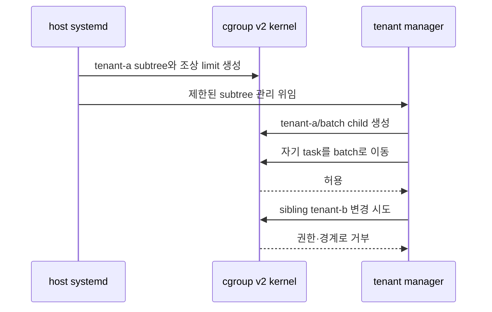

# 05. cgroup v2 hierarchy와 delegation

[이 책 목차](README.md)

[← 이전: memory와 PSI](04-memory-pages-reclaim-and-psi.md) · [다음: CPU quota·weight·cpuset →](06-cpu-quota-weight-and-cpuset.md)

cgroup(control group)은 task를 계층으로 묶어 CPU·memory·I/O·task 수를 계정하고 분배·제한하는 kernel 객체다. namespace가 PID나 mount를 “어떤 관점으로 보는가”를 바꾼다면 cgroup은 “자원 사용을 어느 집단에 귀속하고 조상 정책 아래 어떻게 나눌까”를 다룬다. v2는 controller를 하나의 통합 hierarchy에 둔다.


## 1. directory는 kernel 객체의 파일 인터페이스다

cgroup v2 filesystem은 보통 `/sys/fs/cgroup`에 mount된다. 그 아래 directory 하나가 cgroup 하나를 나타낸다. 일반 디스크 설정 파일처럼 보이지만 `cgroup.procs`나 `cpu.max`를 읽고 쓰는 동작은 kernel의 현재 계층 상태를 조회·변경한다. 파일을 지워 영구 설정을 제거한다는 일반 file 직관을 그대로 쓰면 안 된다.

```mermaid
flowchart TD
    R[/sys/fs/cgroup<br/>root cgroup] --> SYS[system.slice<br/>내부 분배 노드]
    R --> USER[user.slice]
    SYS --> A[app-a.service<br/>workload leaf]
    SYS --> B[app-b.service<br/>workload leaf]
    USER --> U[user-1000.slice]
    U --> S[session-4.scope]
```

`cgroup.procs`는 그 cgroup에 속한 thread group의 PID 관점을 보여 주고 process 단위 이동 인터페이스로 사용된다. `cgroup.threads`는 TID 관점을 보여 준다. `cgroup.controllers`는 이 cgroup이 자식에게 제공할 수 있는 controller 목록이고, `cgroup.subtree_control`은 그중 자식 subtree에 실제 배포하도록 활성화한 목록이다. `cgroup.events`의 `populated`는 자신 또는 descendant에 live task가 있는지, `frozen`은 freeze 상태를 나타낸다.

controller가 활성화되면 `cpu.max`, `cpu.weight`, `memory.current`, `io.stat`처럼 controller별 인터페이스가 child에 나타난다. 어느 파일이 보이는지는 조상 활성화, cgroup type과 kernel 지원에 달린다.

## 2. controller가 child에 도달하는 순서

root가 `cpu memory io pids`를 사용할 수 있다고 하자. root의 `cgroup.subtree_control`에 cpu와 memory를 활성화하면 직접 child가 CPU·memory 인터페이스를 받는다. `system.slice`가 다시 자기 `subtree_control`에 cpu를 활성화하면 그 아래 service child에 CPU 인터페이스가 전달된다.

```text
root/cgroup.controllers          = cpu memory io pids
root/cgroup.subtree_control      = cpu memory
system.slice/cgroup.controllers  = cpu memory
system.slice/cgroup.subtree_control = cpu
app.service에서 기대: cpu.* 존재, memory.*는 구조에 따라 child 배포되지 않음
```

여기서 `+cpu`는 파일에 쓰는 문법을 설명하는 표기일 뿐 실행 지시가 아니다. systemd가 소유한 실제 hierarchy에 임의로 쓰지 않는다.

**no internal process constraint**는 domain controller를 child에게 분배하는 일반 cgroup이 동시에 자원 소비 process를 직접 담지 않게 하는 구조 규칙이다. 부모는 분배자, leaf는 소비자로 역할을 나눈다. root에는 예외가 있다. 부모에 process P가 있는데 domain controller를 child로 활성화하려 하면 실패할 수 있으므로 P를 leaf child로 옮겨 구조를 정리한다.

## 3. task 이동 한 건을 끝까지 추적하기

관리자가 PID 4200 service를 `app-a.service` cgroup으로 이동한다고 가정하자. 실제 systemd 환경에서는 manager API와 unit 정책을 사용해야 하지만 kernel 동작을 이해하기 위한 모형이다.

1. 요청자는 대상 PID와 destination cgroup을 선택한다.
2. kernel은 요청자가 source와 destination에 필요한 이동 권한을 가졌는지 본다.
3. PID가 아직 존재하며 요청자가 의도한 process인지 확인한다. PID 재사용 race를 고려한다.
4. domain process 이동 규칙에 따라 thread group 전체의 귀속이 바뀐다.
5. 이후 CPU time, 새 memory charge와 I/O가 새 계층 정책의 영향을 받는다.
6. 이미 charge된 자원이 모두 자동 이동하는지는 controller 규칙을 따로 확인한다.

| 시각 | `cgroup.procs` 위치 | CPU 계정 | memory 의미 | 주의점 |
| ---: | --- | --- | --- | --- |
| t0 | old.service | old에 증가 | 기존 charge 존재 | PID 확인 |
| t1 | 이동 검사 | 아직 old | policy 검증 | 권한 실패 가능 |
| t2 | app-a.service | app-a에 새 실행 귀속 | 기존 page가 단순 전부 이동한다고 가정 금지 | 조상 limit 적용 |
| t3 | task exit | 목록에서 사라짐 | page·socket 수명은 참조에 따름 | populated 변화 |

multi-thread process를 `cgroup.procs`로 옮기는 것과 threaded subtree에서 `cgroup.threads`를 다루는 것은 규칙이 다르다. 단일 TID만 보고 process 전체가 같은 leaf에 있다고 단정하지 않는다.

## 4. domain·threaded cgroup

**domain cgroup**은 process의 일반 자원 domain을 형성한다. **threaded subtree**는 한 process의 thread를 일부 threaded controller로 더 세분화하는 구조다. `cgroup.type`에는 `domain`, `domain threaded`, `threaded`와 invalid 상태가 나타날 수 있다. 모든 controller가 thread 단위 조직을 지원하지 않는다.

초보자는 service/process 단위 domain hierarchy를 먼저 이해해야 한다. memory처럼 process 전체 공유 자원은 thread 하나에 단순 분리하기 어렵다. threaded mode를 단지 “더 세밀하니 더 좋다”고 선택하지 않고 controller 지원과 application thread 구조를 확인한다.

## 5. systemd unit과 연결

systemd의 `.slice` unit은 cgroup 내부 grouping에 대응하고 `.service`와 `.scope`는 process를 담는 workload cgroup에 대응한다. service는 systemd가 process lifecycle을 직접 시작·관리하고, scope는 login session이나 container처럼 외부에서 만든 process를 등록할 때 사용한다.

예를 들어 `system.slice/app.service` 경로는 systemd unit graph와 kernel cgroup tree가 만나는 지점이다. `CPUWeight=` 같은 unit 속성은 systemd가 적절한 controller 파일로 반영한다. raw 파일을 직접 바꾸면 manager가 아는 설정과 kernel 상태가 달라지거나 다음 reload에서 덮일 수 있다.

## 6. delegation은 제한된 관리자 권한이다

**delegation**은 subtree 관리 책임을 다른 manager에게 넘기는 것이다. directory에 쓰기 권한 하나를 주는 것보다 복잡하다. delegatee는 자기 subtree에 child를 만들고 자기 task를 배치할 수 있어야 하지만 ancestor·sibling의 정책과 task를 바꾸면 안 된다.

host systemd가 `tenant.slice/tenant-a.scope`를 container manager에 위임했다고 하자. container manager는 그 아래 `batch`와 `interactive`를 만들 수 있다. 그러나 `system.slice`의 limit, tenant B의 task, root `subtree_control`을 바꿀 수 없어야 한다. process 이동 권한, 허용 controller와 cgroup 파일 ownership을 함께 제한한다.



cgroup namespace를 쓰면 tenant에게 path가 짧게 보일 수 있지만 host ancestor limit이 사라지는 것은 아니다. namespace는 view를 바꾸고 delegation은 관리 권한을 제한하며 controller는 실제 자원을 집행한다.

## 7. read-only 관측과 해석

```bash
findmnt -t cgroup2
cat /sys/fs/cgroup/cgroup.controllers
cat /sys/fs/cgroup/cgroup.subtree_control
cat /sys/fs/cgroup/cgroup.type
cat /sys/fs/cgroup/cgroup.events
systemd-cgls
```

위 명령은 실행하지 않은 읽기 예다. mount path와 권한은 환경에 따라 다르다. `cgroup.controllers`에 `io`가 보인다는 사실은 현재 cgroup 자체가 io limit을 이미 받거나 child에 활성화했다는 뜻이 아니다. `subtree_control`과 조상 경로를 함께 읽는다. `populated=0`도 directory가 삭제 가능하다는 충분조건인지 다른 reference와 child를 확인해야 한다.

[USENIX Security 2026의 MicroVM resource accounting 연구](https://www.usenix.org/conference/usenixsecurity26/presentation/wang-shiwen)는 guest가 보는 사용량과 host가 실제 귀속하는 비용 사이 차이를 특정 microVM 구성에서 분석한다. 이것을 일반 cgroup v2가 항상 틀리다는 주장으로 확대하지 않는다. 실험할 때 host cgroup, guest 관측, virtual device·hypervisor thread가 어느 cgroup에 charge되는지를 별도 계측해야 한다는 연구 질문으로 연결한다.

## 8. 문제와 해설

### 문제 1
`cgroup.controllers`와 `cgroup.subtree_control`은 무엇이 다른가?

**해설:** 전자는 이 cgroup이 child에 제공할 수 있는 controller, 후자는 child subtree에 실제 활성화한 controller다.

### 문제 2
부모에 process를 둔 채 domain controller를 child에 배포하면 왜 문제가 되는가?

**해설:** 부모의 분배 역할과 leaf의 소비 역할이 섞여 계층 분배 의미가 불명확해진다. no internal process 규칙에 따라 workload를 child leaf로 옮긴다.

### 문제 3
PID를 새 cgroup으로 옮기면 과거 모든 memory charge도 즉시 옮겨지는가?

**해설:** 단정하면 안 된다. task의 향후 실행 귀속과 기존 자원 charge 이동은 controller별 규칙이 다르다.

### 문제 4
cgroup namespace에서 `/`로 보이면 host 제한이 사라지는가?

**해설:** 아니다. path view가 바뀔 뿐 host ancestor controller 정책은 계속 적용된다.

### 문제 5
delegation이 chmod 하나보다 복잡한 이유는?

**해설:** child 생성뿐 아니라 task 이동, controller 파일, ancestor·sibling 보호와 process ownership을 함께 제한해야 하기 때문이다.

## 공식 자료

- [Linux cgroup v2](https://docs.kernel.org/admin-guide/cgroup-v2.html)
- [systemd resource control](https://www.freedesktop.org/software/systemd/man/latest/systemd.resource-control.html)
- [systemd delegation](https://systemd.io/CGROUP_DELEGATION/)
- [MicroVM resource accounting 연구](https://www.usenix.org/conference/usenixsecurity26/presentation/wang-shiwen)

[← 이전: memory와 PSI](04-memory-pages-reclaim-and-psi.md) · [다음: CPU quota·weight·cpuset →](06-cpu-quota-weight-and-cpuset.md)
