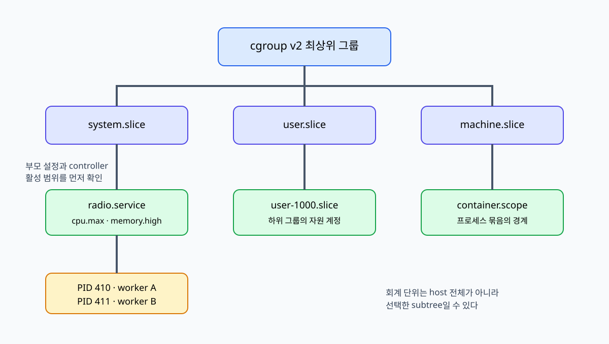

# 05. cgroup v2 hierarchy와 delegation

[이 책 목차](README.md)

[← 이전: memory와 PSI](04-memory-pages-reclaim-and-psi.md) · [다음: CPU quota·weight·cpuset →](06-cpu-quota-weight-and-cpuset.md)

한 서버에서는 시스템 서비스, 로그인 사용자, 컨테이너와 작업이 같은 CPU·메모리·저장 장치를 나눠 쓴다. 프로세스 이름만으로는 어느 작업이 자원을 사용했는지 일관되게 묶기 어렵고, 자식 프로세스가 생길 때마다 목록을 다시 관리해야 한다. Linux의 cgroup은 프로세스를 나무 모양으로 묶어 자원 사용을 계정하고, 부모가 받은 범위 안에서 자식에게 다시 분배하고 제한한다.

이 장에서는 디렉터리처럼 보이는 cgroup의 실제 대상, controller가 부모에서 자식으로 전달되는 조건, domain과 threaded 구조의 차이, systemd가 소유한 tree와 위임받은 subtree의 경계를 하나의 3단계 수치 trace로 연결한다.

## 1. cgroup은 무엇을 관리하는가

**task(태스크)**는 커널이 실행과 자원 사용을 추적하는 실행 주체다. 사용자 관점의 process와 thread가 커널 task로 표현된다. **process(프로세스)**는 자신에게 속한 주소 공간과 열린 파일 등의 운영체제 자원을 가진 실행 중인 프로그램이다. 한 프로세스 안에 여러 **thread(스레드)**라는 명령 실행 흐름이 있을 수 있으며, 이 스레드들이 같은 프로세스의 주소 공간과 자원을 공유한다.

**cgroup(control group, 제어 그룹)**은 task들을 계층적으로 조직하는 커널 객체다. 어느 집단이 CPU 시간을 사용했는지, 어느 집단에 메모리 page가 charge되었는지, 어느 집단이 I/O를 발생시켰는지 기록하고 정책을 적용하는 경계다.

**hierarchy(계층)**는 부모와 자식 관계로 이어진 나무 구조다. root cgroup이 맨 위에 있고 각 process는 정확히 한 cgroup에 속한다. 새 process는 생성 시 부모 process가 속한 cgroup에서 시작하며, 권한 있는 관리자가 다른 cgroup으로 이동할 수 있다.

**controller(컨트롤러)**는 특정 자원 종류의 계정과 분배 규칙을 구현하는 커널 부분이다. cpu controller는 CPU 사용 비율과 대역폭 정책을, memory controller는 memory charge와 보호·제한을, io controller는 장치 I/O 정책을 다룬다. cgroup core가 task를 tree에 조직하고 controller가 그 tree를 따라 자원 규칙을 집행한다.

cgroup v2는 controller들을 하나의 통합 hierarchy에 둔다. CPU용 tree와 memory용 tree에서 같은 process가 서로 다른 위치에 있는 v1식 혼동을 줄이고, 한 부모 아래에서 여러 자원을 함께 조직한다.

## 2. cgroup filesystem은 커널 객체의 창이다

cgroup v2 filesystem은 보통 /sys/fs/cgroup에 mount된다. mount는 커널 기능을 파일과 디렉터리 모양으로 볼 수 있게 연결하는 작업이다. 그 아래 디렉터리 하나가 cgroup 객체 하나에 대응한다.

**cgroup.procs**는 소속 process PID를 보여 주며, PID를 쓰면 그 process의 모든 thread를 이동한다. PID는 종료 뒤 재사용될 수 있으므로 대상 수명을 다시 확인한다.

**cgroup.threads**는 thread ID를 보여 주고 threaded subtree 안에서 thread 단위 이동에 사용한다. 일반 domain hierarchy에서 process 전체를 조직할 때 cgroup.procs와 혼동하지 않는다.

~~~mermaid
flowchart TD
    R[/sys/fs/cgroup root cgroup] --> SYS[system.slice 내부 분배 노드]
    R --> USER[user.slice]
    SYS --> A[app-a.service workload leaf]
    SYS --> B[app-b.service workload leaf]
    USER --> U[user-1000.slice]
    U --> S[session-4.scope]
~~~

그림의 slice는 여러 unit을 묶는 내부 분배 노드이고, service와 scope는 실제 process를 담는 workload cgroup이다. 파일 경로와 systemd unit 이름은 연결되지만 어느 관리자가 소유하는지도 함께 보아야 한다.

## 3. controllers와 subtree_control은 질문이 다르다

**cgroup.controllers**는 현재 cgroup이 자식에게 제공할 수 있는 controller 이름 목록이다. “사용 가능 후보”를 보여 준다. 이 목록에 memory가 있다는 사실만으로 자식에게 memory controller가 이미 배포된 것은 아니다.

**cgroup.subtree_control**은 그 후보 중 현재 cgroup의 바로 아래 자식들에게 실제로 활성화한 controller 목록이다. 부모가 +cpu를 쓰면 자식 cgroup에 cpu controller 인터페이스가 나타나고, 자식이 다시 자기 자식에게 전달하려면 자신의 subtree_control에서 cpu를 활성화해야 한다.

다음 상태를 보자.

~~~text
root/cgroup.controllers              cpu memory io pids
root/cgroup.subtree_control          cpu memory
system.slice/cgroup.controllers      cpu memory
system.slice/cgroup.subtree_control  cpu
app.service에서 기대                 cpu.* 인터페이스
~~~

root가 cpu와 memory를 활성화했기 때문에 system.slice는 두 controller를 사용할 수 있다. 그러나 system.slice가 자식에게 cpu만 활성화했으므로 app.service에는 cpu 인터페이스가 생기고, memory는 app.service 자식 분배용으로 전달되지 않는다. system.slice 자체가 조상 memory 정책의 영향을 받는 문제와, app.service에 memory controller 파일이 노출되는 문제를 구분해야 한다.

controller는 조상에서 끊김 없이 활성화되어야 아래 단계에 도달한다. leaf에서 갑자기 +memory를 요청해도 부모가 제공하지 않으면 사용할 수 없다. enable은 “자식에게 배포”하는 동작이며 현재 cgroup 자체의 자원을 직접 늘리는 동작이 아니다.

## 4. no internal process constraint가 필요한 이유

부모가 자원을 자식에게 나누면서 자기 process도 같은 층에서 소비하면 부모 자체 소비와 자식 몫의 관계가 모호해진다. v2의 일반 domain controller에서는 비-root cgroup이 domain 자원을 자식에게 배포하려면 그 cgroup 자체에 process가 없어야 한다. 이를 **no internal process constraint(내부 process 금지 제약)**라고 한다.

예를 들어 manager cgroup M에 PID 100이 들어 있고 M 아래에 A와 B를 만들었다고 하자. M의 cgroup.subtree_control에서 memory를 활성화하려 하면 실패할 수 있다. 올바른 domain 구조는 M을 분배 전용 내부 노드로 두고, manager process를 M/manager-leaf로 옮긴 다음 A와 B와 나란히 둔다.

~~~text
M                     ← process 없음, controller 배포
├─ manager-leaf       ← PID 100
├─ A                  ← workload A
└─ B                  ← workload B
~~~

root cgroup은 이 제약의 예외다. 또한 controller를 subtree_control에 활성화하지 않은 단순 부모는 process를 가지면서 child를 만들 수 있다. “자식 디렉터리가 있으면 부모 process는 언제나 금지”라는 규칙이 아니다.

threaded subtree는 별도 규칙을 가진다. threaded controller는 non-leaf에 thread가 있어도 경쟁을 정의할 수 있으므로 일반 no-internal-process 제약의 적용 방식이 다르다. 이 예외를 domain memory hierarchy에 섞어 쓰면 안 된다.

## 5. charge가 leaf와 조상에 누적되는 과정

**charge(사용량 귀속)**는 새로 사용한 자원을 특정 cgroup 계층의 사용량으로 기록하는 동작이다. memory page가 fault로 할당될 때 memory controller가 그 page를 어느 cgroup에 귀속할지 결정한다. CPU 시간과 I/O도 각 controller 규칙에 따라 실행 주체의 계층에 계정된다.

leaf job의 memory.current가 300 MiB라면 그 subtree 사용량은 부모와 조상 통계에도 포함된다. 부모는 모든 descendant 사용량을 제한해야 하기 때문이다. 한 page를 물리적으로 여러 번 만들었다는 뜻이 아니라 하나의 사용이 leaf에서 root 방향의 정책 경로에 걸린다는 뜻이다.

task를 새 cgroup으로 옮긴 뒤의 CPU 시간은 새 위치에 계정된다. 이미 charge된 모든 memory page가 task 이동과 함께 즉시 새 cgroup으로 옮겨진다고 가정하면 안 된다. 자원 수명과 controller별 migration 규칙이 process membership 수명과 다르기 때문이다.

process가 종료해 cgroup.procs에서 사라져도 그 process가 만든 socket, page cache나 다른 참조가 남을 수 있다. cgroup의 populated와 자원 current가 동시에 정확히 0이 된다고 가정하지 않는다.

## 6. 3단계 tree의 controller 활성화 전체 trace

다음 세 단계의 비-root tree를 보자. root 아래 team.slice, 그 아래 analytics.service, 그 아래 batch가 있다. analytics.service는 systemd가 외부 manager에 위임한 경계라고 가정한다.

~~~text
root
└─ team.slice
   └─ analytics.service        ← delegation 경계
      ├─ supervisor            ← manager PID
      └─ batch                 ← worker PID들
~~~

### 단계 1: root에서 team.slice로 제공

root의 cgroup.controllers에 cpu, memory, io, pids가 있다. root의 cgroup.subtree_control에 cpu와 memory를 활성화하면 team.slice가 두 controller 인터페이스를 받는다.

### 단계 2: team.slice에서 service로 제공

team.slice는 systemd가 관리하는 내부 노드이며 직접 process를 담지 않는다. systemd가 team.slice/cgroup.subtree_control에서 cpu와 memory를 활성화하면 analytics.service가 두 controller를 사용할 수 있다.

### 단계 3: 위임 경계 아래 배포

analytics.service에 manager PID가 직접 남은 상태에서 memory를 자식에게 활성화하면 no internal process constraint에 걸린다. manager를 supervisor child로 옮긴 뒤 analytics.service/cgroup.subtree_control에 cpu와 memory를 활성화한다. batch child에 cpu.*와 memory.* 인터페이스가 나타난다.

| 단계 | 현재 cgroup | process 직접 포함 | subtree_control | 결과 |
|---:|---|---|---|---|
| 1 | root | 예외 허용 | cpu memory | team.slice에 제공 |
| 2 | team.slice | 없음 | cpu memory | service에 제공 |
| 3a | analytics.service | manager 있음 | 활성화 시도 | domain memory는 실패 가능 |
| 3b | analytics.service | 없음 | cpu memory | supervisor·batch에 제공 |
| 4 | batch | worker 있음 | 비어 있음 | 소비 leaf |

+cpu라는 표기는 cgroup.subtree_control 파일에 추가를 요청하는 인터페이스 문법이다. systemd가 소유한 root나 slice에 사용자가 임의로 쓰라는 운영 명령이 아니다. systemd 환경에서는 manager의 unit 설정과 API를 사용해 소유권 충돌을 피한다.

## 7. 조상 limit과 effective boundary 수치 추적

계층형 controller에서는 descendant가 조상 제한을 넘어설 수 없다. 가까운 cgroup에 더 큰 숫자를 써도 조상 경계가 사라지지 않는다.

다음 memory.max를 가정한다.

| cgroup | 설정 memory.max |
|---|---:|
| team.slice | 2048 MiB |
| analytics.service | 1024 MiB |
| batch | 800 MiB |
| supervisor | 256 MiB |

batch의 설정만 보면 800 MiB까지 가능하지만, analytics.service의 supervisor와 batch 사용량 합은 1024 MiB를 넘을 수 없다. team.slice의 다른 service까지 합친 사용량은 2048 MiB 경계 안에 있어야 한다.

현재 supervisor 200 MiB, batch 700 MiB, analytics 합계 900 MiB라고 하자. batch가 200 MiB를 추가로 fault하면 다음 검사가 이어진다.

1. batch 자기 경계: 700 + 200 = 900 MiB로 batch max 800을 100 MiB 넘는다.
2. analytics 조상 경계: 전체 900 + 200 = 1100 MiB로 service max 1024도 76 MiB 넘는다.
3. memory controller는 batch와 조상 범위의 reclaim을 시도한다.
4. batch에서 clean file 120 MiB를 회수하면 batch는 780 MiB, analytics는 980 MiB가 되어 두 경계 안으로 들어온다.
5. 회수 후보가 없으면 charge가 stall하고 cgroup OOM으로 갈 수 있다.

이번에는 batch memory.max를 1500 MiB로 설정했다고 하자. 설정 조합 자체가 허용될 수 있지만 effective 사용은 analytics.service 1024 MiB와 team.slice 2048 MiB의 조상 경로에 계속 제한된다. 일반적으로 한 leaf가 실제 소비할 수 있는 상한은 자기와 모든 조상에서 동시에 남아 있는 여유 중 가장 좁은 경계가 결정한다. 단순히 설정 숫자의 최소값만 보는 것으로는 sibling의 현재 사용량을 반영하지 못한다.

**memory.low**는 best-effort 보호이고 **memory.min**은 더 강한 보호 경계다. 보호도 조상 아래에서 계층적으로 해석되며 자식 보호 합이 부모가 제공할 수 있는 양을 넘으면 비례해 나뉠 수 있다. leaf에 큰 min을 썼다고 조상이 제공하지 않은 메모리가 새로 생기지 않는다.

## 8. domain과 threaded cgroup을 분리해 이해하기

**domain cgroup**은 process의 일반 자원 domain을 만든다. memory처럼 process 주소 공간과 공유 자원에 귀속되는 controller는 domain 구조로 조직한다. 새 cgroup은 처음에 domain으로 만들어진다.

한 process 안의 thread를 서로 다른 cgroup에 놓아 CPU 같은 일부 자원을 더 세분화해야 할 때 **threaded subtree**를 사용할 수 있다. threaded를 지원하는 controller만 사용할 수 있으며 공식 문서의 현재 목록과 커널 지원을 확인해야 한다. memory controller를 thread 하나마다 독립 domain처럼 나누는 기능으로 보면 안 된다.

cgroup.type은 다음 상태를 나타낼 수 있다.

- domain: 일반 자원 domain
- domain threaded: threaded subtree의 root 역할을 하는 domain
- threaded: 위 thread domain을 공유하는 child
- domain (invalid): topology 조건을 만족하지 못한 상태

cgroup.type에 threaded를 쓰는 전환은 한 방향이다. threaded cgroup은 부모의 resource domain에 합류한다. cgroup.threads로 thread를 이동해도 같은 threaded domain 경계를 벗어날 수 없다.

예를 들어 process P의 worker thread만 별도 cpu.weight를 주고 싶을 수 있다. 먼저 process 전체를 service domain 안에 두고, 그 아래 올바른 threaded subtree를 구성하며 cpu controller 지원을 확인한다. memory.current를 각 thread leaf의 독립 메모리 소유량으로 해석하면 틀린다.

초보 운영에서는 service·container process 단위 domain hierarchy를 먼저 설계한다. “threaded가 더 세밀하니 항상 더 좋다”는 선택이 아니다.

## 9. task 이동의 주체와 수명

PID 4200 process를 old.service에서 app-a.service로 이동하는 커널 모형을 보자.

1. 요청자는 destination cgroup을 선택한다.
2. 커널은 source와 destination에 대한 이동 권한과 delegation 경계를 검사한다.
3. PID가 아직 존재하고 요청자가 이동할 수 있는 process인지 확인한다.
4. cgroup.procs에 PID를 쓰면 process의 모든 thread가 destination으로 이동한다.
5. 이후 실행된 CPU 시간과 새 자원 charge는 새 계층 정책의 영향을 받는다.
6. 이미 존재하는 descendant process는 자동으로 함께 이동하지 않는다.
7. 기존 memory charge와 장기 자원은 controller 규칙과 객체 수명을 따른다.

| 시각 | membership | CPU 계정 | memory 의미 | 주의 |
|---:|---|---|---|---|
| t0 | old.service | old에 증가 | 기존 charge 존재 | PID 확인 |
| t1 | 이동 검사 중 | old | 권한·경계 검사 | PID 재사용 가능 |
| t2 | app-a.service | 새 실행은 app-a | 과거 page 전부 즉시 이동 가정 금지 | 조상 정책 적용 |
| t3 | process exit | live 목록에서 사라짐 | 참조 남은 객체 가능 | populated 재확인 |

fork로 생긴 child process는 생성 순간 부모가 속한 cgroup에서 시작한다. 이미 존재하는 자손을 부모 process 이동이 재귀적으로 끌고 가지는 않는다. process tree와 cgroup tree는 다른 구조다.

## 10. systemd slice, service, scope의 정확한 역할

Ubuntu의 systemd는 boot부터 cgroup tree를 구성하고 unit 수명과 연결한다.

**slice unit**은 service와 scope를 계층적으로 묶는 내부 그룹이다. system.slice와 user.slice가 예다. slice는 자원 분배 tree의 중간 노드이며 systemd가 그 아래 unit을 만들고 관리한다.

**service unit**은 systemd가 명령을 시작하고 재시작·종료 등 process lifecycle을 직접 관리하는 workload다. app.service의 MainPID와 관련 process는 service cgroup에 배치된다.

**scope unit**은 login session, container처럼 다른 manager가 이미 만든 process를 systemd tree에 등록해 수명을 함께 추적할 때 사용한다. systemd가 ExecStart로 시작하지 않는다는 점이 service와 다르다.

CPUWeight=, MemoryMax= 같은 unit 속성은 systemd가 해당 cgroup controller 파일로 반영한다. systemd가 소유한 cgroup 파일을 사용자가 직접 바꾸면 manager가 아는 설정과 커널 상태가 달라지고 재시작·reload 때 덮일 수 있다. 관측을 위해 읽는 것과 소유권 없이 쓰는 것을 구분한다.

## 11. delegation은 subtree 관리 권한의 경계다

**delegation(위임)**은 cgroup subtree를 만들고 task를 배치하는 관리 책임을 다른 manager에게 넘기는 일이다. 단순히 디렉터리 chmod 하나로 모든 파일 쓰기를 허용하는 것과 다르다.

위임자와 위임받은 주체를 각각 **delegator**와 **delegatee**라고 한다. systemd는 service 또는 scope unit의 Delegate= 속성으로 그 unit 아래 subtree를 위임할 수 있다. 위임 경계 unit 자체의 속성은 systemd가 관리하고, delegatee는 그 아래 child cgroup을 만들고 관리한다.

systemd 문서가 강조하는 single-writer 원리는 한 subtree를 한 manager가 소유해야 한다는 것이다. slice는 systemd가 계속 여러 service와 scope를 만들 내부 노드이므로 Delegate=를 지원하지 않는다. delegation은 service와 scope에 설정하며, slice나 root 아래에 임의 child를 직접 만들지 않는다.

Delegate=yes가 controller를 사용 가능하게 준비해도 delegatee가 자신의 cgroup.subtree_control에서 필요한 controller를 실제 enable해야 할 수 있다. “위임됨”, “controllers 목록에 있음”, “subtree_control에서 활성화됨”은 서로 다른 상태다.

## 12. containment: 무엇을 할 수 없게 해야 하는가

위임받은 manager가 할 수 있어야 하는 일은 다음과 같다.

- 자기 경계 아래 child cgroup 생성·삭제
- 자기 process를 자기 subtree 안에서 이동
- 제공받은 controller를 아래로 배포
- 자기 child의 controller 정책 설정

할 수 없어야 하는 일은 다음과 같다.

- ancestor의 limit과 controller 설정 변경
- sibling tenant의 task나 정책 변경
- 자기 subtree 밖 process를 임의로 끌어오기
- process를 경계 밖으로 내보내기
- delegator가 소유한 위임 root의 부모 자원 분배 파일 변경

kernel delegation 규칙은 directory와 cgroup.procs, cgroup.threads, cgroup.subtree_control의 권한, 공통 조상에 대한 이동 권한을 함께 검사해 경계를 만든다. resource control 파일은 그 cgroup이 부모에게서 받은 자원을 나누는 설정이므로 위임 root의 소유권을 무차별로 넘기면 parent 정책을 건드릴 수 있다.

~~~mermaid
sequenceDiagram
    participant H as host systemd
    participant K as cgroup v2 kernel
    participant T as tenant manager
    H->>K: tenant-a service와 조상 limit 생성
    H->>T: service 아래 subtree 관리 위임
    T->>K: tenant-a/batch child 생성
    T->>K: 자기 task를 batch로 이동
    K-->>T: 경계 안이므로 허용
    T->>K: sibling tenant-b 변경 시도
    K-->>T: 권한과 경계로 거부
~~~

## 13. namespace와 rootless를 delegation으로 착각하지 않는다

**namespace(네임스페이스)**는 process가 PID, mount, cgroup path 같은 시스템 대상을 보는 관점을 분리한다. cgroup namespace 안에서는 위임 경계가 /처럼 짧게 보일 수 있다. 그러나 보이는 경로가 root라고 해서 host root cgroup의 권한이나 조상 limit이 사라지지 않는다.

**rootless**는 host의 root 권한 없이 일반 사용자 권한으로 container나 manager를 실행하는 구성이다. rootless process가 자기 cgroup namespace를 가졌다는 사실만으로 cgroup을 쓸 권한이 생기지 않는다. 다음 조건이 별개로 필요하다.

1. systemd user manager나 host manager가 적절한 service/scope subtree를 위임했는가?
2. 필요한 controller가 조상에서 계속 제공되는가?
3. 위임 경계 파일의 소유권과 쓰기 권한이 delegatee에게 있는가?
4. subtree_control에서 실제 활성화했는가?
5. host 조상 limit 안에서 요청한 정책이 의미가 있는가?

rootless container 안에서 /sys/fs/cgroup이 read-only로 보이거나 controller가 일부만 보이면, namespace가 실패한 것이 아니라 delegation 또는 조상 controller 제공 조건이 없는 것일 수 있다. 모든 문제를 privileged container로 바꾸어 해결하면 격리 경계를 없애므로 원인을 분리한다.

## 14. 관측을 같은 경로에서 해석하기

~~~bash
findmnt -t cgroup2
cat /sys/fs/cgroup/cgroup.controllers
cat /sys/fs/cgroup/cgroup.subtree_control
cat /sys/fs/cgroup/cgroup.type
cat /sys/fs/cgroup/cgroup.events
systemd-cgls
~~~

위 명령은 읽기 전용 관측 예다. mount path는 환경에 따라 다를 수 있다.

진단 순서는 다음과 같다.

1. cgroup v2 mount와 현재 process의 /proc/PID/cgroup 경로를 확인한다.
2. root에서 대상 leaf까지 각 단계의 cgroup.controllers를 읽는다.
3. 각 부모의 cgroup.subtree_control에서 controller가 끊긴 지점을 찾는다.
4. cgroup.type과 process 직접 포함 여부를 확인한다.
5. systemd unit과 Delegate= 경계를 확인한다.
6. leaf 설정뿐 아니라 모든 ancestor limit과 sibling 사용량을 본다.
7. 사건 전후 current, events, pressure의 delta를 기록한다.

cgroup.controllers에 io가 보이는 것은 자식에게 제공 가능한 후보라는 뜻이다. 현재 cgroup이 io.max를 이미 받고 있다는 뜻도, 자식에게 활성화했다는 뜻도 아니다. populated=0은 live process가 없다는 뜻이지만 child 존재와 다른 reference까지 모두 없다는 충분조건으로 사용하지 않는다.

## 15. 완전 풀이 문제

### 문제 1. controllers와 subtree_control

team/cgroup.controllers에 cpu memory가 있고 team/cgroup.subtree_control에는 cpu만 있다. team/job에서 무엇을 기대하는가?

**풀이:** team은 cpu와 memory를 자식에게 제공할 후보로 받았지만 실제 자식에게 cpu만 활성화했다. job에는 cpu controller 인터페이스가 나타나고 memory는 자식 배포가 끊긴다. team 자체가 조상 memory 정책의 영향을 받는 것과는 별개다.

### 문제 2. 내부 process 제약

M cgroup에 manager PID가 있고 M/A와 M/B가 있다. M에서 memory controller를 자식에게 활성화하려면 어떻게 하는가?

**풀이:** 일반 domain hierarchy라면 M을 분배 전용으로 만들어야 한다. M/manager-leaf를 만들고 manager PID를 그 leaf로 이동한 뒤 M/cgroup.subtree_control에서 memory를 활성화한다. root 예외와 threaded controller 규칙을 이 domain memory 사례에 적용하지 않는다.

### 문제 3. 조상 limit

parent memory.max 1 GiB, child memory.max 2 GiB다. child가 1.5 GiB를 사용할 수 있는가?

**풀이:** child 설정 숫자가 더 커도 parent의 subtree 전체 hard limit 1 GiB를 넘을 수 없다. sibling 사용량이 있다면 child가 실제로 쓸 수 있는 여유는 더 작다. 가까운 leaf 설정만 읽어 effective boundary를 판단하면 안 된다.

### 문제 4. 수치 charge trace

service max 1024 MiB에서 supervisor 200 MiB, batch 700 MiB다. batch가 200 MiB를 추가하고 120 MiB를 회수했다. 최종 값과 경계를 판단하라.

**풀이:** batch는 700 + 200 - 120 = 780 MiB다. service 합은 200 + 780 = 980 MiB다. batch max가 800 MiB라면 두 경계 모두 안이다. reclaim 전에는 batch 900과 service 1100으로 양쪽을 넘었으므로 charge가 바로 완료된다고 가정하면 안 된다.

### 문제 5. process 이동과 memory

PID를 old에서 new cgroup으로 옮기면 old memory.current가 즉시 0이 되는가?

**풀이:** 아니다. membership과 기존 resource charge의 수명이 다르다. 이후 실행과 새 charge는 new 정책을 받지만 기존 page와 다른 객체의 charge 이동은 controller 규칙을 확인해야 한다. process exit 뒤에도 참조된 자원이 남을 수 있다.

### 문제 6. domain과 threaded

한 process의 thread별 CPU 비율을 나누고 싶다. memory도 같은 threaded leaf별로 완전히 분리된다고 보아도 되는가?

**풀이:** 아니다. threaded mode는 지원하는 controller에 한해 thread를 subtree에 나누며 전체 subtree는 공통 resource domain을 가진다. memory는 일반 process domain 구조로 이해해야 한다. cgroup.type과 현재 kernel controller 지원을 확인한다.

### 문제 7. systemd delegation

tenant.slice에 Delegate=yes를 두고 그 아래를 직접 관리하면 되는가?

**풀이:** systemd delegation은 service와 scope unit에서 제공되며 slice에는 지원되지 않는다. slice는 systemd가 계속 child unit을 관리하는 내부 노드라 두 writer가 충돌한다. tenant manager용 service 또는 scope에 delegation을 요청하고 그 경계 아래만 관리한다.

### 문제 8. rootless와 namespace

rootless container 안에서 cgroup 경로가 /로 보인다. host memory.max를 바꿀 수 있는가?

**풀이:** 없다. cgroup namespace는 path view를 바꿀 뿐 권한과 조상 정책을 없애지 않는다. host manager가 위임한 subtree, 파일 ownership, 제공된 controller, subtree_control 활성화가 필요하고 ancestor memory.max는 계속 적용된다.

## 공식 자료

- [Linux cgroup v2](https://docs.kernel.org/admin-guide/cgroup-v2.html)
- [systemd resource control](https://www.freedesktop.org/software/systemd/man/latest/systemd.resource-control.html)
- [systemd delegation](https://systemd.io/CGROUP_DELEGATION/)
- [systemd slice units](https://www.freedesktop.org/software/systemd/man/latest/systemd.slice.html)
- [systemd scope units](https://www.freedesktop.org/software/systemd/man/latest/systemd.scope.html)

[← 이전: memory와 PSI](04-memory-pages-reclaim-and-psi.md) · [다음: CPU quota·weight·cpuset →](06-cpu-quota-weight-and-cpuset.md)
