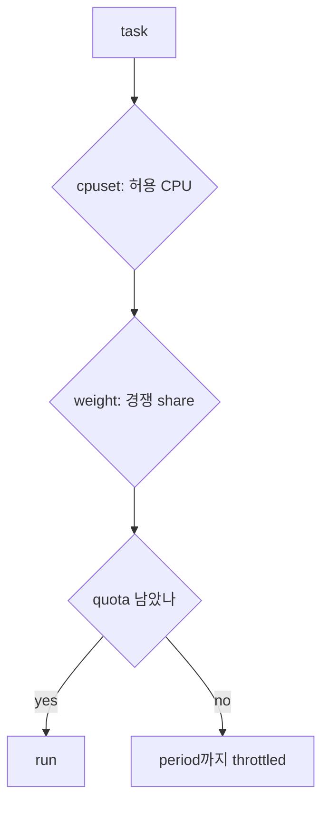

# 06. CPU quota·weight·cpuset

[이 책 목차](README.md)

[← 이전: cgroup v2 hierarchy](05-cgroup-v2-hierarchy-and-delegation.md) · [다음: memory·PIDs·OOM →](07-memory-pids-and-oom.md)

## 세 제어는 다른 질문이다

| 제어 | 질문 | 대표 file |
|---|---|---|
| quota | 한 period에 최대 얼마나 실행할까 | `cpu.max` |
| weight | 경쟁할 때 상대 share는 | `cpu.weight` |
| cpuset | 어느 CPU/node에서 실행·할당할까 | `cpuset.cpus`, `cpuset.mems` |

quota는 core pinning이 아니다.
weight는 절대 보장이 아니다.
cpuset은 실행 시간 cap이 아니다.



## cpu.max

`cpu.max` 형식은 `MAX PERIOD`다.
단위는 microsecond다.
`max 100000`이면 bandwidth cap을 두지 않는 뜻이다.

```text
cpu.max = 50000 100000
```

100ms period마다 최대 50ms CPU time이다.
장기 throughput cap 모형은 0.5 CPU다.

CPU 두 개에서 thread 두 개가 동시에 실행하면 25ms 만에 합계 50ms를 쓸 수 있다.
그 뒤 period 끝까지 throttled될 수 있다.
따라서 0.5 CPU가 특정 core 절반에 고정된다는 뜻이 아니다.

## 시간표

period 100ms, quota 50ms, 두 CPU 허용이라고 하자.

| wall time | CPU0 | CPU1 | 누적 cgroup CPU time |
|---:|---|---|---:|
| 0~10ms | A | B | 20ms |
| 10~20ms | A | B | 40ms |
| 20~25ms | A | B | 50ms |
| 25~100ms | throttled | throttled | 50ms |

burst latency가 커질 수 있다.
평균 사용률만 50%라고 보고 throttling 구간을 놓치면 안 된다.

## cpu.weight

v2 `cpu.weight`는 일반적으로 1~10000 범위의 상대 weight다.
A=100, B=300이고 같은 CPU에서 둘 다 runnable이면 이상 장기 share는 약 1:3이다.

```text
A ≈ 25%
B ≈ 75%
```

B가 idle이면 A는 CPU 전체를 쓸 수 있다.
quota가 A에 따로 있으면 quota가 먼저 cap을 만들 수 있다.
weight는 contention에서만 의미가 드러난다.

## quota와 weight 결합

A weight 100, quota 0.5CPU.
B weight 300, quota 없음.
CPU 하나에서 둘 다 runnable이라고 하자.
weight만 보면 A 25%, B 75%다.
A share가 quota 50%보다 작으므로 quota는 이 steady 상태에서 binding하지 않는다.

B가 sleep하면 A는 weight 경쟁 없이 CPU를 쓰려 하지만 50% quota에서 throttled된다.
어느 control이 실제 병목인지 workload 상태에 따라 달라진다.

## cpuset

`cpuset.cpus`는 허용 CPU 집합이다.
`cpuset.mems`는 허용 memory node 집합이다.
child의 유효 집합은 ancestor 제한과 online 상태의 영향을 받는다.
`cpuset.cpus.effective`와 `cpuset.mems.effective`가 실제 유효 범위를 보여 준다.

```text
parent effective CPUs: 0-3
child requested CPUs: 2-5
child effective CPUs: 2-3
```

요청 문자열만 보고 CPU4-5를 쓸 수 있다고 단정하지 않는다.

## NUMA 선수조건

cpuset CPU만 정하고 memory node를 무시하면 remote memory가 생길 수 있다.
`cpuset.mems`를 바꾸면 memory migration과 allocation policy 효과를 문서에서 확인해야 한다.
이미 할당된 page가 즉시 모두 이동한다고 단정하지 않는다.

CPU pinning 전에 topology, SMT sibling, interrupt, device NUMA node를 본다.
고립 CPU를 만들었다고 모든 kernel work가 사라지는 것은 아니다.

## systemd 표현

systemd unit은 `CPUWeight=`, `CPUQuota=`, `AllowedCPUs=`, `AllowedMemoryNodes=` 같은 고수준 설정을 제공한다.
systemd가 소유한 hierarchy는 unit 설정으로 관리하는 편이 일관된다.
직접 cgroup file write는 이 교재 범위 밖이다.

## read-only 관측

실행하지 않은 예:

```bash
cat /sys/fs/cgroup/cpu.max
cat /sys/fs/cgroup/cpu.weight
cat /sys/fs/cgroup/cpu.stat
cat /sys/fs/cgroup/cpuset.cpus.effective
cat /sys/fs/cgroup/cpuset.mems.effective
```

`cpu.stat`의 usage, throttled 관련 값은 누적 counter다.
두 시점 차이를 시간 간격과 함께 읽어야 rate가 된다.

## pressure 연결

quota throttling은 runnable task를 기다리게 해 CPU pressure에 영향을 줄 수 있다.
cpuset이 너무 좁아도 다른 CPU가 idle인데 task가 기다릴 수 있다.
높은 CPU PSI만으로 quota, affinity, 전체 saturation 중 하나를 확정할 수 없다.
`cpu.stat`, affinity, run queue와 같이 본다.

## 반례

0.5CPU quota가 latency를 항상 절반으로 늘리는 것은 아니다.
짧은 request가 quota가 남은 burst 초기에 끝날 수 있다.
weight 100이 CPU 100% cap이라는 뜻이 아니다.
cpuset 0-1이 두 core 보장이라는 뜻이 아니다. sibling thread일 수 있다.

## 문제

## period 경계에서 throttling이 보이는 방식

quota는 period마다 사용할 CPU time budget을 채운다.
두 thread가 두 CPU에서 동시에 돌면 wall time보다 budget이 두 배 빠르게 줄 수 있다.
budget이 0이 되면 runnable이어도 다음 replenishment까지 throttled된다.
weight는 budget이 남고 CPU를 놓고 경쟁하는 task 사이 share에 영향을 준다.
cpuset은 애초에 어느 CPU에서 경쟁할 수 있는지 제한한다.
NUMA node 제한은 새 memory를 어느 node에서 할당할 수 있는지 정한다.
따라서 느림을 볼 때 quota 고갈, 낮은 weight 경쟁, 좁은 cpuset, remote NUMA를 서로 다른 원인으로 검사한다.

1. `50000 100000`은 몇 CPU의 장기 cap 모형인가?
2. weight 100과 300이 둘 다 runnable일 때 share는?
3. `cpuset.cpus`와 `cpuset.mems`를 함께 보는 이유는?

## 해설

1. `50000/100000=0.5CPU`다.
2. 이상 경쟁 모형에서 25%와 75%다.
3. 실행 CPU와 memory node 위치가 NUMA 접근 거리와 allocation 가능 범위를 함께 정하기 때문이다.

## 공식 자료

- [Linux cgroup v2 CPU controller](https://docs.kernel.org/admin-guide/cgroup-v2.html)
- [Linux cpuset](https://docs.kernel.org/admin-guide/cgroup-v1/cpusets.html)
- [systemd resource control](https://www.freedesktop.org/software/systemd/man/latest/systemd.resource-control.html)

[← 이전: cgroup v2 hierarchy](05-cgroup-v2-hierarchy-and-delegation.md) · [다음: memory·PIDs·OOM →](07-memory-pids-and-oom.md)
