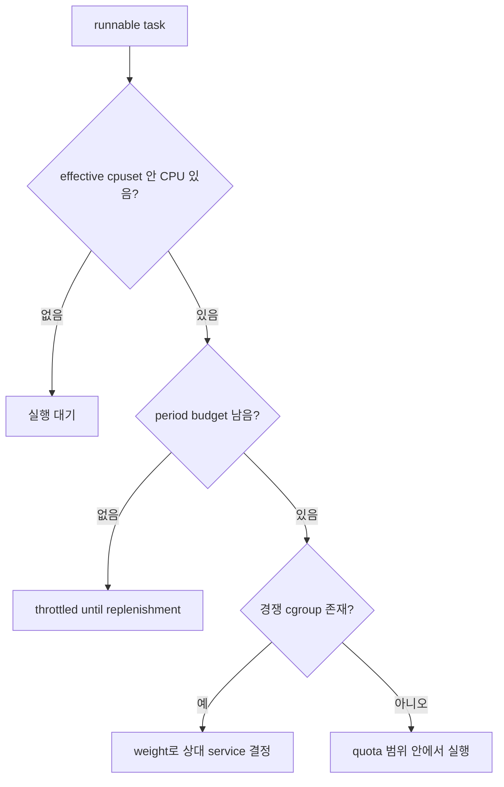

# 06. CPU quota·weight·cpuset

[이 책 목차](README.md)

[← 이전: cgroup v2 hierarchy](05-cgroup-v2-hierarchy-and-delegation.md) · [다음: memory·PIDs·OOM →](07-memory-pids-and-oom.md)

이 장의 핵심은 세 knob가 서로 다른 질문에 답한다는 사실이다. **quota**는 일정 period에 실행할 수 있는 CPU 시간의 상한, **weight**는 경쟁할 때의 상대 몫, **cpuset**은 실행 가능한 CPU와 memory node의 집합이다. 셋을 “CPU 제한” 한 문장으로 합치면 latency 원인을 틀리게 찾는다.

## 0. 한 코어와 CPU time부터 정의한다

logical CPU 하나는 한 순간에 task 하나를 실행한다. 한 task가 logical CPU 하나에서 10ms 실행되면 CPU time 10ms를 사용한다. task 네 개가 CPU 네 개에서 같은 10ms wall-clock 동안 동시에 실행되면 cgroup은 합계 CPU time 40ms를 쓴다.

```text
wall-clock 0..10ms
CPU0: task A 10ms
CPU1: task B 10ms
CPU2: task C 10ms
CPU3: task D 10ms
elapsed=10ms, aggregate CPU time=40ms
```

이 차이가 quota 해석의 출발점이다. cpu.max가 100000 100000이면 100ms period마다 합계 100ms CPU time이므로 장기적으로 약 1 CPU capacity다. CPU 4개에서 25ms씩 병렬로 쓰면 quota를 25ms wall-clock 만에 소진할 수 있다.

## 1. quota period의 완전한 상태표

cpu.max는 MAX PERIOD 형식이며 단위는 microsecond다. 50000 100000이면 각 100ms period에 합계 50ms CPU time, 즉 장기 cap 약 0.5 CPU다.

| wall-clock | 실행 상황 | 남은 quota | cgroup 상태 |
|---:|---|---:|---|
| 0ms | worker 두 개가 CPU 두 개에서 실행 시작 | 50ms | runnable/running |
| 10ms | 각 10ms, 합계 20ms 사용 | 30ms | 계속 실행 |
| 20ms | 합계 40ms 사용 | 10ms | 계속 실행 |
| 25ms | 합계 50ms 사용 | 0ms | period 끝까지 throttle 가능 |
| 100ms | 새 period 시작 | 50ms | runnable task가 다시 경쟁 |

quota가 “50ms 연속 실행 뒤 멈춤”을 뜻하지 않는다. 여러 CPU에서 병렬로 더 빨리 소진될 수 있고 runnable task가 없으면 quota가 남는다. exact burst와 carry 규칙은 kernel 설정과 controller 동작을 확인한다.

**throttling**은 task가 실행 가능해도 cgroup CPU bandwidth가 없어 period 갱신까지 실행을 제한하는 상태다. host utilization이 낮아도 생길 수 있다. cpu.stat의 periods, throttled 횟수와 시간을 구간 차이로 보고 application p99와 맞춘다.

## 2. weight는 절대 CPU 예약이 아니다

cpu.weight는 같은 부모 아래 sibling cgroup들이 동시에 CPU를 요구할 때의 상대 share다. A=100, B=300이고 둘 다 계속 runnable이며 다른 제약이 없다는 이상 모형에서는 A:B가 1:3, 즉 25%:75%에 가까워진다.

B가 sleeping이면 A는 idle CPU를 더 쓸 수 있다. weight 100이 “언제나 CPU 25%만 쓴다”는 뜻이 아니다. 부모 cgroup의 몫, group 내부 task, affinity, quota, 다른 scheduling class가 결과에 영향을 준다.

```text
parent P
├─ service A weight 100
└─ team B weight 300
   ├─ service B1 weight 100
   └─ service B2 weight 100
```

모두 CPU-bound라는 단순 조건에서 먼저 P 안에서 A와 team B가 1:3으로 나뉘고, B 몫 안에서 B1/B2가 다시 나뉜다. leaf weight 숫자를 hierarchy 전체에서 직접 비교하면 안 된다.

## 3. quota와 weight가 동시에 있을 때

A와 B가 weight 100:300인데 A quota가 20ms/100ms, B는 unlimited라고 하자. period 초반 경쟁에서는 weight가 share에 영향을 주지만 A가 20ms를 쓰면 throttle된다. 남은 CPU는 B가 쓸 수 있다.

workload가 가벼워 A가 period에 5ms만 필요하면 quota에 닿지 않는다. 이때 p99 spike를 quota 탓으로 결론 내리면 틀리다. counter가 실제로 늘었는지 확인한다.

quota는 평균 capacity를 제한하지만 짧은 요청 deadline을 보장하지 않는다. period와 burst 때문에 tail latency가 주기적으로 튈 수 있다. period를 짧게 하면 refill 빈도와 overhead가 달라지고 너무 길면 긴 throttle 구간이 생길 수 있어 측정한다.

## 4. cpuset은 장소를 정한다

cpuset.cpus는 task가 실행할 CPU 집합, cpuset.mems는 memory allocation에 사용할 NUMA node 집합이다. effective 파일은 parent 제한과 online CPU/node를 반영해 실제 허용 집합을 보여 준다.

cpuset {2,3}에 CPU-bound task 8개가 있으면 CPU 0,1이 idle이어도 쓸 수 없다. 좁은 set은 cache locality와 isolation을 주지만 capacity와 load balancing 범위를 줄인다.

NUMA node 0 CPU만 허용하면서 memory node 1만 허용하면 remote memory 접근이 생길 수 있다. CPU set과 mem set, device NUMA locality를 함께 설계한다. 기존 page가 즉시 새 node로 자동 이동한다고 가정하지 않는다.

## 5. systemd와 Kubernetes 이름을 kernel 파일로 번역한다

systemd의 CPUQuota, CPUWeight, AllowedCPUs 같은 선언은 cgroup v2 파일로 변환될 수 있지만 version과 hierarchy mode를 확인한다. Kubernetes CPU request는 scheduling과 runtime weight/shares에, CPU limit은 quota에 연결될 수 있다. static CPU manager의 exclusive CPU 배치와 quota는 별도 축이다.

container 안에서 보이는 CPU 수, cpuset effective mask, quota capacity가 서로 다를 수 있다. thread pool이 host CPU 전체 수로 만들어지고 실제 cpuset은 두 개면 runnable queue와 context switch가 증가할 수 있다.

## 6. pressure로 결과를 검증한다

- 원인: 8 worker, cpuset 2 CPU, quota 1 CPU, weight는 높음.
- 기작: 두 CPU에서 병렬 실행해 quota를 빠르게 소진하고 나머지 period에 throttle.
- 결과: utilization은 평균 1 CPU지만 runnable wait와 p99가 주기적으로 증가.
- 관측: cpu.max, cpu.weight, cpuset.cpus.effective, cpu.stat, cpu.pressure를 같은 구간에서 읽는다.
- 응용: limit만 없애기 전에 concurrency와 SLA, node capacity를 함께 조정한다.

## 7. 설정을 바꿀 때의 순서와 수명

cgroup 설정 file에 값을 썼다고 모든 기존 상태가 순간적으로 새 배치가 되는 것은 아니다. cpuset 변경은 task가 다음에 어느 CPU에서 실행될 수 있는지 바꾸지만 이미 cache에 있는 working set을 옮기지 않는다. memory node mask 변경도 기존 page를 모두 즉시 migration한다는 뜻이 아니다.

quota를 낮출 때는 이미 진행 중인 period의 accounting과 application concurrency가 만나 짧은 stall이 보일 수 있다. weight 변경은 경쟁자가 있을 때 점진적으로 share에 반영된다. 설정의 **lifetime**은 cgroup directory와 그 안 task가 존재하는 동안 이어지며, process를 다른 cgroup으로 옮기면 이후 accounting과 controller 규칙의 적용 위치가 달라진다.

운영 변경은 다음처럼 검증한다.

1. 변경 전 effective cpuset, cpu.max, cpu.weight와 counter snapshot을 기록한다.
2. 한 변수만 바꾸고 workload 입력을 고정한다.
3. 여러 period에 걸쳐 cpu.stat, pressure와 p50/p99를 본다.
4. NUMA와 IRQ 배치가 함께 바뀌지 않았는지 확인한다.
5. 결과가 나쁘면 기록한 이전 값으로 되돌린다.

## 8. delegation이라는 단어

**delegation(위임)**은 cgroup subtree의 일부를 service manager나 container runtime이 안전하게 관리하도록 권한과 controller 범위를 넘기는 것이다. 단순히 directory write permission만 주는 일이 아니다. 부모는 어느 controller를 child가 쓸 수 있게 할지 subtree_control로 정하고, 관리 주체는 hierarchy와 ownership 규칙을 지켜야 한다.

application이 systemd가 관리하는 cgroup file을 직접 바꾸면 manager가 나중에 덮어쓰거나 hierarchy 정책을 깨뜨릴 수 있다. Ubuntu 운영에서는 systemd unit property, container runtime/Kubernetes 선언과 실제 kernel file을 연결해 어느 계층이 소유하는 설정인지 확인한다.

## 9. 추가 해설 문제

1. 200000 100000은 장기적으로 몇 CPU capacity인가?
   - 합계 CPU time 기준 약 2 CPU다.
2. weight 100/300인데 B가 sleeping이다. A는 25%에 묶이는가?
   - 아니다. weight는 경쟁 시 상대 몫이다.
3. quota가 남았는데 task가 실행되지 않는다. 가능한 원인은?
   - blocked I/O/lock, affinity 밖 CPU만 idle, 더 높은 우선순위 경쟁 등이다.
4. cpuset.cpus에 0-3을 썼는데 effective는 2-3이다. 무엇을 기준으로 보는가?
   - parent와 online 상태를 반영한 effective 집합이다.
5. CPU limit을 높였는데 remote-memory latency가 남는다. 다음 확인은?
   - cpuset.mems, NUMA placement와 device/IRQ locality를 본다.

CPU controller의 quota, weight와 cpuset은 모두 CPU와 관련 있지만 서로 다른 질문에 답한다. quota는 일정 period의 실행 시간 상한, weight는 경쟁할 때 상대 share, cpuset은 실행 가능한 CPU와 memory node 집합이다. “0.5 CPU”를 어느 core 절반에 고정하는 설정으로 이해하면 실제 burst와 throttling을 놓친다.

## 1. 세 제어의 객체와 단위

| 제어 | 대표 파일 | 입력 단위 | kernel이 판단하는 것 |
| --- | --- | --- | --- |
| quota | `cpu.max` | microsecond quota와 period | cgroup 누적 CPU time budget |
| weight | `cpu.weight` | 1~10000 상대값 | 같은 CPU를 놓고 경쟁할 share |
| cpuset | `cpuset.cpus`, `cpuset.mems` | CPU·NUMA node 목록 | task 실행·memory 할당 가능 위치 |

`cpu.max = 50000 100000`은 100,000µs, 즉 100ms period마다 이 cgroup의 모든 CPU에서 합친 실행 시간을 최대 50ms 허용한다. 장기 throughput 모형은 0.5 CPU다. `max 100000`은 quota cap을 두지 않는다는 뜻이다.

## 2. 두 thread가 budget을 쓰는 실제 시간표

CPU0과 CPU1이 허용되고 A와 B 두 task가 동시에 runnable이라고 하자.

| wall time | CPU0 | CPU1 | 구간에 쓴 CPU time | period 누적 | 상태 |
| ---: | --- | --- | ---: | ---: | --- |
| 0~10ms | A | B | 20ms | 20ms | 실행 |
| 10~20ms | A | B | 20ms | 40ms | 실행 |
| 20~25ms | A | B | 10ms | 50ms | quota 소진 |
| 25~100ms | 다른 cgroup/idle | 다른 cgroup/idle | 0 | 50ms | A·B throttled |
| 100ms | A | B | 새 budget | 0부터 | replenishment |

두 CPU에서 병렬 실행해 25ms wall time 만에 50ms CPU time을 썼다. 이후 75ms 동안 task가 runnable이어도 quota 때문에 실행하지 못할 수 있다. 평균만 보면 한 CPU의 50%지만 request가 period 초반인지 후반인지에 따라 latency가 크게 다르다.



## 3. weight는 경쟁할 때만 드러난다

A weight 100, B weight 300이 같은 CPU에서 계속 runnable이면 이상적 장기 share는 25%와 75%다. B가 I/O를 기다리면 A가 CPU 전체를 쓸 수 있다. 따라서 weight 100은 “100%”나 절대 cap이 아니다.

A에 0.5 CPU quota도 있다고 하자. B와 경쟁할 때 A의 weight share 25%가 quota 50%보다 작아 quota는 병목이 아닐 수 있다. B가 sleep하면 A는 더 쓰려 하지만 50% quota에서 throttled된다. 같은 설정도 workload runnable 상태에 따라 실제 지배 제어가 바뀐다.

## 4. cpuset과 effective 값

`cpuset.cpus`는 요청한 CPU 집합이고 `cpuset.cpus.effective`는 조상 제한과 online 상태를 적용한 실제 가능 집합이다. 부모 effective가 `0-3`, child 요청이 `2-5`라면 child effective는 `2-3`일 수 있다. 설정 문자열만 보고 CPU4·5를 쓴다고 결론 내리지 않는다.

`cpuset.mems`는 memory를 할당할 NUMA node 집합이다. CPU만 가까운 core로 고정하고 memory가 먼 node에 남으면 remote access 비용이 생긴다. 이미 할당한 page가 설정 변경과 동시에 모두 이동한다고 가정하지 않는다. CPU topology의 SMT sibling, device NUMA node, interrupt affinity도 측정 조건에 포함한다.

두 번째 예로 latency service를 CPU2에만 고정했는데 CPU2가 NIC interrupt도 많이 처리한다고 하자. CPU0·1·3이 idle이어도 service는 CPU2에서 경쟁한다. cpuset은 전용 core 보장이 아니라 허용 집합이며 다른 kernel work와 sibling 관계를 별도로 확인한다.

## 5. systemd와 관측

systemd는 `CPUQuota=`, `CPUWeight=`, `AllowedCPUs=`, `AllowedMemoryNodes=` 같은 unit 속성을 cgroup 정책으로 연결한다. manager가 소유한 hierarchy는 unit 설정으로 관리해야 raw file 변경과 충돌을 피할 수 있다.

```bash
cat /sys/fs/cgroup/cpu.max
cat /sys/fs/cgroup/cpu.weight
cat /sys/fs/cgroup/cpu.stat
cat /sys/fs/cgroup/cpuset.cpus.effective
cat /sys/fs/cgroup/cpuset.mems.effective
cat /sys/fs/cgroup/cpu.pressure
```

위 명령은 실행하지 않은 읽기 예다. `cpu.stat`의 usage·throttled 값은 누적 counter이므로 두 시점 차이와 wall interval을 함께 쓴다. throttled 횟수만으로 지연 시간을 알 수 없고 throttled_usec와 application latency를 연결한다.

| 10초 delta | 값 | 해석 |
| --- | ---: | --- |
| usage_usec | 5,000,000 | 평균 0.5 CPU time 사용 |
| throttled_usec | 2,000,000 | quota로 runnable 진행이 제한된 누적 시간 지표 |
| PSI some total | +1,200,000 | 범위 내 일부 task CPU stall wall time 1.2초 |

counter 정의와 중첩 task 의미를 공식 문서에 맞춰 읽으며 세 값을 단순 합하지 않는다.

## 6. 실패 조건과 연구 연결

quota를 올렸는데 latency가 그대로면 cpuset 포화, 낮은 weight, lock·I/O 대기를 본다. weight를 올려도 CPU가 남는 단독 실행에는 차이가 없을 수 있다. cpuset을 넓혀도 NUMA remote memory나 quota가 병목이면 개선되지 않는다.

[USENIX Security 2026 MicroVM resource accounting 연구](https://www.usenix.org/conference/usenixsecurity26/presentation/wang-shiwen)는 특정 guest/host 구성에서 관측과 귀속의 차이를 다룬다. 이 결과를 모든 VM이나 일반 cgroup 수치에 그대로 적용하지 않는다. 실험에서는 guest vCPU time, host hypervisor thread와 I/O emulation thread가 어느 host cgroup에 있는지, steal 성격 시간을 함께 기록한다.

## 7. 문제와 해설

### 문제 1
`50000 100000`은 장기적으로 몇 CPU인가?

**해설:** 합산 CPU time `50000/100000=0.5` CPU다. 특정 core 절반에 고정한다는 뜻은 아니다.

### 문제 2
두 thread가 CPU 두 개에서 실행하면 quota 50ms를 몇 ms wall time에 쓸 수 있는가?

**해설:** 둘이 계속 병렬이면 약 25ms에 합계 50ms를 쓸 수 있다.

### 문제 3
weight 100과 300인데 B가 sleep한다. A는 25%만 쓰는가?

**해설:** 아니다. weight는 경쟁 share다. 별도 quota가 없다면 A가 idle CPU 전체를 쓸 수 있다.

### 문제 4
child `cpuset.cpus=2-5`, effective가 `2-3`인 이유는?

**해설:** 조상 cpuset과 online CPU 조건의 교집합이 실제 유효 집합을 제한하기 때문이다.

### 문제 5
CPU PSI가 높을 때 quota가 원인이라고 확정할 수 있는가?

**해설:** 없다. 전체 saturation, 좁은 affinity·cpuset도 가능하다. `cpu.stat`, effective cpuset, run queue를 함께 본다.

## 공식 자료

- [Linux cgroup v2 CPU controller](https://docs.kernel.org/admin-guide/cgroup-v2.html)
- [Linux cpuset](https://docs.kernel.org/admin-guide/cgroup-v1/cpusets.html)
- [systemd resource control](https://www.freedesktop.org/software/systemd/man/latest/systemd.resource-control.html)

[← 이전: cgroup v2 hierarchy](05-cgroup-v2-hierarchy-and-delegation.md) · [다음: memory·PIDs·OOM →](07-memory-pids-and-oom.md)
