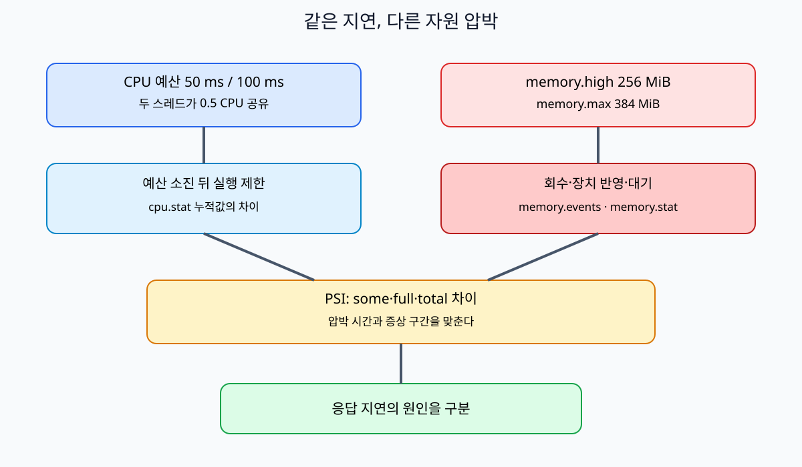
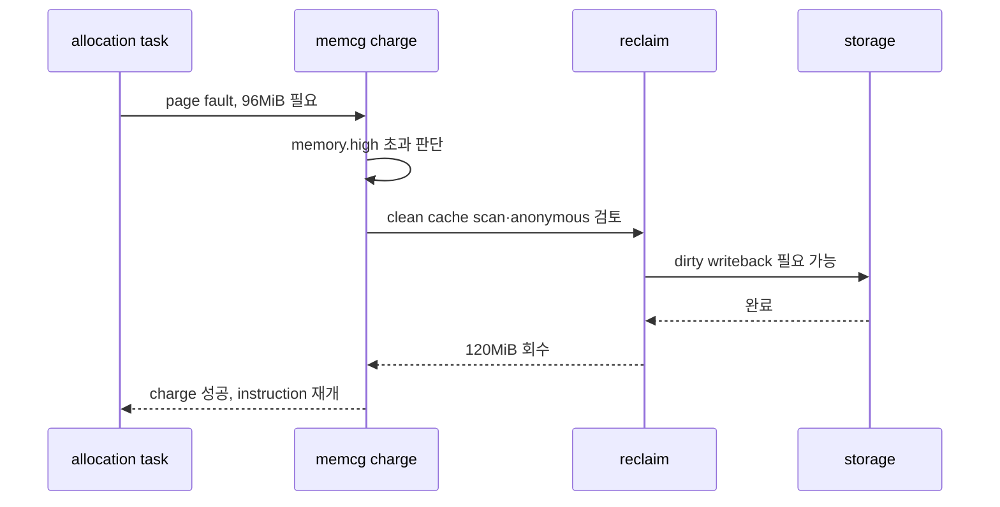

# 07. cgroup v2 memory, PID와 OOM

[이 책 목차](README.md) · [이전: CPU quota, weight와 cpuset](06-cpu-quota-weight-and-cpuset.md) · [다음: I/O 제어, page cache와 durability](08-io-control-page-cache-and-durability.md)

이 장에서 먼저 다룰 실제 대상은 “프로그램이 쓰는 byte”와 “실행 흐름의 개수”다. Linux kernel은 process들을 **control group**, 줄여서 cgroup이라는 계층형 묶음에 넣고, 어느 묶음이 메모리를 얼마나 쓰며 실행 흐름을 몇 개 만드는지 센다. 이 묶음은 디스크의 폴더처럼 보이는 cgroup filesystem의 directory로 표현되지만 일반 파일 보관용 directory가 아니다. kernel controller의 상태와 설정을 읽고 쓰는 interface다.

## 0. memory가 cgroup에 기록되는 순간부터 정의한다

프로그램이 heap byte를 쓴다고 바로 물리 RAM 사용량 한 숫자만 늘어나는 것은 아니다. 가상 주소에 처음 쓰면 kernel이 물리 page를 준비한다. 그 page가 어느 cgroup 사용량에 속하는지 회계에 기록하는 일을 **charge(차지, 비용 귀속)**라고 부른다. 여기서 charge는 돈을 청구한다는 뜻이 아니라 page나 kernel object의 사용량을 특정 cgroup counter에 더하는 동작이다. page가 공유되거나 다른 context에서 writeback되는 경우 귀속 규칙이 단순히 “지금 CPU에서 실행 중인 process”와 같지 않을 수 있다.

**anonymous memory**는 heap·stack처럼 원본 file에서 다시 읽어 복원할 수 없는 process memory다. **file memory**는 file 내용을 RAM에 보관한 page다. 이 file page들의 집합을 **page cache**라고 부른다. 같은 file을 다시 읽을 때 storage 접근을 줄이기 위해 kernel이 RAM에 둔다. page cache도 실제 RAM을 쓰므로 cgroup memory 사용에 포함될 수 있다.

RAM이 부족하거나 cgroup 경계에 닿을 때 kernel이 덜 필요한 page를 찾아 공간을 되돌리는 일을 **reclaim(회수)**이라고 한다. clean file page는 원본이 storage에 있어 버릴 수 있다. 변경된 file page는 먼저 storage에 기록해야 하고, anonymous page는 swap이라는 저장 공간이 있을 때 내보낼 수 있다. reclaim하는 task가 직접 이 일을 하면 request latency가 늘 수 있다.

## 1. low, min, high, max는 네 개의 다른 문장이다

memory.low와 memory.min은 reclaim에서 일정 사용량을 보호하려는 경계다. low는 best-effort 보호이고 min은 더 강한 보호다. 부모보다 자식 보호 합이 큰 과도한 설정에서는 요청한 보호가 그대로 보장되지 않거나 OOM 위험이 커진다.

memory.high는 hard kill 선이 아니다. cgroup 사용량이 이 값을 넘으면 allocation을 일으킨 task가 reclaim 비용을 지고 느려지도록 압력을 준다. **throttle(속도 억제)**은 일을 완전히 금지한다는 한 의미만이 아니라 자원 경계를 맞추기 위해 task의 진행을 늦추는 동작을 말한다. memory.high 초과가 즉시 process kill을 뜻하지 않는 이유다.

memory.max는 main hard limit이다. 사용량이 이 경계에 닿고 reclaim으로 줄이지 못하면 그 cgroup 범위에서 **OOM(Out Of Memory)** 처리가 일어날 수 있다. OOM은 “host RAM이 0byte”와 같은 말이 아니다. 특정 cgroup, NUMA/cpuset, allocation 조건 안에서 필요한 memory를 확보하지 못한 상태다.

| 시각 | 설정과 사용량 | kernel 동작 가능성 | application에서 보이는 결과 |
|---:|---|---|---|
| t0 | current 3GiB, high 4GiB, max 6GiB | 정상 charge | 정상 |
| t1 | current 4.3GiB | high 초과 reclaim | allocation latency 증가 |
| t2 | clean file page 회수 | current 감소 가능 | cache miss 증가 가능 |
| t3 | anonymous가 많고 swap I/O | reclaim이 storage를 기다림 | memory·I/O 지연 |
| t4 | max 6GiB 근처, 회수 실패 | cgroup OOM 판단 | victim kill 가능 |

memory.events의 high, max, oom, oom_kill counter를 두 시점의 차이로 읽으면 실제로 어느 경계가 작동했는지 알 수 있다. 한 번 읽은 누적값만으로 현재 사건의 원인을 확정하지 않는다.

## 2. PSI라는 말이 필요한 이유

사용량은 “몇 byte를 보유했는가”를 말하지만, 서비스가 알고 싶은 것은 “그 때문에 얼마나 멈췄는가”일 때가 많다. **PSI(Pressure Stall Information)**는 CPU, memory, I/O 자원 부족 때문에 task가 진전하지 못한 시간을 kernel이 모아 보여 주는 interface다.

memory pressure의 some은 일부 non-idle task가 memory 때문에 멈춘 시간, full은 모든 non-idle task가 동시에 memory stall인 시간을 나타낸다. avg10, avg60, avg300은 이동 평균이고 total은 누적 microsecond다. total이 1초 동안 200,000µs 늘었다고 request latency가 정확히 20% 증가했다는 뜻은 아니다. 여러 task의 stall과 범위를 함께 해석한다.

reclaim scan과 refault, swap in/out, storage latency, memory.events를 PSI와 같은 시간축에 놓아야 한다. PSI가 높아도 current가 max보다 낮을 수 있다. high reclaim이나 host-wide pressure가 원인일 수 있기 때문이다.

## 3. replica 한 개의 memory budget을 완전히 계산한다

Kubernetes workload replica 하나가 다음을 쓴다고 하자.

| 항목 | 사용량 |
|---|---:|
| application heap | 700MiB |
| thread stack resident 합 | 80MiB |
| file page cache | 250MiB |
| socket buffer와 kernel memory | 90MiB |
| runtime/native library 기타 | 110MiB |

단순 합은 1,230MiB다. 여기에 traffic burst 20%를 여유로 두면 약 1,476MiB다. memory.max를 1GiB로 잡으면 heap이 700MiB라서 안전하다는 결론이 틀린다. cgroup memory에는 page cache와 일부 kernel memory도 들어가기 때문이다.

replica 8개면 단순 최악 합은 11,808MiB지만 shared file page의 account와 node 여유, workload 동시 peak가 달라 실제 host budget은 측정이 필요하다. request/limit 숫자만 곱하지 말고 memory.stat의 anon, file, kernel 계열과 working set을 확인한다.

memory.high를 1.3GiB, max를 1.5GiB로 두는 실험이라면 1.3GiB부터 reclaim latency가 나타날 수 있고 1.5GiB에서 회수 실패 시 OOM이 가능하다. 이 값은 예시이며 실제 SLO, cache 이득, node capacity로 정한다.

## 4. PID controller가 세는 것은 숫자 이름이 아니라 task다

Linux에서 process는 주소 공간과 자원을 공유하는 실행 단위이고 thread는 그 안의 실행 흐름이다. scheduler가 관리하는 각 실행 흐름을 넓게 **task**라고 부른다. PID controller의 pids.current는 process만이 아니라 thread를 포함한 task 수를 센다.

process 4개가 각각 main thread를 포함해 thread 30개면 대략 task 120개다. pids.max가 100이면 새 thread 생성이 실패할 수 있다. RAM이 충분해도 발생하며 OOM kill과 다르다.

thread pool이 요청마다 제한 없이 늘어나면 pids limit이 먼저 막을 수 있다. fork 폭주도 같은 controller에 영향을 준다. pids.events의 max와 application의 EAGAIN류 생성 실패, 현재 thread 수를 함께 본다.

container의 PID namespace에서 보이는 PID 숫자와 cgroup이 세는 task 수는 다른 축이다. namespace는 식별자와 process view를 격리하고 cgroup은 resource accounting과 limit을 제공한다.

## 5. OOM victim과 서비스 결과

cgroup OOM은 해당 범위에서 victim을 고를 수 있다. 어떤 process가 선택되는지는 memory 사용량 하나만의 단순 정렬이 아니며 oom_score_adj, 공유 관계와 kernel 정책 조건이 관여한다. application이 여러 worker process로 나뉘면 한 worker만 죽거나 group 단위 정책으로 더 넓게 종료될 수 있다.

Kubernetes의 OOMKilled 표시는 원인을 시작하는 단서다. container memory limit, node pressure, 종료 시각의 memory.events, kernel log, restart policy를 연결한다. host에 free memory가 보였다는 이유로 cgroup OOM을 부정할 수 없다.

## 6. 추가 해설 문제

1. heap 700MiB, file cache 300MiB, kernel/socket 150MiB면 단순 charge 합은?
   - 약 1,150MiB다. 공유와 상세 account는 memory.stat로 확인한다.
2. current가 high를 넘었지만 max 아래다. 반드시 kill되는가?
   - 아니다. reclaim과 throttling으로 느려질 수 있다.
3. host에 20GiB free인데 1GiB limit container가 OOMKilled될 수 있는가?
   - 가능하다. memcg 범위의 max와 reclaim 실패가 기준일 수 있다.
4. process 2개가 thread 60개씩이면 pids.current의 근사값은?
   - main thread 포함 조건이면 약 120 task다.
5. pids.max 실패를 memory OOM으로 고치려 swap을 늘리면 해결되는가?
   - 아니다. 실행 흐름 수 limit과 memory capacity는 별도 controller다.

memory controller는 단순한 “N바이트 초과 즉시 종료 장치”가 아니다. page와 kernel memory를 cgroup에 charge하고, 보호선과 reclaim 압력을 적용하며, hard limit에서 회복하지 못할 때 OOM 처리를 한다. pids controller도 이름과 달리 process 개수만이 아니라 thread를 포함한 kernel task 수를 제한한다.



## 1. charge와 네 경계

**charge**는 새 page·socket buffer 같은 사용량을 어느 memory cgroup에 귀속할지 기록하는 동작이다. `memory.current`는 해당 cgroup과 descendant의 현재 charge를 byte 단위로 보여 준다. heap RSS만이 아니라 anonymous, file page cache, socket과 일부 kernel object가 포함될 수 있으며 세부 항목은 `memory.stat`에서 본다.

| 파일 | 성격 | kernel의 기본 행동 |
| --- | --- | --- |
| `memory.min` | 강한 보호 | 유효 보호량 안을 reclaim하지 않으려 함 |
| `memory.low` | best-effort 보호 | 보호받지 않은 cgroup을 먼저 reclaim |
| `memory.high` | throttle 경계 | 초과 task에 reclaim 부담과 지연 부과 |
| `memory.max` | hard limit | reclaim 실패 시 allocation 실패·cgroup OOM 가능 |

min·low는 추가 사용 허용량이 아니라 reclaim 보호량이다. parent가 제공할 수 있는 보호보다 child 요청 합이 크면 effective protection이 줄 수 있다. high는 kill 경계가 아니며 순간 사용량이 넘을 수 있다. max도 숫자에 닿은 정확한 시각에 무조건 한 process를 죽이는 timer가 아니다. kernel은 reclaim을 먼저 시도하고 allocation 성격과 정책에 따라 실패 또는 OOM victim 선택으로 간다.

## 2. page fault부터 high 회복까지

`memory.high=1GiB`, `memory.max=1536MiB`, 현재 `memory.current=980MiB`라고 하자. worker가 96MiB 주소를 처음 쓴다. page fault handler는 physical page를 마련하고 memcg charge를 시도한다. current가 약 1076MiB가 되어 high를 넘으면 worker가 reclaim에 참여하거나 지연될 수 있다.



| 시각 | current | 중간 상태 | application 관찰 |
| ---: | ---: | --- | --- |
| 0ms | 980MiB | high 아래 | 정상 |
| 2ms | 1076MiB 필요 | high 초과 | fault 지연 시작 |
| 20ms | 1060MiB | clean cache 회수 | p99 상승 가능 |
| 80ms | 1030MiB | dirty writeback 대기 | memory·I/O PSI 연동 |
| 120ms | 956MiB | high 아래 | kill 없이 재개 |

`memory.events`의 `high` 증가와 PSI 상승은 “살아 있지만 느린” 상태의 증거다. high를 너무 낮게 잡으면 OOM은 없어도 계속 reclaim하여 처리량이 무너질 수 있다.

## 3. max와 OOM 상태

current가 1500MiB이고 새 64MiB charge가 필요하다고 하자. clean cache 16MiB만 회수되고 swap도 없으면 1536MiB max 안에 필요한 공간을 만들지 못한다. kernel은 cgroup OOM 상태에 도달할 수 있다.

`memory.events`의 `max`는 max 경계 도달, `oom`은 allocation이 cgroup OOM 상태에 도달, `oom_kill`은 victim kill, `oom_group_kill`은 group kill을 센다. 이 counter들이 항상 같은 수로 증가하지 않는다. allocation이 오류를 처리하거나 concurrent 사건이 합쳐질 수 있다.

`memory.oom.group=1`은 cgroup workload를 하나의 단위로 종료하도록 요청해 일부 worker만 죽고 손상된 공유 상태를 계속 서비스하는 위험을 줄일 수 있다. 그러나 supervisor와 복구 agent를 같은 cgroup에 넣으면 모두 사라질 수 있으므로 경계를 설계해야 한다.

## 4. `memory.stat`으로 1.1GiB를 설명하기

```text
anon               650MiB
file               320MiB
sock                70MiB
slab·기타           86MiB
합계 관점          약 1126MiB
```

application heap만 650MiB인데 current가 1.1GiB인 것은 모순이 아니다. buffered file read/write의 page cache, socket queue와 kernel metadata가 charge될 수 있다. 합계는 계층·counter 정의와 순간 변화로 정확히 맞지 않을 수 있어 공식 필드 의미와 같은 시각 snapshot을 사용한다.

dirty file page는 storage writeback 뒤 회수할 수 있다. 느린 disk와 high pressure가 만나면 memory allocation thread가 I/O를 기다린다. 그래서 memory PSI, `io.pressure`, dirty/writeback, application latency를 같은 시간축에 놓는다.

## 5. pids controller는 TID를 센다

Java process 하나가 main 1, worker 120, GC 16, JIT와 runtime 13개 thread를 가지면 task는 약 150개다. `pids.max=160`이면 process 하나뿐이어도 11번째 추가 thread 근처에서 `clone()`이 `EAGAIN`으로 실패할 수 있다.

| 파일 | 단위와 의미 |
| --- | --- |
| `pids.current` | 현재 task 수, thread 포함 |
| `pids.max` | task hard limit 또는 `max` |
| `pids.events`의 `max` | limit 때문에 생성 거부된 사건 수 |
| `pids.peak` | 지원 kernel에서 관찰한 peak task 수 |

현재 task보다 낮게 max를 설정해도 기존 task를 즉시 죽이는 것이 아니라 이후 생성이 거부되는 상태가 가능하다. thread pool 확장 실패와 OOM을 오류 문자열만으로 혼동하지 않고 `pids.events`와 `memory.events`를 본다.

두 번째 예로 web request가 request당 thread를 하나 만들고 종료하지 않는 bug가 있다고 하자. memory는 아직 500MiB로 여유가 있어도 pids.current가 256에 닿으면 새 요청 thread 생성이 실패한다. pids limit은 fork bomb의 영향 경계를 줄이지만 정상 최대 동시성과 runtime 내부 thread를 포함해 정해야 한다.

## 6. 관측과 연구 경계

```text
/sys/fs/cgroup/.../memory.current
/sys/fs/cgroup/.../memory.stat
/sys/fs/cgroup/.../memory.events
/sys/fs/cgroup/.../memory.pressure
/sys/fs/cgroup/.../pids.current
/sys/fs/cgroup/.../pids.events
```

위는 읽기 대상 예이며 실행하지 않았다. 경로는 systemd·container runtime hierarchy에 따라 다르다. snapshot 하나 대신 delta와 timestamp를 수집한다. Kubernetes request는 scheduler placement 입력이고 Linux `memory.max`는 runtime hard boundary이므로 같은 숫자라도 주체와 결과가 다르다.

[Memstrata(OSDI 2024)](https://www.usenix.org/conference/osdi24/presentation/zhong-yuhong)는 CXL 기반 VM memory tiering과 contention을 다룬다. 일반 memcg high/max가 자동 tiering을 제공한다는 근거가 아니다. tier별 latency·bandwidth, shared contention과 charge 경계를 별도 변수로 둔 실험 사례로 연결한다.

## 7. 문제와 해설

### 문제 1
current 1.2GiB, high 1GiB, max 2GiB면 즉시 kill하는가?

**해설:** 아니다. high 초과는 reclaim·throttle 경로다. max에서 회수하지 못해야 cgroup OOM 가능성이 생긴다.

### 문제 2
process 4개가 각각 총 thread 30개면 pids.current는 대략 얼마인가?

**해설:** 다른 task가 없다면 약 120이다. main을 포함한 TID를 센다.

### 문제 3
`oom`은 증가했는데 `oom_kill`은 그대로일 수 있는가?

**해설:** 가능하다. OOM 상태 도달과 실제 victim kill은 다른 사건이며 allocation 실패 처리나 concurrent 상황이 있다.

### 문제 4
heap 650MiB인데 current 1.1GiB인 원인을 어디서 찾는가?

**해설:** `memory.stat`의 anon, file, sock, slab와 dirty/writeback을 본다. RSS만으로 memcg 전체를 설명하지 않는다.

### 문제 5
memory를 늘렸는데 native thread 생성 실패가 계속되는 이유는?

**해설:** pids.max에 닿은 별도 자원 고갈일 수 있다. `pids.current`와 `pids.events`를 확인한다.

## 공식 자료

- [Linux cgroup v2 memory·pids controller](https://docs.kernel.org/admin-guide/cgroup-v2.html)
- [Linux PSI](https://docs.kernel.org/accounting/psi.html)
- [systemd resource control](https://www.freedesktop.org/software/systemd/man/latest/systemd.resource-control.html)

[← 이전: CPU quota, weight와 cpuset](06-cpu-quota-weight-and-cpuset.md) · [다음: I/O 제어, page cache와 durability](08-io-control-page-cache-and-durability.md)
