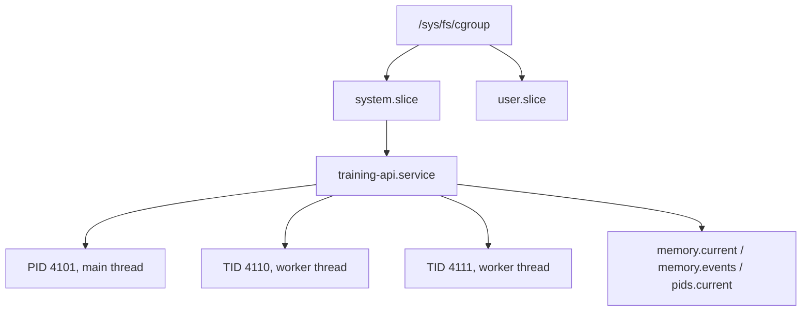
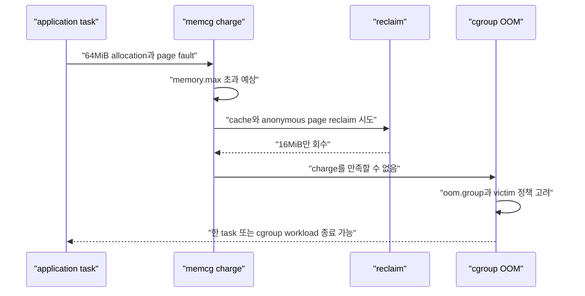
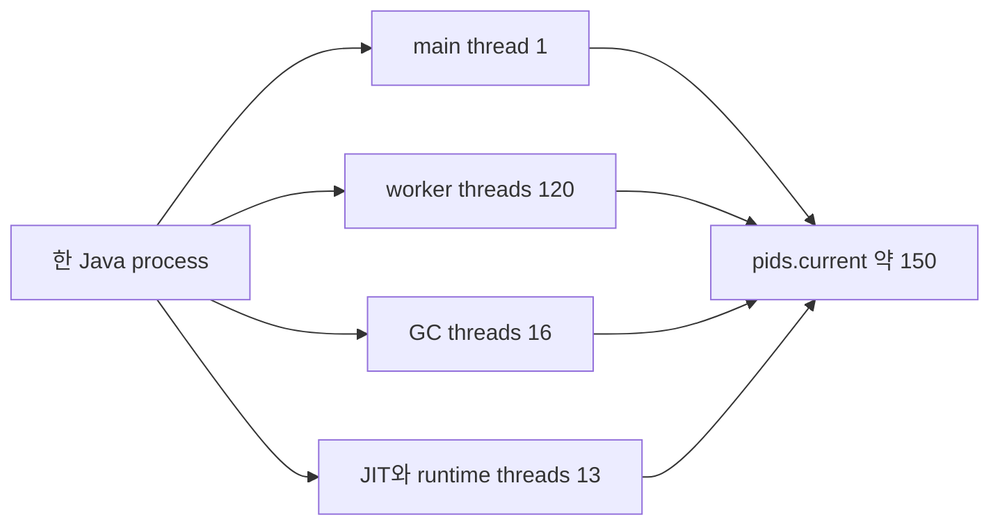

# 07. cgroup v2 memory, PID와 OOM

[이 책 목차](README.md) · [이전: CPU quota, weight와 cpuset](06-cpu-quota-weight-and-cpuset.md) · [다음: I/O 제어, page cache와 durability](08-io-control-page-cache-and-durability.md)

Linux의 memory controller는 단순히 “메모리 N GiB를 넘으면 process를 죽인다”는 장치가 아니다. 사용량을 account하고, reclaim 압력을 주고, 최종 hard limit에서 OOM(Out Of Memory) 처리를 수행한다. PID controller도 이름과 달리 process뿐 아니라 thread까지 세는 task 수 제한이다.

이 장의 경로와 숫자는 교육용 모형이다. 현재 host의 cgroup 파일을 쓰거나 workload를 종료하는 명령은 실행하지 않았다.


## 1. cgroup v2가 다루는 대상

**cgroup(control group)**은 process를 계층으로 묶고 CPU, memory, I/O, PID 같은 자원을 account·분배·제한하는 Linux kernel mechanism이다. v2에서는 controller가 하나의 unified hierarchy에서 협력한다.



Kernel은 process의 virtual address limit만 세는 것이 아니다. Memory controller는 anonymous memory, page cache, 일부 kernel data structure, TCP socket buffer 등을 cgroup에 charge한다. 무엇이 charge되는지는 kernel version과 resource 종류에 따라 달라질 수 있다.

Ubuntu의 systemd 환경에서는 Service, Scope, Slice unit이 cgroup tree를 관리한다. Kubelet과 container runtime도 자신의 subtree를 소유한다. 운영 중인 hierarchy의 raw cgroup file을 임의로 고치면 manager가 값을 되돌리거나 delegation 규칙을 깨뜨릴 수 있으므로 [systemd resource control](https://www.freedesktop.org/software/systemd/man/latest/systemd.resource-control.html)과 runtime 설정 경계를 따른다.

## 2. 네 memory 경계를 구분한다

| File | 역할 | 경계를 넘었을 때 |
| --- | --- | --- |
| `memory.min` | hard protection | 유효 보호량 안에서는 reclaim하지 않으려 함 |
| `memory.low` | best-effort protection | 다른 unprotected memory를 먼저 reclaim하려 함 |
| `memory.high` | throttle 경계 | workload를 강한 reclaim과 throttling에 넣음 |
| `memory.max` | hard usage limit | reclaim으로 줄이지 못하면 cgroup OOM 가능 |

`memory.low`와 `memory.min`은 “사용 허용량”이 아니라 reclaim에서 보호할 양이다. Parent가 제공할 수 있는 보호량보다 child가 더 많이 요구하면 effective protection은 줄어든다.

`memory.high`는 OOM kill 경계가 아니다. 초과한 task가 다음 memory charge에서 reclaim 일을 더 하거나 지연되어 application latency가 커질 수 있다. 극단적 상황에서는 사용량이 잠시 high를 넘을 수도 있다.

`memory.max`도 숫자에 닿는 그 순간 항상 같은 process를 즉시 kill하는 timer가 아니다. Kernel은 먼저 reclaim을 시도하고 allocation 종류에 따라 `-ENOMEM`을 반환하거나 다른 방식으로 실패할 수 있다. Reclaim으로 limit 아래로 갈 수 없고 memory charge를 진행해야 하면 cgroup OOM killer가 victim을 선택할 수 있다.

공식 의미는 Linux kernel의 [Control Group v2](https://docs.kernel.org/admin-guide/cgroup-v2.html) 문서를 기준으로 한다.

## 3. `memory.high` 시간표

다음은 `memory.high=1GiB`, `memory.max=1536MiB`인 cgroup의 교육용 예상 흐름이다.

| 시각 | `memory.current` | 중간 상태 | application 관찰 |
| --- | ---: | --- | --- |
| 10:00:00 | 900MiB | high 아래 | 정상 latency |
| 10:00:02 | 1050MiB | high 초과, reclaim 시작 | allocation이 느려질 수 있음 |
| 10:00:05 | 1120MiB | file cache 회수, dirty page writeback 가능 | p99 latency 증가 |
| 10:00:08 | 980MiB | high 아래로 회복 | kill 없이 계속 실행 |
| 10:00:20 | 1400MiB | 다시 pressure, max에는 미도달 | reclaim stall 증가 |

이 사례에서 process가 죽지 않은 것은 정상이다. `memory.events`의 `high` 증가와 PSI(Pressure Stall Information)의 memory pressure를 함께 보면 “살아 있지만 reclaim 때문에 느린” 상태를 찾을 수 있다.

```text
memory.current = 1,174,405,120 bytes
memory.high    = 1,073,741,824 bytes
memory.max     = 1,610,612,736 bytes

high 초과량 = 100,663,296 bytes ≈ 96MiB
```

High 값을 너무 낮게 잡으면 OOM은 없어도 workload가 계속 reclaim을 수행해 처리량이 무너질 수 있다. “kill이 없으니 안전하다”는 반례다.

## 4. `memory.max`와 cgroup OOM



`memory.events`에서 다음 counter를 구분한다.

- `high`: high 경계를 넘어 throttling/reclaim 경로를 밟은 횟수
- `max`: max 경계에 닿은 횟수
- `oom`: allocation이 cgroup OOM 상태에 도달한 횟수
- `oom_kill`: OOM killer가 process를 kill한 횟수
- `oom_group_kill`: group kill이 일어난 횟수

`oom`이 증가해도 반드시 `oom_kill`이 같은 수만큼 증가하는 것은 아니다. Allocation이 실패를 처리했거나 concurrent OOM 상황이 합쳐질 수 있다.

`memory.oom.group=1`은 workload를 하나의 indivisible unit처럼 kill하도록 요청할 때 쓰인다. Partial kill 뒤 남은 worker가 손상된 shared state를 서비스하는 위험을 줄일 수 있지만, 중요한 supervisor까지 같은 cgroup에 넣는 설계는 다시 검토해야 한다.

## 5. Anonymous memory와 page cache

Process RSS(Resident Set Size)만 보고 cgroup memory를 설명하면 부족하다.

```text
anonymous heap        620MiB
file page cache       310MiB
kernel/socket memory   90MiB
기타 accounted         28MiB
--------------------------------
memory.current       1048MiB
```

File을 buffered I/O로 읽은 page cache도 cgroup에 charge될 수 있다. “Application heap은 620MiB인데 왜 1GiB high를 넘었나?”라는 질문에는 `memory.stat`의 `anon`, `file`, `sock`, slab 관련 값을 함께 본다.

Page cache는 reclaim 가능한 경우가 많지만 dirty page는 storage에 writeback해야 회수할 수 있다. 느린 device와 memory pressure가 만나면 allocation thread가 I/O를 기다려 latency가 커진다. Memory 문제와 I/O 문제를 분리하지 말아야 하는 이유다.

## 6. 손계산: replica 전체 memory budget

Node allocatable memory가 16GiB이고 system reserve가 이미 반영되었다고 하자. API Pod 6개의 memory request가 1GiB, cgroup max가 2GiB라면 다음처럼 읽는다.

```text
scheduler request 합 = 6 × 1GiB = 6GiB
가능한 runtime max 합 = 6 × 2GiB = 12GiB
node allocatable = 16GiB
남는 allocatable = 4GiB
```

이 계산은 “항상 4GiB가 free”라는 뜻이 아니다. 다른 Pod, page cache, node daemon, kernel memory가 있고 모든 replica가 동시에 max에 가까워질 수 있다. Request는 placement 약속이고 max는 memcg hard boundary다.

## 7. PID controller는 thread도 센다

`pids.max`의 PID는 user space에서 흔히 말하는 process ID만 뜻하지 않는다. Kernel task, 즉 TID(Thread ID)를 센다. `clone()`으로 만들어진 thread도 `pids.current`를 증가시킨다.



`pids.max=160`이면 process는 하나뿐이어도 thread를 11개 더 만들 무렵 limit에 닿는다. 새 `fork()` 또는 `clone()`은 `-EAGAIN`으로 실패할 수 있다. Application에서는 “unable to create native thread”처럼 보일 수 있다.

| 값 | 의미 |
| --- | --- |
| `pids.current` | cgroup과 descendant의 현재 task 수 |
| `pids.max` | 허용하는 task 수 hard limit 또는 `max` |
| `pids.events`의 `max` | PID limit 때문에 생성이 거부된 사건 |
| `pids.peak` | 지원 kernel에서 관찰된 peak task 수 |

관리 작업으로 이미 많은 task가 있는 cgroup의 `pids.max`를 더 낮은 값으로 바꾸면 `pids.current > pids.max` 상태가 가능하다. 기존 thread를 즉시 kill하는 것이 아니라 이후 생성이 거부된다.

## 8. OOM과 PID exhaustion을 구분한다

| 증상 | Memory limit 가능성 | PID limit 가능성 |
| --- | --- | --- |
| exit code 137, `OOMKilled` | 높음 | 낮음 |
| `fork: Resource temporarily unavailable` | 낮음 | 높음 |
| `memory.events: oom_kill` 증가 | 직접 증거 | 해당 없음 |
| `pids.events: max` 증가 | 해당 없음 | 직접 증거 |
| Thread pool 확장 실패 | 가능 | 높음 |

PID exhaustion에서 memory를 늘려도 해결되지 않는다. 반대로 thread 수를 줄였더라도 각 thread stack과 queue가 memory를 많이 쓰면 memory pressure는 남는다.

## 9. 읽기 전용 관찰 모형

다음 경로는 systemd service 또는 container runtime이 만든 cgroup마다 달라진다. 아래는 읽기 대상의 예시이며 현재 host에서 실행하지 않았다.

```text
/sys/fs/cgroup/.../memory.current
/sys/fs/cgroup/.../memory.events
/sys/fs/cgroup/.../memory.stat
/sys/fs/cgroup/.../memory.pressure
/sys/fs/cgroup/.../pids.current
/sys/fs/cgroup/.../pids.events
```

하나의 snapshot보다 시간 변화가 중요하다. `memory.current`, `memory.events`, PSI, application latency, storage writeback을 같은 timestamp로 모은다.

## 10. 반례 모음

- `memory.high` 초과는 자동 OOM kill 신호가 아니다.
- `memory.max` 도달은 exact timestamp kill 계약이 아니다.
- RSS만 더하면 page cache와 kernel-accounted memory를 놓친다.
- PID 하나인 process도 thread 수 때문에 `pids.max`에 닿을 수 있다.
- OOM 뒤 process 재시작은 이미 발생한 외부 side effect를 되돌리지 않는다.
- Limit을 크게 올리면 node 전체 pressure와 다른 workload eviction 위험이 커질 수 있다.

## 11. 처음 보는 단어로 한 allocation을 끝까지 따라가기

**Allocation**은 process가 새 memory를 달라고 요청하는 일이다. `malloc()`은 userspace allocator에서 빈 구간을 돌려줄 수 있지만, 그 주소를 처음 실제로 읽거나 쓸 때 page fault가 발생해 kernel이 physical page를 연결할 수 있다.

**Charge**는 그 page 사용량을 어느 memory cgroup에 계산할지 기록하는 일이다. Memory cgroup을 줄여 **memcg**라고도 부른다. Charge가 성공하면 `memory.current`가 늘 수 있다.

**Resident memory**는 현재 RAM에 올라와 있는 memory다. Anonymous page는 heap·stack처럼 file backing이 없는 page이고 file page는 executable, library, data file의 page cache일 수 있다.

**Reclaim**은 kernel이 RAM 공간을 되찾는 일이다. 깨끗한 file cache는 버렸다가 storage에서 다시 읽을 수 있다. Dirty file page는 먼저 writeback해야 한다. Anonymous page는 swap 설정과 정책에 따라 swap-out 후보가 될 수 있다.

**Throttle**은 task를 kill하지 않고 진행을 늦추는 것이다. `memory.high` 위에서 allocation task가 reclaim 일을 부담하거나 기다리면 process는 살아 있지만 request latency가 늘어난다.

**OOM**은 Out Of Memory의 약자로 필요한 memory를 확보하지 못한 상태다. **OOM killer**는 system이나 cgroup이 회복하도록 process를 victim으로 골라 종료할 수 있는 kernel mechanism이다.

한 page fault를 시간순서로 따라가면 다음과 같다.

```text
1. Worker thread가 아직 실제 RAM이 없는 virtual address에 처음 write
2. CPU가 page fault를 일으켜 kernel로 진입
3. Kernel이 새 physical page를 준비하고 현재 memcg에 charge 시도
4. memory.high 위라면 reclaim/throttle이 발생할 수 있음
5. memory.max도 넘고 reclaim이 부족하면 cgroup OOM 판단 가능
6. Charge 성공이면 page table을 연결하고 thread가 같은 instruction을 재개
7. 실패하면 allocation error 또는 OOM kill 결과를 application이 관찰
```

**PID(Process ID)**는 process를 식별하는 번호로 흔히 말하지만 Linux kernel 내부 scheduling 단위는 task다. Multi-thread process의 각 thread에는 **TID(Thread ID)**가 있다. PID controller는 이 TID들을 세므로 thread 생성도 limit에 영향을 준다.

## 12. 문제

1. `memory.current=1.2GiB`, `memory.high=1GiB`, `memory.max=2GiB`다. 즉시 OOM kill이 필요한가?
2. Process 4개가 각각 thread 30개를 가지며 main thread가 이 수에 포함된다. 다른 task가 없다면 `pids.current`는 대략 얼마인가?
3. Heap은 700MiB인데 `memory.current`가 1.1GiB다. 먼저 어떤 항목을 확인하는가?

## 13. 해설

1. 아니다. High 초과는 reclaim과 throttling을 유도한다. Max에 닿아 reclaim이 실패할 때 cgroup OOM 가능성이 생긴다.
2. 대략 120이다. PID controller는 process 수가 아니라 thread를 포함한 task 수를 센다.
3. `memory.stat`의 anonymous memory, file page cache, socket·kernel memory를 본다. Dirty page와 I/O pressure도 연결한다.

다음 장에서는 같은 cgroup hierarchy에서 buffered I/O가 page cache와 writeback을 거쳐 device limit과 filesystem durability에 어떻게 연결되는지 살펴본다.
