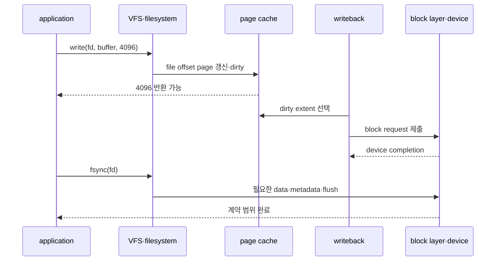
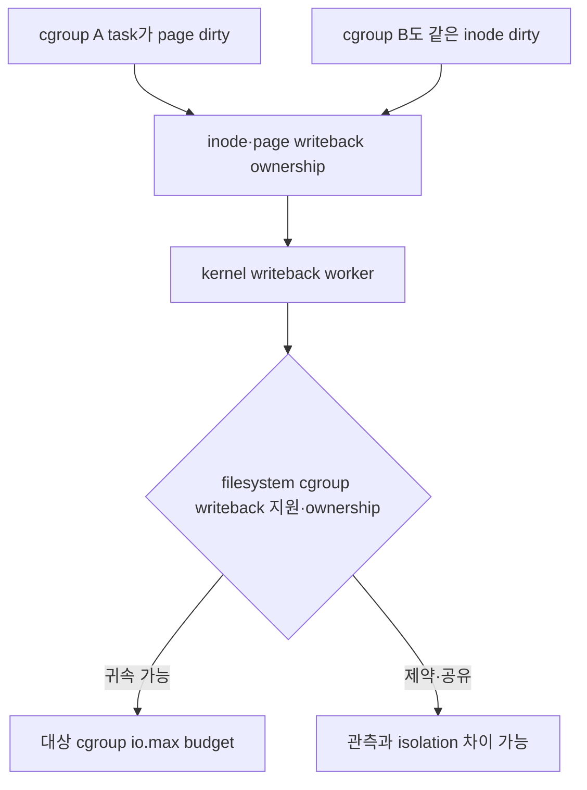

# 08. I/O 제어, page cache와 durability

[이 책 목차](README.md) · [이전: memory, PID와 OOM](07-memory-pids-and-oom.md) · [다음: io_uring SQ·CQ와 lifetime](09-io-uring-sq-cq-and-lifetimes.md)

이 장은 application이 4KiB를 저장하는 한 사건을 따라간다. 먼저 **I/O(Input/Output)**는 CPU register와 memory 밖의 file, storage device, network 같은 대상과 data를 주고받는 일이다. 이 장에서는 주로 block storage에 대한 file 읽기·쓰기를 뜻한다.

## 0. file offset과 byte가 놓이는 위치

열린 file에는 다음 read/write byte 위치를 나타내는 **file offset**이 있다. 같은 open file description을 공유하는 fd들은 offset도 공유할 수 있다. write가 offset 8192에서 4096byte를 쓰면 8192..12287 범위를 바꾸고 다음 offset은 12288이 될 수 있다. pwrite처럼 offset을 argument로 받는 API는 shared current offset을 바꾸지 않고 특정 위치에 쓴다.

Linux의 일반 **buffered I/O**는 application byte를 먼저 RAM의 file page에 복사한다. file 내용을 RAM에 보관하는 이 cache를 **page cache**라고 한다. 다시 읽을 때 storage를 기다리지 않고 RAM에서 줄 수 있으며 여러 process가 같은 file page를 공유할 수 있다.

application이 page cache 내용을 바꾸어 storage의 기존 내용과 달라진 page를 **dirty page**라고 부른다. dirty는 손상됐다는 뜻이 아니라 아직 backing storage와 동기화되지 않은 변경분이 있다는 상태다. dirty page 내용을 storage 쪽으로 보내는 과정을 **writeback**이라고 한다. application thread가 일부 수행하거나 별도 kernel worker가 수행할 수 있다.

## 1. 4KiB buffered write의 상태 전이

| 순서 | 주체와 위치 | object 상태 | 아직 보장하지 않는 것 |
|---:|---|---|---|
| 1 | application user buffer | 새 4096byte | kernel이 받았다는 보장 없음 |
| 2 | write syscall, VFS/filesystem | fd·offset·permission 검사 | storage 기록 아님 |
| 3 | page cache | file page 수정, dirty 표시 | power-loss durability 아님 |
| 4 | write가 4096 반환 | process가 새 byte를 읽을 수 있음 | device cache 도착 아님 |
| 5 | writeback | block request를 device queue에 제출 | filesystem ordering 완료 아님 |
| 6 | device completion | request 완료 보고 | volatile cache 조건에 따라 내구성 다름 |
| 7 | fsync 계약 완료 | file data와 필요한 metadata 동기화 | 새 directory entry는 별도 sync 가능 |

write 성공 뒤 같은 process가 page cache의 새 byte를 보는 **visibility(보임)**와 crash 뒤에도 남는 **durability(내구성)**는 다르다.

## 2. BPS와 IOPS는 서로 다른 병목이다

**BPS(Bytes Per Second)**는 초당 전송 byte 수, **IOPS(I/O Operations Per Second)**는 초당 I/O 요청 수다. cgroup v2 io.max는 device별 rbps, wbps, riops, wiops 같은 상한을 표현할 수 있다.

```text
4KiB random write 500 IOPS
= 500 × 4096 byte/s
= 2,048,000 byte/s
≈ 1.95 MiB/s
```

wbps가 100MiB/s여도 wiops가 500이면 작은 요청 workload는 IOPS가 먼저 제한한다. 1MiB request 200 IOPS는 약 200MiB/s라서 wbps 100MiB/s가 먼저 제한한다. filesystem과 block layer에서 merge/split이 생길 수 있으므로 syscall 수와 device IOPS는 항상 같지 않다.

## 3. writeback의 소유권과 cgroup 귀속

buffered write를 한 task가 return한 뒤 다른 kernel worker가 writeback할 수 있다. 현재 writeback thread의 cgroup만으로 원 application I/O를 제어할 수 없다. Linux는 page와 backing writeback context의 귀속 정보를 이용해 dirtying cgroup에 I/O를 account하려 한다. filesystem과 device가 writeback accounting을 지원하는 조건을 확인한다.

**accounting(회계)**은 I/O byte와 operation을 어느 cgroup 사용량으로 셀지 정하는 것이다. **charge(귀속)**는 memory page 같은 resource 비용을 특정 cgroup에 기록하는 것이다. 둘 다 source-code 줄과 일대일로 단순 연결되지 않는다.

writeback이 느려 dirty page가 쌓이면 memory controller와 I/O controller가 만난다. dirty limit이나 reclaim 때문에 application thread가 writeback 진행을 기다리면 write 또는 allocation latency가 증가할 수 있다. memory PSI와 io.pressure를 함께 보는 이유다.

## 4. device 번호와 mount path는 다르다

io.max는 보통 block device의 major:minor identity를 대상으로 한다. /data라는 mount path는 device identity가 아니다. logical volume, device mapper, encryption, RAID, network filesystem을 거치면 어느 block device로 내려가는지 여러 층이다.

```text
/data/app.db
→ filesystem mount
→ logical volume dm-3 (major:minor 예 253:3)
→ physical NVMe namespace 둘에 stripe
```

dm-3 limit이 아래 physical device 각각에서 같은 모양으로 보장된다고 단정할 수 없다. controller 지원, stacked-device propagation과 scheduler를 확인한다. tmpfs는 RAM 기반이고 NFS는 network/server 경로가 지배할 수 있다.

## 5. PSI는 utilization이 아니라 stall이다

**io.pressure**는 I/O 때문에 task가 진전하지 못한 시간을 보여 준다. some은 일부 task의 stall, full은 모든 non-idle task의 동시 stall이다. device utilization 100%와 같은 지표가 아니다. device가 busy해도 application이 async work로 진전하면 PSI 모양이 다를 수 있다.

10초 동안 io some total이 2,000,000µs 늘었다는 값은 aggregate stall이 2초 늘었다는 뜻이다. request p99가 정확히 20% 증가했다는 뜻은 아니다. cgroup 범위, task 수, writeback과 memory pressure를 함께 본다.

## 6. file fsync와 directory fsync

새 file을 안전하게 교체하는 전형적 순서다.

```text
1. 같은 directory에 temp file 생성
2. temp에 전체 content write
3. temp file fsync
4. temp를 target 이름으로 rename
5. parent directory fd를 fsync
```

3단계는 temp content와 필요한 metadata의 durability를 요청한다. 4단계는 namespace의 이름을 바꾼다. 5단계는 directory entry 변경의 durability를 요청한다. filesystem, mount option, storage hardware와 오류 처리에 따라 계약 세부가 달라 portable database는 검증된 library와 filesystem 문서를 따른다.

fsync 성공이 remote replica 둘에도 data가 있다는 뜻은 아니다. local filesystem/device 완료와 distributed replication quorum은 다른 경계다.

## 7. direct I/O도 자동 durability가 아니다

**direct I/O**는 일반 page cache data 경로를 우회하려는 방식이다. alignment, filesystem, device 조건이 있고 metadata나 다른 cache가 완전히 사라진다는 뜻은 아니다. page cache를 우회해도 device volatile write cache에 data가 남을 수 있고 filesystem metadata ordering도 필요하다.

따라서 O_DIRECT write 성공을 fsync와 같은 durability 계약으로 일반화하지 않는다. database는 double caching 감소와 buffer 관리 목적으로 direct I/O를 쓰면서 flush/FUA/fsync 계약을 별도로 다룬다.

## 8. Kubernetes에서 Linux 경로로 번역한다

Pod volume이 emptyDir, hostPath, local persistent volume, CSI network storage 중 무엇인지에 따라 경로가 다르다. container의 /data만 보고 block device와 durability를 결정할 수 없다.

모든 storage class가 동일한 io.max 설정을 자동 제공하는 것도 아니다. runtime, cgroup version, CSI driver, node topology를 확인한다. node-level dirty writeback이 여러 Pod latency를 연결할 수 있고 remote storage latency는 local io controller 밖에서 발생할 수 있다.

## 9. 추가 해설 문제

1. 8KiB write가 성공했다. crash 뒤 남는가?
   - page cache에만 있을 수 있어 성공만으로 보장하지 않는다.
2. 4KiB 1,000 IOPS의 처리량은?
   - 약 3.91MiB/s다.
3. wbps 20MiB/s와 wiops 10,000에서 1MiB request가 오면?
   - BPS가 약 20 request/s 수준으로 먼저 제한한다.
4. /data가 dm-crypt 위 volume이다. mount path를 io.max 대상에 쓰는가?
   - major:minor device stack과 controller 지원을 찾는다.
5. file fsync 뒤 새 이름으로 rename했다. 이름까지 durable한가?
   - parent directory fsync가 추가로 필요할 수 있다.
6. O_DIRECT write 성공은 power-loss durability인가?
   - 아니다. device cache, metadata와 flush 계약을 따져야 한다.

application의 `write()` 성공은 kernel이 byte를 받아들였다는 완료일 수 있으며 전원 손실 뒤 저장장치에 남는 durability 완료와 다르다. buffered I/O는 page cache와 나중 writeback을 거친다. cgroup I/O controller는 block device별 전송률을 조절하지만 filesystem의 crash consistency 계약을 대신하지 않는다.

## 1. 4KiB write를 끝까지 추적하기

**file descriptor(fd)**는 process가 열린 file을 찾는 작은 정수 handle이다. kernel 안에는 open file description, offset, inode와 mount가 연결된다. **VFS**는 여러 filesystem에 공통 file API를 제공한다. **page cache**는 file 내용을 RAM page로 보관한다. storage보다 RAM 내용이 새로우면 **dirty page**다.



write return 전에 user buffer의 byte는 page cache에 반영되지만 device 완료를 기다리지 않을 수 있다. kernel writeback worker가 나중에 dirty extent를 block request로 바꾼다. `fsync()`는 file data와 관련 metadata를 filesystem·device 계약에 따라 동기화한다. remote replica와 backup 완료까지 뜻하지 않는다.

## 2. burst가 storage 속도를 숨기는 시간표

application이 10초간 600MiB/s로 쓰고 device가 200MiB/s를 지속한다고 단순화하면 dirty 증가량은 `(600-200)×10=4000MiB`다. 처음 benchmark의 write latency는 RAM copy 속도를 보고 빠를 수 있다.

| 시각 | write rate | device rate | dirty 상태 | application 관찰 |
| ---: | ---: | ---: | ---: | --- |
| 0~3s | 600MiB/s | 200MiB/s | +1200MiB | write p50 낮음 |
| 3~8s | 600 | 200 | +3200MiB | memory pressure 시작 가능 |
| 8~10s | throttle 영향 | 200 | 약 +4000MiB | write p99 상승 |
| 10~30s | 새 write 0 | 200 | drain | process 끝나도 writeback 지속 |

dirty threshold와 memory.high가 겹치면 application task가 balance dirty page나 reclaim에서 I/O를 기다릴 수 있다. CPU 문제처럼 보이는 tail latency를 memory.events, dirty/writeback, io.pressure와 연결한다.

## 3. `io.max`의 device 식별과 단위

```text
8:16 rbps=2097152 wbps=max riops=max wiops=120
```

`8:16`은 block device의 major:minor 번호다. `/data` 같은 pathname이나 mount 이름이 아니다. `rbps`·`wbps`는 byte/s, `riops`·`wiops`는 operation/s 제한이다. limit 초과 I/O는 오류보다 delay될 수 있고 temporary burst가 가능해 정확한 1초 firewall처럼 읽지 않는다.

4KiB random write에 `wbps=100MiB/s`, `wiops=1000`이면 IOPS가 허용하는 약 3.9MiB/s가 지배한다. 1MiB write라면 BPS가 허용하는 100 IOPS가 지배한다. filesystem과 block layer가 application write를 merge·split하므로 syscall 수와 device IOPS는 같지 않다.

`/data → ext4 → dm-crypt 253:2 → NVMe partition 259:3`처럼 여러 device layer가 있을 수 있다. 어느 major:minor를 제한할지 실제 mount와 device mapper stack을 추적한다. network filesystem은 local block controller만으로 remote disk와 network를 모두 제한하지 못한다.

## 4. writeback 귀속

dirty하게 만든 task와 나중 block request를 제출한 kernel worker가 다르다. cgroup v2 writeback attribution은 dirty page를 만든 cgroup에 I/O를 귀속하려고 한다. filesystem 지원과 같은 inode를 여러 cgroup이 쓰는 ownership 전환 조건이 있다. “worker가 root라 모두 무제한”도, “항상 원래 write syscall에 완벽히 귀속”도 단정하지 않는다.



## 5. 이름과 data의 durability

새 file을 원자적으로 공개하는 일반적 패턴은 temp file write, temp file `fsync`, `rename`, parent directory `fsync` 순서다. file sync는 내용과 관련 metadata, directory sync는 새 이름과 rename 관계의 durability에 필요할 수 있다. filesystem별 crash consistency와 모든 오류를 검증해야 한다.

`O_DIRECT`는 page cache를 우회하려는 I/O mode이며 alignment와 filesystem 조건이 있다. 자동 durability가 아니다. `O_DSYNC`, `O_SYNC`, `RWF_DSYNC`, fsync의 의미와 device flush/FUA 지원을 별도로 확인한다.

두 번째 예로 DB가 WAL record를 write한 직후 client에 commit을 답하면 crash 때 record가 사라질 수 있다. WAL file에 필요한 sync가 성공한 뒤 commit을 publish해야 한다. data page와 WAL, directory 이름, replica ack는 서로 다른 완료 경계다.

## 6. 관측·연구 연결

```text
14:00:00 ingest 500MiB/s
14:00:05 write p50 0.3ms, dirty 2GiB
14:00:08 io.max delay, io.pressure some 상승
14:00:11 memory.high 초과, reclaim이 writeback 대기
14:00:15 write p99 900ms, device 200MiB/s
14:00:40 fsync 성공 뒤 durable checkpoint 공개
```

`io.stat`, `io.pressure`, memory.stat/events, filesystem error, device latency와 fsync latency를 같은 clock으로 수집한다. PSI는 utilization이 아니라 task stall이다.

[I/O Passthru(FAST 2024)](https://www.usenix.org/conference/fast24/presentation/joshi)는 NVMe character device와 io_uring command로 전통 block path의 일부 비용을 줄이는 특정 FIO 구성 결과를 다룬다. 모든 application이 자동으로 빠르다는 근거가 아니다. 이 장의 VFS·page cache·block layer 중 어떤 층을 우회하고 어떤 durability·isolation 책임이 이동하는지, workload size·queue depth·hardware를 독립 변수로 재현해야 한다.

## 7. 문제와 해설

### 문제 1
`write()`가 64KiB를 반환하면 전원 손실 뒤 반드시 남는가?

**해설:** 아니다. buffered data가 dirty page에만 있을 수 있다. filesystem과 device까지의 sync 계약이 필요하다.

### 문제 2
4KiB write, wiops 500, wbps 100MiB/s의 지배 limit은?

**해설:** IOPS다. 약 `500×4KiB=1.95MiB/s`로 BPS limit보다 낮다.

### 문제 3
`/data` path를 `io.max`에 쓸 수 있는가?

**해설:** 아니다. io.max는 major:minor block device를 사용한다. mount와 device mapper stack을 추적한다.

### 문제 4
file data를 fsync하고 rename했으면 새 이름도 확실히 durable한가?

**해설:** parent directory sync가 별도로 필요할 수 있다. filesystem 계약과 오류 처리를 확인한다.

### 문제 5
O_DIRECT completion은 fsync와 같은가?

**해설:** 아니다. page cache 우회와 전원 손실 durability는 다른 속성이다. sync flag와 device flush 계약을 본다.

## 공식 자료

- [Linux cgroup v2 I/O controller](https://docs.kernel.org/admin-guide/cgroup-v2.html#io)
- [fsync(2)](https://man7.org/linux/man-pages/man2/fsync.2.html)
- [open(2)](https://man7.org/linux/man-pages/man2/open.2.html)
- [I/O Passthru, FAST 2024](https://www.usenix.org/conference/fast24/presentation/joshi)

[← 이전: memory, PID와 OOM](07-memory-pids-and-oom.md) · [다음: io_uring SQ·CQ와 lifetime](09-io-uring-sq-cq-and-lifetimes.md)
