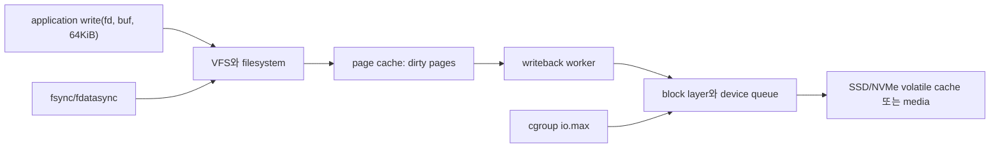
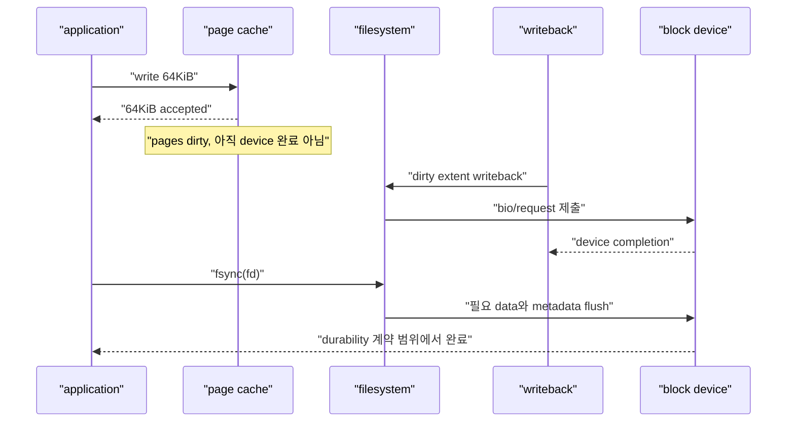
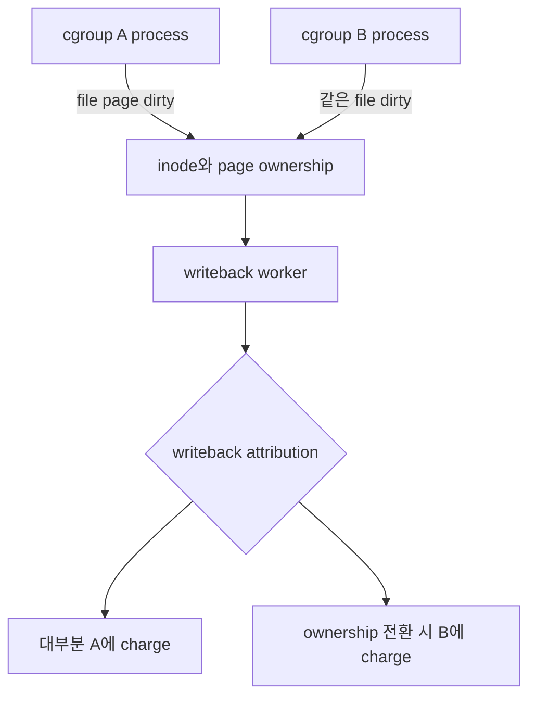

# 08. I/O 제어, page cache와 durability

[이 책 목차](README.md) · [이전: memory, PID와 OOM](07-memory-pids-and-oom.md) · [다음: io_uring SQ·CQ와 lifetime](09-io-uring-sq-cq-and-lifetimes.md)

Application의 `write()`가 성공했다고 storage device에 byte가 영구 기록된 것은 아니다. Linux buffered I/O는 page cache를 거치며, writeback은 나중에 별도 context에서 일어날 수 있다. cgroup v2 I/O controller는 이 경로의 속도를 device 단위로 제어하지만 filesystem durability 계약을 대신하지 않는다.

이 장의 경로, 숫자, 설정 text는 교육용이다. 현재 host의 cgroup이나 block device 설정을 변경하지 않았다.

## 1. 세 층을 먼저 분리한다



- **VFS(Virtual File System)**: 여러 filesystem에 공통 file API를 제공하는 kernel layer
- **Page cache**: file data page를 RAM에 cache하는 영역
- **Dirty page**: memory의 내용이 backing storage보다 새롭고 writeback이 필요한 page
- **Writeback**: dirty page를 filesystem과 block layer를 통해 device로 내보내는 과정
- **Durability**: crash나 전원 손실 뒤에도 요구한 data·metadata가 남는 성질

## 2. Buffered write의 실제 상태 전이



첫 `write()`의 return value는 user buffer에서 kernel이 몇 byte를 받아들였는지다. 성공 뒤에도 dirty page가 RAM에만 있을 수 있다. Process가 정상 종료해도 kernel은 살아 있으므로 writeback이 계속될 수 있지만, 갑작스러운 host 전원 손실에는 약하다.

## 3. Page cache의 장점과 반례

Page cache는 작은 write를 합치고, 반복 read를 RAM에서 처리하며, application과 느린 device의 속도 차이를 흡수한다. 이 때문에 `write()` latency가 낮을 수 있다.

반례는 burst 뒤에 나타난다.

```text
application write rate = 600MiB/s
device sustained rate  = 200MiB/s
10초 동안 dirty 증가  = (600 - 200) × 10 = 4000MiB
```

Memory와 dirty threshold가 충분하지 않으면 application thread가 balance dirty pages나 reclaim 경로에서 멈출 수 있다. 처음 5초 benchmark만 보고 storage가 600MiB/s라고 결론 내리면 page cache를 측정한 것이다.

## 4. `io.max`는 `MAJOR:MINOR` device를 고른다

cgroup v2의 `io.max`는 block device마다 read/write BPS(Bytes Per Second)와 IOPS(I/O Operations Per Second) 상한을 표현한다.

```text
8:16 rbps=2097152 wbps=max riops=max wiops=120
```

이 text는 교육용 설정 형식이며 현재 system에 쓰지 않았다.

| 항목 | 뜻 |
| --- | --- |
| `8:16` | kernel block device의 major 8, minor 16 |
| `rbps=2097152` | read를 초당 약 2MiB로 제한 |
| `wbps=max` | write byte/s 제한 없음 |
| `riops=max` | read operation/s 제한 없음 |
| `wiops=120` | write operation을 초당 120회로 제한 |

Limit을 넘은 I/O는 실패시키기보다 delay될 수 있고 temporary burst가 허용될 수 있다. 정확한 1초 bucket firewall처럼 해석하지 않는다. 공식 형식과 caveat는 kernel [cgroup v2 I/O controller](https://docs.kernel.org/admin-guide/cgroup-v2.html#io)에서 확인한다.

## 5. BPS와 IOPS를 함께 계산한다

`wbps=100MiB/s`, `wiops=1000`인 device limit에서 workload가 4KiB random write를 한다고 하자.

```text
IOPS가 허용하는 byte/s = 1000 × 4KiB = 4000KiB/s ≈ 3.9MiB/s
BPS limit = 100MiB/s
실제 상한의 지배 조건 ≈ 3.9MiB/s인 IOPS limit
```

반대로 1MiB sequential write면 다음과 같다.

```text
BPS가 허용하는 IOPS = 100MiB/s ÷ 1MiB = 100 IOPS
IOPS limit = 1000
지배 조건 = 100MiB/s인 BPS limit
```

Filesystem이 request를 merge하거나 split하면 application의 `write()` 호출 수와 block IOPS는 같지 않다. 1000번의 4KiB write가 device request 1000개라는 보장은 없다.

## 6. Buffered I/O를 어느 cgroup에 charge하는가

Application이 page cache를 dirty하게 만든 시각과 writeback worker가 device I/O를 제출하는 시각은 다르다. Modern cgroup v2는 writeback attribution을 이용해 dirty page를 만든 cgroup에 I/O를 charge하려고 한다.



이 기능은 filesystem이 cgroup writeback을 지원해야 한다. 지원하지 않거나 여러 writer가 같은 inode를 심하게 공유하면 기대한 isolation과 다를 수 있다. “Worker thread가 root cgroup이므로 모든 writeback이 무제한”이라고 단정하는 것도, “항상 정확히 원래 process에 charge된다”고 단정하는 것도 틀릴 수 있다.

## 7. Device identity와 mount path는 다르다

`/data`라는 path는 filesystem namespace의 mount point다. `io.max`는 `MAJOR:MINOR` block device를 지정한다.

```text
/data → ext4 filesystem → dm-crypt device 253:2 → NVMe partition 259:3
```

어느 layer의 device를 제한할지는 device mapper, logical volume, filesystem, container mount 구조를 알아야 한다. Overlay filesystem의 upper layer가 어느 backing device에 있는지도 확인한다.

Network filesystem은 local block I/O controller만으로 remote server disk와 network throughput을 모두 제어할 수 없다. Local socket memory, network queue, remote storage controller가 별도다.

## 8. `write()` 성공과 `fsync()` 성공

`fsync(fd)`는 file data와 관련 metadata를 storage device로 flush하도록 요청한다. `fdatasync(fd)`는 이후 data retrieval에 불필요한 일부 metadata flush를 줄일 수 있다. 실제 보장은 filesystem과 device가 flush/FUA를 올바르게 구현한다는 전제에 의존한다.

```text
t=0ms   write(fd, 64KiB) → 64KiB
t=1ms   application은 새 record를 memory에서 봄
t=8ms   writeback 시작
t=12ms  fsync(fd) 호출
t=19ms  fsync(fd) → 0
t=20ms  application이 durable commit으로 간주
```

`fsync()`가 성공하기 전 crash가 나면 마지막 write가 사라질 수 있다. `fsync()` 성공도 remote replica나 backup 완료를 뜻하지 않는다.

공식 syscall 계약은 [fsync(2)](https://man7.org/linux/man-pages/man2/fsync.2.html)을 본다.

## 9. 새 file 이름에는 directory sync가 필요하다

File data를 쓰고 file 자체를 `fsync()`해도 새 directory entry가 crash 뒤 존재한다는 보장이 별도일 수 있다.

```text
1. temp file 생성
2. temp file data write
3. fsync(temp fd)
4. rename(temp, final)
5. fsync(parent directory fd)
```

이 pattern은 교육용 순서다. Filesystem별 crash consistency와 error handling을 검증해야 한다. Directory `fsync()`는 이름과 rename 같은 directory entry 변경의 durability를 위한 단계다.

반례로 file만 sync하고 directory를 sync하지 않으면 crash 뒤 data block은 있지만 새 이름이 사라질 수 있다. 반대로 directory만 sync해도 file content가 모두 durable하다는 뜻은 아니다.

## 10. Direct I/O도 자동 durability가 아니다

`O_DIRECT`는 page cache를 우회하려는 I/O mode이며 alignment와 filesystem 제약이 있다. Cache coherency 비용을 줄일 수 있지만 `fsync()`와 같은 durability flag가 아니다.

`O_DSYNC`, `O_SYNC`, `RWF_DSYNC` 같은 semantics와 filesystem/device 지원을 별도로 봐야 한다. Direct I/O read/write가 완료됐다는 사실과 NVMe media에 power-loss-safe하게 기록됐다는 사실도 구분한다.

Linux의 자세한 flag 의미는 [open(2)](https://man7.org/linux/man-pages/man2/open.2.html)를 참고한다.

## 11. `io.pressure`는 utilization이 아니다

PSI의 `io.pressure`는 task가 I/O 때문에 진행하지 못한 stall 시간을 나타낸다.

- `some`: 적어도 일부 task가 I/O에 막힘
- `full`: 모든 non-idle task가 동시에 I/O에 막힘

Device utilization 90%와 PSI 90%는 같은 값이 아니다. Async pipeline이 queue를 깊게 유지해 device는 바쁘지만 application task는 다른 계산을 하면 PSI가 낮을 수 있다. 반대로 latency-sensitive task 하나가 자주 막히면 낮은 throughput에서도 pressure가 중요할 수 있다.

공식 정의는 [PSI documentation](https://docs.kernel.org/accounting/psi.html)을 따른다.

## 12. 완전한 진단 시간표

```text
14:00:00 ingest workload 500MiB/s 시작
14:00:05 write() p50 0.3ms, dirty page 2GiB
14:00:08 io.max write delay 증가, io.pressure some 상승
14:00:11 memory.high 초과, reclaim이 dirty writeback을 기다림
14:00:15 write() p99 900ms, device 200MiB/s 유지
14:00:20 application batch 종료
14:00:38 dirty page writeback 완료
14:00:40 fsync 완료 뒤 durable checkpoint 기록
```

이 사건을 CPU 문제로만 보면 reclaim과 writeback을 놓친다. `memory.events`, `memory.stat`, `io.stat`, `io.pressure`, filesystem error, device latency와 application fsync latency를 같은 시각에 맞춘다.

## 13. Kubernetes와 연결되는 지점

Container memory usage에는 page cache가 포함될 수 있고 memory limit pressure가 writeback을 촉진할 수 있다. Ephemeral storage request/limit, PVC backend QoS, node filesystem과 cgroup `io.max`는 서로 다른 정책 층이다.

Kubernetes YAML에 storage limit을 적었다고 block device `io.max`가 모든 runtime에서 같은 방식으로 설정된다고 가정하지 않는다. Runtime, kubelet, CSI driver, storage class와 Linux node 설정을 확인한다.

## 14. 처음 보는 단어로 4KiB write를 끝까지 따라가기

**File descriptor(fd)**는 process가 open한 file을 가리키는 작은 정수 handle이다. Kernel 안에는 실제 file object, inode, filesystem과 mount 정보가 연결된다.

**Page**는 kernel이 memory를 관리하는 기본 크기 단위 중 하나이며 흔히 4KiB다. **Page cache**는 file 내용을 RAM의 page에 보관한다. Cache는 별도 복사본 database가 아니라 filesystem I/O 경로의 일부다.

Application이 buffered `write(fd, buffer, 4096)`를 호출하면 kernel은 user buffer의 byte를 해당 file offset의 page cache page에 반영한다. Storage보다 RAM 내용이 새로워진 page를 **dirty page**라고 한다.

**Inode**는 filesystem 안에서 file의 metadata와 data block mapping을 표현하는 object다. Filename은 directory entry가 inode를 가리키는 관계다. 그래서 file data sync와 directory name sync가 다른 단계다.

**Writeback**은 dirty page를 backing storage 쪽으로 내보내 clean하게 만드는 과정이다. Kernel worker가 나중에 수행할 수 있어 원래 `write()` thread와 device request를 제출하는 thread가 다를 수 있다.

**Block layer**는 filesystem I/O를 storage device request로 정리·merge·schedule하는 kernel layer다. `MAJOR:MINOR`는 이 block device를 kernel에서 식별하는 번호 쌍이다. Path `/data/a.bin` 자체는 device ID가 아니다.

한 write의 시간순서는 다음과 같다.

```text
1. Application이 fd, userspace address, length=4096으로 write syscall
2. VFS가 fd를 file object와 filesystem operation에 연결
3. Filesystem이 file offset에 대응하는 page cache page를 찾거나 생성
4. 4096 bytes를 page에 반영하고 dirty 표시
5. write는 device completion 전에도 4096을 반환할 수 있음
6. Writeback이 dirty extent를 block request로 변환
7. io.max가 해당 MAJOR:MINOR의 BPS/IOPS budget을 검사하고 필요하면 delay
8. Driver가 request를 device queue에 제출
9. Device completion 뒤 page가 clean 후보가 됨
10. fsync가 요구됐다면 filesystem metadata와 flush 조건까지 기다린 뒤 완료
```

**BPS**는 초당 byte 수, **IOPS**는 초당 I/O operation 수다. 큰 sequential request는 BPS에, 작은 random request는 IOPS에 먼저 제한될 수 있다.

**Durability**는 process가 지금 값을 읽을 수 있다는 뜻보다 강하다. Crash 또는 power loss 뒤에도 약속한 data와 이름이 남아야 한다. Device completion, file fsync, directory fsync, remote replication은 서로 다른 완료 경계다.

## 15. 문제

1. 4KiB write, `wiops=500`, `wbps=100MiB/s`에서 어느 limit이 지배적인가?
2. `write()`가 64KiB를 반환했다. 전원 손실 뒤 data가 반드시 남는가?
3. File을 새 이름으로 rename한 뒤 file만 `fsync()`했다. 어떤 durability 단계가 빠졌을 수 있는가?

## 16. 해설

1. IOPS limit이다. 약 `500×4KiB≈1.95MiB/s`가 되어 100MiB/s보다 훨씬 낮다.
2. 아니다. Buffered data가 page cache에만 있을 수 있으며 filesystem과 device까지 sync하는 계약이 필요하다.
3. Parent directory의 `fsync()`다. File content와 directory entry durability는 구분한다.

다음 장에서는 syscall마다 기다리는 대신 SQ(Submission Queue)와 CQ(Completion Queue)를 공유하는 io_uring의 index와 request lifetime을 추적한다.
