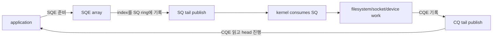
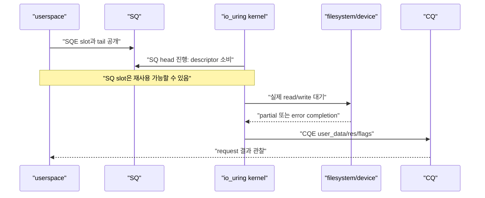
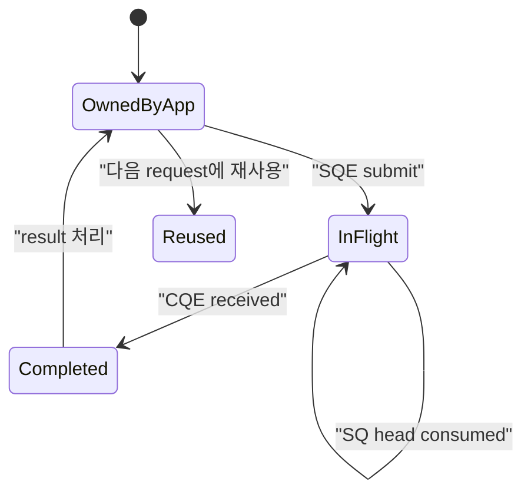
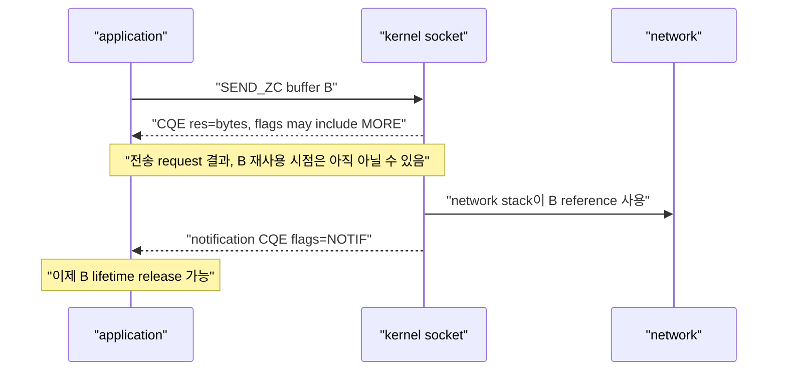

# 09. io_uring SQ·CQ와 request lifetime

[이 책 목차](README.md) · [이전: I/O 제어, page cache와 durability](08-io-control-page-cache-and-durability.md) · [다음: io_uring registration, polling과 feature 탐지](10-io-uring-registration-polling-and-features.md)

**io_uring**은 userspace와 kernel이 ring buffer를 공유하여 I/O request를 제출하고 completion을 회수하는 Linux interface다. 핵심은 syscall 수를 줄이는 것보다 “제출한 descriptor, buffer와 user context를 completion까지 안전하게 유지하는 것”이다.

이 장의 C 모양 text는 API 구조를 설명하는 pseudocode이며 현재 host에서 compile하거나 실행하지 않았다.


## 1. SQ와 CQ 약어

- **SQ(Submission Queue)**: userspace가 kernel에 처리할 request index를 공개하는 queue
- **SQE(Submission Queue Entry)**: opcode, fd, address, length, offset, `user_data` 등을 담는 request descriptor
- **CQ(Completion Queue)**: kernel이 완료 결과를 userspace에 공개하는 queue
- **CQE(Completion Queue Entry)**: `user_data`, `res`, `flags`를 담는 completion descriptor



기본 SQ array 방식에서 SQ ring은 SQE 자체가 아니라 SQE array의 index를 담는다. 최신 커널의 `IORING_SETUP_NO_SQARRAY` 같은 선택 모드는 구성이 다르므로 이 장은 기본 방식을 설명한다. liburing이 이 detail을 감싸더라도 head, tail, mask, entries 관계를 이해하면 queue full과 completion leak을 진단하기 쉽다.

## 2. Ring index 손계산

Entry가 8개인 ring은 mask가 7이다. Logical tail이 계속 증가해도 physical slot은 `index & mask`로 고른다.

```text
sq_head = 13
sq_tail = 18
kernel이 아직 SQ에서 소비하지 않은 entries = 18 - 13 = 5
free entries = 8 - 5 = 3

logical index 18 → physical slot 18 & 7 = 2
```

이 5개는 SQ에 남아 있는 제출 항목 수다. 이미 SQ에서 소비됐지만 실제 I/O가 끝나지 않은 request는 따로 있을 수 있어 전체 in-flight 수와 같지 않다. Head와 tail을 단순히 0–7 범위 숫자로만 비교하면 wrap-around에서 틀린다. Producer가 SQE field를 모두 쓴 뒤 tail을 publish하고, consumer는 적절한 memory ordering으로 tail을 본다. 직접 raw ring을 다룰 때는 kernel UAPI의 barrier pattern을 따른다.

## 3. SQE를 kernel이 소비했다고 I/O가 끝난 것이 아니다



SQ head가 진행하면 kernel이 submission descriptor를 가져갔다는 뜻이다. Buffer, file lifetime, application operation이 끝났다는 뜻은 아니다. Request 완료는 대응 CQE로 판단한다.

## 4. `user_data`는 application correlation key다

Kernel은 `user_data`의 의미를 해석하지 않고 SQE에서 CQE로 돌려준다. Pointer를 그대로 넣을 수도 있지만 object lifetime과 alignment/tagging을 안전하게 관리해야 한다.

```text
user_data = (operation_id << 8) | operation_kind

0x00000000002A01 → operation 42, kind READ
0x00000000002A02 → operation 42, kind WRITE
0x00000000002A03 → operation 42, kind TIMEOUT
```

같은 logical operation에 여러 SQE를 제출하면 각 step을 구분할 key가 필요하다. 취소 request의 CQE와 대상 request의 CQE도 별도다.

`user_data`를 heap object pointer로 썼다면 모든 관련 CQE가 끝나기 전에 object를 free하지 않는다. Cancellation을 제출했다는 이유만으로 대상 object를 해제하면 race에서 use-after-free가 된다.

## 5. `cqe->res` 읽는 법

`res`는 성공 byte count 또는 negative errno다. `errno` global을 읽는 일반 syscall wrapper와 다르다.

```text
res = 4096    → 4096 bytes 완료
res = 512     → short I/O, 요청 4096 중 512 bytes
res = 0       → read에서는 EOF 가능, opcode별 의미 확인
res = -11     → -EAGAIN
res = -125    → -ECANCELED
```

Negative result는 `-res`를 errno number로 해석한다. 모든 opcode가 byte count를 반환하는 것은 아니므로 opcode reference를 확인한다.

## 6. Short I/O와 EOF

Read 64KiB를 제출했다고 한 CQE가 항상 65536을 반환하지 않는다.

```text
요청 offset=0, len=65536
CQE res=24576
남은 len=40960
다음 offset=24576
```

Regular file read에서 EOF에 도달하면 `res=0`일 수 있다. Socket receive의 `res=0`은 orderly peer shutdown을 뜻할 수 있다. `0`을 “아직 결과 없음”으로 쓰지 않는다. CQE가 도착했다면 그 request는 opcode semantics에 따라 완료된 것이다.

Write도 signal, filesystem, capacity, socket backpressure 등으로 short completion이 가능하다. 남은 byte를 다시 제출할지, logical operation을 실패로 처리할지 application protocol이 결정한다.

## 7. Buffer lifetime의 기본 규칙

Read request에서는 kernel이 buffer에 쓰고, write request에서는 buffer 내용을 읽는다. 일반 원칙은 해당 request CQE를 보기 전까지 buffer 주소와 필요한 content를 안정적으로 유지하는 것이다.



SQE가 consume된 직후 write buffer를 덮어쓰면 kernel이 아직 data를 읽지 않았을 수 있다. Stack buffer를 가리킨 request를 제출하고 function이 return하는 것도 위험하다.

## 8. CQE를 소비하는 책임

Kernel이 CQE를 CQ ring에 게시하면 userspace는 결과를 처리한 뒤 CQ head를 진행해야 한다. CQE를 회수하지 않으면 completion queue가 가득 차고 overflow handling이나 성능 문제가 생긴다.

```text
cq_entries = 8
cq_head = 20
cq_tail = 27
pending completions = 7
free CQ slots = 1
```

Completion handler가 느리면 submission rate가 아니라 CQ drain rate가 병목일 수 있다. `IORING_FEAT_NODROP` 같은 feature가 있더라도 무한한 completion 저장소가 생기는 것은 아니다.

## 9. Multishot와 `IORING_CQE_F_MORE`

Multishot accept, receive, poll 같은 request는 SQE 하나에서 여러 CQE를 만들 수 있다. CQE `flags`에 `IORING_CQE_F_MORE`가 있으면 같은 request에서 completion이 더 올 수 있다.

```text
CQE 1: user_data=77, res=client_fd_1, flags=MORE
CQE 2: user_data=77, res=client_fd_2, flags=MORE
CQE 3: user_data=77, res=-ECANCELED, flags=0
```

첫 CQE를 받았다고 request context를 free하면 두 번째 CQE가 dangling pointer를 참조한다. `MORE`가 사라진 terminal CQE까지 lifetime을 유지한다.

Multishot receive에서 selected buffer ID가 flags에 포함될 수 있다. Application은 어떤 provided buffer가 사용됐는지 확인하고 data 처리를 마친 뒤 적절히 recycle한다.

## 10. Zero-copy send의 두 completion 의미

일부 zero-copy networking operation은 request completion과 buffer lifetime notification을 분리한다.



`IORING_CQE_F_NOTIF`는 buffer를 kernel이 더 이상 참조하지 않는 lifetime notification이다. Remote peer가 data를 application에서 처리했다는 ACK가 아니다. Error request에도 notification이 올 수 있으므로 첫 CQE result만 보고 buffer를 free하지 않고 `MORE`/`NOTIF` 계약을 따른다.

Zero-copy는 항상 보장되지 않고 copy fallback이 가능할 수 있다. “ZC opcode를 썼으니 copy가 0”이라고 측정 없이 주장하지 않는다.

## 11. Cancellation은 두 CQE의 race다

Target request T를 cancel하는 request C를 제출하면 최소 두 결과를 생각한다.

| 순서 | Target T CQE | Cancel C CQE | 해석 |
| --- | --- | --- | --- |
| Cancel이 먼저 성공 | `-ECANCELED` 가능 | cancel 성공 | T가 취소됨 |
| T가 먼저 완료 | 정상 bytes/error | `-ENOENT` 등 가능 | 찾을 active T가 없음 |
| 실행을 멈출 수 없음 | 정상 또는 다른 error | cancel 실패 | opcode/device semantics 확인 |

```text
t=0   READ T 제출, user_data=100
t=5   CANCEL C 제출, target user_data=100
t=6   READ T CQE res=4096
t=7   CANCEL C CQE res=-ENOENT
```

이 시간표에서 cancel 실패는 read 실패가 아니다. Read가 이미 완료된 race 결과다. T와 C CQE를 모두 처리할 때까지 buffer와 operation context를 유지한다.

## 12. File descriptor lifetime

일반 fd를 SQE에 넣고 바로 `close()`하면 fd number가 다른 file에 재사용되는 race를 피하기 위한 kernel reference semantics가 opcode마다 중요하다. Registered fixed file은 ring table이 file reference를 유지해 hot path lookup 비용과 lifetime 관리 방식을 바꾼다.

Fixed file registration은 다음 장에서 다루지만, “등록했으니 underlying file을 절대 닫을 수 없다” 또는 “userspace fd number를 영원히 보존해야 한다”로 단순화하지 않는다. Registration table update와 outstanding request completion을 설계한다.

## 13. Pseudocode로 보는 안전한 loop

```text
allocate operation context and stable buffer
sqe = get_sqe()
sqe.opcode = READ
sqe.fd = file_fd
sqe.addr = buffer
sqe.len = buffer_len
sqe.user_data = operation_id
submit()

while operation not terminal:
    cqe = wait_or_peek_completion()
    context = lookup(cqe.user_data)
    handle negative errno, zero, and short result
    if cqe.flags has MORE:
        keep context alive
    else if this is zero-copy and notification is pending:
        keep buffer alive
    else:
        release or reuse resources
    mark_cqe_seen()
```

이는 liburing API 이름을 완전히 재현한 실행 code가 아니다. Unsupported host에서 실행하지 않는다. 실제 code는 liburing version과 opcode man page를 확인한다.

## 14. 처음 보는 단어로 request 하나를 끝까지 따라가기

**Ring buffer**는 끝에 도달하면 처음 slot로 돌아가 재사용하는 고정 크기 원형 queue다. Memory를 계속 allocate하지 않고 producer와 consumer가 shared array를 반복 사용한다.

**Head**는 consumer가 어디까지 처리했는지 나타내는 logical index이고 **tail**은 producer가 어디까지 새 entry를 공개했는지 나타낸다. `tail - head`는 queue에 공개됐지만 아직 consumer가 지나가지 않은 entry 수를 계산하는 기본식이다.

**Mask**는 power-of-two ring의 logical index를 physical slot로 바꾸는 bit mask다. Entry가 8개면 mask는 7이고 logical index 10은 `10 & 7 = 2`번 slot을 사용한다.

**Memory barrier**는 CPU와 compiler가 memory access 순서를 바꾸더라도 consumer가 half-written SQE를 보지 않게 하는 ordering 규칙이다. Producer는 SQE field를 먼저 완성하고 release semantics로 tail을 공개한다. Consumer는 acquire semantics 뒤 entry를 읽는다. liburing을 사용하면 library가 이 protocol을 구현하지만 shared-memory 원리는 남는다.

**`user_data`**는 application이 request와 completion을 연결하는 64-bit 값이다. Kernel이 자동 pointer lifetime을 관리하는 field가 아니다. Integer ID, generation, operation kind를 encode하고 별도 table에서 context를 찾는 방식이 dangling pointer 위험을 줄일 수 있다.

**errno**는 Linux error number 이름 체계다. 일반 syscall은 `-1`과 thread-local `errno`를 쓰는 wrapper가 많지만 io_uring CQE는 `res=-EAGAIN`처럼 negative error number를 직접 담는다.

**EOF(End Of File)**는 더 읽을 byte가 없다는 뜻이다. Regular file read의 CQE `res=0` 또는 TCP peer의 orderly shutdown은 EOF 성격을 가질 수 있다. Error가 아니므로 무한 재제출하지 않고 protocol을 종료한다.

**Cancellation**은 이미 제출한 request를 멈추려는 별도 request다. Target이 먼저 끝날 수 있으므로 cancel CQE와 target CQE 둘 다 온다는 상태 machine을 만든다.

**Multishot**은 SQE 하나가 accept·receive 같은 event에 대해 CQE 여러 개를 만드는 mode다. `F_MORE`는 같은 request에서 더 올 가능성을 알린다. Terminal CQE까지 request context가 살아 있어야 한다.

**Notification CQE**는 zero-copy send 같은 operation에서 buffer를 kernel이 더 이상 참조하지 않는 lifetime 경계를 알린다. Remote application의 업무 처리 notification이 아니다.

한 read request의 전체 순서는 다음과 같다.

```text
1. Application이 stable buffer와 operation context 할당
2. Free SQE slot에 READ opcode, fd, address, length, offset, user_data 기록
3. SQ array/index와 tail을 올바른 memory ordering으로 공개
4. Kernel이 SQ entry를 소비하여 internal request 생성
5. SQ slot은 재사용 가능해져도 buffer와 context는 여전히 in-flight일 수 있음
6. Filesystem 또는 socket이 0, short bytes, full bytes, negative errno 중 하나로 완료
7. Kernel이 CQE에 user_data, res, flags를 쓰고 CQ tail 공개
8. Application이 user_data로 context 조회
9. res와 flags를 해석하여 EOF, retry, remaining bytes, terminal 여부 결정
10. CQE seen 처리 뒤 terminal lifetime일 때만 buffer/context 재사용 또는 free
```

## 15. 문제

1. SQ head가 request index를 지나갔다. Write buffer를 즉시 덮어써도 되는가?
2. Read CQE의 `res=0`은 무엇을 뜻할 수 있는가?
3. Multishot CQE에 `F_MORE`가 있다. Context를 free해도 되는가?
4. Zero-copy send의 첫 CQE가 8192를 반환했다. Buffer를 바로 재사용해도 되는가?

## 16. 해설

1. 아니다. Descriptor 소비와 I/O completion은 다르다. 대응 CQE와 opcode별 lifetime을 기다린다.
2. Regular file 또는 socket에서 EOF/orderly shutdown을 뜻할 수 있다. Opcode semantics를 확인한다.
3. 안 된다. 같은 SQE에서 CQE가 더 올 수 있으므로 terminal CQE까지 유지한다.
4. Notification 계약이 있는 opcode라면 `F_NOTIF` CQE까지 기다린다. 첫 CQE는 remote consumption 보장도 아니다.

공식 interface는 [io_uring(7)](https://man7.org/linux/man-pages/man7/io_uring.7.html), [io_uring_enter(2)](https://man7.org/linux/man-pages/man2/io_uring_enter.2.html)을 참고한다.

다음 장에서는 fixed file·fixed buffer registration, SQPOLL·IOPOLL의 실제 전제, kernel feature 탐지와 security policy failure를 다룬다.
