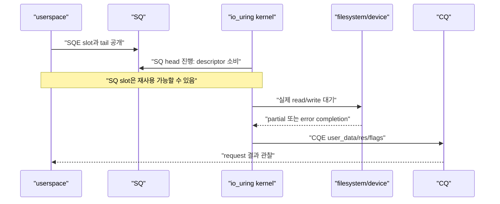
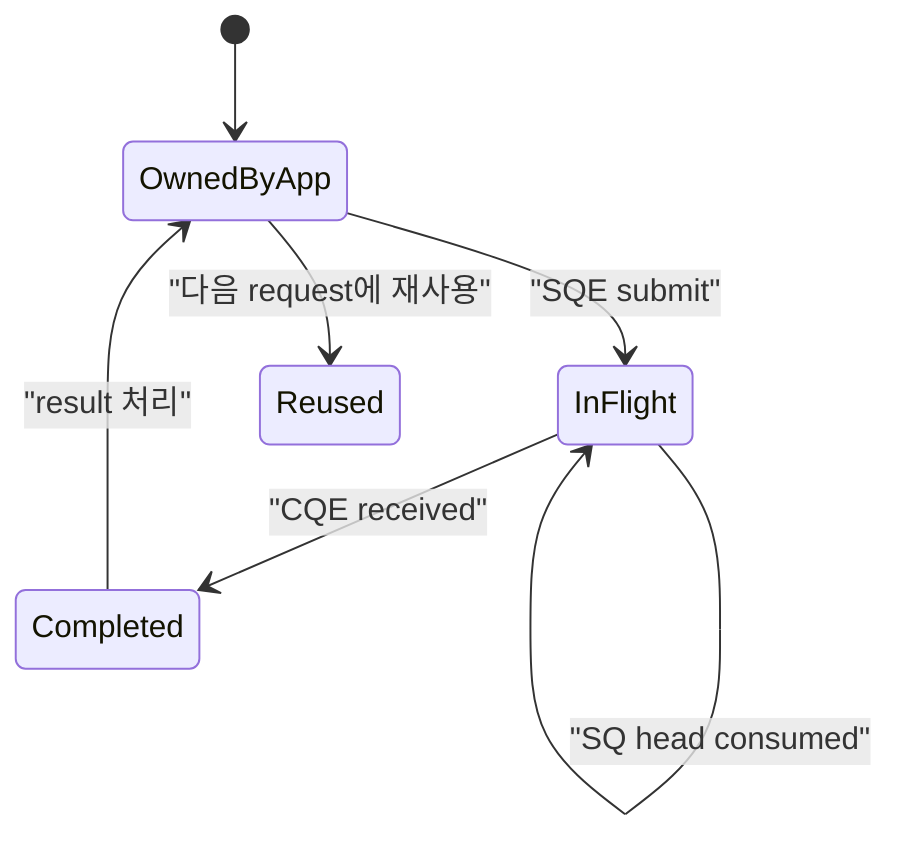
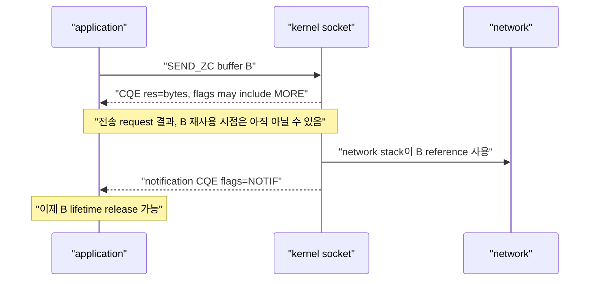

# 09. io_uring SQ·CQ와 request lifetime

[이 책 목차](README.md) · [이전: I/O 제어, page cache와 durability](08-io-control-page-cache-and-durability.md) · [다음: io_uring registration, polling과 feature 탐지](10-io-uring-registration-polling-and-features.md)

일반 프로그램이 실행되는 메모리와 CPU 권한 영역을 **사용자 영역**이라고 한다. 영어 문서에서는 userspace라고 부른다. 프로그램은 이 영역에서 자기 계산과 자료 처리를 하지만 저장장치와 네트워크 장치를 마음대로 제어할 수 없다. 장치와 메모리 보호를 관리하는 운영체제 핵심 코드가 실행되는 높은 권한 영역을 **커널 영역**이라고 한다. 영어 이름은 kernel space다. 프로그램은 파일을 읽거나 socket으로 byte를 받으려 할 때 운영체제에 작업을 요청한다.

예를 들어 파일에서 4096byte를 읽는 일에는 시작과 끝이 있다. 시작할 때 프로그램은 운영체제에 다섯 가지를 알려 준다.

- 어느 열린 파일인가: 프로세스가 가진 작은 정수 번호인 **파일 식별 번호**, 영어로 file descriptor 또는 fd다.
- 받은 byte를 어디에 둘 것인가: 프로그램 메모리의 연속 구간인 **버퍼(buffer)**다.
- 파일의 어느 지점부터 읽을 것인가: 첫 byte의 위치인 **offset**이다.
- 최대 몇 byte를 읽을 것인가: **length**다.
- 나중에 결과가 왔을 때 어느 작업인지 어떻게 찾을 것인가: 프로그램이 정한 식별값이다.

이 정보를 모아 운영체제에 건네는 한 건을 이 장에서는 **요청(request)**이라고 부른다. 요청이 성공했는지, 몇 byte를 처리했는지, 왜 실패했는지를 운영체제가 돌려주는 한 건을 **완료 결과(completion)**라고 부른다. 요청을 시작했다는 사실과 완료 결과를 받았다는 사실 사이에는 시간이 있다. 그동안 운영체제나 장치가 파일과 버퍼를 사용하므로 프로그램은 관련 memory를 함부로 해제하거나 다른 용도로 덮어쓰면 안 된다.

전통적인 방식은 요청할 때마다 시스템 호출로 커널 영역에 들어가고, 결과를 기다리거나 다시 확인한다. 요청이 매우 많으면 이 왕복과 대기 관리도 비용이 된다. Linux의 io_uring은 프로그램과 커널이 요청과 결과를 놓는 배열을 공유하게 해 여러 건을 묶어 처리하도록 돕는다.

**고정 크기 순환 저장소**는 entry를 놓는 칸 수가 정해져 있고 마지막 칸 다음에는 첫 칸을 다시 쓰는 저장소다. 영어 이름은 ring buffer다. 무한히 새 memory를 할당하지 않고 같은 배열을 반복 사용할 수 있다. 단, 아직 읽지 않은 칸을 덮지 않으려면 두 위치 번호가 필요하다. 새 항목을 어디까지 공개했는지를 **tail**, 소비자가 어디까지 처리했는지를 **head**라고 한다. 둘은 배열 칸 번호에서 바로 0으로 돌아가는 값이 아니라 계속 증가하는 논리 index로 관리할 수 있다. 실제 칸은 ring 크기에 맞춰 계산한다.

io_uring이라는 이름은 이 순환 저장소를 이용하는 Linux I/O interface를 뜻한다. 두 방향의 저장소가 있다.

- **Submission Queue, SQ(제출 큐)**: 프로그램이 커널에 처리해 달라고 공개한 요청의 순서를 보관한다.
- **Submission Queue Entry, SQE(제출 항목)**: 한 요청의 작업 종류, fd, 버퍼 주소, 길이, offset, 식별값을 담는 구조체다.
- **Completion Queue, CQ(완료 큐)**: 커널이 프로그램에 공개한 완료 결과의 순서를 보관한다.
- **Completion Queue Entry, CQE(완료 항목)**: 작업 식별값, 성공 byte 수 또는 오류, 추가 결과 여부를 담는 구조체다.

기본 구성에서 SQ ring의 칸은 SQE 전체가 아니라 SQE 배열의 몇 번째 칸을 사용할지 나타내는 index를 담는다. 프로그램은 먼저 SQE의 모든 정보를 완성하고, 그 index를 SQ에 놓은 뒤 tail을 공개한다. 커널은 tail을 확인해 요청을 가져간다. 작업이 끝나면 CQE를 완성하고 CQ tail을 공개한다. 프로그램은 CQE를 읽은 뒤 CQ head를 진행시킨다.


이 장의 C 모양 text는 구조를 설명하는 의사 코드이며 현재 host에서 compile하거나 실행하지 않았다. 최신 kernel의 선택 mode는 기본 SQ array가 없을 수 있으므로 해당 feature를 쓸 때 별도 규칙을 확인한다.


## 1. 첫 요청에서 각 항목의 실체와 수명

SQE는 공유 memory에 있는 제출 설명 칸이다. 커널이 내용을 가져가 SQ head를 진행하면 그 SQE 칸은 다시 쓸 수 있을 수 있다. 그러나 read 대상 file object, 결과를 받을 buffer, 식별값이 가리키는 application context의 수명은 CQE가 알려 주는 종료 조건까지 이어진다. “SQE 칸 재사용 가능”과 “I/O에 쓰인 모든 object 해제 가능”은 다른 사건이다.

CQE의 식별값 필드를 **user_data**라고 한다. 커널은 이 64bit 값의 업무 의미를 해석하지 않고 SQE에서 CQE로 돌려준다. 프로그램은 operation 번호나 table slot과 generation을 넣어 완료 결과를 원래 작업에 연결한다. raw pointer를 넣으면 모든 관련 완료가 끝날 때까지 그 object가 살아 있어야 한다.

CQE의 **res** 필드는 보통 성공한 byte 수 또는 음수 오류 번호를 담는다. 4096이면 4096byte 처리, 512면 일부만 처리한 short I/O, read에서 0이면 EOF일 수 있다. -11 같은 음수는 Linux 오류 번호 체계로 해석한다. flags는 multishot의 추가 결과나 buffer 선택, notification 같은 부가 상태를 전달한다.

## 2. Ring index 손계산

Entry가 8개인 ring은 mask가 7이다. Logical tail이 계속 증가해도 physical slot은 `index & mask`로 고른다.

```text
sq_head = 13
sq_tail = 18
kernel이 아직 SQ에서 소비하지 않은 entries = 18 - 13 = 5
free entries = 8 - 5 = 3

logical index 18 → physical slot 18 & 7 = 2
```

이 5개는 SQ에 남아 있는 제출 항목 수다. 이미 SQ에서 소비됐지만 실제 I/O가 끝나지 않은 request는 따로 있을 수 있어 전체 in-flight 수와 같지 않다. Head와 tail을 단순히 0–7 범위 숫자로만 비교하면 wrap-around에서 틀린다. Producer가 SQE field를 모두 쓴 뒤 tail을 publish하고, consumer는 적절한 memory ordering으로 tail을 본다. 직접 raw ring을 다룰 때는 kernel UAPI의 barrier pattern을 따른다.

## 3. SQE를 kernel이 소비했다고 I/O가 끝난 것이 아니다



SQ head가 진행하면 kernel이 submission descriptor를 가져갔다는 뜻이다. Buffer, file lifetime, application operation이 끝났다는 뜻은 아니다. Request 완료는 대응 CQE로 판단한다.

## 4. `user_data`는 application correlation key다

Kernel은 `user_data`의 의미를 해석하지 않고 SQE에서 CQE로 돌려준다. Pointer를 그대로 넣을 수도 있지만 object lifetime과 alignment/tagging을 안전하게 관리해야 한다.

```text
user_data = (operation_id << 8) | operation_kind

0x00000000002A01 → operation 42, kind READ
0x00000000002A02 → operation 42, kind WRITE
0x00000000002A03 → operation 42, kind TIMEOUT
```

같은 logical operation에 여러 SQE를 제출하면 각 step을 구분할 key가 필요하다. 취소 request의 CQE와 대상 request의 CQE도 별도다.

`user_data`를 heap object pointer로 썼다면 모든 관련 CQE가 끝나기 전에 object를 free하지 않는다. Cancellation을 제출했다는 이유만으로 대상 object를 해제하면 race에서 use-after-free가 된다.

## 5. `cqe->res` 읽는 법

`res`는 성공 byte count 또는 negative errno다. `errno` global을 읽는 일반 syscall wrapper와 다르다.

```text
res = 4096    → 4096 bytes 완료
res = 512     → short I/O, 요청 4096 중 512 bytes
res = 0       → read에서는 EOF 가능, opcode별 의미 확인
res = -11     → -EAGAIN
res = -125    → -ECANCELED
```

Negative result는 `-res`를 errno number로 해석한다. 모든 opcode가 byte count를 반환하는 것은 아니므로 opcode reference를 확인한다.

## 6. Short I/O와 EOF

Read 64KiB를 제출했다고 한 CQE가 항상 65536을 반환하지 않는다.

```text
요청 offset=0, len=65536
CQE res=24576
남은 len=40960
다음 offset=24576
```

Regular file read에서 EOF에 도달하면 `res=0`일 수 있다. Socket receive의 `res=0`은 orderly peer shutdown을 뜻할 수 있다. `0`을 “아직 결과 없음”으로 쓰지 않는다. CQE가 도착했다면 그 request는 opcode semantics에 따라 완료된 것이다.

Write도 signal, filesystem, capacity, socket backpressure 등으로 short completion이 가능하다. 남은 byte를 다시 제출할지, logical operation을 실패로 처리할지 application protocol이 결정한다.

## 7. Buffer lifetime의 기본 규칙

Read request에서는 kernel이 buffer에 쓰고, write request에서는 buffer 내용을 읽는다. 일반 원칙은 해당 request CQE를 보기 전까지 buffer 주소와 필요한 content를 안정적으로 유지하는 것이다.



SQE가 consume된 직후 write buffer를 덮어쓰면 kernel이 아직 data를 읽지 않았을 수 있다. Stack buffer를 가리킨 request를 제출하고 function이 return하는 것도 위험하다.

## 8. CQE를 소비하는 책임

Kernel이 CQE를 CQ ring에 게시하면 userspace는 결과를 처리한 뒤 CQ head를 진행해야 한다. CQE를 회수하지 않으면 completion queue가 가득 차고 overflow handling이나 성능 문제가 생긴다.

```text
cq_entries = 8
cq_head = 20
cq_tail = 27
pending completions = 7
free CQ slots = 1
```

Completion handler가 느리면 submission rate가 아니라 CQ drain rate가 병목일 수 있다. `IORING_FEAT_NODROP` 같은 feature가 있더라도 무한한 completion 저장소가 생기는 것은 아니다.

## 9. Multishot와 `IORING_CQE_F_MORE`

Multishot accept, receive, poll 같은 request는 SQE 하나에서 여러 CQE를 만들 수 있다. CQE `flags`에 `IORING_CQE_F_MORE`가 있으면 같은 request에서 completion이 더 올 수 있다.

```text
CQE 1: user_data=77, res=client_fd_1, flags=MORE
CQE 2: user_data=77, res=client_fd_2, flags=MORE
CQE 3: user_data=77, res=-ECANCELED, flags=0
```

첫 CQE를 받았다고 request context를 free하면 두 번째 CQE가 dangling pointer를 참조한다. `MORE`가 사라진 terminal CQE까지 lifetime을 유지한다.

Multishot receive에서 selected buffer ID가 flags에 포함될 수 있다. Application은 어떤 provided buffer가 사용됐는지 확인하고 data 처리를 마친 뒤 적절히 recycle한다.

## 10. Zero-copy send의 두 completion 의미

일부 zero-copy networking operation은 request completion과 buffer lifetime notification을 분리한다.



`IORING_CQE_F_NOTIF`는 buffer를 kernel이 더 이상 참조하지 않는 lifetime notification이다. Remote peer가 data를 application에서 처리했다는 ACK가 아니다. Error request에도 notification이 올 수 있으므로 첫 CQE result만 보고 buffer를 free하지 않고 `MORE`/`NOTIF` 계약을 따른다.

Zero-copy는 항상 보장되지 않고 copy fallback이 가능할 수 있다. “ZC opcode를 썼으니 copy가 0”이라고 측정 없이 주장하지 않는다.

## 11. Cancellation은 두 CQE의 race다

Target request T를 cancel하는 request C를 제출하면 최소 두 결과를 생각한다.

| 순서 | Target T CQE | Cancel C CQE | 해석 |
| --- | --- | --- | --- |
| Cancel이 먼저 성공 | `-ECANCELED` 가능 | cancel 성공 | T가 취소됨 |
| T가 먼저 완료 | 정상 bytes/error | `-ENOENT` 등 가능 | 찾을 active T가 없음 |
| 실행을 멈출 수 없음 | 정상 또는 다른 error | cancel 실패 | opcode/device semantics 확인 |

```text
t=0   READ T 제출, user_data=100
t=5   CANCEL C 제출, target user_data=100
t=6   READ T CQE res=4096
t=7   CANCEL C CQE res=-ENOENT
```

이 시간표에서 cancel 실패는 read 실패가 아니다. Read가 이미 완료된 race 결과다. T와 C CQE를 모두 처리할 때까지 buffer와 operation context를 유지한다.

## 12. File descriptor lifetime

일반 fd를 SQE에 넣고 바로 `close()`하면 fd number가 다른 file에 재사용되는 race를 피하기 위한 kernel reference semantics가 opcode마다 중요하다. Registered fixed file은 ring table이 file reference를 유지해 hot path lookup 비용과 lifetime 관리 방식을 바꾼다.

Fixed file registration은 다음 장에서 다루지만, “등록했으니 underlying file을 절대 닫을 수 없다” 또는 “userspace fd number를 영원히 보존해야 한다”로 단순화하지 않는다. Registration table update와 outstanding request completion을 설계한다.

## 13. Pseudocode로 보는 안전한 loop

```text
allocate operation context and stable buffer
sqe = get_sqe()
sqe.opcode = READ
sqe.fd = file_fd
sqe.addr = buffer
sqe.len = buffer_len
sqe.user_data = operation_id
submit()

while operation not terminal:
    cqe = wait_or_peek_completion()
    context = lookup(cqe.user_data)
    handle negative errno, zero, and short result
    if cqe.flags has MORE:
        keep context alive
    else if this is zero-copy and notification is pending:
        keep buffer alive
    else:
        release or reuse resources
    mark_cqe_seen()
```

이는 liburing API 이름을 완전히 재현한 실행 code가 아니다. Unsupported host에서 실행하지 않는다. 실제 code는 liburing version과 opcode man page를 확인한다.

## 15. 세대 번호로 request와 memory 재사용을 증명한다

`user_data`에 pointer만 넣으면 address가 재사용될 때 오래된 CQE와 새 request를 혼동할 수 있다. **generation(세대 번호)**은 같은 slot이나 object가 다시 쓰일 때마다 증가시키는 논리 번호다. 실제 위치는 application의 request table entry 안이며 CQE가 어떤 생애의 request에 속하는지 구분하기 위해 필요하다.

```text
request table slot 7
generation 41: recv request R41 제출
→ cancel과 completion이 경쟁하는 동안 slot 유지
→ terminal CQE까지 처리, generation 41 종료

generation 42: 같은 slot 7 재사용
user_data = encode(slot=7, generation=42)
```

늦게 도착한 R41 CQE의 user_data에는 generation 41이 있어 현재 42와 다르므로 새 buffer를 해제하지 않는다. bit packing을 쓰면 slot과 generation에 몇 bit를 배정할지, wraparound 전에 outstanding request가 모두 끝난다는 조건을 설계한다. 무제한 시간이 흐르면 작은 generation도 반복될 수 있으므로 충분한 폭과 retirement 규칙이 필요하다.

## 16. publish 순서와 ring ownership을 한 단계씩 본다

SQE memory에 opcode와 buffer를 썼다는 사실만으로 kernel이 request를 볼 수 있는 것은 아니다. userspace는 SQE를 완성하고 SQ array에 index를 놓은 뒤 tail을 공개한다. **publish(공개)**는 다른 실행 주체가 완성된 상태를 읽어도 된다는 순서 경계다. library가 필요한 memory ordering을 제공하므로 application은 raw ring을 직접 다룰 때만 architecture별 barrier를 구현하려 하지 말고 공식 helper 계약을 따른다.

한 producer 모형은 다음 순서다.

1. 현재 SQ tail에서 사용할 ring slot을 고른다.
2. free SQE를 얻고 opcode, fd, offset, address, length, user_data를 모두 채운다.
3. application request object와 buffer 상태를 SUBMITTED로 바꾼다.
4. SQ array entry가 SQE index를 가리키게 한다.
5. release 성격의 순서로 tail을 공개한다.
6. kernel은 head와 tail을 보고 SQE를 소비한다.
7. 소비 뒤에도 request object와 buffer는 completion 계약이 끝날 때까지 살아 있어야 한다.

여러 producer가 raw ring을 함께 갱신하면 같은 slot을 선택하거나 tail update를 잃을 수 있다. liburing의 queueing pattern, application lock 또는 single-submitter 규칙 중 하나를 명시한다. SQ entry ownership과 I/O buffer ownership은 별개다.

CQ에서도 kernel이 CQE field를 채운 뒤 tail을 공개하고 userspace는 tail을 확인한 뒤 CQE를 읽는다. 읽기가 끝나기 전에 CQ head를 먼저 전진시키면 kernel이 그 slot을 재사용해 CQE가 덮일 수 있다.

## 17. buffer 상태 기계로 short I/O와 multishot을 합친다

buffer 상태를 FREE, IN_FLIGHT, APP_OWNED, RETURNABLE 네 개로 두자.

| 사건 | 이전 상태 | 새 상태 | 허용 동작 |
|---|---|---|---|
| recv 제출 | FREE | IN_FLIGHT | kernel이 쓸 수 있어 application 수정 금지 |
| CQE res=600, MORE=1 | IN_FLIGHT | APP_OWNED | 첫 600byte 처리, request는 계속 살아 있음 |
| payload 처리 완료 | APP_OWNED | RETURNABLE | provided-buffer ring 반환 준비 |
| terminal CQE, MORE=0 | IN_FLIGHT 또는 APP_OWNED | RETURNABLE | multishot request 자체 종료 |
| buffer 반환 publish | RETURNABLE | FREE | 다음 receive에 재사용 가능 |

multishot request 하나가 여러 CQE를 만들 수 있으므로 CQE 하나당 request object를 free하면 안 된다. `IORING_CQE_F_MORE`가 더 올 수 있음을 나타낼 때 request lifetime을 유지한다. 개별 buffer는 payload 처리가 끝난 뒤 반환하지만 request descriptor는 terminal CQE까지 유지한다.

**short I/O**는 요청 length보다 작은 양이 성공한 결과다. file read는 EOF 근처, socket은 현재 도착 byte, signal이나 device 조건 때문에 짧을 수 있다. res가 양수면 그만큼 진행한 것이므로 남은 byte가 업무상 필요하면 새 request를 만들거나 offset/address를 조정한다. res=0은 opcode별로 EOF, orderly shutdown 또는 zero-length 성공 의미가 다르다.

## 18. cancellation의 두 completion을 시간표로 읽기

cancel request C는 target R을 찾아 취소하려는 별도 request다. 따라서 C 자체 CQE와 R의 terminal CQE 두 결과를 관리한다.

```text
t0 R(user_data=100) 제출, buffer B는 IN_FLIGHT
t1 timeout 발생, cancel C(user_data=200, target=100) 제출
t2 R이 device에서 이미 완료될 수 있음
t3 C CQE: target을 찾았는지/취소했는지 결과
t4 R CQE: 성공 byte 또는 취소 오류
t5 두 request의 terminal 조건을 확인한 뒤 B와 context 해제
```

C CQE 성공만 보고 B를 free하면 R CQE나 kernel path가 B를 참조하는 race가 생길 수 있다. 반대로 target이 먼저 완료되어 cancel이 못 찾았다는 결과도 정상 경쟁 결과일 수 있다. application state machine은 “cancel 요청 보냄”을 “target 수명 종료”와 구분한다.

linked SQE에서도 앞 request 실패 시 뒤 request가 취소되는 규칙과 이미 실행을 시작한 정도를 opcode 계약으로 확인한다. link는 transaction rollback이나 durability를 자동 제공하지 않는다.

## 19. zero-copy notification과 원격 완료를 구분한다

zero-copy send 계열은 payload data를 즉시 복사하지 않고 application memory를 network stack/device가 참조할 수 있게 한다. 첫 CQE가 send request 결과를 알려도 buffer를 즉시 덮어써도 된다는 뜻이 아닐 수 있다. **notification CQE**는 kernel이 해당 memory를 더 이상 참조하지 않아 재사용 가능한 시점을 알려 주는 별도 completion이다.

두 completion을 다음처럼 구분한다.

- request CQE: send 요청의 제출·처리 결과와 byte 수
- notification CQE: local kernel/network path의 buffer reference 종료
- remote ACK 또는 application-level 응답: 상대가 수신·처리했다는 별도 protocol 사건

notification은 remote durability나 remote application consumption을 보장하지 않는다. 첫 CQE, F_NOTIF CQE, remote ACK를 서로 다른 상태로 둔다.

## 20. 전체 loop의 종료 조건

안전한 event loop는 SQ 공간, CQ 공간, request table, buffer pool 네 자원의 backpressure를 함께 다룬다.

```text
while running or outstanding > 0:
    가능한 만큼 신규 request 준비
      - request slot과 generation 확보
      - buffer ownership을 IN_FLIGHT로 전환
      - SQE 완성 후 publish

    필요하면 enter/wait
      - SQ가 가득 차면 completion 회수로 공간 확보
      - CQ overflow와 kernel feature 조건 관찰

    모든 보이는 CQE 처리
      - user_data의 slot+generation 검증
      - res와 flags를 opcode 계약대로 해석
      - short I/O면 나머지 정책 결정
      - MORE/NOTIF/cancel terminal 조건 갱신
      - payload 처리가 끝난 buffer만 반환
      - 마지막에 CQ head 전진

shutdown:
    신규 제출 중단
    outstanding multishot/timeout/cancel 정리
    terminal CQE와 notification 회수
    registration 해제 전 buffer/file reference가 0인지 확인
    ring close
```

## 21. 추가 완전 해설 문제

1. user_data가 slot 7만 담고 있는데 slot을 재사용했다. 위험은?
   - 늦은 CQE가 새 request로 오인될 수 있다. generation을 함께 검증한다.
2. SQE field를 일부 채운 뒤 tail을 먼저 공개하면?
   - kernel이 미완성 SQE를 볼 수 있다. 완성 후 공식 publish ordering을 지킨다.
3. multishot CQE에 MORE가 있다. request와 개별 buffer를 함께 free해도 되는가?
   - request는 유지한다. buffer는 payload 처리와 제공-buffer 계약이 끝날 때만 반환한다.
4. cancel CQE가 성공했다. target buffer를 즉시 free해도 되는가?
   - target의 terminal CQE와 참조 종료를 확인해야 한다.
5. zero-copy notification CQE는 상대 application이 data를 저장했다는 뜻인가?
   - 아니다. local buffer 재사용 경계이며 원격 protocol 완료와 다르다.
6. 4KiB write가 1024를 반환했다. 완료인가?
   - 1024byte만 진행했다. 나머지 3072byte가 필요하면 새 offset/address로 이어 제출한다.
7. CQE를 읽기 전에 CQ head를 전진시키면?
   - kernel이 slot을 재사용해 CQE가 덮일 수 있다.

## 22. 문제

1. SQ head가 request index를 지나갔다. Write buffer를 즉시 덮어써도 되는가?
2. Read CQE의 `res=0`은 무엇을 뜻할 수 있는가?
3. Multishot CQE에 `F_MORE`가 있다. Context를 free해도 되는가?
4. Zero-copy send의 첫 CQE가 8192를 반환했다. Buffer를 바로 재사용해도 되는가?

## 23. 해설

1. 아니다. Descriptor 소비와 I/O completion은 다르다. 대응 CQE와 opcode별 lifetime을 기다린다.
2. Regular file 또는 socket에서 EOF/orderly shutdown을 뜻할 수 있다. Opcode semantics를 확인한다.
3. 안 된다. 같은 SQE에서 CQE가 더 올 수 있으므로 terminal CQE까지 유지한다.
4. Notification 계약이 있는 opcode라면 `F_NOTIF` CQE까지 기다린다. 첫 CQE는 remote consumption 보장도 아니다.

공식 interface는 [io_uring(7)](https://man7.org/linux/man-pages/man7/io_uring.7.html), [io_uring_enter(2)](https://man7.org/linux/man-pages/man2/io_uring_enter.2.html)을 참고한다.

다음 장에서는 fixed file·fixed buffer registration, SQPOLL·IOPOLL의 실제 전제, kernel feature 탐지와 security policy failure를 다룬다.
