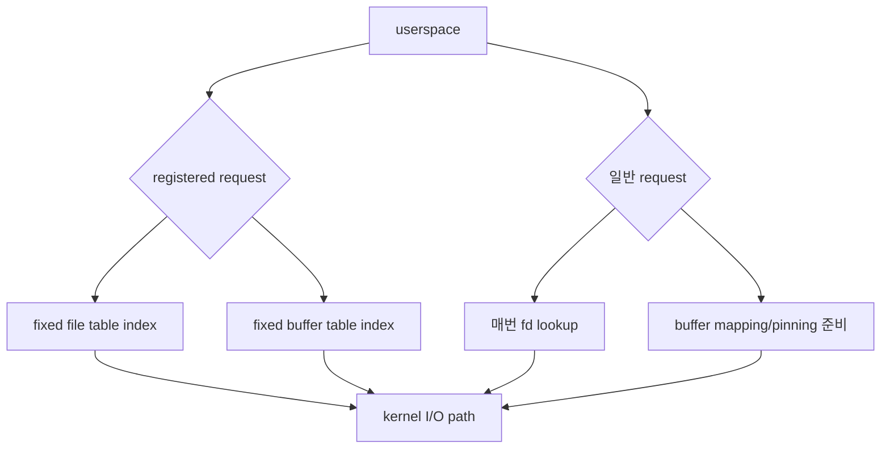
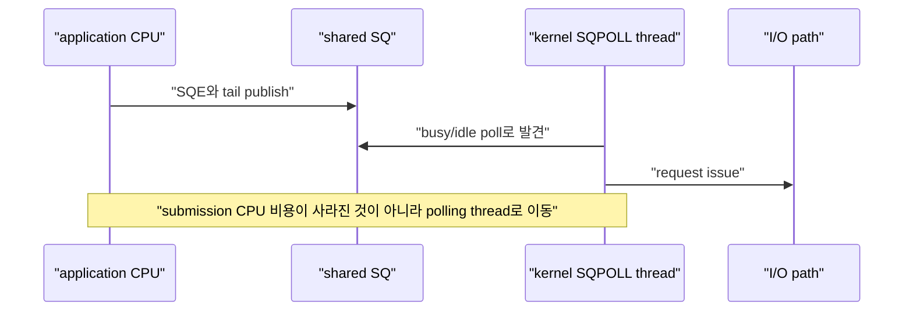
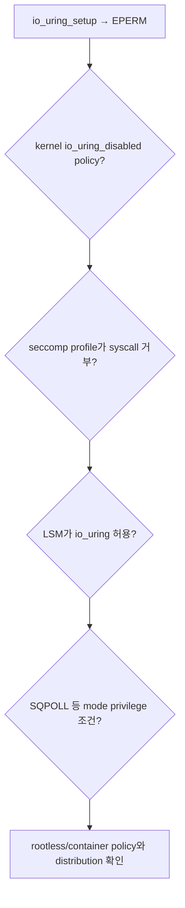
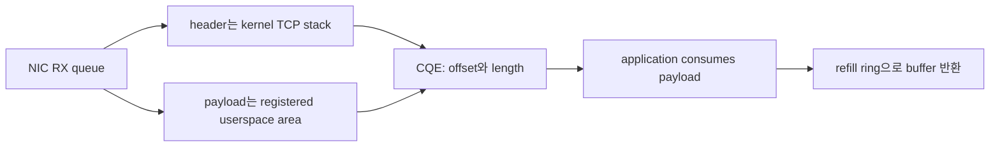

# 10. io_uring registration, polling과 feature 탐지

[이 책 목차](README.md) · [이전: io_uring SQ·CQ와 lifetime](09-io-uring-sq-cq-and-lifetimes.md) · [다음: io_uring ordering, error와 fsync](11-io-uring-ordering-errors-and-fsync.md)

io_uring에는 fixed file, fixed buffer, SQPOLL, IOPOLL처럼 성능을 높일 수 있는 mode가 많다. 이름만 켜면 빨라지는 switch가 아니며 kernel, device, filesystem, privilege, memory budget 조건이 맞아야 한다. Registration은 lookup·pinning 비용을 바꾸지만 자동 zero-copy 보장은 아니다.

이 장은 교육용 설계 설명이다. Kernel sysctl, seccomp, cgroup, NIC queue 또는 io_uring mode를 실제로 변경하지 않았다.


## 1. Registration이 필요한 이유

일반 request마다 kernel은 fd를 file object로 lookup하고 userspace buffer page를 pin하거나 copy할 준비를 한다. 반복 workload에서는 file과 buffer를 ring에 미리 등록하여 hot path 비용을 줄일 수 있다.



## 2. Fixed file table

`io_uring_register()`로 file descriptor array를 등록하면 ring이 kernel file reference table을 유지한다. SQE는 `IOSQE_FIXED_FILE`과 table index를 사용한다.

```text
registered files:
index 0 → data-0001.bin file object
index 1 → data-0002.bin file object
index 2 → listening socket
```

장점은 반복 fd lookup을 줄이고 SQPOLL 같은 mode에서 안정적인 file reference를 제공하는 것이다. 비용은 table 관리와 update synchronization이다.

반례:

- Index 1은 userspace fd number 1이 아니다.
- File 등록만으로 data copy가 사라지지 않는다.
- Table에서 entry를 update할 때 outstanding request가 어느 file object를 참조하는지 관리해야 한다.
- Ring마다 registration state가 있으므로 process 전체 global table로 단정하지 않는다.

## 3. Fixed buffer registration

Fixed buffer는 memory region을 ring에 등록하고 read/write fixed operation이 index와 offset을 참조하게 한다. Kernel이 매 request마다 page를 준비하는 비용을 줄일 수 있다.

```text
buffer 0: virtual address A, length 1MiB
buffer 1: virtual address B, length 1MiB

READ_FIXED uses buffer_index=0, offset within A
```

등록한 page는 memory pressure에서 자유로운 공짜 memory가 아니다. 장기간 많은 memory를 pin하면 reclaim과 container memory budget에 영향을 준다. `RLIMIT_MEMLOCK`, cgroup memory accounting, kernel version의 pinning 정책도 확인한다.

Fixed buffer registration은 “storage device가 application memory에 직접 DMA하여 copy가 항상 0”이라는 보장이 아니다. Buffered filesystem I/O라면 page cache와 copy가 남을 수 있고 device·filesystem이 direct I/O 조건을 만족해야 한다.

## 4. Provided buffer와 fixed buffer는 목적이 다르다

Provided buffer pool 또는 buffer ring은 receive처럼 kernel이 사용 가능한 buffer 중 하나를 고르게 한다. Fixed buffer는 request가 특정 registered region을 index로 가리키는 방식이다.

| 방식 | 누가 buffer를 고르는가 | 대표 목적 |
| --- | --- | --- |
| Fixed buffer | application이 SQE index 지정 | 반복 file read/write의 registration 비용 감소 |
| Provided buffer selection | kernel이 group에서 선택 | multishot receive와 buffer 공급 |

CQE flag의 buffer ID를 확인하기 전에 provided buffer를 다른 request에 반환하면 data corruption이 생긴다. Buffer pool은 lifetime protocol이지 단순 allocator 이름이 아니다.

## 5. SQPOLL은 submission polling thread다

**SQPOLL(Submission Queue Polling)**은 kernel thread가 SQ를 polling하여 매 batch의 `io_uring_enter()` submission syscall을 줄일 수 있는 mode다.



SQPOLL은 device completion을 polling하는 IOPOLL과 다르다. SQPOLL thread는 CPU를 소비하며 idle policy 뒤에는 application이 wake-up syscall을 해야 할 수 있다.

Low submission rate에서 계속 polling하면 syscall 절감보다 CPU·energy 비용이 커질 수 있다. CPU quota가 작은 container에서는 polling thread가 workload quota와 어떻게 account되는지도 측정한다.

## 6. IOPOLL은 device completion polling이다

**IOPOLL(I/O Polling)**은 interrupt 기반 completion 대신 application이 device completion을 poll하는 mode다. 일반적으로 polling을 지원하는 storage와 direct I/O 같은 조건이 필요하며 buffered I/O에 임의로 쓰는 switch가 아니다.

| Mode | Polling 대상 | 주된 비용 | 필요한 조건 |
| --- | --- | --- | --- |
| 기본 | interrupt/wakeup 기반 completion | syscall·interrupt·schedule | 넓은 호환성 |
| SQPOLL | submission queue | kernel polling CPU | permission, stable files, workload rate |
| IOPOLL | storage completion | caller polling CPU | 지원 device와 I/O 방식 |

SQPOLL과 IOPOLL을 함께 쓸 수 있는 조합이 있어도 서로 대체하지 않는다. 하나는 request issue 앞, 다른 하나는 completion 뒤의 대기 방식을 바꾼다.

## 7. 손계산: polling의 break-even

초당 200,000 request를 batch 32개로 submit한다고 가정한다.

```text
submission enter 횟수 = 200,000 ÷ 32 = 6,250 calls/s
call당 CPU 비용 가정 = 1.2µs
submission CPU ≈ 7.5ms CPU/s = 한 core의 0.75%
```

SQPOLL thread가 한 core의 15%를 사용한다면 이 workload에서는 손해일 수 있다. 반대로 batch 없이 초당 1,000,000회 enter하고 latency 목표가 매우 낮다면 trade-off가 달라진다. 실제 syscall cost, cache miss, wake-up, tail latency로 측정한다.

## 8. Runtime feature 탐지가 필요하다

Kernel version 문자열만으로 opcode와 flag 사용 가능성을 결정하지 않는다. Distribution backport, security patch, config, seccomp policy 때문에 결과가 다를 수 있다.

```text
1. io_uring_setup() 성공 여부와 params.features 확인
2. io_uring_register(PROBE) 또는 liburing probe로 opcode 확인
3. 필요한 setup/register flag를 작은 isolated ring에서 시도
4. -EINVAL, -EOPNOTSUPP, -EPERM을 구분
5. 지원하지 않으면 epoll/threaded I/O 등 fallback 선택
```

공식 setup과 registration interface는 [io_uring_setup(2)](https://man7.org/linux/man-pages/man2/io_uring_setup.2.html), [io_uring_register(2)](https://man7.org/linux/man-pages/man2/io_uring_register.2.html)을 따른다.

## 9. `EPERM`의 여러 원인

`io_uring_setup()`이 `-EPERM`이면 root가 아니라는 이유 하나로 결론 내리지 않는다.



- Kernel `io_uring_disabled` sysctl policy가 unprivileged creation을 막을 수 있다.
- Container seccomp profile이 `io_uring_setup`, `io_uring_enter`, `io_uring_register`를 차단할 수 있다.
- LSM(Linux Security Module)이 ring 또는 `uring_cmd`를 거부할 수 있다.
- SQPOLL의 permission 조건은 kernel generation과 configuration에 따라 다르다.
- Rootless container는 host policy를 우회하지 못한다.

Security restriction을 benchmark 때문에 임의 해제하지 않는다. 필요한 opcode와 threat model을 검토하고 좁은 policy를 사용한다.

## 10. Feature와 운영 support는 다르다

Upstream kernel에 feature가 들어간 시점과 현재 Ubuntu host가 지원하는 시점은 다르다. Ubuntu LTS는 GA kernel과 HWE(Hardware Enablement) kernel lifecycle이 다르며 backport 여부도 확인해야 한다.

공식 Ubuntu [HWE kernel 안내](https://documentation.ubuntu.com/kernel/reference/hwe-kernels/)를 기준으로 installed kernel package, booted kernel, userspace liburing을 함께 기록한다.

```text
source code에 opcode 존재
≠ booted kernel이 opcode 지원
≠ seccomp/LSM가 허용
≠ filesystem/device가 빠른 path 지원
≠ application이 fallback 없이 안전
```

## 11. ZCRX는 조건부 최신 예시다

**ZCRX(Zero-Copy Receive)**는 network receive payload를 userspace memory로 직접 받는 io_uring 기능군이다. Kernel TCP stack을 사용하면서 copy를 줄이는 것이 목표다.

현재 kernel 문서의 [io_uring zero copy Rx](https://docs.kernel.org/networking/iou-zcrx.html)는 다음과 같은 전제를 둔다.

- Header/data split을 지원하는 NIC
- Flow steering과 RSS(Receive Side Scaling) queue 구성
- 필요한 io_uring setup flag
- Registered memory area와 refill ring
- 사용한 buffer를 kernel에 돌려주는 recycle protocol



이 기능을 host가 자동 지원한다고 가정하지 않는다. NIC hardware와 out-of-band queue 설정이 필요하며 registration 실패나 unsupported feature에는 기존 receive path fallback이 있어야 한다.

## 12. Registration 실패 설계

| 실패 | 가능한 원인 | 안전한 대응 |
| --- | --- | --- |
| `-ENOMEM` | pinning/memory budget 부족 | pool 축소, 일반 buffer fallback |
| `-EPERM` | memlock/security policy | policy 확인, 임의 privilege 확대 금지 |
| `-EINVAL` | flag·alignment·kernel 불지원 | probe 결과와 ABI 재확인 |
| `-EOPNOTSUPP` | device/filesystem/opcode 미지원 | 지원 path로 fallback |

Registration이 절반 성공한 뒤 후속 단계가 실패할 수 있으므로 unwind 순서를 갖는다. Outstanding request가 참조하는 table을 먼저 unregister하지 않는다.

## 13. 관찰할 수치

- Submit batch 크기와 `io_uring_enter()` 횟수
- SQPOLL thread CPU와 wake-up 횟수
- I/O completion latency p50/p99
- Registered/pinned memory 크기
- CQ overflow와 pending completion
- Fallback 비율과 copy 여부
- cgroup CPU quota throttling과 memory pressure

Throughput만 높고 polling CPU가 한 core를 독점하면 shared node에서는 전체 효율이 나빠질 수 있다.

## 14. 처음 보는 단어로 registration과 polling을 끝까지 따라가기

**Registration**은 application이 file이나 memory region을 ring에 미리 알려 kernel table에 reference를 유지하게 하는 작업이다. Request마다 같은 object를 다시 찾아 준비하는 비용을 줄이려는 이유가 있다.

**Pinning**은 memory page가 I/O 도중 이동·회수되어 주소 의미가 사라지지 않도록 kernel이 page reference를 유지하는 것이다. Pin된 page가 많으면 reclaim 가능한 RAM이 줄어 system 전체에 비용을 준다.

**memlock**은 user가 lock/pin할 수 있는 memory 양과 관련된 resource limit·accounting을 가리킨다. Fixed buffer registration이 실패하면 application heap 여유만 보지 말고 memlock, cgroup, privilege와 kernel 정책을 함께 본다.

**Polling**은 event notification을 기다려 sleep하는 대신 CPU가 상태를 반복 확인하는 방식이다. Wake-up latency를 줄일 수 있지만 확인하는 동안 CPU cycle과 power를 소비한다.

SQPOLL의 실제 흐름은 다음과 같다.

```text
1. Ring setup 때 kernel SQ polling thread 생성 요청
2. Application은 SQE와 tail을 shared memory에 공개
3. Polling thread가 tail 변화를 CPU에서 반복 확인
4. 새 entry를 발견하면 file table과 opcode를 읽어 request issue
5. 일정 idle 조건 뒤 polling thread가 sleep할 수 있음
6. Application은 NEED_WAKEUP 상태를 확인하고 필요하면 enter syscall로 깨움
7. I/O completion은 별도 CQ path로 돌아옴
```

IOPOLL의 실제 대상은 SQ가 아니라 device completion이다. Application이 completion을 기다리며 driver/device의 poll method를 호출하는 쪽이므로 지원 storage와 direct-I/O 조건이 중요하다.

**Probe**는 여기서 monitoring metric이 아니라 kernel이 feature를 제공하는지 runtime에 질문하는 동작이다. Setup result의 feature bit와 register probe의 opcode bit를 확인한다. Version string 비교보다 실제 booted kernel ABI를 묻는다.

```text
1. 최소 flag로 ring setup 시도
2. params.features를 bit 단위로 기록
3. 필요한 opcode를 register probe에서 확인
4. Fixed file/buffer 같은 registration을 작은 크기로 시도
5. EPERM, EINVAL, EOPNOTSUPP, ENOMEM을 서로 다른 원인으로 분류
6. 조건이 하나라도 맞지 않으면 검증된 fallback mode 선택
```

**Seccomp**는 process가 사용할 syscall을 filter하는 Linux 보안 mechanism이다. **LSM**은 SELinux, AppArmor 같은 Linux Security Module hook으로 security decision을 내린다. Rootless container 안의 root UID도 host의 seccomp·LSM·sysctl을 자동 우회하지 않는다.

## 15. 문제

1. Fixed buffer를 등록하면 buffered file read의 data copy가 항상 사라지는가?
2. SQPOLL과 IOPOLL은 각각 무엇을 poll하는가?
3. Kernel version이 충분히 새롭다. Opcode를 바로 사용해도 되는가?
4. ZCRX CQE를 처리한 buffer를 언제 refill ring에 돌려주는가?

## 16. 해설

1. 아니다. Registration은 page 준비 비용을 줄일 수 있지만 filesystem/page cache/device path의 copy 의미는 별도다.
2. SQPOLL은 submission queue, IOPOLL은 지원 storage의 completion을 poll한다.
3. 아니다. Runtime probe, policy, filesystem/device 조건을 확인하고 fallback을 둔다.
4. Application이 payload 사용을 끝낸 뒤다. 너무 일찍 반환하면 kernel이 같은 memory를 덮을 수 있다.

다음 장에서는 여러 SQE의 논리 순서를 link·hardlink·drain으로 표현하고, error 전파와 `fsync()` durability를 함께 설계한다.
