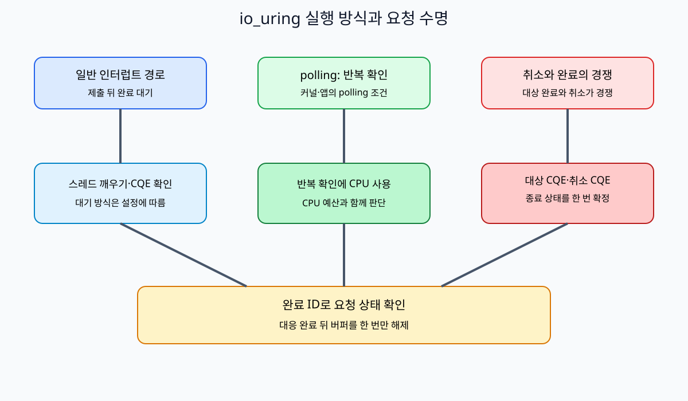
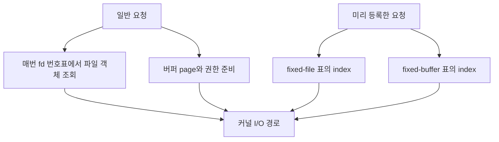
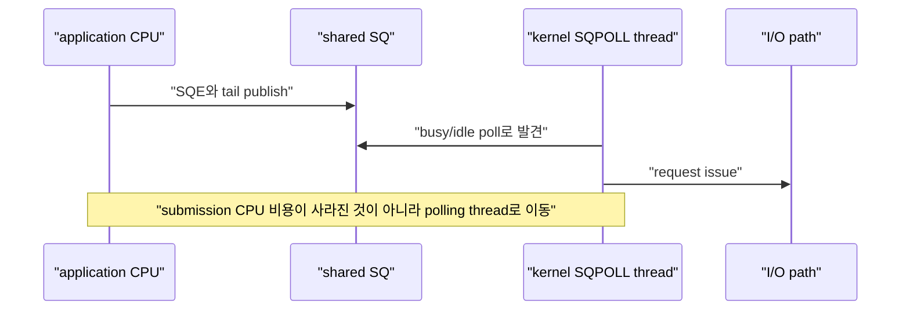
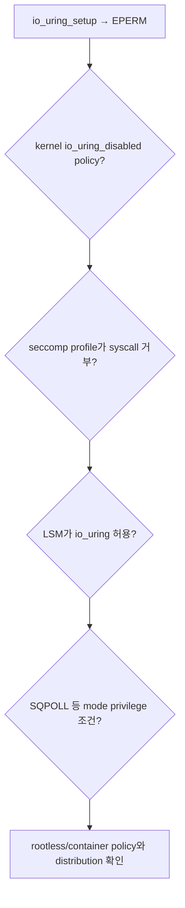
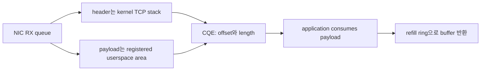

# 10. io_uring registration, polling과 feature 탐지

[이 책 목차](README.md) · [이전: io_uring SQ·CQ와 lifetime](09-io-uring-sq-cq-and-lifetimes.md) · [다음: io_uring ordering, error와 fsync](11-io-uring-ordering-errors-and-fsync.md)

앞 장의 일반 프로그램은 열린 파일을 작은 정수 번호로 가리킨다. 이 번호를 파일 식별 번호, 영어로 file descriptor 또는 fd라고 했다. 프로그램이 읽기 요청을 보낼 때마다 커널은 현재 프로세스의 번호표에서 fd를 찾아 실제 열린 파일 객체를 확인하고, 그 객체를 요청이 끝날 때까지 참조한다. 이 찾기 작업을 **조회(lookup)**라고 부른다. 한두 번에는 작지만 같은 파일로 초당 수십만 요청을 보내면 반복 비용이 된다.

읽은 byte를 놓을 프로그램 메모리 구간은 **버퍼(buffer)**다. 버퍼의 가상 주소만으로 장치가 영원히 같은 물리 page를 사용할 수 있는 것은 아니다. 요청 동안 커널은 해당 page에 접근할 권한과 현재 연결을 확인하고, 필요한 경로에서는 page가 이동하거나 회수되어 주소 의미가 사라지지 않도록 참조를 유지한다. page를 이런 식으로 붙잡아 두는 성격의 동작을 **고정(pinning)**이라고 한다. 너무 많은 page를 오래 고정하면 다른 프로그램이 회수해 쓸 RAM이 줄어든다.

반복 조회와 page 준비를 줄이기 위해 io_uring은 파일과 버퍼를 ring에 미리 알려 주는 기능을 제공한다. 이 절차를 **미리 등록(registration)**이라고 한다. 등록 상태는 ring 내부의 표와 kernel reference로 존재하며, 등록 해제 또는 ring 종료까지 수명이 이어질 수 있다.

- 미리 등록한 파일 표를 **fixed file table**이라고 한다. 요청은 일반 fd 대신 이 표의 index를 쓸 수 있다.
- 미리 등록한 메모리 구간을 **fixed buffer**라고 한다. 요청은 등록 표의 buffer index와 범위를 쓸 수 있다.
- 수신 작업에서 커널이 준비된 여러 buffer 중 하나를 고르게 하는 별도 pool은 **provided buffer**라고 한다.

fixed라는 말은 file 내용이나 virtual address 숫자가 영원히 변하지 않는다는 뜻이 아니다. ring이 reference와 table entry를 관리한다는 뜻이다. 등록만으로 file data 복사가 모두 없어지거나 storage 장치가 반드시 application memory에 직접 쓰는 것도 아니다.

또 다른 반복 비용은 “새 제출이 왔는가” 또는 “장치 작업이 끝났는가”를 알기 위해 thread가 잠들고 깨어나는 과정이다. 상태를 반복 확인하는 방식을 **polling(폴링)**이라고 한다. 잠들어 알림을 기다리는 대신 CPU를 사용해 확인하므로 지연을 줄일 수 있지만 CPU 시간과 전력을 낸다.

- **SQPOLL(Submission Queue Polling)**은 커널 thread가 제출 큐인 SQ를 반복 확인해 새 SQE를 가져가는 mode다.
- **IOPOLL(I/O Polling)**은 지원 storage 작업의 완료 상태를 적극적으로 확인하는 mode다.

둘은 이름이 비슷하지만 확인 대상과 실행 주체가 다르다. SQPOLL을 켠다고 storage 완료까지 자동 polling하는 것이 아니고, IOPOLL을 켠다고 모든 file·socket이 지원되는 것도 아니다.

마지막 문제는 실행 환경의 차이다. 개발할 때 사용한 header에 기능 이름이 있어도 실제 실행 중인 kernel, filesystem, device와 보안 정책이 지원하지 않을 수 있다. 프로그램이 실행 시점에 기능 제공 여부를 질문하고 확인하는 일을 **기능 탐지(feature probing)**라고 한다. 탐지가 실패하면 검증된 일반 경로로 돌아가는 **대체 경로(fallback)**가 필요하다.

이 장은 설정을 실제 host에 적용하지 않는 설계 설명이다. kernel 설정, 보안 filter, cgroup, NIC queue를 변경하지 않았다.



## 1. 등록이 필요한 문제를 한 요청으로 추적한다

등록하지 않은 일반 read 요청의 단순 경로는 다음과 같다.

```text
1. application이 fd 12와 buffer 주소 A를 SQE에 기록
2. kernel이 fd table에서 12를 찾아 file object F의 reference 확보
3. buffer A의 page와 permission을 확인하고 I/O에 필요한 상태 준비
4. filesystem·device 경로가 작업
5. CQE를 공개하고 file/page reference 정리
6. 다음 요청에서 같은 조회와 준비를 다시 수행할 수 있음
```

등록 경로에서는 초기화 때 file object F를 fixed-file slot 5에, memory range A를 fixed-buffer slot 3에 넣는다. 반복 request는 slot index를 사용한다. 비용 일부를 request마다 내는 대신 startup, table memory, page 고정과 update 동기화 비용을 낸다.



registration은 성능 보장이 아니라 비용 위치를 바꾸는 선택이다. 짧게 한 번 쓰는 file과 buffer라면 초기 등록 비용이 더 클 수 있다. 장기 pinning은 RAM 회수와 container memory budget에 영향을 준다. 파일 또는 buffer table을 바꿀 때는 진행 중인 request가 어느 entry를 참조하는지 수명을 관리해야 한다.

## 2. Fixed file table

`io_uring_register()`로 file descriptor array를 등록하면 ring이 kernel file reference table을 유지한다. SQE는 `IOSQE_FIXED_FILE`과 table index를 사용한다.

```text
registered files:
index 0 → data-0001.bin file object
index 1 → data-0002.bin file object
index 2 → listening socket
```

장점은 반복 fd lookup을 줄이고 SQPOLL 같은 mode에서 안정적인 file reference를 제공하는 것이다. 비용은 table 관리와 update synchronization이다.

반례:

- Index 1은 userspace fd number 1이 아니다.
- File 등록만으로 data copy가 사라지지 않는다.
- Table에서 entry를 update할 때 outstanding request가 어느 file object를 참조하는지 관리해야 한다.
- Ring마다 registration state가 있으므로 process 전체 global table로 단정하지 않는다.

## 3. Fixed buffer registration

Fixed buffer는 memory region을 ring에 등록하고 read/write fixed operation이 index와 offset을 참조하게 한다. Kernel이 매 request마다 page를 준비하는 비용을 줄일 수 있다.

```text
buffer 0: virtual address A, length 1MiB
buffer 1: virtual address B, length 1MiB

READ_FIXED uses buffer_index=0, offset within A
```

등록한 page는 memory pressure에서 자유로운 공짜 memory가 아니다. 장기간 많은 memory를 pin하면 reclaim과 container memory budget에 영향을 준다. `RLIMIT_MEMLOCK`, cgroup memory accounting, kernel version의 pinning 정책도 확인한다.

Fixed buffer registration은 “storage device가 application memory에 직접 DMA하여 copy가 항상 0”이라는 보장이 아니다. Buffered filesystem I/O라면 page cache와 copy가 남을 수 있고 device·filesystem이 direct I/O 조건을 만족해야 한다.

## 4. Provided buffer와 fixed buffer는 목적이 다르다

Provided buffer pool 또는 buffer ring은 receive처럼 kernel이 사용 가능한 buffer 중 하나를 고르게 한다. Fixed buffer는 request가 특정 registered region을 index로 가리키는 방식이다.

| 방식 | 누가 buffer를 고르는가 | 대표 목적 |
| --- | --- | --- |
| Fixed buffer | application이 SQE index 지정 | 반복 file read/write의 registration 비용 감소 |
| Provided buffer selection | kernel이 group에서 선택 | multishot receive와 buffer 공급 |

CQE flag의 buffer ID를 확인하기 전에 provided buffer를 다른 request에 반환하면 data corruption이 생긴다. Buffer pool은 lifetime protocol이지 단순 allocator 이름이 아니다.

## 5. SQPOLL은 submission polling thread다

**SQPOLL(Submission Queue Polling)**은 kernel thread가 SQ를 polling하여 매 batch의 `io_uring_enter()` submission syscall을 줄일 수 있는 mode다.



SQPOLL은 device completion을 polling하는 IOPOLL과 다르다. SQPOLL thread는 CPU를 소비하며 idle policy 뒤에는 application이 wake-up syscall을 해야 할 수 있다.

Low submission rate에서 계속 polling하면 syscall 절감보다 CPU·energy 비용이 커질 수 있다. CPU quota가 작은 container에서는 polling thread가 workload quota와 어떻게 account되는지도 측정한다.

## 6. IOPOLL은 device completion polling이다

**IOPOLL(I/O Polling)**은 interrupt 기반 completion 대신 application이 device completion을 poll하는 mode다. 일반적으로 polling을 지원하는 storage와 direct I/O 같은 조건이 필요하며 buffered I/O에 임의로 쓰는 switch가 아니다.

| Mode | Polling 대상 | 주된 비용 | 필요한 조건 |
| --- | --- | --- | --- |
| 기본 | interrupt/wakeup 기반 completion | syscall·interrupt·schedule | 넓은 호환성 |
| SQPOLL | submission queue | kernel polling CPU | permission, stable files, workload rate |
| IOPOLL | storage completion | caller polling CPU | 지원 device와 I/O 방식 |

SQPOLL과 IOPOLL을 함께 쓸 수 있는 조합이 있어도 서로 대체하지 않는다. 하나는 request issue 앞, 다른 하나는 completion 뒤의 대기 방식을 바꾼다.

## 7. 손계산: polling의 break-even

초당 200,000 request를 batch 32개로 submit한다고 가정한다.

```text
submission enter 횟수 = 200,000 ÷ 32 = 6,250 calls/s
call당 CPU 비용 가정 = 1.2µs
submission CPU ≈ 7.5ms CPU/s = 한 core의 0.75%
```

SQPOLL thread가 한 core의 15%를 사용한다면 이 workload에서는 손해일 수 있다. 반대로 batch 없이 초당 1,000,000회 enter하고 latency 목표가 매우 낮다면 trade-off가 달라진다. 실제 syscall cost, cache miss, wake-up, tail latency로 측정한다.

## 8. Runtime feature 탐지가 필요하다

Kernel version 문자열만으로 opcode와 flag 사용 가능성을 결정하지 않는다. Distribution backport, security patch, config, seccomp policy 때문에 결과가 다를 수 있다.

```text
1. io_uring_setup() 성공 여부와 params.features 확인
2. io_uring_register(PROBE) 또는 liburing probe로 opcode 확인
3. 필요한 setup/register flag를 작은 isolated ring에서 시도
4. -EINVAL, -EOPNOTSUPP, -EPERM을 구분
5. 지원하지 않으면 epoll/threaded I/O 등 fallback 선택
```

공식 setup과 registration interface는 [io_uring_setup(2)](https://man7.org/linux/man-pages/man2/io_uring_setup.2.html), [io_uring_register(2)](https://man7.org/linux/man-pages/man2/io_uring_register.2.html)을 따른다.

## 9. `EPERM`의 여러 원인

`io_uring_setup()`이 `-EPERM`이면 root가 아니라는 이유 하나로 결론 내리지 않는다.



- Kernel `io_uring_disabled` sysctl policy가 unprivileged creation을 막을 수 있다.
- Container seccomp profile이 `io_uring_setup`, `io_uring_enter`, `io_uring_register`를 차단할 수 있다.
- LSM(Linux Security Module)이 ring 또는 `uring_cmd`를 거부할 수 있다.
- SQPOLL의 permission 조건은 kernel generation과 configuration에 따라 다르다.
- Rootless container는 host policy를 우회하지 못한다.

Security restriction을 benchmark 때문에 임의 해제하지 않는다. 필요한 opcode와 threat model을 검토하고 좁은 policy를 사용한다.

## 10. Feature와 운영 support는 다르다

Upstream kernel에 feature가 들어간 시점과 현재 Ubuntu host가 지원하는 시점은 다르다. Ubuntu LTS는 GA kernel과 HWE(Hardware Enablement) kernel lifecycle이 다르며 backport 여부도 확인해야 한다.

공식 Ubuntu [HWE kernel 안내](https://documentation.ubuntu.com/kernel/reference/hwe-kernels/)를 기준으로 installed kernel package, booted kernel, userspace liburing을 함께 기록한다.

```text
source code에 opcode 존재
≠ booted kernel이 opcode 지원
≠ seccomp/LSM가 허용
≠ filesystem/device가 빠른 path 지원
≠ application이 fallback 없이 안전
```

## 11. ZCRX는 조건부 최신 예시다

**ZCRX(Zero-Copy Receive)**는 network receive payload를 userspace memory로 직접 받는 io_uring 기능군이다. Kernel TCP stack을 사용하면서 copy를 줄이는 것이 목표다.

현재 kernel 문서의 [io_uring zero copy Rx](https://docs.kernel.org/networking/iou-zcrx.html)는 다음과 같은 전제를 둔다.

- Header/data split을 지원하는 NIC
- Flow steering과 RSS(Receive Side Scaling) queue 구성
- 필요한 io_uring setup flag
- Registered memory area와 refill ring
- 사용한 buffer를 kernel에 돌려주는 recycle protocol



이 기능을 host가 자동 지원한다고 가정하지 않는다. NIC hardware와 out-of-band queue 설정이 필요하며 registration 실패나 unsupported feature에는 기존 receive path fallback이 있어야 한다.

## 12. Registration 실패 설계

| 실패 | 가능한 원인 | 안전한 대응 |
| --- | --- | --- |
| `-ENOMEM` | pinning/memory budget 부족 | pool 축소, 일반 buffer fallback |
| `-EPERM` | memlock/security policy | policy 확인, 임의 privilege 확대 금지 |
| `-EINVAL` | flag·alignment·kernel 불지원 | probe 결과와 ABI 재확인 |
| `-EOPNOTSUPP` | device/filesystem/opcode 미지원 | 지원 path로 fallback |

Registration이 절반 성공한 뒤 후속 단계가 실패할 수 있으므로 unwind 순서를 갖는다. Outstanding request가 참조하는 table을 먼저 unregister하지 않는다.

## 13. 관찰할 수치

- Submit batch 크기와 `io_uring_enter()` 횟수
- SQPOLL thread CPU와 wake-up 횟수
- I/O completion latency p50/p99
- Registered/pinned memory 크기
- CQ overflow와 pending completion
- Fallback 비율과 copy 여부
- cgroup CPU quota throttling과 memory pressure

Throughput만 높고 polling CPU가 한 core를 독점하면 shared node에서는 전체 효율이 나빠질 수 있다.

## 15. fixed file과 fixed buffer의 실제 table과 수명

**registration(등록)**은 application이 반복해서 사용할 resource를 ring에 미리 알려 kernel 내부 table 또는 pinned-memory 상태를 준비하는 절차다. table은 ring context에 연결되어 존재하고 unregister 또는 ring 종료까지 수명이 이어진다. request마다 fd lookup이나 page 준비를 줄이는 데 필요하지만 data copy 전체가 없어졌다는 뜻은 아니다.

fixed file table의 slot 5에 file object F를 등록했다고 하자.

```text
application fd 12 ──register──> ring fixed-file slot 5 ──reference──> file object F
request SQE: fixed-file flag + index 5
```

등록 뒤 application이 fd 12를 close해도 registration이 F reference를 유지하는 계약에서는 slot 5 request가 동작할 수 있다. 그러나 slot update/unregister와 in-flight request가 경쟁하지 않도록 library/kernel API 규칙을 지킨다. 숫자 5는 일반 fd가 아니라 ring-local table index다.

fixed buffer는 user VA range의 page를 ring에 등록해 반복 I/O에 사용한다. **pinning(고정)**은 kernel/device가 접근하는 동안 page가 회수·이동되지 않도록 reference를 유지하는 성격이다. 등록된 memory를 application allocator에 free하거나 다른 용도로 재사용하면 안 된다. unregister 성공과 모든 in-flight request 종료 전에 mapping을 없애면 수명 오류다.

| 상태 | file slot | buffer slot | 가능한 작업 |
|---|---|---|---|
| REGISTERED | F reference 보유 | B page range 준비 | 신규 request 제출 가능 |
| IN_FLIGHT | request가 slot 사용 | kernel/device가 B 참조 가능 | update/free 금지 |
| DRAINING | 신규 제출 중단 | completion 대기 | 기존 request 회수 |
| UNREGISTERED | table reference 제거 | pin/reference 제거 | application close/free 가능 |

## 16. fixed buffer와 provided buffer는 목적이 다르다

fixed buffer는 request가 “등록 table의 몇 번째 range를 사용한다”고 지정해 매번 memory 준비 비용을 줄이려는 기능이다. **provided buffer**는 receive처럼 결과 크기와 도착 시점을 모를 때 application이 buffer pool을 kernel에 제공하고 kernel이 하나를 골라 CQE에 buffer ID를 돌려주는 기능이다.

```text
fixed buffer:
SQE가 buffer index 3을 지정
→ 특정 address/length가 request와 연결

provided-buffer pool:
application이 group 9에 buffer ID 100..163 제공
→ recv request가 group 9를 지정
→ kernel이 available buffer 하나 선택
→ CQE flags에서 선택된 buffer ID 확인
→ payload 처리 뒤 application이 다시 pool에 반환
```

provided buffer를 CQE 처리 전에 pool에 돌려주면 kernel이 같은 memory를 새 packet으로 덮을 수 있다. buffer ID에도 generation이나 state table을 두어 FREE→KERNEL_OWNED→APP_OWNED→RETURNABLE 전이를 확인한다.

## 17. SQPOLL과 IOPOLL의 실행 주체

**polling**은 event 알림을 기다려 sleep하는 대신 상태를 반복 확인하는 방식이다. wakeup latency와 syscall을 줄일 수 있지만 CPU time과 power를 사용한다.

**SQPOLL**은 kernel polling thread가 SQ tail을 살펴 새 submission을 가져가는 mode다. application이 매 batch마다 enter syscall로 kernel을 깨우는 비용을 줄일 수 있다. polling thread는 실제 kernel thread이며 idle timeout 뒤 잠들 수 있고, 다시 깨우는 절차가 필요할 수 있다. SQPOLL이 device completion까지 계속 poll한다는 뜻은 아니다.

**IOPOLL**은 지원하는 storage I/O의 completion을 interrupt 대신 적극적으로 확인하는 mode다. filesystem, file type, block device와 direct-I/O 조건이 맞아야 할 수 있다. network socket completion을 일반적으로 IOPOLL로 해결한다고 생각하면 안 된다.

둘을 동시에 사용해도 역할은 분리된다.

```text
application → SQ에 request publish
SQPOLL thread → SQE를 가져와 I/O 제출
device → 작업 진행
IOPOLL completion path → 완료 상태 확인
kernel → CQE publish
application → CQE 회수
```

## 18. polling break-even을 숫자로 판단한다

interrupt/wakeup path가 request당 평균 8µs를 더하고 polling 전용 CPU 한 개 비용을 초당 1 CPU-second라고 단순화하자. 초당 100,000 completion이면 절약 후보는 `100000×8µs=0.8 CPU-second/s`다. 이 이상적 계산에서도 polling CPU 1개보다 작으므로 다른 이득과 batch 효과가 없으면 순 CPU 비용은 손해일 수 있다.

초당 1,000 completion이면 절약 후보는 0.008 CPU-second/s에 불과하다. polling thread가 대부분 빈 queue를 확인한다. 반대로 매우 높은 IOPS와 엄격한 tail latency에서 dedicated core와 power를 지불할 가치가 있을 수 있다.

8µs는 예시이며 실제 syscall, interrupt coalescing, CPU frequency, NUMA와 device queue에 따라 다르다. p50만 보지 말고 p99, CPU utilization, energy, throughput, idle workload까지 비교한다.

## 19. runtime feature 탐지와 fallback

새 kernel header로 compile됐다는 사실은 실행 host가 opcode와 flag를 지원한다는 보장이 아니다. application은 setup 결과, probe API, feature bit와 실제 operation error를 확인한다. library version과 kernel feature도 분리한다.

안전한 흐름은 다음과 같다.

1. 기본 ring setup을 시도한다.
2. 필요한 opcode/feature를 runtime probe한다.
3. filesystem, file type, device와 privilege 조건을 검사한다.
4. optional fast path를 작은 request로 검증한다.
5. unsupported, invalid, permission failure를 분류한다.
6. buffered read/write, epoll 또는 non-polling io_uring 같은 fallback으로 전환한다.
7. fallback 사용 여부를 metric/log로 남긴다.

fallback은 “조용히 느려져도 된다”가 아니다. 기능이 필수면 명확히 startup failure를 내고, 성능 최적화면 SLA가 허용하는 fallback을 둔다.

## 20. EPERM을 원인 이름으로 착각하지 않는다

`EPERM`은 operation이 허용되지 않았다는 errno 결과지만 원인은 하나가 아니다. io_uring setup 또는 operation이 seccomp profile에 막히거나, container sandbox가 syscall/flag를 제한하거나, kernel security policy와 privilege 조건을 만족하지 못할 수 있다. SQPOLL의 privilege 규칙도 kernel version에 따라 변해 왔다.

진단은 kernel version 하나만 보는 것이 아니라 다음을 나눈다.

| 층 | 질문 |
|---|---|
| syscall policy | seccomp가 io_uring_setup/enter/register를 허용하는가? |
| process credential | 필요한 capability나 resource limit 조건이 있는가? |
| cgroup/sandbox | runtime policy가 기능을 막는가? |
| kernel build/config | 기능이 compile되고 활성화됐는가? |
| device/filesystem | mode가 해당 path에서 지원되는가? |

권한을 무작정 높이는 대신 최소한의 정책 변경 또는 fallback을 선택한다.

## 21. ZCRX full trace와 하드웨어 조건

**ZCRX(zero-copy receive)**는 network receive payload를 application에 전달할 때 전통적 copy를 줄이려는 io_uring 경로다. “최신 kernel이면 모든 NIC에서 자동 zero-copy”가 아니다. kernel 문서는 hardware header/data split, queue steering과 RSS, memory area와 refill ring 같은 조건을 설명한다.

개념 상태를 추적한다.

```text
1. application이 receive memory area와 refill ring을 준비·등록
2. buffer token을 refill ring에 publish
3. NIC/driver가 지원 queue로 packet payload를 해당 memory에 배치
4. kernel이 CQE에 offset/length와 buffer 정보를 publish
5. application이 payload를 읽는 동안 buffer는 APP_OWNED
6. 처리가 끝난 뒤 token을 refill ring에 반환
7. 반환 publish 뒤에야 kernel/NIC가 같은 영역을 재사용
```

5단계 전에 반환하면 payload를 읽는 중 새 packet이 덮을 수 있다. 반환하지 않으면 available buffer가 고갈되어 receive가 멈추거나 fallback/error가 날 수 있다. queue와 CPU affinity가 바뀌면 hardware steering 전제가 깨질 수 있다.

ZCRX availability는 runtime feature, NIC/driver support, configuration과 권한을 모두 확인한다. 성능 평가는 copy 감소뿐 아니라 buffer memory, refill overhead, packet size, cache locality와 drop을 포함한다.

## 22. 전체 초기화와 종료 순서

```text
startup:
  ring setup
  runtime feature probe
  file table 등록
  fixed/provided buffer memory 할당·등록
  optional SQPOLL/IOPOLL/ZCRX 조건 검증
  fast path 또는 fallback 선택

steady state:
  request slot+generation 확보
  buffer ownership 전환
  SQE publish
  CQE와 terminal condition 회수
  buffer를 올바른 pool에 반환
  feature별 error를 metric에 기록

shutdown:
  신규 제출 중단
  multishot/cancel outstanding 정리
  모든 terminal CQE 회수
  provided/ZCRX buffer 회수
  fixed buffer unregister
  fixed file unregister
  application fd close와 memory free
  ring close
```

unregister가 busy/error를 반환하면 무시하고 memory를 free하지 않는다. 어느 request가 reference를 유지하는지 찾아 terminal completion을 회수한다.

## 23. 추가 완전 해설 문제

1. fixed file slot 5를 쓰는 request가 진행 중일 때 slot을 다른 file로 교체해도 되는가?
   - update API의 atomicity와 in-flight reference 규칙을 따라야 한다. 임의 table memory 변경은 안 된다.
2. fixed buffer 등록 직후 malloc memory를 free해도 되는가?
   - unregister와 in-flight 종료 전에는 안 된다.
3. provided buffer CQE를 받자마자 payload 처리 전에 반환하면?
   - 같은 memory가 새 receive로 덮일 수 있다.
4. SQPOLL을 켜면 NVMe completion도 자동 busy-poll인가?
   - 아니다. submission polling이며 IOPOLL과 구분한다.
5. header가 opcode를 정의하면 runtime host에서 지원되는가?
   - probe와 실제 setup/operation 결과를 확인해야 한다.
6. EPERM이면 root로 실행하는 것이 첫 해법인가?
   - 아니다. seccomp, sandbox, capability와 mode 조건을 구분하고 최소 변경이나 fallback을 쓴다.
7. ZCRX buffer는 언제 refill ring에 돌려주는가?
   - application이 payload 사용을 완전히 끝낸 뒤다.
8. polling workload가 초당 1,000건뿐이면 왜 손해일 수 있는가?
   - 절약할 wakeup 비용보다 빈 polling CPU와 power 비용이 훨씬 클 수 있다.

## 24. 문제

1. Fixed buffer를 등록하면 buffered file read의 data copy가 항상 사라지는가?
2. SQPOLL과 IOPOLL은 각각 무엇을 poll하는가?
3. Kernel version이 충분히 새롭다. Opcode를 바로 사용해도 되는가?
4. ZCRX CQE를 처리한 buffer를 언제 refill ring에 돌려주는가?

## 25. 해설

1. 아니다. Registration은 page 준비 비용을 줄일 수 있지만 filesystem/page cache/device path의 copy 의미는 별도다.
2. SQPOLL은 submission queue, IOPOLL은 지원 storage의 completion을 poll한다.
3. 아니다. Runtime probe, policy, filesystem/device 조건을 확인하고 fallback을 둔다.
4. Application이 payload 사용을 끝낸 뒤다. 너무 일찍 반환하면 kernel이 같은 memory를 덮을 수 있다.

다음 장에서는 여러 SQE의 논리 순서를 link·hardlink·drain으로 표현하고, error 전파와 `fsync()` durability를 함께 설계한다.
