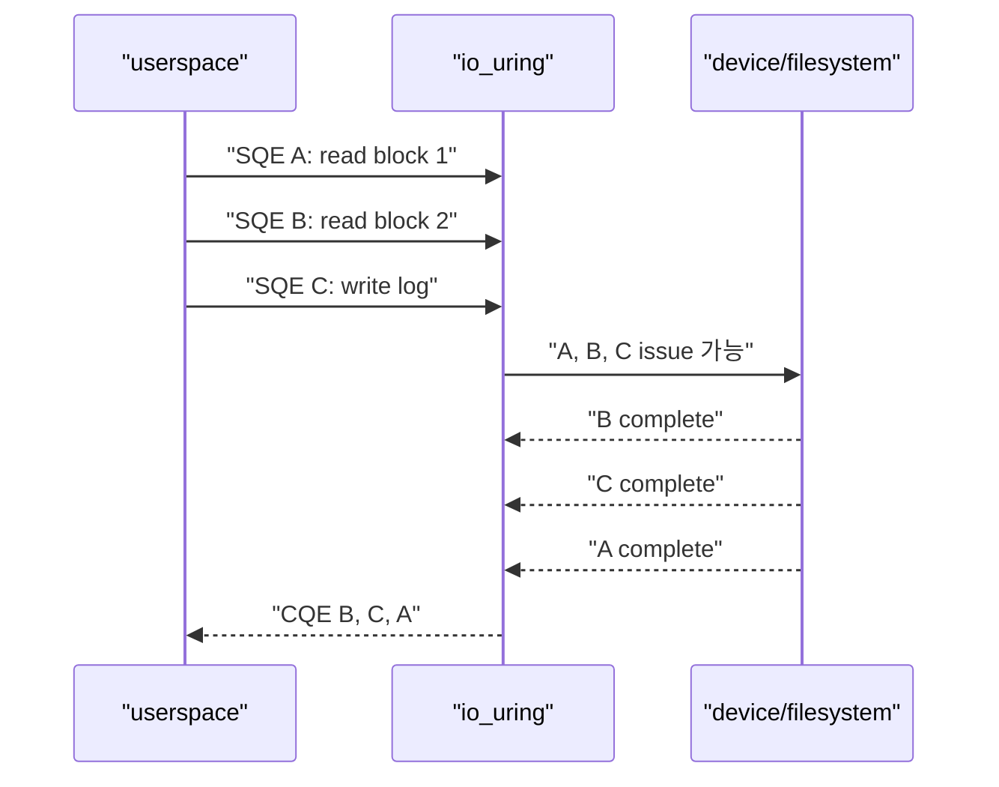
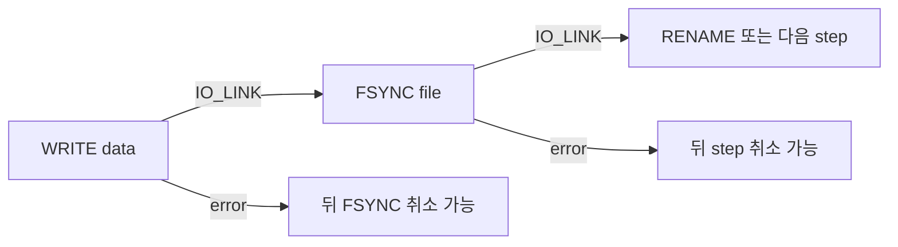
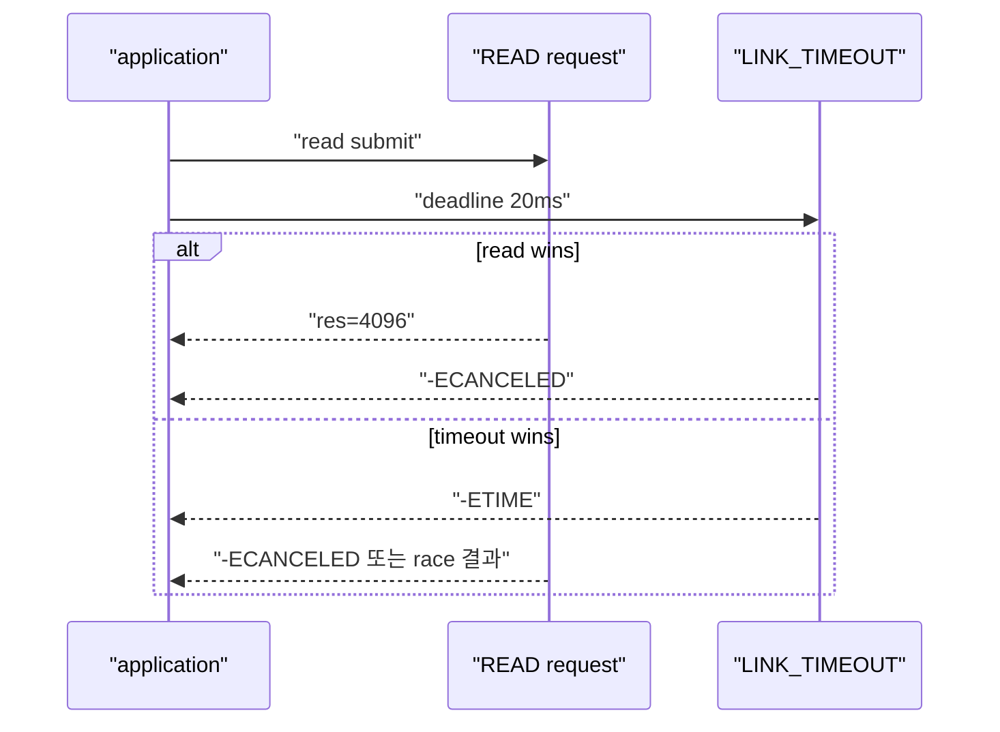
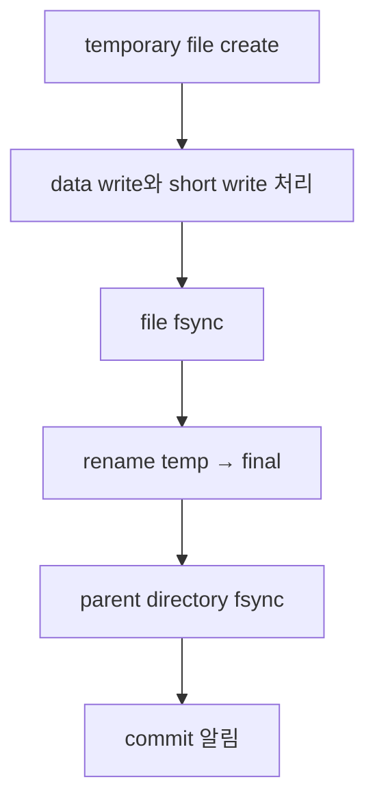

# 11. io_uring ordering, error와 fsync

[이 책 목차](README.md) · [이전: io_uring registration, polling과 feature 탐지](10-io-uring-registration-polling-and-features.md) · [다음: Network I/O와 kernel 관찰](12-network-io-and-kernel-observation.md)

SQE를 A, B, C 순서로 넣었다고 completion도 A, B, C 순서라는 보장은 없다. Storage와 network는 concurrent하게 진행되고 CQE는 실제 완료 순서로 나타날 수 있다. 논리적으로 “read한 data를 write한 뒤 sync”해야 한다면 dependency를 명시하고 각 CQE error를 처리해야 한다.

이 장의 request graph와 pseudocode는 교육용이다. File을 생성·수정하거나 sync syscall을 실행하지 않았다.

## 1. Submission order와 completion order



Independent request에서는 out-of-order completion이 성능의 원천이다. `user_data`로 각 result를 원래 operation에 연결한다. Application이 CQ 배열 순서를 logical record 순서로 사용하면 data corruption이 생긴다.

## 2. Read→transform→write는 한 번에 link할 수 없다

Write buffer가 read 결과를 CPU에서 변환한 뒤 만들어진다면 read와 write SQE를 동시에 준비할 수 없다.

```text
1. READ submit
2. READ CQE에서 res 확인
3. short read/EOF/error 처리
4. CPU transform
5. WRITE submit
6. WRITE CQE 확인
7. 필요하면 FSYNC submit
```

`IOSQE_IO_LINK`는 kernel request 순서를 연결하지만 userspace transform을 자동 삽입하지 않는다. 아직 채워지지 않은 buffer로 write SQE를 미리 link하면 잘못된 data를 쓸 수 있다.

## 3. `IOSQE_IO_LINK`

Link된 chain은 앞 request가 성공해야 다음 request를 진행하는 dependency를 표현한다. 앞 request가 실패하면 뒤 request가 `-ECANCELED`로 취소될 수 있다.



Success와 failure의 뜻은 opcode마다 다르다. Short write가 positive result이므로 link chain에서 성공으로 취급될 수 있어도 application 요구 길이를 만족하지 않는다. “Link가 유지됐으니 full write”라고 단정하지 않는다.

## 4. `IOSQE_IO_HARDLINK`

Hardlink는 앞 request가 실패해도 뒤 request를 계속 진행해야 하는 chain에서 사용한다. 이름이 filesystem hard link와 같아 보이지만 전혀 다른 SQE ordering flag다.

적절한 예는 cleanup 또는 failure report처럼 앞 operation 결과와 관계없이 실행해야 하는 단계일 수 있다. 그러나 write 실패 뒤 fsync를 계속 수행해도 빠진 data가 생기지는 않는다.

```text
normal link: A failure → B, C cancel 가능
hard link:   A failure → B 실행 계속
```

Hardlink를 error handling 대신 사용하지 않는다. 모든 CQE를 읽고 어느 step이 실패했는지 application state machine에 기록한다.

## 5. `IOSQE_IO_DRAIN`

Drain request는 그 ring에서 앞서 제출한 request들이 완료된 뒤 issue되도록 ordering barrier 역할을 한다. Link는 특정 chain의 dependency이고 drain은 이전 request 집합과의 ordering이 필요할 때 쓴다.

```text
SQE 10: unrelated read A
SQE 11: unrelated write B
SQE 12: DRAIN + checkpoint write

checkpoint는 A와 B completion 이후 issue
```

Drain은 storage cache flush나 filesystem transaction durability를 자동 보장하지 않는다. 앞 I/O가 kernel completion됐다는 ordering이지, 별도 `fsync()` 계약을 대신하지 않는다.

`IOSQE_CQE_SKIP_SUCCESS`와 drain의 조합에는 API caveat가 있으므로 최신 [io_uring_enter(2)](https://man7.org/linux/man-pages/man2/io_uring_enter.2.html)를 확인한다. CQE를 줄이려다가 error attribution을 잃지 않는다.

## 6. Linked timeout

I/O와 timeout을 link하여 deadline을 표현할 수 있다. Timeout CQE와 target CQE가 race하므로 둘 다 처리한다.



Deadline이 지났다고 device가 물리적으로 즉시 멈췄다는 뜻은 아니다. Cancellation 가능성은 opcode와 실행 단계에 따라 다르다. Buffer lifetime은 target terminal CQE까지 유지한다.

## 7. Error는 CQE마다 독립적으로 본다

Logical transaction이 세 request로 구성되면 결과 matrix가 생긴다.

| WRITE CQE | FSYNC CQE | 의미 |
| --- | --- | --- |
| full bytes | 0 | 요구 범위에서 성공 후보 |
| short positive | 0 | 일부 data만 썼을 수 있음, 실패 처리 필요 |
| negative error | `-ECANCELED` | write 실패로 sync가 취소됨 |
| full bytes | negative error | dirty data는 있었지만 durability 확보 실패 |

FSYNC 실패를 log만 남기고 성공 response를 반환하면 application-level durability contract를 어긴다. Disk full, I/O error는 earlier buffered write가 아니라 later writeback/fsync에서 처음 보일 수 있다.

## 8. 완성된 append와 fsync state machine

```text
state PREPARE:
  encode record with length and checksum

state WRITE:
  submit WRITE at reserved offset
  on res < 0 → FAILED
  on 0 <= res < remaining → advance buffer/offset and resubmit
  on full record → SYNC

state SYNC:
  submit FSYNC or DATASYNC according to contract
  on res < 0 → DURABILITY_FAILED
  on res == 0 → COMMITTED

state COMMITTED:
  publish record visibility to caller
```

Concurrent append는 offset allocation과 record interleaving도 관리해야 한다. `O_APPEND`, filesystem atomicity 범위와 io_uring opcode semantics를 검증한다.

## 9. `fsync` opcode와 범위

`IORING_OP_FSYNC`는 file descriptor에 `fsync()` 또는 datasync semantics를 비동기 request로 표현한다. CQE가 성공하면 syscall contract의 완료를 얻지만 다음을 자동으로 뜻하지 않는다.

- 새 filename의 parent directory entry까지 sync됨
- Remote replica가 commit함
- Backup이 생성됨
- NVMe가 power-loss protection 없이도 거짓말하지 않음
- 다른 file의 transaction도 함께 durable함

공식 기본 계약은 [fsync(2)](https://man7.org/linux/man-pages/man2/fsync.2.html)을 따른다.

## 10. 새 file을 durable하게 publish하는 순서



io_uring으로 각 filesystem operation을 제출하더라도 dependency와 CQE error handling이 필요하다. Rename 뒤 directory sync를 빼면 crash 뒤 새 이름이 사라질 수 있다.

Filesystem마다 rename과 journal mode의 crash consistency가 다르므로 isolated failure test와 공식 filesystem 문서를 확인한다.

## 11. NVMe completion과 filesystem durability

NVMe request completion은 device가 command를 완료했다는 신호다. Buffered write에서는 filesystem과 page cache 단계가 먼저 있고, device volatile write cache가 있다면 flush/FUA semantics가 중요하다.

```text
application WRITE CQE
→ page cache acceptance일 수 있음
→ filesystem writeback
→ NVMe write completion
→ 필요한 flush completion
→ filesystem fsync CQE
```

Direct I/O write completion도 rename이나 directory metadata를 durable하게 만들지 않는다. Filesystem을 우회하지 않는 한 block completion과 namespace durability를 같은 사건으로 보지 않는다.

## 12. Queue depth와 ordering cost

Independent I/O 64개를 동시에 issue하면 device parallelism을 활용할 수 있다. 모든 request 사이에 drain을 넣으면 사실상 queue depth 1처럼 동작할 수 있다.

```text
single I/O latency = 200µs
완전 직렬 64개 예상 = 64 × 200µs = 12.8ms
동시 queue depth 16이면 이상적 4 wave = 약 0.8ms + overhead
```

실제 device와 filesystem은 이 단순 계산과 다르지만 불필요한 global ordering이 throughput을 줄인다는 방향은 같다. Dependency가 있는 record group 안만 link하고 독립 group은 병렬화한다.

## 13. Completion 순서를 복원하는 방법

Network packet이나 storage block이 out-of-order로 끝나도 application logical sequence를 따로 둔다.

```text
user_data fields:
  stream_id = 9
  logical_seq = 1042
  step = WRITE

CQE arrival order: 1043, 1041, 1042
commit frontier: 1040 → 1041 → 1042 → 1043
```

CQE arrival 순서와 publish 순서를 분리하면 parallel I/O를 유지하면서 protocol order를 지킬 수 있다. Missing sequence의 error나 timeout 처리 정책이 필요하다.

## 14. 흔한 반례

- SQE 순서가 CQE 순서를 보장하지 않는다.
- `IO_LINK`는 short positive I/O를 application 의미에서 full success로 바꾸지 않는다.
- `IO_DRAIN`은 `fsync()`가 아니다.
- `FSYNC CQE=0`은 parent directory 또는 remote replica sync가 아니다.
- Timeout CQE만 받고 target buffer를 즉시 free하면 cancel race가 남는다.
- NVMe가 빠르다고 filesystem metadata ordering이 자동 해결되지 않는다.

## 15. 처음 보는 단어로 durable record를 끝까지 따라가기

**Ordering**은 두 operation이 겹쳐 실행될 수 있는지, 하나가 끝난 뒤 다음을 시작해야 하는지 정하는 규칙이다. Submission order는 queue에 넣은 순서이고 completion order는 실제 작업이 끝난 순서다.

**Dependency**는 뒤 operation이 앞 result에 의존하는 관계다. `IO_LINK`는 kernel에게 이 chain을 전달하지만 userspace가 read result를 변환하는 계산까지 대신하지 않는다.

**Hardlink**는 앞 request가 실패해도 chain을 계속하는 io_uring flag다. Filesystem의 여러 filename이 한 inode를 가리키는 hard link와 다른 용어다.

**Drain**은 앞서 제출된 request가 완료될 때까지 해당 request issue를 늦추는 barrier다. Device volatile cache를 flush하는 operation은 아니므로 durability와 다르다.

**FUA(Force Unit Access)**는 storage command가 volatile cache에만 머물지 않도록 요구하는 device-level 의미다. 모든 filesystem request가 FUA를 쓰는 것도 아니고, FUA 하나가 directory entry까지 sync하는 것도 아니다.

**Flush**는 device의 volatile write cache 내용을 persistent media 쪽으로 내보내도록 요청하는 operation이다. Filesystem은 journal과 metadata ordering을 고려해 flush/FUA를 조합할 수 있다.

한 record를 안전하게 publish하는 시간순서는 다음과 같다.

```text
1. Application이 length, payload, checksum을 userspace buffer에 완성
2. Reserved file offset으로 WRITE SQE 제출
3. WRITE CQE가 negative면 실패, short면 남은 offset/length를 다시 제출
4. Full record bytes가 완료되면 FSYNC SQE 제출
5. Filesystem이 dirty data, journal, 필요한 metadata와 device flush를 조정
6. FSYNC CQE negative면 caller에 durability 실패를 반환
7. Temp file 방식이면 rename으로 final name에 publish
8. Parent directory fd에 대한 sync를 완료
9. 모든 CQE가 성공한 뒤에만 application commit을 알림
```

**Error propagation**은 앞 단계 실패가 뒤 단계와 최종 caller에게 전달되는 것이다. Linked request가 `-ECANCELED`를 반환하면 그것이 최초 원인인지, 앞 WRITE error의 결과인지 chain 전체 CQE를 본다.

**Commit frontier**는 순서가 있는 record 중 어디까지 durable·visible하다고 발표할 수 있는지 나타내는 logical sequence다. 1043번 I/O가 먼저 끝나도 1041번이 실패했다면 frontier를 1043으로 건너뛰지 않는 protocol이 필요할 수 있다.

## 16. 문제

1. Read A와 Read B를 순서대로 SQ에 넣었다. B CQE가 먼저 와도 정상인가?
2. Write가 요청 8KiB 중 4KiB를 반환했고 linked fsync가 성공했다. Record는 완전한가?
3. Drain 뒤 checkpoint write를 제출했다. 이전 data는 power loss에 durable한가?
4. Temp file을 fsync하고 rename했다. 새 이름 durability를 위해 무엇을 검토하는가?

## 17. 해설

1. 정상일 수 있다. Independent I/O completion은 out-of-order일 수 있어 `user_data`로 연결한다.
2. 아니다. Short write의 나머지를 처리하지 않았으며 fsync는 존재하는 일부 data만 sync했을 수 있다.
3. Drain은 completion ordering일 뿐 durability flush가 아니다. File·filesystem 계약에 맞는 fsync가 필요하다.
4. Parent directory fd의 `fsync()`와 filesystem crash consistency를 검토한다.

다음 장에서는 socket, epoll과 io_uring network I/O가 packet path·deadline·copy lifetime과 어떻게 이어지고 eBPF로 무엇을 안전하게 관찰할 수 있는지 살펴본다.
