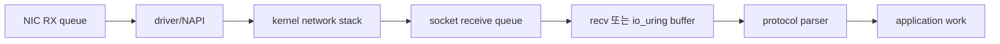
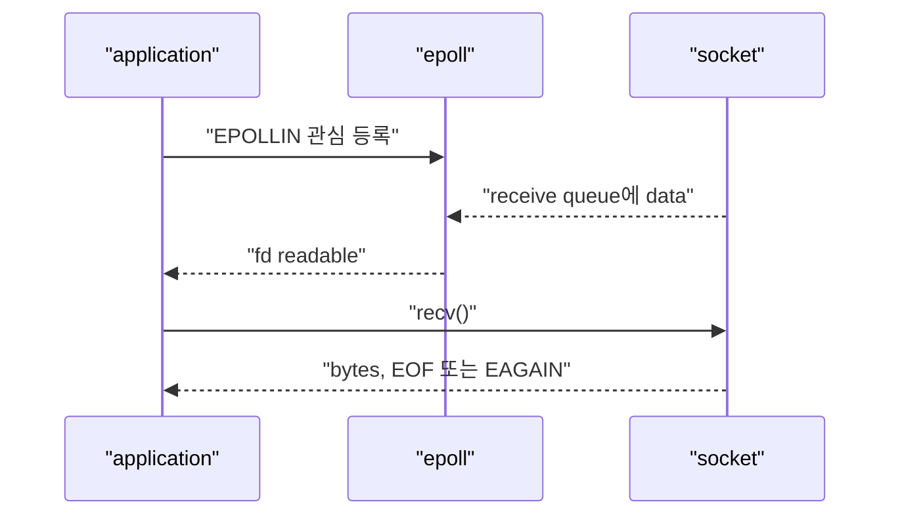
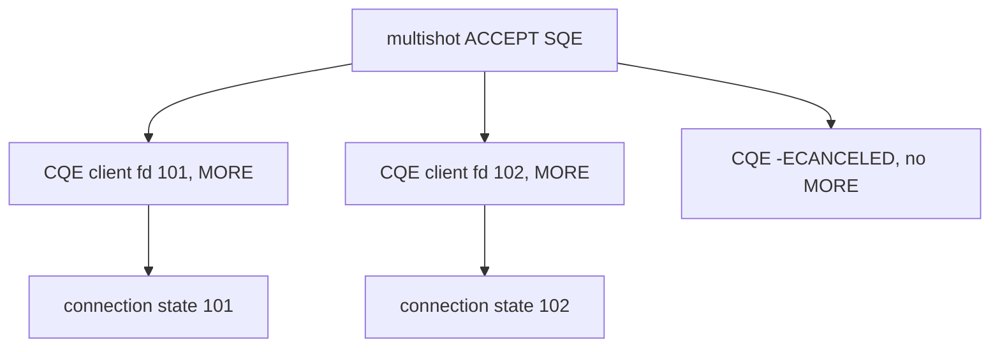
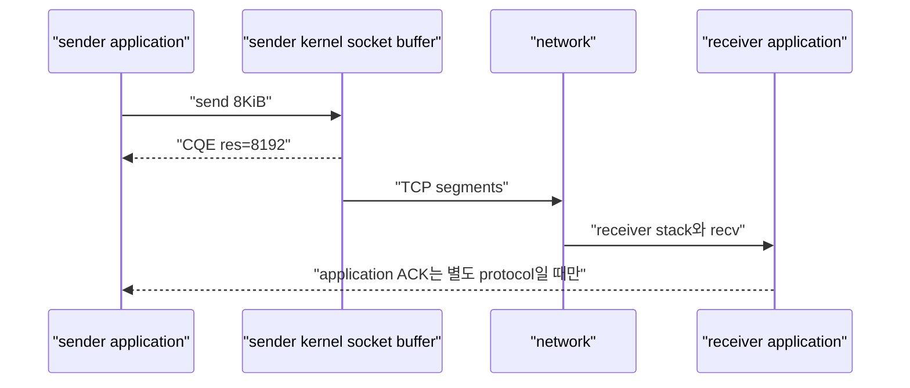
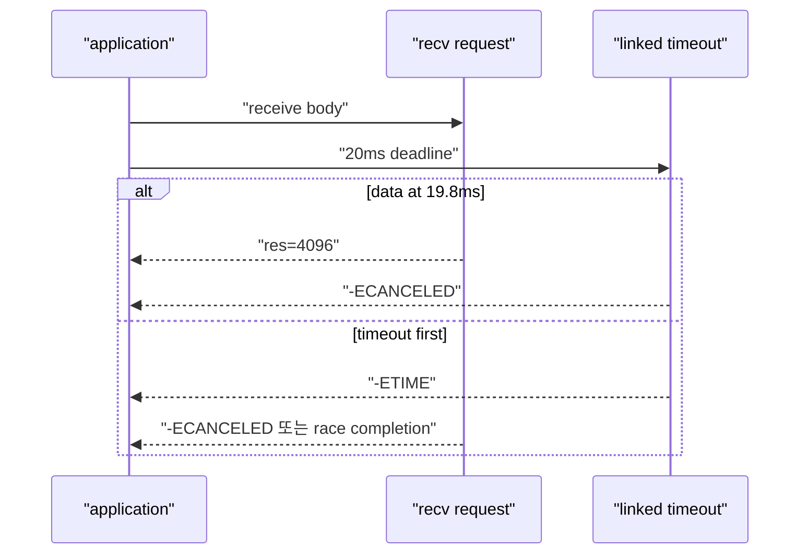
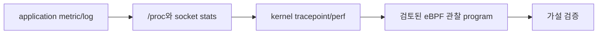

# 12. Network I/O와 kernel 관찰

[이 책 목차](README.md) · [이전: io_uring ordering, error와 fsync](11-io-uring-ordering-errors-and-fsync.md) · [다음: Container, Kubernetes, GPU와 RAN](13-containers-kubernetes-gpu-and-ran.md)

Network server에서 `recv()`와 `send()`만 보면 packet이 NIC에서 socket buffer, application buffer, protocol parser로 이동하는 중간 상태를 놓친다. epoll과 io_uring은 readiness와 completion이라는 서로 다른 관찰 모델을 제공한다. Deadline, short I/O, backpressure, buffer lifetime을 application protocol까지 연결해야 한다.

이 장의 packet trace와 명령 이름은 교육용 관찰 모형이다. eBPF program을 attach하거나 network·kernel 설정을 변경하지 않았다.

## 1. Receive path의 큰 흐름



- **NIC(Network Interface Controller)**: packet을 host memory와 kernel에 전달하는 hardware
- **NAPI(New API)**: Linux network driver가 interrupt와 polling을 조합하는 mechanism
- **Socket receive queue**: TCP/UDP stack이 application이 읽을 data를 보관하는 queue
- **Backpressure**: 소비자가 느릴 때 producer가 계속 밀어 넣지 못하도록 속도가 전달되는 현상

TCP에서는 packet segment가 그대로 application `recv()` 경계가 되지 않는다. Byte stream이므로 한 message가 여러 read로 나뉘거나 여러 message가 한 read에 들어올 수 있다.

## 2. epoll은 readiness를 알린다

`epoll`은 fd가 read/write를 시도할 준비가 되었음을 알린다. Completion result를 미리 주는 것은 아니다.



다른 thread가 먼저 data를 읽거나 edge-triggered loop가 queue를 모두 drain하지 않으면 예상이 달라질 수 있다. Readable event 뒤에도 nonblocking `recv()`가 `EAGAIN`을 반환할 수 있으므로 syscall result를 처리한다.

## 3. io_uring은 request completion을 돌려준다

io_uring receive SQE를 제출하면 CQE `res`에 받은 byte 수나 negative errno가 온다.

```text
RECV SQE len=8192, user_data=connection_42
CQE res=1460  → 1460 bytes 처리, message complete 여부는 parser가 판단
CQE res=0     → TCP peer orderly shutdown 가능
CQE res=-11   → -EAGAIN, mode와 flags에 따라 다시 대기/제출
```

Completion API여도 application message가 완료됐다는 뜻은 아니다. Header에 body length가 32KiB이면 CQE 여러 개의 byte를 누적해야 한다.

## 4. Multishot accept와 receive

Multishot request는 SQE 하나로 accept 또는 receive CQE 여러 개를 만들 수 있다. `IORING_CQE_F_MORE`가 terminal 여부를 알려 준다.



Accept CQE마다 새 socket의 nonblocking flag, credentials, address, resource limit을 처리한다. Terminal CQE 전 request context를 해제하지 않는다.

## 5. Provided buffer와 receive lifetime

Receive는 어느 connection에서 얼마가 올지 모르므로 provided buffer ring을 사용할 수 있다. Kernel이 buffer ID를 골라 CQE flag로 돌려준다.

```text
buffer group 7:
  id 0 → 16KiB
  id 1 → 16KiB
  id 2 → 16KiB

CQE: res=1200, flags=BUFFER|MORE, selected id=1
```

Application은 ID 1의 1200 bytes를 parse하고 필요한 reference를 해제한 뒤 buffer를 pool에 돌려준다. Parser가 buffer slice를 다른 thread에 넘겼는데 먼저 recycle하면 다음 receive가 같은 memory를 덮는다.

## 6. Send completion과 peer delivery

Socket send가 bytes를 반환하면 kernel socket send buffer가 data를 받아들였다는 의미일 수 있다. Remote application이 읽었다는 뜻은 아니다.



TCP ACK도 receiver kernel이 byte를 받았다는 transport 신호이며 remote business transaction commit이 아니다. 업무 완료가 필요하면 application-level response와 idempotency를 둔다.

Zero-copy send notification은 sender buffer lifetime을 알려 주지만 remote 처리 완료를 뜻하지 않는다.

## 7. Deadline을 operation graph로 만든다

Connection deadline에는 여러 층이 있다.

- Accept 대기 deadline
- Header read deadline
- 전체 body deadline
- Upstream RPC deadline
- Response write deadline
- 전체 request budget

```text
전체 budget 100ms
header read 10ms
body read 20ms
application work 45ms
response write 15ms
reserve 10ms
```

각 step timeout을 100ms로 두면 worst case가 합쳐져 전체 SLO를 넘을 수 있다. Absolute deadline에서 남은 budget을 계산한다.

```text
deadline = start + 100ms
header 완료 시 elapsed=18ms
remaining=82ms
DB call budget=min(45ms, remaining-reserve)
```

## 8. Timeout과 completion race



Timeout CQE만 보고 connection context와 buffer를 free하지 않는다. Target request terminal CQE와 cancelability를 확인한다. Clock source와 absolute/relative timeout semantics도 API별로 구분한다.

## 9. Backpressure를 숫자로 본다

Client 1000개가 각각 초당 100KiB를 보내면 ingress는 약 100MiB/s다. Application parser가 60MiB/s만 처리하면 queue는 초당 약 40MiB 증가하려 한다.

```text
5초 누적 차이 ≈ 40MiB/s × 5 = 200MiB
```

실제로는 socket receive buffer와 TCP receive window가 sender를 늦춘다. UDP는 같은 reliable backpressure가 없어서 drop이 나타날 수 있다. Buffer를 무한히 늘리면 latency와 memory 사용만 커질 수 있다.

`memory.current`에는 TCP socket memory가 포함될 수 있다. Network burst가 container memory limit과 OOM으로 연결되는 이유다.

## 10. Copy 경로를 과장하지 않는다

일반 receive는 NIC DMA, skb와 kernel stack, userspace copy 단계를 포함할 수 있다. GRO(Generic Receive Offload), TLS, page fragment, zero-copy feature에 따라 실제 경로가 달라진다.

```text
"io_uring 사용" ≠ "zero-copy"
"registered buffer" ≠ "NIC가 항상 직접 user buffer에 DMA"
"SEND_ZC 요청" ≠ "copy fallback이 절대 없음"
```

Copy 감소를 주장하려면 CPU profile, memory bandwidth, opcode result/notification과 feature support를 측정한다.

## 11. epoll과 io_uring 선택

| 질문 | epoll | io_uring |
| --- | --- | --- |
| 기본 모델 | fd readiness | request completion |
| Mature portability | 넓음 | kernel feature별 probe 필요 |
| File+network 통합 | 별도 syscall 조합 | 한 completion model 가능 |
| Buffer lifetime | recv/send syscall 동안 중심 | SQE부터 terminal CQE/notification까지 |
| Multishot | event loop로 반복 | 지원 opcode에서 한 SQE→여러 CQE |

둘을 혼합할 수도 있다. Library와 protocol complexity, fallback, security policy, observability를 포함해 결정한다.

## 12. Kernel을 읽기 전용으로 관찰하는 층

먼저 application이 이미 제공하는 metric, socket statistics, `/proc`, `ss` 같은 읽기 전용 정보로 범위를 좁힌다. 그 다음 tracepoint·perf·eBPF가 필요한지 판단한다.



이 교재는 eBPF program attach, kprobe, traffic 변경을 수행하지 않았다. 운영 host에서 attach는 권한, verifier, overhead, privacy와 change policy를 검토해야 하는 상태 변경이다.

## 13. eBPF로 보고 싶은 것

- Syscall 또는 io_uring operation latency histogram
- TCP retransmission과 reset
- Socket queue와 drop 지점
- Scheduler latency와 CPU migration
- Block I/O latency와 writeback
- cgroup ID별 event attribution

함수 이름 kprobe에만 의존하면 kernel version 변화에 깨질 수 있다. Stable tracepoint, BTF(BPF Type Format), CO-RE(Compile Once – Run Everywhere) 지원을 검토한다.

High-cardinality IP, credential, payload를 수집하지 않는다. Observability program이 packet data를 노출하는 새 보안 경계가 될 수 있다.

## 14. 완전한 지연 진단 이야기

```text
09:00:00 request p99 8ms
09:02:10 ingress 2배 증가
09:02:15 socket receive queue 증가, no packet drop
09:02:18 cgroup memory.high event 증가
09:02:20 memory PSI some과 io PSI 상승
09:02:22 request p99 450ms, timeout CQE 증가
09:02:30 block writeback latency 상승 확인
```

처음에는 network 지연처럼 보이지만 ingress burst가 page cache·socket memory를 늘리고 memory reclaim이 writeback을 기다린 사건일 수 있다. Packet trace 하나가 아니라 cgroup memory, I/O, scheduler, application deadline을 같은 timestamp로 연결한다.

## 15. 반례 모음

- EPOLLIN은 complete application message를 보장하지 않는다.
- Receive CQE 한 개가 protocol frame 한 개라는 보장은 없다.
- Send CQE 성공은 remote business commit이 아니다.
- Timeout CQE 도착은 target buffer를 즉시 free할 허가가 아니다.
- Device utilization은 task stall을 나타내는 PSI와 다르다.
- eBPF attach는 읽기 전용 의도여도 kernel state를 바꾸는 운영 행위다.

## 16. 처음 보는 단어로 TCP request를 끝까지 따라가기

**Driver**는 kernel이 NIC hardware를 제어하도록 device register, DMA queue, interrupt를 다루는 software다. **DMA(Direct Memory Access)**는 device가 CPU의 byte-by-byte copy 없이 host memory와 data를 주고받는 hardware mechanism이다.

**RX**는 receive, **TX**는 transmit의 약자다. NIC에는 RX/TX descriptor ring이 있고 driver와 hardware가 buffer ownership을 주고받는다. 이 ring은 io_uring SQ/CQ와 목적·구조가 다른 device queue다.

**Interrupt**는 device가 CPU에 처리할 일이 있음을 알리는 signal이다. Packet마다 interrupt가 너무 많으면 비싸므로 NAPI는 interrupt로 일을 알린 뒤 일정 budget 동안 packet queue를 polling한다.

**Socket**은 process가 network endpoint를 다루는 kernel object다. Userspace fd는 socket object를 가리키고, TCP state machine과 receive/send queue는 kernel에 있다.

**Readiness**는 지금 syscall을 시도하면 blocking 없이 진행할 가능성이 있다는 상태다. epoll은 readiness를 알린 뒤 application이 `recv()`를 호출해야 실제 byte 수를 얻는다.

**Completion**은 제출한 특정 operation이 끝나 result를 얻었다는 사건이다. io_uring CQE는 receive request의 byte 수나 negative error를 돌려준다. Protocol message 전체 completion과는 다르다.

한 TCP request의 receive부터 response까지를 따라가면 다음과 같다.

```text
1. Ethernet frame이 NIC RX queue에 도착하고 DMA로 host buffer에 기록
2. NIC/driver가 interrupt를 알리고 NAPI poll이 descriptor를 회수
3. Kernel network stack이 Ethernet/IP/TCP header를 검사하고 TCP 순서를 맞춤
4. Payload byte가 socket receive queue에 쌓임
5a. epoll 방식: fd readable event → application recv syscall → byte count
5b. io_uring 방식: pending RECV request와 data를 연결 → CQE byte count
6. Application parser가 여러 chunk를 모아 header와 body boundary 확인
7. Deadline과 authentication을 검사하고 business handler 실행
8. Response buffer를 send queue에 넣음
9. Kernel TCP stack이 segment를 만들고 driver TX queue에 제출
10. NIC가 packet을 전송하고 transport ACK를 처리
11. 업무 완료가 필요하면 remote application response를 별도로 기다림
```

**Backpressure**는 4번 socket queue가 계속 커질 때 TCP receive window 축소 등으로 sender까지 속도 제한이 전달되는 현상이다. UDP에는 같은 reliable stream backpressure가 없어서 drop 정책이 더 직접적으로 보인다.

**Deadline**은 operation이 끝나야 하는 마지막 시각이다. Timeout은 그 시각을 감시하는 mechanism이고, timeout CQE와 대상 CQE의 race를 처리해야 한다.

**eBPF**는 verified bytecode program을 kernel hook에서 실행하는 기술이다. 관찰 목적으로도 attach 자체는 kernel runtime state 변경이므로 change control과 overhead 검토가 필요하다. 이미 있는 tracepoint와 metric을 먼저 사용한다.

## 17. 문제

1. TCP receive CQE가 1000 bytes를 반환했다. 4KiB message가 끝났는가?
2. Send CQE가 full bytes를 반환했다. Remote database commit을 보장하는가?
3. 초당 ingress 80MiB, 처리 50MiB라면 4초 동안 잠재 queue 증가량은 얼마인가?
4. eBPF 관찰 전 먼저 확인할 좁은 증거는 무엇인가?

## 18. 해설

1. Header와 누적 byte를 확인해야 한다. TCP는 byte stream이며 CQE 경계가 message 경계가 아니다.
2. 아니다. Sender kernel이 data를 받아들인 결과일 수 있어 application-level ACK가 필요하다.
3. `(80-50)×4=120MiB`다. 실제 TCP backpressure와 buffer limit이 sender를 늦출 수 있다.
4. Application metric/log, socket stats, `/proc`, cgroup pressure와 기존 tracepoint부터 본다.

공식 interface와 kernel 관찰 경계는 [epoll(7)](https://man7.org/linux/man-pages/man7/epoll.7.html), [io_uring(7)](https://man7.org/linux/man-pages/man7/io_uring.7.html), Linux kernel [Networking documentation](https://docs.kernel.org/networking/index.html), [BPF documentation](https://docs.kernel.org/bpf/index.html)을 기준으로 확인한다.

다음 장에서는 이 kernel 경로가 container cgroup, Kubernetes request·limit, GPU device memory와 RAN deadline 안에서 어떻게 결합되는지 살펴본다.
