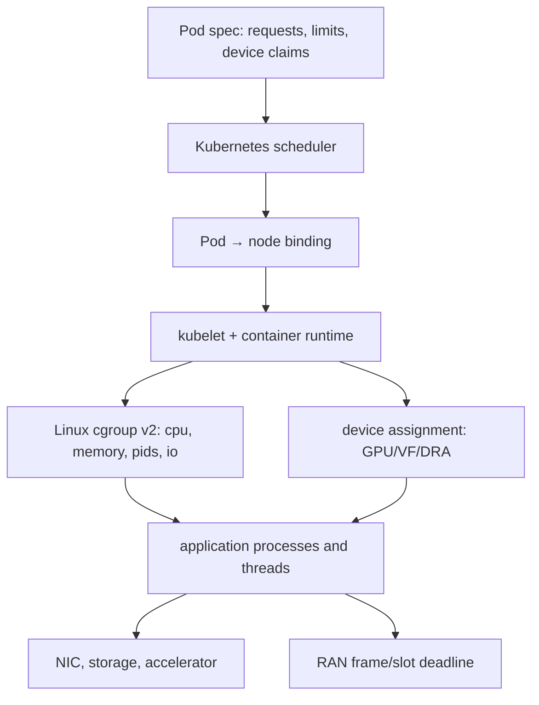
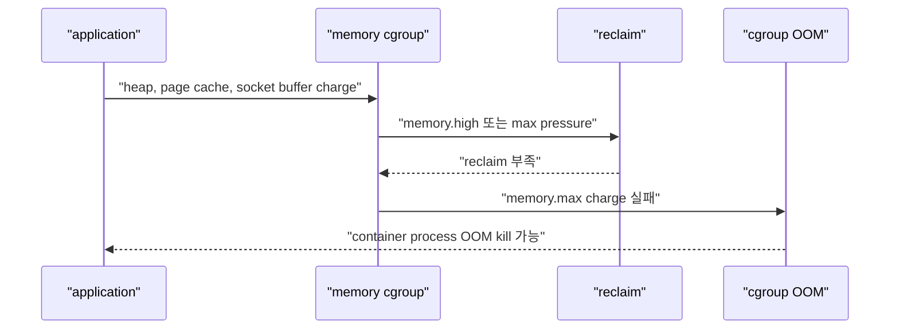
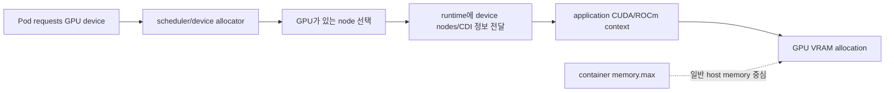
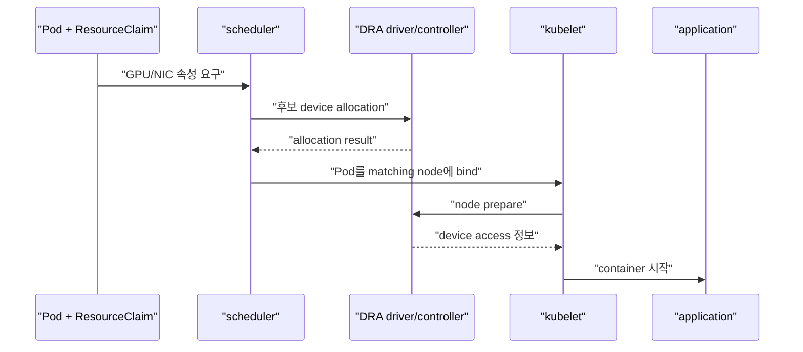

# 13. Container, Kubernetes, GPU와 RAN

[이 책 목차](README.md) · [이전: Network I/O와 kernel 관찰](12-network-io-and-kernel-observation.md) · [다음: Troubleshooting과 증거](14-troubleshooting-and-evidence.md)

Kubernetes resource request, Linux cgroup, GPU device assignment, application deadline은 서로 다른 control plane이다. Pod가 schedule되었다고 CPU latency가 보장되지 않고, memory limit을 지켰다고 GPU VRAM이 제한되는 것도 아니다. RAN(Radio Access Network) workload에서는 이 경계를 시간 budget과 함께 읽어야 한다.

이 장의 YAML, 숫자와 결과는 교육용 모형이다. Cluster, cgroup, GPU 또는 RAN system에 적용하거나 실행하지 않았다.


## 1. Pod에서 hardware까지의 경로



각 주체가 바꾸는 상태가 다르다.

| 주체 | 입력 | 바꾸는 상태 | 보장하지 않는 것 |
| --- | --- | --- | --- |
| Scheduler | Pod requests, affinity, device availability | Pod의 target node binding | Runtime latency와 실제 사용량 |
| Kubelet/runtime | Pod spec과 node 상태 | Container process, cgroup, mount, device access | Application deadline |
| Linux scheduler/memcg | Runnable task와 cgroup files | CPU time, reclaim, OOM | Kubernetes replica 수 |
| Device plugin/DRA driver | Device request/claim | GPU·NIC 같은 device 할당 | GPU kernel correctness |
| Application | Packet, frame, model, deadline | 업무 결과와 retry | Node resource isolation 전체 |

## 2. Request는 scheduler 입력이다

CPU·memory **request**는 scheduler가 Pod가 node에 fit하는지 계산하는 값이다. 현재 실제 사용량과 다르다.

```text
node allocatable: 16 CPU, 64Gi
existing requests: 12 CPU, 48Gi
new Pod request: 6 CPU, 8Gi

CPU: 12 + 6 = 18 > 16 → fit하지 않음
Memory: 48 + 8 = 56 <= 64 → fit
결론: 두 resource를 모두 만족하지 못해 후보 제외
```

Node의 순간 CPU 사용이 20%여도 request 합 때문에 Pending일 수 있다. 반대로 request가 너무 낮으면 scheduler는 많은 Pod를 배치하지만 runtime contention이 커진다.

공식 의미는 Kubernetes [Resource Management for Pods and Containers](https://kubernetes.io/docs/concepts/configuration/manage-resources-containers/)를 따른다.

## 3. CPU limit는 allocatable 예약량이 아니다

CPU request는 placement와 CPU share/weight에 연결되고 CPU limit는 runtime quota로 구현될 수 있다.

```yaml
resources:
  requests:
    cpu: "4"
    memory: 8Gi
  limits:
    cpu: "6"
    memory: 12Gi
```

이 조각은 교육용 container spec이며 단독 manifest로 적용하지 않는다.

Scheduler는 CPU 4를 request로 계산한다. Runtime에서는 CFS fair-class bandwidth 또는 관련 cgroup mechanism이 CPU 6 상한을 적용할 수 있다. 실제 quota period 안에 CPU 시간을 모두 쓰면 다음 period까지 throttling되어 latency spike가 생긴다.

```text
quota가 600ms / period 100ms인 6 CPU limit 모형
6개 thread가 100ms 동안 모두 실행 → quota 소진 가능
7번째 runnable thread가 있어도 period budget 때문에 대기
```

CPU limit을 없애면 node 여유를 burst에 쓸 수 있지만 noisy neighbor risk가 커진다. RAN deadline workload에서는 quota throttling count, cpuset, IRQ placement와 priority를 함께 측정한다.

## 4. Memory limit는 memcg로 이어진다

Container memory limit은 Linux cgroup v2 `memory.max` 같은 hard boundary에 연결될 수 있다. Request는 scheduler fit에 쓰이고 limit은 runtime memory charge에 작동한다.



Kubernetes의 `OOMKilled` status는 memcg 사건을 user-facing container 상태로 보여 줄 수 있다. Pod phase는 Running이면서 container restart count가 증가할 수 있다.

## 5. HugePages와 일반 memory를 구분한다

DPDK, packet processing, accelerator runtime은 HugeTLB page를 요구할 수 있다. Kubernetes hugepages resource와 memcg 일반 memory는 allocation·accounting 방식이 다르다.

Hugepage size별 resource를 request해야 하며 일반 memory처럼 overcommit되는 것으로 가정하지 않는다. Node에 필요한 preallocated pool이 없으면 Pod가 schedule되지 않거나 application allocation이 실패할 수 있다.

`memory.max`만 높이면 부족한 hugepage pool이 생기지 않는다. 반대로 hugepage를 확보해도 application heap과 socket buffer memory budget은 별도다.

## 6. GPU device assignment와 VRAM

GPU를 Pod에 할당하는 것과 GPU device memory(VRAM)를 세밀하게 제한하는 것은 다르다.



Traditional extended resource request `vendor.example/gpu: 1`은 보통 device 단위를 할당한다. CPU memory limit 16Gi를 적었다고 GPU VRAM도 16Gi로 제한되는 것은 아니다.

MIG(Multi-Instance GPU), mediated device, vendor time-slicing은 서로 다른 isolation과 accounting을 제공한다. “GPU 1개”가 full physical GPU인지 partition인지 resource name과 driver configuration을 확인한다.

## 7. DRA가 표현하는 assignment

**DRA(Dynamic Resource Allocation)**는 device request와 claim을 통해 structured parameter, scheduling, allocation 상태를 표현하는 Kubernetes mechanism이다. Driver가 device 준비와 node-local 정보를 runtime에 연결한다.



DRA object가 존재한다고 driver가 정상이라는 뜻은 아니다. Claim allocation, node preparation, CDI(Container Device Interface) 정보, device health와 application initialization을 단계별로 본다.

Kubernetes version별 DRA API와 feature state는 [Dynamic Resource Allocation](https://kubernetes.io/docs/concepts/resource-management/dynamic-resource-allocation/) 공식 문서에서 확인한다.

## 8. GPU memory를 별도 측정한다

```text
Host memory:
  process RSS 6Gi
  pinned host buffers 4Gi
  page cache 2Gi

GPU memory:
  model weights 18Gi
  activation peak 10Gi
  communication buffers 2Gi
```

Host memcg 관찰값은 약 12Gi와 관련될 수 있지만 GPU 30Gi 사용을 같은 숫자로 포함한다고 가정하지 않는다. Driver와 device telemetry, 지원되는 device-memory controller 또는 vendor mechanism을 별도로 확인한다.

Pinned host memory는 reclaim이 어려워 node pressure를 키울 수 있다. GPU OOM과 host cgroup OOM은 error message와 controller가 다르다.

## 9. RAN deadline budget

RAN workload는 packet 처리량뿐 아니라 frame·slot deadline을 지켜야 한다. 예를 들어 1ms budget을 다음처럼 나눈 교육 모형을 보자.

| 단계 | Budget |
| --- | ---: |
| NIC receive와 kernel path | 120µs |
| Userspace dequeue와 parse | 80µs |
| PHY/MAC compute 또는 accelerator | 500µs |
| Result queue와 transmit 준비 | 150µs |
| Jitter reserve | 150µs |
| 합계 | 1000µs |

평균이 700µs라도 p99.999가 1200µs면 deadline miss가 생긴다. CPU quota period, scheduler preemption, IRQ, page fault, memory reclaim, GPU launch, PCIe transfer, IOMMU와 network queue를 tail latency에서 본다.

## 10. Deadline miss 시간표

```text
t=0µs    NIC queue에 packet 도착
t=90µs   NAPI/kernel network 처리 완료
t=160µs  application receive CQE
t=240µs  parse 완료
t=260µs  GPU work submit
t=720µs  GPU completion
t=760µs  response build
t=810µs  send submit
t=880µs  정상 completion
```

Memory pressure가 있는 반례:

```text
t=160µs  receive CQE
t=210µs  page fault에서 memcg reclaim 시작
t=620µs  reclaim 종료
t=700µs  GPU submit
t=1160µs send 준비 → deadline miss
```

GPU compute를 최적화해도 reclaim 410µs가 남으면 목표를 못 맞춘다. PSI, page fault, cgroup event와 application trace를 같은 monotonic clock에 맞춘다.

## 11. CPU isolation의 조건

Cpuset으로 exclusive CPU를 주는 것만으로 jitter가 사라지지 않는다.

- IRQ와 softirq가 같은 CPU에서 실행될 수 있다.
- Kernel worker와 RCU callback이 간섭할 수 있다.
- SMT(Simultaneous Multithreading) sibling이 resource를 공유한다.
- CPU frequency와 thermal throttling이 바뀔 수 있다.
- NUMA(Non-Uniform Memory Access) remote memory와 PCIe locality가 다를 수 있다.
- Cgroup CPU quota가 여전히 throttling할 수 있다.

Topology Manager, CPU Manager, device NUMA node와 hugepage locality를 함께 맞춘다. Policy를 켰다는 사실보다 실제 Pod의 cpuset, device locality, latency histogram을 확인한다. CPU pinning 정책의 전제와 option은 Kubernetes [CPU management policies](https://kubernetes.io/docs/tasks/administer-cluster/cpu-management-policies/)에서 확인한다.

## 12. Network와 storage가 RAN에 끼치는 영향

Packet pipeline이 log, checkpoint, model load를 같은 node storage에 의존하면 writeback spike가 memory reclaim과 scheduler latency를 만들 수 있다. Control-plane log를 synchronous fsync하면 deadline path를 막을 수도 있다.

Critical packet path와 telemetry path를 queue와 thread에서 분리하되, crash 뒤 필요한 durability 수준을 버리지 않는다. Async log queue가 가득 찰 때 drop할지 backpressure할지 명시한다.

## 13. Kubernetes QoS만으로 부족한 이유

Guaranteed QoS는 모든 container의 CPU·memory request와 limit이 같은 Pod에 상대적으로 강한 eviction protection을 준다. 다음을 보장하지 않는다.

- CPU가 항상 즉시 4 core에서 실행됨
- Quota throttling이 없음
- GPU VRAM capacity와 bandwidth
- NIC queue와 IRQ exclusivity
- RAN slot deadline
- Node power·thermal 상태

PriorityClass와 Guaranteed를 최고로 설정한 workload가 많아지면 차별화가 사라진다. Capacity와 admission policy가 필요하다.

## 14. 통합 관찰 matrix

| 증상 | Kubernetes | Linux | Device/application |
| --- | --- | --- | --- |
| Pod Pending | scheduling event, claim status | 해당 node 미선택 | device availability |
| CPU jitter | request/limit, cpuset | throttled time, run queue, PSI | frame deadline histogram |
| OOMKilled | container lastState | memory.events, memory.stat | heap, pinned host memory |
| GPU OOM | device allocation | host memory와 분리 | VRAM telemetry, runtime error |
| Packet loss | Pod readiness, node | socket/drop/softirq | NIC counters, sequence gap |
| Slow checkpoint | volume event | io.pressure, writeback | filesystem/device latency |

한 열만 보고 원인을 결정하지 않는다. Timestamp, Pod UID, cgroup path, device ID, application frame ID를 연결한다.

## 15. 반례 모음

- Request 4 CPU는 실제 사용 4 CPU를 예약 실행하는 realtime contract가 아니다.
- CPU limit 6은 scheduler가 6 CPU를 allocatable에서 빼는 값이 아니다.
- Memory limit은 GPU VRAM limit이 아니다.
- GPU device assignment는 GPU compute latency 보장이 아니다.
- DRA claim이 Allocated여도 node preparation과 application init은 실패할 수 있다.
- Guaranteed QoS는 RAN deadline을 보장하지 않는다.
- 평균 latency가 budget 아래여도 tail deadline miss가 발생한다.

## 16. 처음 보는 단어로 RAN Pod 하나를 끝까지 따라가기

**Container**는 image에서 시작한 process를 Linux namespace와 cgroup 같은 kernel 기능으로 격리·제어하는 실행 단위다. VM처럼 별도 kernel을 자동 제공하는 개념은 아니다.

**Pod**는 Kubernetes scheduler가 node에 배치하는 최소 단위다. Pod 안 container들은 node, network identity와 명시한 volume을 공유할 수 있지만 resource limit과 process는 container별일 수 있다.

**Scheduler**는 아직 node가 정해지지 않은 Pod의 request, affinity, taint, volume·device 조건을 보고 후보 node를 고른다. Process를 직접 실행하지 않는다.

**Kubelet**은 선택된 node에서 PodSpec을 관찰하고 container runtime에 sandbox와 container 생성을 요청한다. Runtime은 OCI bundle, namespace, cgroup, mount와 device access를 구성한다.

**Allocatable**은 node capacity에서 Kubernetes와 system daemon을 위해 예약한 양 등을 뺀 scheduler 사용 가능 값이다. Request 합을 allocatable과 비교한다.

**GPU(Graphics Processing Unit)**는 많은 연산을 병렬로 수행하는 accelerator다. **VRAM(Video RAM)**은 GPU device에 붙은 memory다. Host DDR memory와 address·controller·telemetry가 다르다.

**DRA(Dynamic Resource Allocation)**는 Pod가 필요한 device 속성을 claim으로 표현하고 scheduler와 driver가 allocation·node preparation을 조정하는 Kubernetes resource model이다.

**RAN(Radio Access Network)**은 단말과 core network 사이의 radio 접속 계층이다. Baseband processing은 정해진 frame·slot 시각 안에 끝나야 하므로 평균 throughput보다 deadline miss tail이 중요하다.

한 Pod의 제출부터 radio 결과까지 시간순서는 다음과 같다.

```text
1. 사용자가 CPU/memory request·limit과 GPU/NIC claim이 있는 PodSpec 제출
2. API server가 object를 저장하고 scheduler가 watch
3. Scheduler가 allocatable, cpuset/NUMA, hugepage, device claim 후보를 filter
4. 한 node를 골라 Pod binding 기록
5. 선택 node의 kubelet이 Pod 변경을 관찰
6. Runtime이 network namespace, mount와 CPU/memory/PID cgroup을 생성
7. DRA/device driver가 GPU 또는 NIC를 prepare하고 container access 정보 제공
8. Container process가 시작해 host memory, pinned buffer, GPU VRAM을 각각 allocate
9. NIC packet이 kernel/socket 또는 userspace I/O path로 application에 도착
10. CPU thread와 GPU kernel이 PHY/MAC 계산을 수행
11. Response를 deadline 전에 TX queue로 제출
12. Kubelet은 process 상태를, application은 frame deadline metric을 각각 보고
```

여기서 4번 성공은 11번 deadline 성공을 보장하지 않는다. Scheduler는 미래의 page fault, CPU throttling, IRQ, GPU queue, device temperature를 모두 예측하지 않는다.

**NUMA(Non-Uniform Memory Access)**는 CPU socket에 따라 local memory와 remote memory 접근 비용이 다른 architecture다. GPU와 NIC의 PCIe locality, CPU cpuset, hugepage가 서로 다른 NUMA node면 data 이동 latency가 늘 수 있다.

**IRQ(Interrupt Request)**와 **softirq**는 device event와 network 후속 처리를 CPU에서 실행하는 kernel work다. Application CPU만 isolate하고 IRQ가 같은 core를 쓰면 jitter가 남는다.

## 17. 문제

1. Pod CPU request 4, limit 8이다. Scheduler는 기본적으로 node에서 몇 CPU를 fit 계산하는가?
2. Container memory limit 12Gi다. GPU VRAM도 12Gi로 제한되는가?
3. 1ms deadline에서 kernel 150µs, application 200µs, GPU 550µs, transmit 180µs가 걸렸다. Reserve 없이 deadline을 만족하는가?
4. Guaranteed Pod가 deadline을 놓쳤다. 어떤 Linux 증거를 먼저 연결할 수 있는가?

## 18. 해설

1. Request인 4 CPU다. Limit 8은 runtime 상한과 관련된다.
2. 아니다. Host memcg와 GPU device memory는 별도 accounting·제어 경로다.
3. 합이 1080µs이므로 80µs 초과한다. Tail jitter reserve까지 있으면 더 엄격하다.
4. CPU throttling, run queue와 PSI, memory reclaim/page fault, IRQ·softirq, NUMA locality, device completion을 application timestamp와 연결한다.

다음 장에서는 지금까지의 status, counter, event, trace를 하나의 재현 가능한 troubleshooting evidence package로 만드는 방법을 다룬다.
