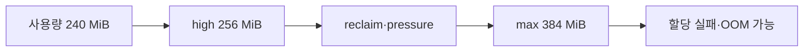

# 14. 문제 해결과 증거 수집

[이전: 13. Container·Kubernetes·GPU·RAN](13-containers-kubernetes-gpu-and-ran.md) · [목차](README.md) · [다음: 15. 안전한 로컬 모형 실습](15-safe-local-model-labs.md)

문제 해결은 명령을 많이 실행하는 일이 아니라, 서로 다른 원인이 같은 증상을 만드는 상황에서 가설을 하나씩 구분하는 일이다. 이 장의 명령은 상태를 읽는 예시이며 값을 바꾸지 않는다.


## 1. 증상과 원인을 분리한다

“프로그램이 느리다”는 증상이다. CPU quota, run queue 경쟁, memory reclaim, storage 지연, lock 대기, network 지연이 모두 같은 말로 보일 수 있다.

먼저 시각과 범위를 적는다.

| 질문 | 예시 |
| --- | --- |
| 언제 시작했는가 | 14:03부터 |
| 무엇이 느린가 | 요청 p95가 20 ms→180 ms |
| 어디까지인가 | 한 service cgroup만 |
| 무엇은 정상인가 | host idle 70%, network 정상 |
| 재현 조건은 | worker 2개일 때 |

숫자가 없는 “가끔 느림”은 전후 비교를 어렵게 한다.

## 2. 읽기 전용 증거의 경계

### `/proc`와 `/sys`는 보통 파일과 역할이 다르다

`/proc`와 `/sys` 아래의 많은 경로는 disk에 저장된 일반 text file이 아니다. Kernel이 현재 상태를 file처럼 보여 주는 virtual filesystem entry다. `cat`은 내용을 읽지만, 값이 언제 만들어지고 어떤 단위를 쓰는지는 해당 kernel 문서에서 확인해야 한다.

예를 들어 `cpu.stat`의 숫자는 process가 출력한 log가 아니다. Kernel이 cgroup CPU accounting 결과를 누적해 보여 준다. 같은 이름의 항목이라도 kernel version과 controller 활성 상태에 따라 존재 여부가 다를 수 있다.

| 값 종류 | 초보자가 할 질문 | 예 |
| --- | --- | --- |
| Gauge | 지금 이 순간의 양인가? | `memory.current` |
| Counter | 시작 뒤 계속 누적되는가? | `oom_kill`, `nr_throttled` |
| Ratio/average | 어느 시간 창의 비율인가? | PSI `avg10` |
| Limit | 현재 사용량이 아니라 경계인가? | `memory.max` |

Counter가 100이라는 사실만으로 지금 장애 중인지 알 수 없다. 14:00에 100, 14:01에 120이라면 1분 동안 20 증가했다는 delta가 증상 시간과 더 직접적으로 연결된다.

다음은 일반적인 읽기 예다. 경로와 권한은 배포 환경에 따라 다르다.

```text
cat /proc/pressure/cpu
cat /proc/pressure/memory
cat /sys/fs/cgroup/cpu.stat
cat /sys/fs/cgroup/memory.events
cat /sys/fs/cgroup/memory.current
```

`cat`으로 pseudo-file을 읽는 것은 값을 바꾸지 않는다. 그러나 production에서 읽기 자체도 감사·접근 정책의 대상일 수 있다.

`sysctl kernel.io_uring_disabled`처럼 이름으로 값을 조회할 수 있지만, `sysctl -w`는 변경이다. 이 장은 조회만 다룬다.

## 3. CPU quota와 host 여유를 구분한다


CPU quota가 `50000`, period가 `100000` 마이크로초라면 허용 CPU 시간은 period당 50 ms, 즉 평균 0.5 CPU다.

여기서 microsecond는 100만분의 1초이고 기호는 µs다. `100000 µs=100 ms=0.1 s`, `50000 µs=50 ms`다. 0.5 CPU는 CPU core 절반을 물리적으로 잘라 둔다는 뜻이 아니다. 여러 period를 평균했을 때 cgroup task들이 소비할 수 있는 CPU 실행 시간이 한 core의 50%와 같다는 뜻이다.

Thread는 process 안에서 scheduler가 실행 대상으로 다루는 흐름이다. Thread가 둘이면 동시에 두 core를 쓸 가능성은 있지만 cgroup quota 합계는 그대로다. 두 thread가 더 빨리 50 ms 예산을 소진할 수 있다.

두 thread A와 B가 계속 계산하면 100 ms period 초반에 합계 50 ms를 소비할 수 있다. 그 뒤 다음 period까지 throttling될 수 있다.

| 시간 구간 | A CPU | B CPU | cgroup 합계 | 상태 |
| --- | ---: | ---: | ---: | --- |
| 0~25 ms | 25 | 25 | 50 | quota 소진 |
| 25~100 ms | 0 | 0 | 50 | throttled 가능 |
| 다음 period | 다시 허용 | 다시 허용 | 새 예산 | 실행 재개 |

Host에 idle CPU가 남아도 이 cgroup은 quota 때문에 실행하지 못할 수 있다. “Host CPU 30%이므로 CPU 제한이 아니다”는 결론은 틀릴 수 있다.

## 4. CPU 증거 조합

`cpu.stat`의 `nr_throttled`와 `throttled_usec` 증가, service latency의 period성, CPU PSI(Pressure Stall Information)의 `some` 증가를 함께 본다.

| 관찰 | quota 가설 | host 경쟁 가설 |
| --- | --- | --- |
| host 전체 idle 높음 | 가능 | 약해짐 |
| cgroup throttled 증가 | 강해짐 | 직접 증거 아님 |
| host CPU PSI 증가 | 반드시 아님 | 강해질 수 있음 |
| quota 제거 없는 다른 cgroup 정상 | 강해짐 | 범위 재확인 |

한 counter만으로 인과를 확정하지 않는다. Counter delta와 증상 시간대를 맞춘다.

## 5. CPU PSI 읽기

`some`은 적어도 일부 task가 CPU를 기다린 시간, `full`은 해당 자원 관점에서 모든 non-idle task가 동시에 막힌 상황을 나타내는 지표다. CPU PSI에는 memory·I/O PSI와 다른 의미와 지원 범위가 있다.

`avg10`, `avg60`, `avg300`은 최근 창의 비율 요약이고 `total`은 누적 시간이다. 누적값 자체보다 구간 delta를 본다.

## 6. Process OOM과 node OOM을 구분한다

OOM은 Out Of Memory다. 한 cgroup이 `memory.max`에 닿아 kill이 일어날 수 있고, node 전체 memory pressure로 kernel OOM killer가 동작할 수도 있다.

| 증거 | cgroup 한도 가설 | node 전체 가설 |
| --- | --- | --- |
| 해당 `memory.events`의 `oom_kill` 증가 | 강함 | 함께 나타날 수도 있음 |
| `memory.current`가 `memory.max` 근처 | 강함 | 직접 증거 아님 |
| node `MemAvailable` 급감 | 약함 | 강함 |
| 다른 cgroup도 동시 실패 | 약함 | 강함 |

Container가 종료되었다는 사실만으로 node OOM이라 부르지 않는다.

## 7. Anonymous memory와 file cache

Anonymous memory는 heap·stack 같은 파일에 직접 backing되지 않는 메모리다. File page는 file content cache와 관련된다.

MiB는 mebibyte이며 `1 MiB=1024×1024 byte`다. MB를 1000×1000 byte로 쓰는 문맥과 숫자가 조금 다르므로 한 표에서는 단위를 섞지 않는다.

“File cache 110 MiB”는 application이 파일을 직접 110 MiB 변수에 담았다는 뜻이 아니다. Kernel이 읽은 file content를 page 단위로 memory에 남겨 다음 접근을 빠르게 할 수 있다는 뜻이다. 그 page를 버려도 원본이 storage에 있으면 다시 읽을 수 있지만, 다시 읽는 비용은 생긴다.

예를 들어 384 MiB 한도에서 anonymous 250 MiB, file page 110 MiB, 기타 20 MiB면 합계 380 MiB 수준이다. File cache가 reclaim 가능하다고 해서 즉시 110 MiB 모두 회수할 수 있는 것은 아니다.

Dirty page는 storage에 반영되기 전이라 writeback이 필요할 수 있다. Clean page는 다시 읽을 수 있어 상대적으로 회수하기 쉽다.

## 8. `memory.high`와 `memory.max`

`memory.high`는 reclaim과 throttling을 유도하는 경계, `memory.max`는 hard limit 성격의 경계다. High 256 MiB, max 384 MiB에서 current 300 MiB이면 즉시 OOM이라는 뜻은 아니다. Reclaim·stall이 늘 수 있다.



정확한 동작은 kernel, charge 종류, reclaim 가능성, workload에 달려 있다.

## 9. Memory PSI와 OOM은 같은가

Memory PSI 증가는 reclaim이나 allocation 대기로 task가 멈춘 시간을 보여 준다. OOM kill 없이 PSI가 높을 수 있고, 갑작스러운 큰 할당으로 PSI가 오래 높지 않았는데 kill이 날 수도 있다.

`memory.events`와 PSI, `memory.stat`, application allocation 패턴을 함께 본다.

## 10. I/O 지연의 층

Application은 `read`나 io_uring 요청을 제출한다. Kernel은 page cache, filesystem, block layer, driver, device를 거칠 수 있다.


Cache hit이면 device I/O가 없을 수 있다. Device가 빠른데 filesystem lock이나 dirty throttling으로 느릴 수도 있다.

## 11. io_uring 오류를 분류한다

io_uring은 submission queue와 completion queue를 사용하는 Linux 비동기 I/O 인터페이스다.

비동기는 “요청 함수가 반환되기 전에 모든 I/O가 끝난다”는 뜻이 아니다. Program은 먼저 요청을 제출하고, 나중에 별도의 completion을 받아 성공·실패·처리 byte 수를 확인한다.

`errno`는 Linux/POSIX 계열 API가 실패 종류를 표현하는 번호 체계다. liburing 함수는 흔히 성공 시 0 이상, 실패 시 `-errno`처럼 음수를 반환한다. 따라서 `-22`를 byte 수로 읽지 않고 양수 22에 해당하는 오류 이름 `EINVAL`로 해석한다.

| 오류 | 가능한 범주 | 다음 읽기 전용 확인 |
| --- | --- | --- |
| `ENOSYS` | syscall 미제공·차단 경로 | kernel·architecture·runtime 경계 |
| `EPERM` | policy·권한·disabled 설정 | seccomp, LSM, 관련 sysctl 조회 |
| `EINVAL` | flag·opcode·argument 미지원 | 요청 필드, kernel/liburing 지원표 |

같은 오류 번호도 호출 지점과 argument가 다르면 의미가 달라질 수 있다. 전체 로그의 syscall 단계와 요청을 보존한다.

## 12. `EPERM` 사례

프로그램 시작 즉시 ring 생성이 `EPERM`이면 file permission만 보지 않는다. Seccomp profile이 syscall을 거절하거나 io_uring 비활성 정책이 있을 수 있다.

읽기 가능한 환경에서는 다음 범주를 확인한다.

```text
uname -r
sysctl kernel.io_uring_disabled
cat /proc/self/status
```

설정을 바꾸기 전에 어느 layer가 거절했는지 구분한다.

## 13. `EINVAL` 사례

Ring 생성은 성공했는데 특정 operation 제출이 `EINVAL`이면 syscall 존재 자체보다 flag·opcode·buffer registration 조합을 본다.

새 기능을 오래된 kernel에서 요청했거나 reserved field가 0이 아닐 수 있다. “io_uring 전체 미지원”으로 확대하지 않는다.

## 14. Completion의 음수와 양수

Completion result가 음수면 일반적으로 `-errno` 형식의 실패, 0 이상이면 operation별 결과 byte 수 등이 될 수 있다.

Read 4096 byte를 요청해 1200이 완료되면 성공한 short read일 수 있다. 4096이 아니라고 자동 오류는 아니다. Operation 계약과 EOF를 본다.

EOF는 End Of File의 약어다. 일반 file read에서 result 0은 현재 offset에서 더 읽을 byte가 없다는 뜻일 수 있다. 음수 오류, 0 EOF, 양수 byte 수를 세 갈래로 나눠야 한다.

Offset은 file 시작에서 몇 byte 떨어진 위치인지 나타낸다. Offset 0은 처음부터 읽는다는 뜻이다. 4096을 요청해 1200을 받았다면 buffer의 유효한 범위는 index 0부터 1199까지다. 나머지 영역을 출력 데이터로 사용하면 안 된다.

## 15. Out-of-order completion

요청 101을 먼저 제출하고 102를 나중 제출해도 102가 먼저 완료될 수 있다. Completion ID와 요청 state를 연결해야 한다.

Buffer를 “다음 completion이 왔다”는 이유로 해제하면 다른 요청 buffer를 해제할 수 있다. Matching completion 뒤 수명을 끝낸다.

## 16. Cancel race

Cancel을 제출하는 순간 대상 I/O가 이미 완료 중일 수 있다. Cancel 성공, 대상 성공, 이미 없음 같은 결과를 state machine으로 처리한다.

Cancel 요청 completion만 보고 대상 buffer를 즉시 해제하지 않는다. 대상 operation의 terminal completion을 확인한다.

## 17. 증거 기록 양식

| 항목 | 기록 예 |
| --- | --- |
| 증상 시각 | 14:03:10~14:05:40 |
| 범위 | service.slice의 worker 두 개 |
| 가설 | CPU quota throttling |
| 증거 전 | cpu.stat counter |
| 증거 후 | 60초 delta |
| 반대 증거 | host idle, 다른 slice 정상 |
| 결론 수준 | quota와 강한 상관, 인과 추가 확인 |

## 18. 안전한 중단 기준

Read 권한이 없으면 권한 우회를 시도하지 않는다. 값을 변경해야만 가설을 시험할 수 있다면 별도 승인·복구 계획·관찰 창이 필요하다.

이 교재의 로컬 모형은 실제 sysfs, cgroup, systemd, kernel parameter를 변경하지 않는다.

## 확인 문제

**질문.** Host CPU가 70% idle인데 service가 CPU 때문에 느릴 수 있는가?

**해설.** 가능하다. Service cgroup quota가 0.5 CPU로 제한되어 throttled될 수 있다.

**질문.** `memory.current < memory.max`이면 memory pressure가 없는가?

**해설.** 아니다. `memory.high`, reclaim, dirty page, PSI를 함께 본다.

**질문.** io_uring CQE가 음수면 byte 수인가?

**해설.** 일반적으로 `-errno` 실패를 해석한다. Opcode 계약을 확인한다.

## 공식 자료

- [Linux kernel cgroup v2](https://docs.kernel.org/admin-guide/cgroup-v2.html)
- [Linux kernel PSI](https://docs.kernel.org/accounting/psi.html)
- [Linux kernel io_uring](https://docs.kernel.org/io_uring/)
- [io_uring_setup(2)](https://man7.org/linux/man-pages/man2/io_uring_setup.2.html)
- [liburing](https://github.com/axboe/liburing)
