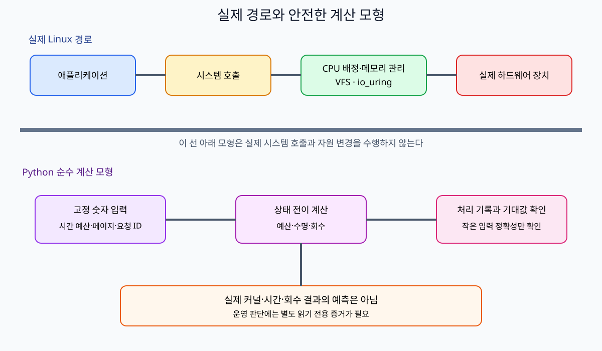
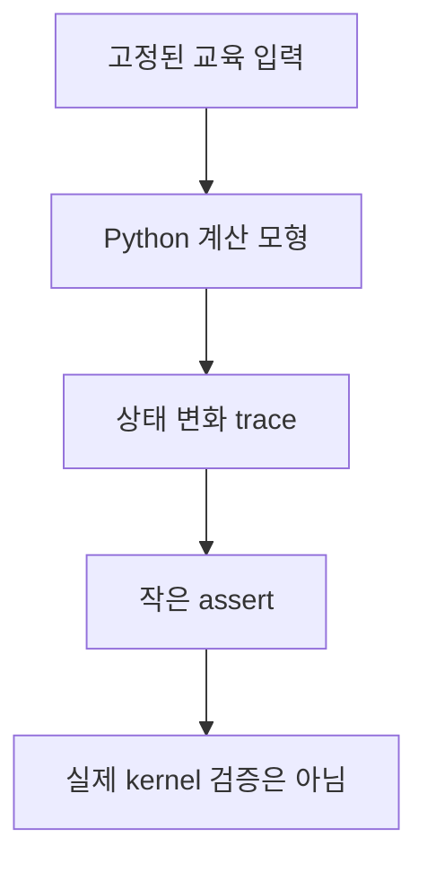
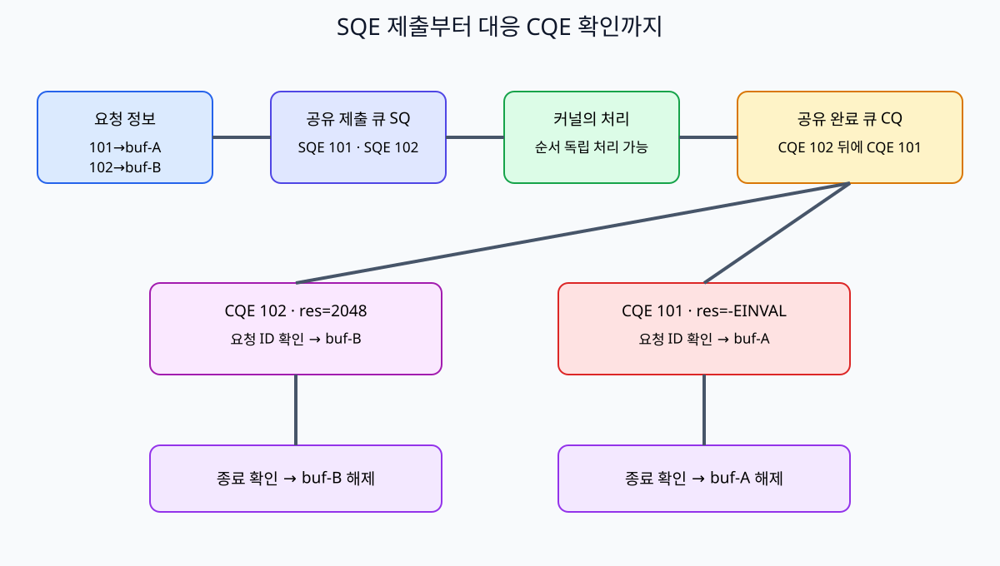

# 15. 안전한 로컬 모형 실습

[이전: 14. 문제 해결과 증거 수집](14-troubleshooting-and-evidence.md) · [목차](README.md) · [다음: 16. 문제·용어·출처](16-exercises-glossary-and-sources.md)

이 장은 실제 cgroup, sysfs, systemd, io_uring을 조작하지 않는다. Python 표준 라이브러리 계산으로 예산·수명·pressure 판단을 손으로 검산한다.





## 1. 실행 위치

Repository root에서 다음 세 명령을 사용한다.

```text
python3 -B learning/ubuntu-linux-internals/examples/cgroup_budget.py
python3 -B learning/ubuntu-linux-internals/examples/ring_lifetime_model.py
python3 -B learning/ubuntu-linux-internals/examples/memory_pressure_model.py
```

`-B`는 `.pyc` bytecode 파일을 만들지 않게 한다. Package 설치가 필요하지 않다.

## 2. 실습 파일

- [cgroup_budget.py](examples/cgroup_budget.py): quota와 period를 두 thread가 나눠 쓰는 계산.
- [ring_lifetime_model.py](examples/ring_lifetime_model.py): 요청 ID, CQE, buffer 수명, cancel race 상태 모형.
- [memory_pressure_model.py](examples/memory_pressure_model.py): anonymous/file page, high/max, clean/dirty reclaim 모형.

예제 설계 원칙은 [examples/README](examples/README.md)에 정리했다.

## 3. CPU quota 입력

Quota 50000 µs, period 100000 µs다.

Quota는 “이 시간만큼 반드시 실행한다”는 예약이 아니라 이 cgroup이 한 period에 소비할 수 있는 상한이다. Runnable work가 없으면 예산을 다 쓰지 않는다. Period는 다음 예산 구간의 길이다.

```text
CPU share = quota / period = 50000 / 100000 = 0.5 CPU
```

Thread A와 B가 각각 period마다 CPU 30 ms를 원하면 demand 합은 60 ms다. 예산은 50 ms이므로 10 ms가 다음 period까지 기다린다.

## 4. 두 thread 손 추적

모형은 5 ms quantum으로 A와 B를 번갈아 계산한다.

Quantum은 이 Python 모형이 한 차례에 배분하는 작은 계산 단위다. 실제 Linux scheduler time slice가 항상 5 ms라는 주장이 아니다. 손으로 열 번 더하면 quota 50 ms가 되는 숫자를 선택했을 뿐이다.

Demand 30 ms는 thread가 일을 끝내기 위해 필요하다고 가정한 CPU 실행 시간이다. Wall-clock 30 ms와 같지 않을 수 있다. Throttling이나 다른 task 대기가 있으면 실제 경과 시간은 더 길다.

| step | 실행 thread | 사용 전 예산 | 사용 | 남은 예산 |
| ---: | --- | ---: | ---: | ---: |
| 1 | A | 50 | 5 | 45 |
| 2 | B | 45 | 5 | 40 |
| ... | ... | ... | ... | ... |
| 9 | A | 10 | 5 | 5 |
| 10 | B | 5 | 5 | 0 |

각 thread가 25 ms를 사용했고 각각 5 ms demand가 남는다. Host에 다른 CPU가 비어 있어도 이 cgroup budget은 끝났다.

## 5. 예상 CPU 출력

```text
quota/period = 0.50 CPU
period 1: A=25ms B=25ms throttled-demand=10ms
period 2: remaining demand completed
model note: calculation only; no cgroup was read or changed
```

출력 숫자는 실측 latency가 아니다. Scheduler time slice와 실제 throttling 시점을 예측하지 않는다.

## 6. CPU assert가 확인하는 것

- Ratio가 0.5다.
- 한 period 사용량이 50 ms를 넘지 않는다.
- 두 runnable thread의 합 demand가 예산보다 크면 대기 demand가 남는다.

실제 kernel의 fairness, migration, accounting rounding은 확인하지 않는다.

## 7. io_uring 수명 모형



요청 ID 101과 102가 shared SQ/CQ에 들어간다. SQ는 Submission Queue, CQ는 Completion Queue다.

SQE는 Submission Queue Entry다. “이 file의 offset 0에서 이 buffer로 최대 4096 byte를 읽어 달라” 같은 요청 한 건을 담는다. CQE는 Completion Queue Entry이며 kernel이 끝낸 요청의 ID와 result를 program에 돌려준다.

Shared라는 말은 user space와 kernel이 ring memory 구조를 통해 항목을 교환한다는 뜻이다. 두 요청이 같은 buffer를 공유해도 안전하다는 뜻은 아니다. 이 모형은 요청마다 다른 stable buffer를 둔다.

| 요청 | buffer | 요청 byte | 제출 순서 |
| ---: | --- | ---: | ---: |
| 101 | buf-A | 4096 | 1 |
| 102 | buf-B | 2048 | 2 |

Completion은 102가 먼저 2048 byte 성공, 101은 나중 `-22`인 `EINVAL`로 도착한다.

## 8. Out-of-order CQE

```text
submit: 101, 102
complete: 102(res=2048), 101(res=-22)
```

CQE 순서가 SQE 순서와 같다는 invariant를 두면 buf-A와 buf-B를 바꿔 해제한다. ID로 pending map을 찾아야 한다.

## 9. Stable buffer 수명

Request를 pending map에 넣을 때 buffer ownership도 연결한다.

```text
pending[101] = buf-A
pending[102] = buf-B
CQE 102 → buf-B 결과 해석 → buf-B release
CQE 101 → buf-A 오류 해석 → buf-A release
```

Matching completion 전에는 buffer를 변경·재사용하지 않는다. 실제 registered buffer 규칙과 언어 binding의 ownership은 별도 문서를 따른다.

Stable buffer는 요청이 진행되는 동안 주소와 저장 영역이 유효하게 남아 있는 buffer를 뜻한다. Stack local array가 함수 return으로 사라지거나, heap buffer를 `free`하거나, 동적 container 재할당으로 주소가 바뀌면 kernel이 아직 사용하는 memory의 수명이 깨질 수 있다.

`user_data=101`은 kernel이 buffer 내용을 이해하게 하는 값이 아니다. Application이 CQE를 원래 request state와 연결하기 위해 넣는 64-bit 식별 값이다. ID가 중복되면 어느 buffer를 해제할지 모호해진다.

## 10. 음수 결과와 byte 결과

102의 `res=2048`은 처리 byte 수다. 101의 `res=-22`는 교육 모형에서 `EINVAL`이다.

Positive 결과도 요청 byte보다 작을 수 있다. Short read를 오류로 바꾸지 않고 operation 계약에 따라 남은 일을 결정한다.

## 11. Cancel race


요청 101을 cancel하려는 순간 세 상태가 가능하다.

1. 아직 pending: cancel이 대상을 terminal cancelled로 만든다.
2. 이미 completion queued: cancel은 이미 완료됨을 관찰할 수 있다.
3. 실행과 cancel 경쟁: 대상 CQE와 cancel CQE를 모두 ID로 처리한다.

Cancel CQE 하나만 보고 buffer를 해제하지 않는다. 대상 101의 terminal 상태와 중복 release 방지 flag를 확인한다.

## 12. 예상 ring 출력

```text
submitted ids: [101, 102]
completion 102: bytes=2048 release=buf-B
completion 101: errno=EINVAL release=buf-A
cancel race: target terminal state owns final release
model note: this is not a real io_uring call
```

## 13. Ring assert가 확인하는 것

- Completion 순서가 달라도 올바른 buffer를 찾는다.
- 음수 result와 byte result를 구분한다.
- 같은 buffer를 두 번 release하지 않는다.
- Unknown ID completion을 조용히 다른 요청에 붙이지 않는다.

Kernel opcode 지원, memory ordering, 실제 syscall은 검증하지 않는다.

## 14. Memory pressure 입력

`memory.high=256 MiB`, `memory.max=384 MiB`다. 상태는 다음과 같다.

Accounting은 “어느 cgroup에 얼마를 셀 것인가”를 정하는 회계다. 같은 physical page의 charge 규칙, shared page, kernel memory는 실제 Linux 문서를 따라야 한다. 아래 네 항목 합은 교육용으로 중복 없이 나뉜다고 가정한다.

| 종류 | 사용량 | 회수 성격 |
| --- | ---: | --- |
| Anonymous | 220 MiB | swap·kill 정책과 관련 |
| Clean file page | 80 MiB | 다시 읽을 수 있어 후보 |
| Dirty file page | 40 MiB | writeback 전 즉시 drop 불가 |
| 기타 | 20 MiB | 모형에서 고정 |
| 합계 | 360 MiB | high 초과, max 미만 |

## 15. Watermark 모형

이 예제의 watermark는 실제 Linux zone watermark가 아니다. 교육용 목표 사용량 240 MiB를 뜻한다.

Reclaim은 memory에서 page를 회수해 다른 allocation에 쓸 수 있게 하는 과정이다. Clean file page는 storage의 원본과 같아 버린 뒤 다시 읽을 수 있다. Dirty file page는 memory의 변경이 storage에 아직 반영되지 않아 writeback이 먼저 필요하다고 단순화한다.

현재 360에서 목표 240까지 120 MiB를 줄여야 한다. Clean file 80을 먼저 회수해도 280이라 40 MiB가 남는다. Dirty 40은 writeback 뒤 clean이 되어야 회수 가능하다고 단순화한다.

## 16. 상태 변화

| 단계 | anon | clean | dirty | 기타 | 합계 |
| --- | ---: | ---: | ---: | ---: | ---: |
| 시작 | 220 | 80 | 40 | 20 | 360 |
| clean reclaim | 220 | 0 | 40 | 20 | 280 |
| dirty writeback | 220 | 40 | 0 | 20 | 280 |
| 추가 reclaim | 220 | 0 | 0 | 20 | 240 |

결과가 240인 이유는 file page 120 MiB 전체가 최종적으로 clean reclaim되었다는 모형 가정 때문이다.

## 17. High와 max 판정

360 MiB는 high 256을 넘으므로 pressure 상태, max 384보다 작으므로 이 숫자만으로 즉시 OOM이라 하지 않는다.

새 anonymous 40 MiB allocation이 reclaim 전에 charge되면 400 MiB가 되어 max를 넘는 요구다. 실제 성공·reclaim·OOM은 kernel 상황에 달려 있다.

## 18. 예상 memory 출력

```text
current=360MiB high=256MiB max=384MiB
pressure=above-high below-max
clean reclaimed=80MiB
dirty writeback then reclaimed=40MiB
modeled final=240MiB
model note: not an exact Linux reclaim prediction
```

## 19. Memory assert가 확인하는 것

- Account 합계가 360 MiB다.
- High 초과와 max 미만을 따로 판정한다.
- Dirty page를 writeback 없이 clean reclaim으로 세지 않는다.
- Reclaim 가능량보다 큰 목표를 성공으로 보고하지 않는다.

NUMA, swap, slab, kernel memory, refault, 실제 LRU 세대는 모형 밖이다.

## 20. 세 모형의 공통 읽기법

1. 입력 단위가 µs인지 MiB인지 확인한다.
2. 상태 표의 합계를 손으로 계산한다.
3. 한 단계가 어떤 invariant를 지키는지 말한다.
4. 예상 출력과 assert 범위를 구분한다.
5. 실제 kernel에 일반화하지 않는다.

## 20.1 Python 모형과 선택 C 예제의 층

Python 세 파일은 숫자 state machine이다. File descriptor를 열지 않고, system call을 호출하지 않고, kernel queue를 만들지 않는다.

[uring_read.c](examples/uring_read.c)는 별도의 선택 예제로 실제 liburing API 모양을 보여 준다. 사용자가 경로로 준 작은 일반 file을 read-only로 열고 한 번 읽는다. Compile에는 liburing header와 library가 필요하며, 실행 환경의 kernel·seccomp·policy가 io_uring을 허용해야 한다.

최신 liburing를 설치했다는 사실만으로 실행 kernel이 모든 opcode와 flag를 지원하는 것은 아니다. Header에서 compile되는 것과 kernel에서 request가 성공하는 것을 구분한다.

## 21. 실패 실험

CPU quota를 60000으로 바꾸면 첫 period에 두 thread demand 60 ms가 모두 끝난다. Ring completion을 101,102 순으로 바꿔도 ID matching 결과는 같다. Clean file을 20 MiB로 줄이면 watermark 240에 도달하지 못한다.

입력을 바꾼 뒤 기대값도 함께 바꾸고, assert가 어떤 계약을 잡는지 설명한다.

## 확인 문제

**질문.** Quota 50000/period 100000은 thread마다 0.5 CPU인가?

**해설.** 아니다. Cgroup 전체가 평균 0.5 CPU 예산을 공유한다.

**질문.** CQE 102가 먼저 오면 요청 101 buffer를 해제하는가?

**해설.** 아니다. ID 102에 연결된 buf-B만 해제한다.

**질문.** 360 MiB가 max 384 MiB 미만이면 pressure가 없는가?

**해설.** High 256 MiB를 넘었으므로 reclaim·stall 가능성을 모형으로 표시한다.

## 공식 자료

- [cgroup v2 CPU와 memory controller](https://docs.kernel.org/admin-guide/cgroup-v2.html)
- [io_uring 문서](https://docs.kernel.org/io_uring/)
- [liburing examples](https://github.com/axboe/liburing/tree/master/examples)
- [systemd resource control](https://www.freedesktop.org/software/systemd/man/latest/systemd.resource-control.html)
