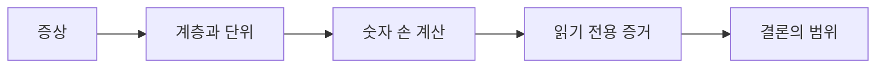

# 16. 문제·용어사전·공식 출처

[이전: 15. 안전한 로컬 모형 실습](15-safe-local-model-labs.md) · [목차](README.md)

각 문제는 숫자를 손으로 계산한 뒤 해설과 비교한다. 같은 증상에서 여러 가설을 구분하는 문장을 함께 쓴다.

## 1. Worked problems

### 문제 1. CPU quota

`cpu.max`가 `50000 100000`이다. 평균 CPU 예산은 얼마인가?

**해설.** `50000/100000=0.5 CPU`다. 두 thread가 있더라도 각 0.5가 아니라 cgroup 합계 0.5다.

### 문제 2. 두 thread demand

A와 B가 period마다 각각 30 ms를 원한다. Quota 50 ms에서 남는 demand는?

**해설.** 합계 60 ms에서 50 ms만 허용하므로 10 ms가 남는다. 공평하게 25 ms씩 썼다는 것은 이 모형의 scheduling 가정이다.

### 문제 3. Host idle 반례

Host idle이 70%인데 service latency가 100 ms period로 튄다. CPU 원인을 제외해도 되는가?

**해설.** 아니다. Service cgroup의 throttled counter가 늘면 local quota가 원인일 수 있다.

### 문제 4. Memory account

Anonymous 220, clean file 80, dirty file 40, 기타 20 MiB의 합은?

**해설.** 360 MiB다. High 256보다 크고 max 384보다 작다.

### 문제 5. Clean reclaim

360에서 clean 80만 회수하면 얼마인가?

**해설.** 280 MiB다. 목표 240까지 40 MiB가 더 필요하다.

### 문제 6. Dirty page

Dirty 40 MiB를 즉시 없는 것으로 세도 되는가?

**해설.** 아니다. 단순 모형에서도 writeback 뒤 clean 상태가 되어야 회수한다. 실제 kernel 동작은 더 복잡하다.

### 문제 7. Cgroup OOM과 node OOM

한 container만 종료되고 해당 `memory.events`의 `oom_kill`이 증가했다. 가장 가까운 가설은?

**해설.** 해당 cgroup 한도에서의 OOM 가설이 강하다. Node log와 다른 workload 상태로 범위를 추가 확인한다.

### 문제 8. Out-of-order CQE

101→buf-A, 102→buf-B를 제출했고 CQE 102가 먼저 왔다. 무엇을 해제하는가?

**해설.** Pending map에서 102를 찾아 buf-B 결과를 처리한 뒤 buf-B를 해제한다.

### 문제 9. 음수 result

CQE result `-22`를 22 byte 성공으로 읽어도 되는가?

**해설.** 아니다. 교육 모형에서는 `-EINVAL` 실패다. Opcode별 completion 계약을 확인한다.

### 문제 10. Short read

4096 byte read 요청이 1200을 반환했다. 자동 실패인가?

**해설.** 아니다. 1200 byte 성공일 수 있다. EOF와 남은 요청 의미를 판단한다.

### 문제 11. Cancel race

Cancel CQE가 왔으니 대상 buffer를 즉시 해제해도 되는가?

**해설.** 아니다. 대상 I/O가 이미 완료와 경쟁했을 수 있다. 대상 request의 terminal completion과 release flag를 확인한다.

### 문제 12. `ENOSYS`, `EPERM`, `EINVAL`

세 오류를 같은 “io_uring 미지원”으로 기록해도 되는가?

**해설.** 아니다. Syscall 부재·차단, policy·권한, argument·opcode 미지원 가설을 분리한다.

## 2. 추가 문제

1. CPU `nr_throttled` 누적값보다 구간 delta가 유용한 이유를 설명하라.
2. Memory PSI가 높지만 OOM kill이 없을 수 있는 사례를 쓰라.
3. File cache가 모두 즉시 회수 가능하지 않은 이유를 clean/dirty로 나누어 쓰라.
4. CQE user data와 배열 순번을 혼동하면 어떤 buffer 오류가 생기는가?
5. `sysctl -w`가 이 책의 읽기 전용 범위를 벗어나는 이유를 쓰라.
6. 모형 출력이 실제 Linux latency 예측이 아닌 이유를 세 가지 쓰라.

## 2.1 처음 보는 단어를 읽는 순서

한 문장에 `cgroup`, `quota`, `period`, `throttling`이 함께 나오면 네 단어를 한꺼번에 외우지 않는다.

1. 대상: cgroup은 process/thread 집합을 묶는 경계다.
2. 숫자: quota는 허용 CPU 시간, period는 그 예산 구간이다.
3. 사건: 예산을 다 쓰면 throttling될 수 있다.
4. 증거: `cpu.stat` counter delta가 증상 구간에 늘었는지 본다.

io_uring도 같은 순서로 읽는다. SQE는 요청, CQE는 결과, `user_data`는 둘을 연결하는 application ID, buffer는 completion까지 살아 있어야 하는 memory다.

Memory는 current라는 현재 합계, high라는 pressure 경계, max라는 hard limit 성격 경계, reclaim이라는 회수 작업을 분리한다. 이 관계를 먼저 잡은 뒤 세부 counter 이름을 본다.

## 3. 용어사전

| 용어 | 뜻 |
| --- | --- |
| Ubuntu | Debian 계열 Linux 배포판 |
| Linux kernel | Process·memory·device를 중재하는 kernel |
| User space | 일반 process가 실행되는 주소·권한 영역 |
| Kernel space | Kernel code가 실행되는 보호 영역 |
| System call | User space가 kernel service를 요청하는 경계 |
| Process | 독립 주소 공간과 자원을 가진 실행 단위 |
| Thread | Process 안의 scheduling 실행 흐름 |
| Scheduler | Runnable task에 CPU 시간을 배정하는 kernel 부분 |
| Run queue | CPU 실행을 기다리는 runnable task 집합 |
| Context switch | 실행 주체의 CPU 상태를 교체하는 일 |
| cgroup | Process 집합의 자원 accounting·제어 계층 |
| cgroup v2 | 통합 hierarchy를 사용하는 cgroup interface |
| Controller | CPU·memory·I/O 같은 자원 제어 기능 |
| Hierarchy | Parent-child cgroup tree |
| Delegation | Subtree 관리 권한을 안전하게 넘기는 구조 |
| Quota | 일정 period 안에 허용한 CPU 시간 |
| Period | CPU quota 예산이 적용되는 시간 구간 |
| Throttling | 예산 소진 등으로 실행을 잠시 제한하는 상태 |
| CPU weight | 경쟁 시 상대적 CPU 배분 힌트 |
| CPU affinity | Thread가 실행 가능한 CPU 집합 |
| PSI | Pressure Stall Information의 약어 |
| `some` | 일부 task가 자원을 기다린 pressure 시간 |
| `full` | 모든 관련 non-idle task가 동시에 막힌 pressure 시간 |
| OOM | Out Of Memory, 메모리 할당을 충족하지 못하는 상태 |
| OOM killer | 메모리 부족 완화를 위해 process를 종료할 수 있는 kernel 경로 |
| `memory.current` | Cgroup의 현재 memory charge 요약 |
| `memory.high` | Reclaim·throttling을 유도하는 memory 경계 |
| `memory.max` | Cgroup memory hard limit 성격의 경계 |
| `memory.events` | High·max·OOM 같은 cgroup memory event counter |
| Anonymous memory | 파일에 직접 backing되지 않는 heap·stack 계열 memory |
| Page cache | File content를 memory page로 cache하는 영역 |
| Clean page | Storage와 일치해 다시 읽을 수 있는 page |
| Dirty page | 변경되어 writeback이 필요한 page |
| Reclaim | 다른 용도를 위해 memory page를 회수하는 과정 |
| Writeback | Dirty data를 backing storage에 반영하는 과정 |
| Watermark | Memory 관리에서 동작을 유도하는 경계 개념 |
| Swap | Anonymous page 등을 보조 저장장치로 이동하는 기능 |
| NUMA | Memory 접근 비용이 CPU 위치에 따라 다른 구조 |
| Slab | Kernel object cache에 사용하는 memory 관리 구조 |
| Page fault | Virtual address의 page mapping 처리가 필요한 사건 |
| Major fault | Storage I/O가 필요할 수 있는 page fault |
| Minor fault | Storage I/O 없이 mapping을 해결하는 page fault |
| VFS | Virtual File System, filesystem 공통 interface |
| Filesystem | File·directory와 storage mapping을 관리하는 계층 |
| Block layer | Block I/O를 장치 요청으로 중재하는 kernel 계층 |
| IOPS | 초당 I/O operation 수 |
| Throughput | 단위 시간당 처리 byte·작업량 |
| Latency | 한 operation이 완료되는 데 걸린 시간 |
| Tail latency | p95·p99처럼 느린 쪽 분포의 지연 |
| io_uring | Shared ring 기반 Linux 비동기 I/O interface |
| SQ | Submission Queue, 제출 요청 queue |
| SQE | Submission Queue Entry, 한 제출 요청 |
| CQ | Completion Queue, 완료 결과 queue |
| CQE | Completion Queue Entry, 한 완료 결과 |
| Opcode | 요청할 operation 종류를 나타내는 code |
| `user_data` | Completion을 원래 요청과 연결하는 사용자 값 |
| Registered buffer | Ring 사용을 위해 미리 등록한 buffer |
| Fixed file | Ring에 미리 등록해 index로 참조하는 file |
| Short read | 요청보다 적은 byte를 성공적으로 읽은 결과 |
| `errno` | System call 실패 원인을 나타내는 오류 번호 체계 |
| `ENOSYS` | 구현되지 않은 syscall 등을 나타내는 오류 |
| `EPERM` | 허용되지 않은 operation을 나타내는 오류 |
| `EINVAL` | 유효하지 않거나 지원되지 않는 argument 오류 |
| Cancellation | 진행 중 요청의 중단을 시도하는 operation |
| Race | 사건 순서가 동시 실행 timing에 따라 달라지는 상황 |
| Terminal state | Request가 더 진행되지 않는 완료·실패·취소 상태 |
| Double release | 같은 자원을 두 번 해제하는 오류 |
| Use after free | 해제된 자원을 다시 사용하는 오류 |
| seccomp | Process가 사용할 syscall을 제한하는 Linux 기능 |
| LSM | Linux Security Module 보안 hook framework |
| sysctl | Kernel parameter 조회·설정 interface |
| sysfs | Kernel object·attribute를 노출하는 virtual filesystem |
| procfs | Process와 kernel 상태를 노출하는 virtual filesystem |
| systemd slice | Unit을 계층적으로 묶어 자원을 관리하는 단위 |
| systemd scope | 외부 생성 process 집합을 관리하는 unit |
| systemd service | Service process 수명과 설정을 관리하는 unit |
| Evidence | 가설을 지지하거나 반박하는 관찰 가능한 자료 |
| Differential diagnosis | 비슷한 증상의 여러 원인을 구분하는 과정 |
| Counter delta | 두 시점 누적 counter의 차이 |
| Correlation | 두 관찰이 함께 변하는 관계 |
| Causation | 한 사건이 다른 사건의 원인이 되는 관계 |
| Model | 현실의 일부 관계만 남긴 단순 표현 |
| Invariant | 상태 전이 전후 계속 참이어야 하는 성질 |

## 4. 문제 해결 체크리스트

1. 증상을 시각·범위·숫자로 적었는가?
2. 최소 두 개의 경쟁 가설을 적었는가?
3. 변경 없는 증거부터 선택했는가?
4. 단위와 counter 누적·delta를 구분했는가?
5. Host와 cgroup 범위를 구분했는가?
6. Anonymous·clean·dirty memory를 구분했는가?
7. io_uring 요청 ID와 buffer 수명을 연결했는가?
8. 오류 번호를 호출 단계와 함께 기록했는가?
9. 모형과 실제 kernel 동작을 구분했는가?
10. 결론의 불확실성과 다음 확인을 적었는가?

## 5. 공식 출처

- [Linux kernel cgroup v2 administration guide](https://docs.kernel.org/admin-guide/cgroup-v2.html)
- [Linux kernel PSI documentation](https://docs.kernel.org/accounting/psi.html)
- [Linux kernel memory documentation](https://docs.kernel.org/admin-guide/mm/)
- [Linux kernel io_uring documentation](https://docs.kernel.org/io_uring/)
- [io_uring_setup(2)](https://man7.org/linux/man-pages/man2/io_uring_setup.2.html)
- [io_uring_enter(2)](https://man7.org/linux/man-pages/man2/io_uring_enter.2.html)
- [io_uring_register(2)](https://man7.org/linux/man-pages/man2/io_uring_register.2.html)
- [liburing source and examples](https://github.com/axboe/liburing)
- [systemd.resource-control](https://www.freedesktop.org/software/systemd/man/latest/systemd.resource-control.html)
- [systemd.slice](https://www.freedesktop.org/software/systemd/man/latest/systemd.slice.html)

## 마무리

Linux 문제 해결의 핵심은 값 하나를 원인으로 선언하는 것이 아니다. 계층과 자원 범위를 먼저 정하고, 같은 시간대의 여러 읽기 전용 증거로 경쟁 가설을 줄이며, 변경 실험이 필요하면 별도 안전 절차로 넘긴다.
