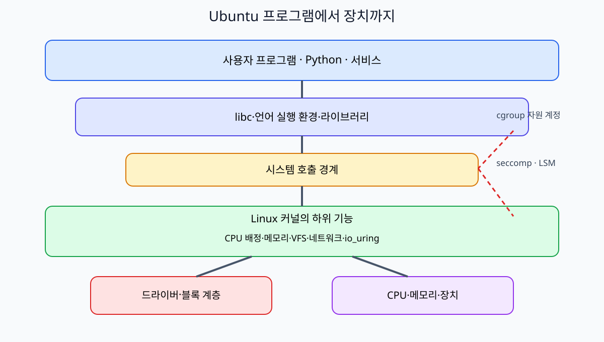
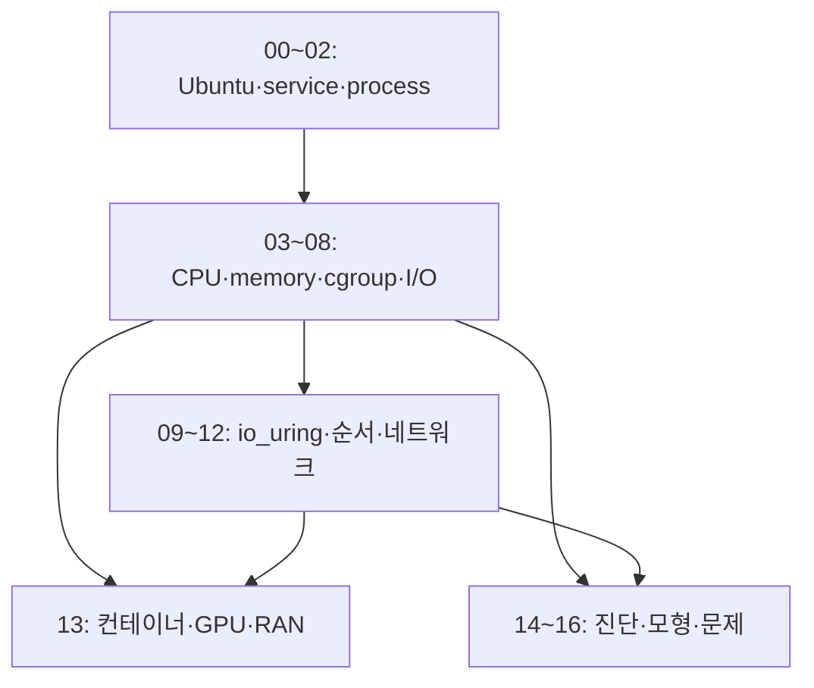

# Ubuntu로 따라가는 Linux 내부: cgroup v2와 io_uring까지

**컨테이너에 CPU 0.5개와 메모리 384 MiB를 준다는 설정은 커널에서 무엇을 바꿀까? 비동기 파일 읽기를 제출한 뒤 버퍼를 언제 다시 써도 될까?** 이 책은 Ubuntu에서 보이는 파일·프로세스·서비스 상태를 Linux 커널의 실행 순서와 연결한다. cgroup v2의 자원 계정·제한·압박, systemd의 서비스 구조, io_uring의 제출·완료·버퍼 수명을 자세히 공부한다.

**Ubuntu**는 Linux 커널에 사용자 도구, package, 서비스 관리와 배포판의 지원 정책을 묶은 운영 환경이다. **Linux 커널**은 그 안에서 CPU·메모리·파일·네트워크·장치를 관리한다. Ubuntu 버전, 실행 중인 커널 버전, 설치한 liburing 버전은 서로 다른 값이다. 어느 하나의 숫자로 모든 기능의 사용 가능 여부를 판정하지 않는다.

자료 확인 기준일은 **2026-10-11**이다. Ubuntu 지원과 GA/HWE 커널 구분은 [00장](00-ubuntu-kernel-and-version-map.md), io_uring의 커널·파일시스템·하드웨어·보안 조건은 [10장](10-io-uring-registration-polling-and-features.md)에 있다. 공식 문서의 최신 기능이 현재 설치한 시스템에서도 그대로 동작한다고 가정하지 않는다.

## 어디에서 시작할까?

운영체제를 처음 보면 [운영체제 공통 원리](../operating-systems/README.md)와 [Linux·커널 입문](../../linux/learning/linux-kernel/README.md)의 00·01장을 먼저 읽는다. 이 책은 입문에서 배운 프로세스·주소 공간·파일·시스템 호출을 실제 Ubuntu의 관측 파일과 자세한 자원·I/O 계약으로 연결한다. 필요한 약어는 각 장에서 의미와 위치를 다시 설명한다.

`/proc`는 실행 중인 프로세스와 커널 상태를 보여주는 가상 파일시스템이다. `/sys`는 장치와 커널 객체를 보여주며, cgroup v2의 계층도 보통 `/sys/fs/cgroup`에서 보인다. 이 파일들을 읽는 것과 설정을 바꾸는 것은 다른 작업이다. 책의 관측 예제는 해당 장에서 권한과 환경 조건을 설명한다.

## 한 권의 목차

| 장 | 출발 질문 | 따라갈 동작 |
| --- | --- | --- |
| [00. Ubuntu·커널·버전 지도](00-ubuntu-kernel-and-version-map.md) | Ubuntu 24.04와 Linux 6.8은 어떤 관계일까? | 배포판·kernel·package·GA/HWE·지원·기능 탐지 |
| [01. 부팅·package·systemd](01-boot-packages-and-systemd.md) | 전원을 켠 뒤 서비스가 누가 만든 프로세스로 실행될까? | boot·PID 1·unit·service·scope·slice |
| [02. 프로세스·namespace·권한](02-processes-namespaces-and-credentials.md) | PID와 컨테이너 안의 root는 무엇을 나타낼까? | task·PID/TID·syscall·이름 공간·credential |
| [03. CPU 스케줄링과 압박](03-cpu-scheduling-and-pressure.md) | CPU가 남는데 내 프로그램은 왜 기다릴까? | runnable·EEVDF·weight·quota·CPU PSI |
| [04. 메모리·페이지·회수](04-memory-pages-reclaim-and-psi.md) | 메모리 사용량과 메모리 압박은 어떻게 다를까? | VSZ/RSS·anonymous/file·reclaim·swap·PSI |
| [05. cgroup v2 계층과 위임](05-cgroup-v2-hierarchy-and-delegation.md) | 부모와 자식 그룹의 제한은 어떻게 이어질까? | controller·subtree_control·domain/threaded·delegation |
| [06. CPU quota·weight·cpuset](06-cpu-quota-weight-and-cpuset.md) | 0.5 CPU는 어느 코어의 절반일까? | cpu.max·period·throttling·경합·실행 가능 CPU |
| [07. 메모리·PID 제한과 OOM](07-memory-pids-and-oom.md) | memory.high와 memory.max는 왜 따로 있을까? | 계정·회수·throttle·OOM·memory.events·pids.max |
| [08. I/O 제한과 저장 완료](08-io-control-page-cache-and-durability.md) | 파일 쓰기 속도와 저장장치 속도는 왜 다를까? | io.max·장치 번호·page cache·writeback·fsync |
| [09. io_uring SQ·CQ와 수명](09-io-uring-sq-cq-and-lifetimes.md) | 제출한 요청과 완료한 요청을 어떻게 구분할까? | SQE·CQE·user_data·out-of-order·버퍼 수명 |
| [10. 등록·polling·최신 기능](10-io-uring-registration-polling-and-features.md) | SQPOLL·IOPOLL·등록 버퍼는 어떤 비용을 바꿀까? | fixed file/buffer·feature probe·multishot·zero-copy 조건 |
| [11. 순서·오류·fsync](11-io-uring-ordering-errors-and-fsync.md) | write CQE가 오면 DB commit을 답해도 될까? | short I/O·errno·link/cancel·완료 순서·지속성 |
| [12. 네트워크 I/O와 관측](12-network-io-and-kernel-observation.md) | socket의 준비 알림과 완료 알림은 어떻게 다를까? | epoll·io_uring·copy·NAPI·관측 위치 |
| [13. 컨테이너·GPU·RAN 연결](13-containers-kubernetes-gpu-and-ran.md) | Kubernetes 설정이 어떤 커널 자원으로 내려갈까? | requests/limits·memcg·GPU memory·DRA·deadline |
| [14. 장애 진단과 증거](14-troubleshooting-and-evidence.md) | 높은 지연의 원인을 어떻게 나눠 볼까? | quota·OOM·PSI·I/O·io_uring 오류의 구별 |
| [15. 작은 로컬 모형](15-safe-local-model-labs.md) | 호스트 설정을 바꾸지 않고 무엇을 계산할 수 있을까? | CPU 예산·SQ/CQ 수명·메모리 회수 모형 |
| [16. 문제·해설·용어·자료](16-exercises-glossary-and-sources.md) | 파일 이름을 외운 것과 동작 이해를 어떻게 구분할까? | 종합 문제·풀이·용어사전·공식 자료 |

## 깊게 읽는 두 경로

**cgroup v2 경로: 00 → 01 → 03 → 04 → 05 → 06 → 07 → 08.** systemd의 서비스 계층이 어떤 cgroup에 연결되는지 확인하고, CPU·메모리·I/O의 제한과 계정 파일을 나눠 읽는다. 예를 들어 `cpu.max`의 `50000 100000`은 100 ms period당 50 ms CPU 시간 예산이다. 한 코어를 지정하는 cpuset과는 역할이 다르다.

**io_uring 경로: 00 → 02 → 08 → 09 → 10 → 11 → 12.** 열린 파일과 버퍼를 이해한 뒤 요청을 SQ에 제출하고 결과를 CQ에서 읽는 과정을 따라간다. 요청 A·B를 그 순서로 제출해도 B의 CQE가 먼저 올 수 있다. `user_data`로 요청을 식별하고 각 operation의 완료·취소 계약에 맞춰 버퍼를 재사용해야 한다.

## 책에서 반복해서 확인할 차이

| 비슷해 보이는 것 | 따로 물어야 할 질문 |
| --- | --- |
| CPU 사용량과 CPU 압박 | 얼마를 썼는가? 실행할 작업이 얼마나 기다렸는가? |
| memory.high와 memory.max | 회수·throttle을 유도하는 경계인가? hard limit에서 해결 못한 OOM인가? |
| namespace와 cgroup | 무엇이 보이는가? 얼마나 사용할 수 있는가? |
| SQE를 kernel이 읽음과 CQE 수거 | 제출 정보를 소비했는가? operation의 결과와 버퍼 수명 조건이 충족됐는가? |
| registered buffer와 zero-copy | 메모리 등록 비용을 줄였는가? 실제 데이터 복사를 줄이는 operation인가? |
| write 완료와 지속성 | 어느 계층까지 완료했는가? 실패 뒤 남아야 하는 기록이 동기화됐는가? |
| 장치 할당과 시간 보장 | 어떤 GPU를 쓸 수 있는가? 요구한 시간 안에 계산이 끝나는가? |

각 장은 이 질문에 실제 파일·객체·시간표로 답한다. `io_uring`이 무조건 빠르다거나, CPU limit이 응답 지연을 보장한다는 결론으로 건너뛰지 않는다.

## 그림·예제와 관측 조건

[한국어 SVG 그림 6개](assets/README.md)와 장별 Mermaid로 계층·제어·데이터 흐름을 설명한다. [Python 모형 3개](examples/README.md)는 표준 라이브러리만 사용하고, 시스템의 cgroup·mount·systemd·kernel parameter를 수정하지 않는다. 실제 Linux 설정 변경이나 실제 io_uring 실행 결과와 교육 모형의 출력은 구별한다.

[선택 C 예제](examples/uring_read.c)는 liburing의 실제 API로 작은 일반 파일의 read 한 건을 제출하고 대응 CQE를 확인하는 전체 소스다. 필요한 compiler·liburing·kernel 조건과 미실행 상태는 [예제 안내](examples/README.md)에 명시했다. Python의 상태 모형을 이해한 뒤 SQE 준비와 `submit`, `wait_cqe`, `cqe_seen`이 실제 코드에서 어디에 나타나는지 비교한다.

읽기 전용 명령도 설치된 도구, permission, container 관점, kernel 설정에 따라 제공되는 값이 달라질 수 있다. 예시 경로·PID·장치 번호·출력은 교육용이면 그렇게 표시한다. 최신 API는 설치 버전 확인 → 기능 탐지 → 대체 경로 준비 → 측정 순서로 읽는다.

## 공식 자료와 연결 교재

- [Ubuntu release cycle](https://ubuntu.com/about/release-cycle)과 [HWE kernel 설명](https://documentation.ubuntu.com/kernel/reference/hwe-kernels/): 배포판·kernel 지원과 실제 설치 구분.
- [Linux cgroup v2](https://docs.kernel.org/admin-guide/cgroup-v2.html), [PSI](https://docs.kernel.org/accounting/psi.html): 계층·자원 제한과 압박의 API.
- [systemd resource control](https://www.freedesktop.org/software/systemd/man/latest/systemd.resource-control.html): service·scope·slice의 resource-control 설정.
- [io_uring_setup(2)](https://man7.org/linux/man-pages/man2/io_uring_setup.2.html), [io_uring_register(2)](https://man7.org/linux/man-pages/man2/io_uring_register.2.html), [liburing upstream](https://github.com/axboe/liburing): ring·등록·기능 조건.
- [open(2)](https://man7.org/linux/man-pages/man2/open.2.html), [fsync(2)](https://man7.org/linux/man-pages/man2/fsync.2.html): 파일 I/O와 지속성.
- [데이터 시스템 교재](../../kubernetes/storage/data-systems-foundations/README.md): WAL·복제·분산 저장의 성공 경계.
- [Kubernetes](../kubernetes/README.md), [GPU Operator·DRA](../gpu-operator-dra/README.md), [무선통신·AI-RAN](../wireless-communications/README.md): 커널 자원 관리 위에서 실행되는 실제 workload.

[통합 learning 목차](../README.md) · [첫 장 시작](00-ubuntu-kernel-and-version-map.md)
