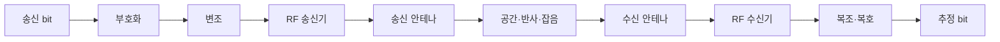

# 00. 무선 통신 전체 지도와 첫 연결

[이 책 목차](README.md)

[← 교재 시작](README.md) · [다음: 파동·주파수·스펙트럼 →](01-waves-frequency-and-spectrum.md)

## 먼저 보는 전체 지도


무선 통신은 공기 중에 비트를 그대로 던지는 일이 아니다.
송신기는 비트를 시간에 따라 변하는 전기 신호로 만든다.
안테나는 전기 신호를 전자기파로 내보낸다.
수신기는 약해지고 뒤섞인 파형에서 비트를 추정한다.



## 첫 연결에서 누가 무엇을 하는가

스마트폰이 Wi‑Fi AP에 작은 packet을 보낸다고 하자.

| 순서 | 주체 | 입력 | 상태 변화 | 출력 |
|---:|---|---|---|---|
| 1 | application | byte | network stack에 요청 | packet |
| 2 | MAC | packet | header·검사값 추가 | frame |
| 3 | channel encoder | frame bit | 여분 bit 추가 | coded bit |
| 4 | modulator | coded bit | symbol에 매핑 | I/Q sample |
| 5 | radio | sample | 주파수 이동·증폭 | RF 신호 |
| 6 | channel | RF 신호 | 감쇠·반사·잡음 | 왜곡된 RF |
| 7 | receiver | 왜곡 신호 | 동기·추정·복호 | 추정 frame |
| 8 | MAC | frame | 주소·오류 확인 | packet 또는 폐기 |

각 단계는 이전 단계의 의미를 모두 알 필요가 없다.
이것이 계층화의 장점이다.
하지만 한 계층의 완료가 전체 성공을 뜻하지 않는다.
radio가 신호를 냈어도 상대가 복호했는지는 ACK로 확인해야 한다.

## 작은 bit 추적

보낼 data를 `1011`이라고 하자.
단순한 반복 부호로 각 bit를 세 번 보낸다.

```text
원본: 1 0 1 1
부호: 111 000 111 111
```

channel에서 두 번째 묶음이 `010`으로 바뀌었다고 하자.
수신기는 세 bit의 다수결로 0을 추정한다.
오류 하나를 고칠 수 있다.
그러나 `110`처럼 두 개가 바뀌면 1로 잘못 추정한다.

이 예는 실제 Wi‑Fi 부호가 아니다.
FEC가 여분을 사용해 오류 가능성을 줄인다는 교육 모형이다.

## 자주 섞는 다섯 양

| 양 | 단위 | 답하는 질문 |
|---|---|---|
| 주파수 | Hz | 1초에 몇 번 반복되는가 |
| 대역폭 | Hz | 얼마만큼의 주파수 폭을 쓰는가 |
| sample rate | sample/s | 1초에 몇 값을 기록하는가 |
| symbol rate | symbol/s | 1초에 몇 symbol을 보내는가 |
| data rate | bit/s | 1초에 몇 bit를 전달하는가 |

20MHz channel은 초당 20Mbit를 보장하지 않는다.
한 symbol에 담는 bit 수, FEC 비율, pilot, guard, 재전송이 data rate를 바꾼다.

## 시간축 예

1,000bit payload에 header 200bit가 붙는다.
coding rate가 1/2이면 coded bit는 `1,200 / 0.5 = 2,400bit`다.
symbol 하나에 2bit를 담으면 1,200symbol이 필요하다.
symbol rate가 100ksymbol/s라면 순수 symbol 시간은 12ms다.

```text
payload 1000 bit
→ header 포함 1200 bit
→ rate 1/2 FEC: 2400 coded bit
→ 2 bit/symbol: 1200 symbol
→ 100,000 symbol/s: 0.012 s
```

실제 packet에는 preamble, inter-frame 간격, contention 시간이 더 있다.
따라서 계산값은 air time의 일부다.

## 연결이 실패하는 위치

신호가 약할 수 있다.
다른 송신기와 충돌할 수 있다.
주파수·시간 동기가 맞지 않을 수 있다.
채널 추정이 틀릴 수 있다.
FEC 능력보다 오류가 많을 수 있다.
frame은 맞지만 주소나 보안 검사가 실패할 수 있다.

## RF 모형의 경계

이 책의 수치는 원리를 위한 합성값이다.
특정 장비, 방, 안테나, 국가 규제 환경의 측정값이 아니다.
실제 link는 calibration, cable loss, antenna pattern, fading, interference를 측정해야 한다.

## 반례

수신 전력이 강해도 간섭이 더 강하면 복호가 실패할 수 있다.
대역폭을 두 배로 넓혀도 data rate가 반드시 두 배가 되지 않는다.
FEC를 강하게 하면 오류는 줄 수 있지만 보내는 여분이 늘어난다.
ACK가 와도 application이 데이터를 저장했다는 뜻은 아니다.

## 문제

## bit가 공기 중에 있다는 말의 정확한 뜻

bit는 0 또는 1이라는 추상 정보다.
안테나 사이 공간에는 숫자 0이 떠다니지 않는다.
송신 modem이 bit 묶음을 symbol로 바꾸고, radio가 symbol의 I/Q sample을 전압 파형으로 만든다.
안테나는 그 전류 변화를 전자기장 변화로 바꾼다.
수신 안테나는 도착한 장을 다시 작은 전기 신호로 바꾼다.
receiver는 timing과 channel을 추정한 뒤 가능한 symbol 중 하나를 고른다.
마지막에 decoder가 여분 구조를 이용해 bit를 추정한다.
따라서 “bit 전송”은 여러 물리·통계 단계의 결과를 짧게 부르는 말이다.

## ACK까지의 5ms 시간표

frame 준비 1ms, channel 대기 2ms, 송신 1ms, ACK 대기 1ms라고 하자.
총 5ms지만 RF가 실제 data를 내보낸 시간은 1ms뿐이다.

| 구간 | 시간 | 상태 |
|---|---:|---|
| encode/map | 1ms | local 준비 |
| medium wait | 2ms | queue/backoff |
| RF transmit | 1ms | on-air |
| ACK wait | 1ms | receiver 결과 대기 |

대역폭을 늘려 송신을 0.5ms로 줄여도 총은 4.5ms다.
병목이 medium wait라면 PHY 개선만으로 latency가 크게 줄지 않는다.
반례로 channel이 비어 있고 큰 payload면 transmit 시간이 지배할 수 있다.

1. 600bit를 rate 1/2로 부호화하면 coded bit는 몇 개인가?
2. 4bit/symbol로 1,200coded bit를 보내면 symbol은 몇 개인가?
3. 20MHz와 20Mbit/s가 다른 이유를 한 문장으로 쓰라.

## 해설

1. `600/0.5=1,200bit`다.
2. `1,200/4=300symbol`이다.
3. MHz는 주파수 폭이고 bit/s는 정보 전달 속도이며 modulation·coding·overhead가 둘을 연결한다.

## 공식 출처

- [MIT 6.450: layered view of digital communication](https://ocw.mit.edu/courses/6-450-principles-of-digital-communication-i-fall-2009/pages/lecture-notes/)
- [MIT 6.02: Bits, Signals, and Packets](https://ocw.mit.edu/courses/6-02-introduction-to-eecs-ii-digital-communication-systems-fall-2012/pages/readings/)

[← 교재 시작](README.md) · [다음: 파동·주파수·스펙트럼 →](01-waves-frequency-and-spectrum.md)
