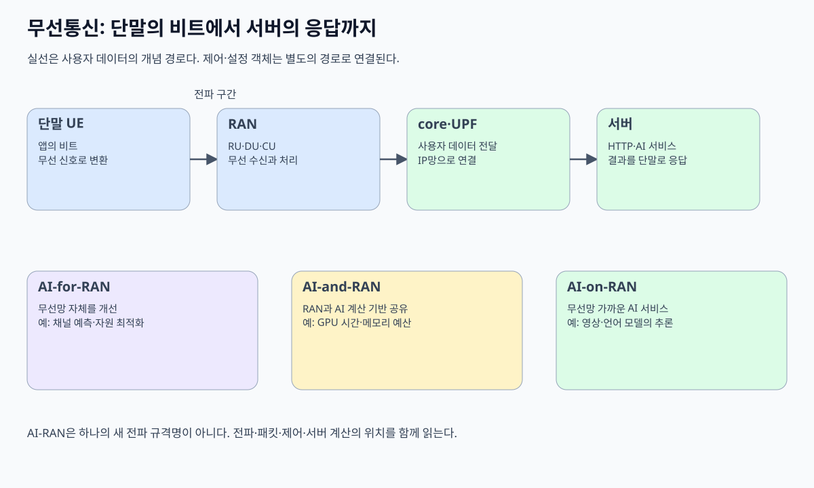
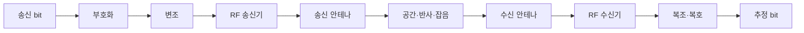

# 00. 무선 통신 전체 지도와 첫 연결

## 휴대전화 한 대에서 시작하는 무선 통신 지도

무선 통신을 처음 배우면 전파, 채널, 안테나, 기지국 같은 단어가 한꺼번에 나온다. 먼저 실제 물체와 위치부터 잡자. **UE(User Equipment, 사용자 장비)** 는 스마트폰이나 무선 모뎀처럼 사용자가 들고 다니는 송수신 장치다. UE 안의 **애플리케이션 프로세서**는 앱을 실행하고, **베이스밴드 처리기**는 보낼 비트를 오류에 견디는 숫자 표현으로 바꾼다. **RF(Radio Frequency, 무선 주파수) 회로**는 그 숫자 표현을 안테나가 방사할 수 있는 높은 주파수의 전기 신호로 바꾼다. **안테나**는 전기 신호와 공간의 전자기파를 서로 변환한다. **기지국**은 여러 UE와 이 전파를 주고받아 이동통신 서비스의 유선 핵심망인 **코어 네트워크(core network)**로 이어 준다. 코어 네트워크는 가입자 인증, 이동성, 인터넷으로 이어지는 데이터 경로 등을 관리한다. Wi-Fi에서는 **AP(Access Point, 무선 접속점)**가 무선 장치와 유선망 사이의 입구를 맡는다.

**셀(cell)** 은 기지국 철탑 한 대의 다른 이름이 아니다. 특정 주파수, 물리 셀 식별자, 시간·무선 설정으로 UE가 발견하고 접속할 수 있게 구성한 논리적 무선 서비스 영역이다. 한 기지국이 여러 셀을 운영할 수 있고, 전파가 겹치는 곳에서는 여러 셀 신호가 동시에 들린다.

**안테나**는 디지털 비트를 직접 공중에 던지는 장치가 아니다. RF 회로가 만든 시간에 따라 변하는 전압과 전류를 공간의 전기장·자기장 변화로 결합하고, 수신할 때는 반대로 도착한 전자기장을 아주 작은 전압·전류로 바꾼다. 안테나 모양과 크기, 방향, 주변 물체는 어느 방향과 주파수에서 얼마나 잘 결합하는지 바꾼다.

## bit, symbol, sample, 파형을 순서대로 구분한다

**bit**는 0 또는 1이라는 추상 정보 단위다. bit 자체에는 전압 단위나 주파수가 없다. 송신기는 bit 묶음에 오류 검출·수정용 여분을 더하고, **symbol**이라는 전송 선택지에 매핑한다. **QPSK(Quadrature Phase Shift Keying, 직교 위상 편이 변조)**는 네 가지 위상 상태 중 하나를 선택하는 변조 방식이다. **위상(phase)**은 주기적으로 진동하는 파형이 기준 파형보다 얼마나 앞서거나 뒤처졌는지 나타낸다. 네 가지 상태에 00·01·10·11을 대응시키면 이상적인 한 symbol이 오류 보호용 부호화를 거친 **coded bit(부호화 비트)** 두 개의 조합을 나타낼 수 있다.

**펄스 성형(pulse shaping)**은 선택한 symbol을 시간에 따라 매끄럽게 변하는 신호로 만드는 과정이다. 급격한 변화로 신호가 허용 대역 바깥으로 퍼지는 것을 줄이고 수신 측이 symbol을 구분하도록 설계한다. **I/Q sample(동상·직교 성분 표본)**은 symbol과 펄스 성형 결과를 두 수 I와 Q로 나타낸 특정 시각의 숫자 쌍이다. I는 기준 cosine과 같은 축, Q는 90도 어긋난 sine 축의 계수다. 이 두 값을 합치면 원하는 순간의 진폭과 위상을 표현할 수 있다. sample은 메모리 안의 숫자다. **DAC(Digital-to-Analog Converter, 디지털-아날로그 변환기)**가 숫자 표본을 전압으로 바꾸고, **믹서(mixer)**가 이를 기준 진동 신호와 결합해 방사할 주파수 대역으로 옮긴다. **PA(Power Amplifier, 전력 증폭기)**는 안테나에 줄 신호의 전력을 키운다. 실제 송신기는 이 여러 단계를 거쳐 연속적인 전기 신호를 만든다.

**베이스밴드(baseband)** 는 정보를 담는 변화가 0 Hz 주변의 낮은 주파수 표현에 놓인 처리 영역이다. **통과대역(passband)** 은 그 변화를 2 GHz 같은 높은 carrier 주변으로 옮긴 실제 RF 대역이다. 베이스밴드 I/Q와 passband RF는 서로 다른 정보가 아니라 같은 변조 신호를 처리하기 편한 좌표와 방사 가능한 주파수에서 본 것이다.

**CRC(Cyclic Redundancy Check, 순환 중복 검사)**는 송신 데이터로 계산한 검사값을 함께 보내 수신 측이 오류를 발견하도록 한다. **FEC(Forward Error Correction, 순방향 오류 정정)**는 여분의 비트를 추가해 일정 범위의 오류를 재전송 없이 복원하도록 한다. 아래 그림의 **payload(페이로드)**는 앱이 보내려는 본래 내용이다. CRC와 FEC로 붙인 여분은 payload의 뜻을 바꾸지 않지만, 실제 보내야 할 비트 수와 처리 시간을 늘린다.

```mermaid
flowchart LR
    A["앱 payload bit"] --> B["CRC·FEC coded bit"]
    B --> C["symbol 선택"]
    C --> D["pulse shaping I/Q sample"]
    D --> E["DAC·mixer: passband RF"]
    E --> F["PA·송신 안테나"]
    F --> G["공간 channel"]
    G --> H["수신 안테나·LNA"]
    H --> I["mixer·ADC: I/Q sample"]
    I --> J["동기·채널 추정·복조·복호"]
    J --> K["추정 payload bit"]
```



각 화살표의 담당 주체와 상태 수명이 다르다. 애플리케이션 payload는 packet buffer에 있고, coded bit와 I/Q sample은 베이스밴드 메모리에서 한 전송 구간 동안 살며, RF 파형은 회로와 공간에 시간에 따라 존재한다. 수신기의 추정 bit는 원본의 물리 조각을 되찾은 것이 아니라 관측 파형에서 가장 가능성 높은 정보를 계산한 결과다.

## 주파수, 파장, 대역폭, data rate를 같은 문장에 섞지 않는다

**주파수**는 1초에 같은 위상 변화가 몇 번 반복되는지 나타내며 단위는 Hz다. 2 GHz carrier는 초당 20억 번 반복한다. 자유공간에서 전파 속도를 약 `c=3×10^8 m/s`로 두면 파장 `λ=c/f`다.

`λ = 3×10^8 / 2×10^9 = 0.15 m = 15 cm`

2 GHz에서 한 파장은 약 15 cm다. 이것은 초당 2 Gbit를 보낸다는 뜻이 아니다. carrier의 빠른 반복 위에 진폭·위상 변화로 symbol을 실어 보낸다.

**대역폭**은 신호나 채널이 차지하도록 허용한 주파수 폭이며 Hz로 잰다. **data rate**는 초당 전달하는 정보 bit이며 bit/s로 잰다. 대역폭이 20 MHz라고 payload rate가 20 Mbit/s로 고정되지 않는다.

예를 들어 symbol rate 10 Msymbol/s, 16-QAM 4 coded bit/symbol이면 raw mapping은 40 Mbit/s다. coding rate 3/4를 적용하면 정보 bit 후보는 `40×3/4=30 Mbit/s`다. 전체 시간·주파수 자원의 20%가 pilot, control, guard에 쓰인다는 교육용 가정이면 payload 후보는 `30×0.8=24 Mbit/s`다. 재전송과 scheduling 대기는 아직 빼지 않았다.

| 양 | 단위 | 실제 대상 | 이 예의 값 |
|---|---|---|---:|
| carrier 주파수 | Hz | passband 반복 중심 | 2 GHz |
| 파장 | m | 공간 한 주기 길이 | 15 cm |
| 채널 대역폭 | Hz | 허용 주파수 폭 | 20 MHz |
| symbol rate | symbol/s | 시간당 symbol 수 | 10 Msymbol/s |
| payload rate | bit/s | 사용자 정보 속도 | 모형상 24 Mbit/s |

같은 20 MHz라도 낮은 SNR 때문에 QPSK와 강한 FEC를 쓰면 payload rate가 낮아진다. 반대로 좋은 channel에서 더 높은 변조와 여러 spatial layer를 쓰면 높아질 수 있다. 대역폭은 자원 폭이고 rate는 변조·부호화·공간 계층·overhead·재전송 결과다.

## 전력, noise, SNR을 수신기 입구에서 본다

**전력(power)** 은 단위 시간에 전달되는 에너지 비율이며 watt로 잰다. 무선에서는 매우 크고 작은 값을 다루기 위해 dBm을 쓴다. `0 dBm=1 mW`, `10 dBm=10 mW`, `20 dBm=100 mW`다. dBm은 절대 전력이고 dB는 비율이다.

송신 전력이 20 dBm이고 안테나·공간·벽을 합친 경로 손실이 80 dB, 수신 안테나 이득이 2 dB라는 단순 모형이면 수신 전력은 `20-80+2=-58 dBm`이다.

**noise(잡음)** 는 원하는 신호와 무관하게 수신 측정에 섞이는 무작위 성분이다. 원하는 수신 신호가 -58 dBm이고 같은 측정 대역의 noise가 -88 dBm이면 SNR은 `-58-(-88)=30 dB`다. 신호가 -78 dBm으로 약해지고 noise가 그대로면 SNR은 10 dB다.

수신 전력이 강하다는 사실만으로 복호 성공을 보장하지 않는다. 원하는 신호 -50 dBm이어도 간섭이 -48 dBm이면 원하는 신호가 더 약하다. 반대로 수신 전력이 -85 dBm으로 작아도 noise가 -110 dBm이면 SNR 25 dB일 수 있다. 측정 대역폭을 넓히면 더 많은 thermal noise가 들어오므로 noise 전력도 바뀐다.

| 경우 | 원하는 신호 | noise+interference | 차이 | 해석 |
|---|---:|---:|---:|---|
| A | -58 dBm | -88 dBm | 30 dB | 비교적 큰 SNR |
| B | -78 dBm | -88 dBm | 10 dB | 오류 가능 증가 |
| C | -50 dBm | -48 dBm | -2 dB | 강한 간섭 |

이 수치는 교육용이며 특정 장비의 복호 임계값이 아니다. 실제 수신기는 noise figure, filter, AGC, channel estimation, 변조·부호화 조건을 함께 가진다.

## 한 packet이 UE에서 AP까지 가는 전체 시간표

UE 애플리케이션이 payload 1,000 bit를 만든다고 하자. MAC·상위 header와 검사값을 합쳐 1,200 bit가 된다. coding rate 1/2이면 coded bit는 `1,200/(1/2)=2,400 bit`다. QPSK는 symbol당 2 coded bit이므로 1,200 symbol이 필요하다.

symbol rate가 1 Msymbol/s라면 data symbol 시간은 `1,200/1,000,000=1.2 ms`다. preamble·pilot 0.2 ms, channel 접근 대기 2.0 ms, ACK 대기 0.5 ms라는 교육용 조건을 더하면 총 지연은 `1.0+2.0+0.2+1.2+0.5=4.9 ms`다. 여기서 1.0 ms는 부호화·준비 시간이다.

| 시각 구간 | 주체 | 입력 | 중간 상태 | 출력 |
|---|---|---|---|---|
| 0~1.0 ms | UE baseband | frame 1,200 bit | coded 2,400 bit·symbol | I/Q buffer |
| 1.0~3.0 ms | MAC | 전송 대기 frame | backoff·channel 관측 | 전송 권한 |
| 3.0~3.2 ms | radio | preamble I/Q | RF 파형 | 수신 동기 단서 |
| 3.2~4.4 ms | radio | data I/Q | 1,200 symbol | 공간 RF |
| 4.4~4.9 ms | UE MAC | frame 상태 | ACK timer | 성공 또는 재시도 |

대역폭 개선으로 data 시간이 1.2 ms에서 0.6 ms가 되어도 전체는 4.3 ms다. 접근 대기 2 ms가 큰 비중을 차지하기 때문이다. 반대로 channel이 비고 payload가 매우 크면 data 시간이 지배한다. 한 계층 최적화를 전체 지연 개선으로 그대로 바꾸면 안 된다.

## 수신기는 파형에서 어떻게 bit를 추정하는가

수신 안테나에는 원하는 신호, 다른 송신기, 반사파, noise가 합쳐진 작은 전압이 생긴다. LNA는 수신 초단에서 신호를 증폭한다. mixer는 원하는 carrier 주변을 베이스밴드 I/Q로 옮긴다. ADC는 연속 전압을 sample 숫자로 바꾼다.

베이스밴드는 packet 시작과 symbol timing을 찾고, 알려진 pilot로 channel의 진폭·위상 변화를 추정한다. equalizer는 그 channel 영향을 보정하고, demodulator는 각 관측점을 가능한 constellation symbol의 확률로 바꾼다. decoder는 FEC 구조를 이용해 오류를 수정하며 CRC는 최종 frame에 남은 오류를 검출한다.

CRC 통과는 해당 frame bit가 검사 규칙과 맞는다는 강한 단서지만 애플리케이션 저장 성공은 아니다. MAC ACK는 수신 MAC이 frame을 받아들였다는 신호이지 원격 데이터베이스 fsync를 뜻하지 않는다.

## AI-RAN 연구를 이 기초와 연결하는 올바른 방법

AI-RAN 연구는 이 물리 체인을 없애지 않는다. 모델 입력은 channel sample, CSI, traffic·부하 관측처럼 특정 위치에서 측정한 값이다. 출력은 channel 예측, scheduling 후보, beam 선택처럼 특정 제어 변수다. 모델이 어느 조건에서 학습됐고 어느 channel·속도·주파수에서 평가됐는지 알아야 한다.

2024년의 multi-task learning 연구는 네 가지 simulation task에서 공동 학습과 partial federation 조건을 다루며 negative transfer 가능성을 분석한다. 이는 모든 운영 RAN에서 성능이 보장됐다는 뜻이 아니다. [연구 원문](https://arxiv.org/abs/2404.15197)의 simulation 설정과 metric 안에서 읽어야 한다.

2026년 MobiSys Companion poster의 physics-guided deep unfolding 기반 cross-band channel prediction도 게시 단계의 연구 결과다. [원문](https://arxiv.org/abs/2605.31279)이 둔 simulation·channel 가정과 실제 배포 검증을 구분한다. 표준은 메시지와 기능의 공통 계약을 만들고, 연구 논문은 특정 문제·자료·평가 조건에서 방법을 비교한다.

## 추가 연습 문제와 완전 해설

### 1. 2 GHz 자유공간 파장을 계산하라.

`λ=c/f=(3×10^8)/(2×10^9)=0.15 m`이므로 15 cm다. 이 값은 carrier의 공간 주기이며 bit 속도가 아니다.

### 2. 1,500 information bit를 coding rate 3/4로 부호화하면 coded bit는?

coding rate는 information/coded이므로 coded는 `1,500/(3/4)=2,000 bit`다. 500 bit가 여분 구조에 해당한다.

### 3. 64-QAM을 symbol당 6 coded bit로 단순화할 때 12,000 coded bit에 필요한 symbol 수는?

`12,000/6=2,000 symbol`이다. 실제 전송에는 pilot·preamble·resource mapping이 추가된다.

### 4. 수신 신호 -72 dBm, 같은 대역의 noise -92 dBm이면 SNR은?

dB 차이로 `-72-(-92)=20 dB`다. 특정 변조가 성공하는지는 구현과 channel 조건을 더 알아야 한다.

### 5. MAC ACK를 받으면 서버 애플리케이션 저장도 끝났는가?

아니다. ACK는 해당 무선 link의 MAC 수신 범위를 뜻한다. 이후 IP 전달, transport 처리, 서버 애플리케이션, 저장소 commit이 남을 수 있다.

[이 책 목차](README.md)

[← 교재 시작](README.md) · [다음: 파동·주파수·스펙트럼 →](01-waves-frequency-and-spectrum.md)

## 먼저 보는 전체 지도



무선 통신은 공기 중에 비트를 그대로 던지는 일이 아니다.
송신기는 비트를 시간에 따라 변하는 전기 신호로 만든다.
안테나는 전기 신호를 전자기파로 내보낸다.
수신기는 약해지고 뒤섞인 파형에서 비트를 추정한다.



## 첫 연결에서 누가 무엇을 하는가

스마트폰이 Wi‑Fi AP에 작은 packet을 보낸다고 하자.

| 순서 | 주체 | 입력 | 상태 변화 | 출력 |
|---:|---|---|---|---|
| 1 | application | byte | network stack에 요청 | packet |
| 2 | MAC | packet | header·검사값 추가 | frame |
| 3 | channel encoder | frame bit | 여분 bit 추가 | coded bit |
| 4 | modulator | coded bit | symbol에 매핑 | I/Q sample |
| 5 | radio | sample | 주파수 이동·증폭 | RF 신호 |
| 6 | channel | RF 신호 | 감쇠·반사·잡음 | 왜곡된 RF |
| 7 | receiver | 왜곡 신호 | 동기·추정·복호 | 추정 frame |
| 8 | MAC | frame | 주소·오류 확인 | packet 또는 폐기 |

각 단계는 이전 단계의 의미를 모두 알 필요가 없다.
이것이 계층화의 장점이다.
하지만 한 계층의 완료가 전체 성공을 뜻하지 않는다.
radio가 신호를 냈어도 상대가 복호했는지는 ACK로 확인해야 한다.

## 작은 bit 추적

보낼 data를 `1011`이라고 하자.
단순한 반복 부호로 각 bit를 세 번 보낸다.

```text
원본: 1 0 1 1
부호: 111 000 111 111
```

channel에서 두 번째 묶음이 `010`으로 바뀌었다고 하자.
수신기는 세 bit의 다수결로 0을 추정한다.
오류 하나를 고칠 수 있다.
그러나 `110`처럼 두 개가 바뀌면 1로 잘못 추정한다.

이 예는 실제 Wi‑Fi 부호가 아니다.
FEC가 여분을 사용해 오류 가능성을 줄인다는 교육 모형이다.

## 자주 섞는 다섯 양

| 양 | 단위 | 답하는 질문 |
|---|---|---|
| 주파수 | Hz | 1초에 몇 번 반복되는가 |
| 대역폭 | Hz | 얼마만큼의 주파수 폭을 쓰는가 |
| sample rate | sample/s | 1초에 몇 값을 기록하는가 |
| symbol rate | symbol/s | 1초에 몇 symbol을 보내는가 |
| data rate | bit/s | 1초에 몇 bit를 전달하는가 |

20MHz channel은 초당 20Mbit를 보장하지 않는다.
한 symbol에 담는 bit 수, FEC 비율, pilot, guard, 재전송이 data rate를 바꾼다.

## 시간축 예

1,000bit payload에 header 200bit가 붙는다.
coding rate가 1/2이면 coded bit는 `1,200 / 0.5 = 2,400bit`다.
symbol 하나에 2bit를 담으면 1,200symbol이 필요하다.
symbol rate가 100ksymbol/s라면 순수 symbol 시간은 12ms다.

```text
payload 1000 bit
→ header 포함 1200 bit
→ rate 1/2 FEC: 2400 coded bit
→ 2 bit/symbol: 1200 symbol
→ 100,000 symbol/s: 0.012 s
```

실제 packet에는 preamble, inter-frame 간격, contention 시간이 더 있다.
따라서 계산값은 air time의 일부다.

## 연결이 실패하는 위치

신호가 약할 수 있다.
다른 송신기와 충돌할 수 있다.
주파수·시간 동기가 맞지 않을 수 있다.
채널 추정이 틀릴 수 있다.
FEC 능력보다 오류가 많을 수 있다.
frame은 맞지만 주소나 보안 검사가 실패할 수 있다.

## RF 모형의 경계

이 책의 수치는 원리를 위한 합성값이다.
특정 장비, 방, 안테나, 국가 규제 환경의 측정값이 아니다.
실제 link는 calibration, cable loss, antenna pattern, fading, interference를 측정해야 한다.

## 반례

수신 전력이 강해도 간섭이 더 강하면 복호가 실패할 수 있다.
대역폭을 두 배로 넓혀도 data rate가 반드시 두 배가 되지 않는다.
FEC를 강하게 하면 오류는 줄 수 있지만 보내는 여분이 늘어난다.
ACK가 와도 application이 데이터를 저장했다는 뜻은 아니다.

## 문제

## bit가 공기 중에 있다는 말의 정확한 뜻

bit는 0 또는 1이라는 추상 정보다.
안테나 사이 공간에는 숫자 0이 떠다니지 않는다.
송신 modem이 bit 묶음을 symbol로 바꾸고, radio가 symbol의 I/Q sample을 전압 파형으로 만든다.
안테나는 그 전류 변화를 전자기장 변화로 바꾼다.
수신 안테나는 도착한 장을 다시 작은 전기 신호로 바꾼다.
receiver는 timing과 channel을 추정한 뒤 가능한 symbol 중 하나를 고른다.
마지막에 decoder가 여분 구조를 이용해 bit를 추정한다.
따라서 “bit 전송”은 여러 물리·통계 단계의 결과를 짧게 부르는 말이다.

## ACK까지의 5ms 시간표

frame 준비 1ms, channel 대기 2ms, 송신 1ms, ACK 대기 1ms라고 하자.
총 5ms지만 RF가 실제 data를 내보낸 시간은 1ms뿐이다.

| 구간 | 시간 | 상태 |
|---|---:|---|
| encode/map | 1ms | local 준비 |
| medium wait | 2ms | queue/backoff |
| RF transmit | 1ms | on-air |
| ACK wait | 1ms | receiver 결과 대기 |

대역폭을 늘려 송신을 0.5ms로 줄여도 총은 4.5ms다.
병목이 medium wait라면 PHY 개선만으로 latency가 크게 줄지 않는다.
반례로 channel이 비어 있고 큰 payload면 transmit 시간이 지배할 수 있다.

1. 600bit를 rate 1/2로 부호화하면 coded bit는 몇 개인가?
2. 4bit/symbol로 1,200coded bit를 보내면 symbol은 몇 개인가?
3. 20MHz와 20Mbit/s가 다른 이유를 한 문장으로 쓰라.

## 해설

1. `600/0.5=1,200bit`다.
2. `1,200/4=300symbol`이다.
3. MHz는 주파수 폭이고 bit/s는 정보 전달 속도이며 modulation·coding·overhead가 둘을 연결한다.

## 공식 출처

- [MIT 6.450: layered view of digital communication](https://ocw.mit.edu/courses/6-450-principles-of-digital-communication-i-fall-2009/pages/lecture-notes/)
- [MIT 6.02: Bits, Signals, and Packets](https://ocw.mit.edu/courses/6-02-introduction-to-eecs-ii-digital-communication-systems-fall-2012/pages/readings/)

[← 교재 시작](README.md) · [다음: 파동·주파수·스펙트럼 →](01-waves-frequency-and-spectrum.md)
