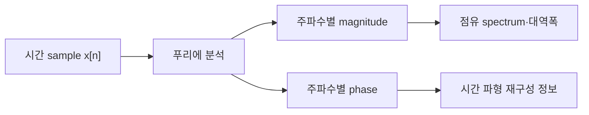
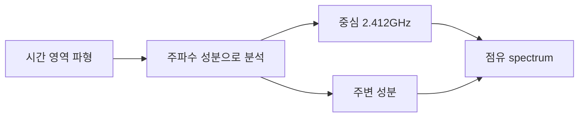

# 01. 파동·주파수·스펙트럼

## 시간과 공간에서 변하는 파형

**파동**은 어떤 물리량의 변화가 시간과 공간으로 퍼지는 현상이다. 무선에서는 전기장과 자기장의 변화가 공간을 전파한다. 송신 회로에서 보는 전압 파형은 안테나 급전점에서 시간에 따라 변하는 양이고, 공간에서는 위치마다 전자기장의 크기와 방향이 달라진다. 처음에는 삼각함수를 몰라도 된다. 같은 모양이 반복되는 시간과 높이부터 읽으면 된다.

**진폭**은 선택한 물리량의 크기다. 전압이면 volt(V), 전기장이면 V/m처럼 대상에 따라 단위가 다르다. 교재 그래프에 정규화 진폭 1이라고 적혀 있더라도 이를 자동으로 1 V라고 해석해서는 안 된다. 무엇을 어느 위치에서 측정했는지 먼저 확인해야 한다.

```mermaid
xychart-beta
    title "한 주기의 단순 파형"
    x-axis "시간(ms)" [0,1,2,3,4]
    y-axis "진폭" -1 --> 1
    line [0,1,0,-1,0]
```

## 주기·주파수·위상

**주기 `T`**는 같은 위상 상태가 다시 나타날 때까지 걸리는 시간이며 단위는 second(s)다. **주파수 `f`**는 1초 동안 반복되는 횟수이며 단위는 hertz(Hz)다.

```text
f = 1 / T
T = 1 / f
```

주기가 1 ms이면 `f=1/0.001=1,000 Hz=1 kHz`다. 주기가 0.5 ms이면 `f=1/0.0005=2,000 Hz=2 kHz`다.

| 표기 | 뜻 |
|---|---:|
| 1 kHz | 1,000 Hz |
| 1 MHz | 1,000,000 Hz |
| 1 GHz | 1,000,000,000 Hz |

2.4 GHz는 초당 24억 번 반복하는 **반송파(carrier)** 근처를 뜻한다. 초당 24억 bit를 전송한다는 뜻은 아니다.

**위상(phase)**은 한 반복 주기 안에서 현재 파형이 놓인 상대 위치다. 한 주기를 360도로 나타낼 수 있다. 같은 주파수인 두 파가 0도 차이면 봉우리와 봉우리가 맞고, 180도 차이면 한쪽 봉우리와 다른 쪽 골이 맞는다. 위상은 “신호가 빠르다”는 뜻이 아니다.

```text
파 A:  +1, 0, -1, 0
파 B:  -1, 0, +1, 0
합:     0, 0,  0, 0
```

같은 크기의 두 파가 반대 위상으로 만나면 상쇄될 수 있고, 같은 위상으로 만나면 더해질 수 있다. 이 합성은 위치에 따라 달라지며 무선 페이딩(fading)이 위치에 따라 달라지는 한 이유다.

## 파장과 공간에서의 합성

**파장 `λ`**는 같은 위상 지점 사이의 공간 거리다. 자유공간 전파 속도를 `c≈3×10^8 m/s`로 단순화하면 `λ=c/f`다.

| 주파수 | 계산 | 파장 |
|---:|---|---:|
| 1 GHz | `3×10^8/10^9` | 0.30 m |
| 2 GHz | `3×10^8/(2×10^9)` | 0.15 m |
| 2.4 GHz | `3×10^8/(2.4×10^9)` | 0.125 m |
| 3 GHz | `3×10^8/(3×10^9)` | 0.10 m |
| 5 GHz | `3×10^8/(5×10^9)` | 약 0.06 m |
| 6 GHz | `3×10^8/(6×10^9)` | 0.05 m |

2 GHz의 15 cm는 전파가 15 cm마다 사라지고 생긴다는 뜻이 아니다. 진행 방향에서 위상 한 바퀴가 반복되는 거리다. 안테나 요소 간격과 반사 경로 차이를 파장 단위로 보는 이유가 여기에 있다.

직접파 진폭 1과 반사파 진폭 0.8이 같은 위상이면 단순 합 진폭은 1.8이다. 180도 반대 위상이면 `1-0.8=0.2`다. 2 GHz에서 수신 위치가 반 파장인 약 7.5 cm 달라지면 단순 1차원 모형의 위상 관계가 크게 바뀔 수 있다. 같은 논리로 2.4 GHz에서는 반 파장이 6.25 cm다. 실제 실내에는 여러 경로와 각도, 넓은 대역이 있고 모든 주파수 성분이 같은 위상 변화로 움직이지 않으므로 이 수치만으로 수신 신호 강도 지표인 **RSSI(Received Signal Strength Indicator, 수신 신호 강도 지표)**를 예측하지 않는다.

주파수가 높아질수록 같은 매질에서 파장은 짧아지지만, 통신 거리가 주파수에 정확히 반비례한다고 결론 내릴 수는 없다. 송신 출력, 안테나, 대역폭, 장애물, 규제가 함께 작용한다.

## 시간 파형과 스펙트럼

마이크로폰 녹음이 시간에 따른 압력 표본이라면 **스펙트럼(spectrum)**은 그 녹음에 낮은 음과 높은 음이 얼마나 들어 있는지 보여 주는 관점이다. 무선 시간 파형도 여러 정현파(sinusoid) 성분의 합으로 표현할 수 있다. **푸리에 변환(Fourier transform)**은 시간 함수에서 주파수별 복소 계수를 계산한다.

시간 표본 8개를 분석한다고 하면, 분석기는 이 8개에 느린 반복과 빠른 반복이 각각 얼마나 포함되어 있는지 계산한다. 결과인 복소 계수에는 각 주파수 성분의 크기와 위상이 들어 있다. 스펙트럼 분석기(spectrum analyzer)가 보여 주는 전력 스펙트럼은 이 가운데 크기·전력 관점을 주로 표시한다. 스펙트럼은 시간 파형과 별도로 존재하는 두 번째 신호가 아니라 같은 신호를 다른 좌표로 표현한 것이다.





길이가 유한한 패킷(packet)은 시작과 끝이 있다. 완벽한 단일 주파수 정현파는 무한 시간 지속하는 이상 모형이므로, 패킷을 갑자기 켜고 끄면 반송파 주변으로 성분이 퍼진다. 펄스 성형(pulse shaping)과 필터는 시간 변화와 대역 밖 방사를 조절한다. 시간 경계를 날카롭게 만들수록 넓은 주파수 성분이 필요하다는 상충 관계가 있다.

폭 20 MHz인 패킷을 사각 펄스로 갑자기 켜면 시간 경계가 날카로워 스펙트럼의 곁엽(sidelobe)이 넓어진다. 완만한 펄스 성형을 쓰면 바깥 성분은 줄지만 심볼 사이 영향과 시간 길이를 함께 설계해야 한다. 필터는 “불필요한 bit를 삭제”하는 장치가 아니라 시간 파형을 바꾸어 주파수 분포를 조정하는 장치다.

## 중심 주파수·대역폭·채널

**중심 주파수**는 신호 대역의 가운데 위치다. **대역폭**은 신호가 차지하도록 설계한 주파수 폭이다. **채널(channel)**은 중심 주파수·폭·접속 규칙을 묶어 여러 송수신자가 공통으로 사용하는 무선 자원의 정의다.

중심 2.000 GHz, 폭 20 MHz라면 단순 직사각형 비유로 1.990~2.010 GHz 주변이다. 중심 2.412 GHz, 폭 20 MHz도 대략 중심 주변 20 MHz를 쓴다고 읽는다. 실제 경계는 필터, 스펙트럼 마스크(spectral mask), 표준 정의를 따르며 인접 채널 누설 때문에 수학적 경계 밖 성분이 완전히 0이 되지는 않는다.

대역폭 10 MHz는 주파수 폭이고 10 Mbit/s는 초당 정보 bit 수다. 두 값은 단위와 대상이 다르다. 다음은 10 Msymbol/s인 신호의 전송률 후보를 단계별로 구한 예다.

| 단계 | 값 | 계산 결과 |
|---|---:|---:|
| symbol rate | 10 Msymbol/s | 10M symbol/s |
| QPSK | 2 coded bit/symbol | 20 M coded bit/s |
| coding rate | 1/2 | 10 M information bit/s |
| overhead | 25% | 7.5 M payload bit/s |

**QPSK(Quadrature Phase Shift Keying, 직교 위상 편이 변조)**는 네 위상점으로 심볼당 2 coded bit를 나타내는 변조다. coding rate 1/2이면 coded bit의 절반이 정보 bit에 해당한다. 파일럿(pilot), 보호 구간(guard), 제어 정보가 자원의 25%를 쓰면 이 단순 계산의 payload 후보는 `10×0.75=7.5 Mbit/s`다. 대역폭을 두 배로 해도 잡음 전력, guard, scheduling, 단말 능력, 규제 출력, backhaul 병목이 달라지므로 payload가 정확히 두 배라는 보장은 없다.

## 베이스밴드 I/Q와 패스밴드

**I/Q(In-phase/Quadrature, 동상/직교 성분)** 베이스밴드는 정보를 담는 느린 복소 포락선(envelope)이다. `I(t)`는 cosine 축 계수, `Q(t)`는 sine 축 계수다. 반송파 주파수를 `f_c`라 하면 실제 패스밴드(passband) 파형을 단순화해 다음처럼 쓸 수 있다.

`s(t)=I(t)cos(2πf_c t)-Q(t)sin(2πf_c t)`

I=1, Q=0이면 기준 cosine 방향이고 I=0, Q=1이면 -sine 방향이다. I와 Q가 함께 바뀌면 진폭 `sqrt(I²+Q²)`와 위상 `atan2(Q,I)`가 바뀐다. QPSK에서 `(I,Q)=(1,1)`이면 위상은 약 45도, `(-1,1)`이면 135도이며 두 좌표는 서로 다른 2-bit 심볼을 나타낼 수 있다.

실제 송신기는 펄스 성형된 I/Q 표본을 **DAC(Digital-to-Analog Converter, 디지털-아날로그 변환기)**로 전압화하고 믹서가 2 GHz 반송파 주변으로 옮긴다. 수신기는 안테나와 **LNA(Low-Noise Amplifier, 저잡음 증폭기)** 뒤 믹서에서 같은 기준 주파수의 cosine·sine과 곱해 저주파 I/Q를 얻는다. 송수신 발진기(oscillator) 오차가 있으면 성상도(constellation)가 시간에 따라 회전하므로 주파수·위상 동기를 추정해야 한다.

한 QPSK 추적 예에서 bit `10`을 `(I,Q)=(1,-1)`로 매핑한다. 펄스 성형기가 이를 여러 표본으로 만들고 믹서가 2 GHz 패스밴드로 옮긴다. 채널이 진폭을 0.5배로 만들고 위상을 +30도 회전시키면 수신점의 크기와 각도도 변한다. 파일럿으로 0.5와 30도를 추정한 등화기(equalizer)가 역보정하고 원래 사분면을 선택해 `10`을 추정한다.

## 잡음 스펙트럼과 측정 대역

잡음(noise)은 시간 영역에서 불규칙하게 보이고 스펙트럼에서는 주파수별 전력 밀도로 볼 수 있다. 수신 필터 폭을 넓히면 더 넓은 주파수의 잡음을 받아 총 잡음 전력이 늘어난다. 따라서 **SNR(Signal-to-Noise Ratio, 신호 대 잡음비)**을 말할 때는 어느 대역에서 측정했는지 밝혀야 한다.

원하는 신호가 -70 dBm이고 20 MHz 측정 대역의 잡음이 -95 dBm이면 SNR은 25 dB다. 같은 수신 신호에서 대역을 넓혀 잡음이 -92 dBm이 되면 SNR은 22 dB다. 이는 교육용 수치이며 실제 수신기 잡음 지수와 필터 모양은 생략했다.

간섭은 다른 송신기의 구조 있는 신호일 수 있다. 수신 전력이 -50 dBm으로 커도 간섭이 -48 dBm이면 원하는 신호가 상대적으로 약하다. RSSI 하나만으로 복호 가능성을 단정할 수 없다.

## 송수신 체인에서 스펙트럼이 바뀌는 위치

**RF(Radio Frequency, 무선 주파수)**는 안테나로 송수신하는 고주파 신호와 관련 회로 영역을 뜻한다.

| 위치 | 입력 | 담당 주체 | 스펙트럼 변화 | 출력 |
|---|---|---|---|---|
| symbol mapper | coded bit | baseband | I/Q 점 선택 | symbol |
| pulse shaper | symbol | digital filter | 점유 대역 제어 | I/Q sample |
| mixer | I/Q+LO | RF 회로 | carrier 주변 이동 | passband |
| PA | 작은 RF | 전력 증폭기 | 비선형이면 왜곡 가능 | antenna RF |
| channel | 방사파 | 공간·물체 | 감쇠·다중경로·Doppler | 수신 RF |
| receive filter | 수신 RF | RF front-end | 원하는 channel 선택 | 제한 대역 |
| downconverter | RF+LO | mixer·ADC | baseband 이동·sample | 수신 I/Q |

여기서 **LO(Local Oscillator, 국부 발진기)**는 믹서가 주파수를 옮길 때 쓰는 기준 파형이고, **ADC(Analog-to-Digital Converter, 아날로그-디지털 변환기)**는 연속 전압을 디지털 표본으로 바꾼다. **PA(Power Amplifier, 전력 증폭기)**를 포화에 가깝게 쓰면 시간 파형의 첨두가 잘리고 대역 밖 성분이 늘 수 있다. 높은 평균 출력과 스펙트럼 마스크 준수 사이에 상충 관계가 생긴다. **OFDM(Orthogonal Frequency-Division Multiplexing, 직교 주파수 분할 다중화)**처럼 평균 대비 첨두 전력이 큰 파형에서는 이 문제가 더 중요하며 뒤 장에서 다시 다룬다.

## Doppler를 숫자로 연결하기

**도플러 편이(Doppler shift)**는 송신기와 수신기의 상대 이동 때문에 관측 주파수가 달라지는 현상이다. 구급차 음높이가 접근·이탈할 때 달라지는 현상과 비슷하다. 상대 속도의 진행 방향 성분을 `v`, 파장을 `λ`라 하면 작은 속도에서 크기를 `f_D≈v/λ`로 볼 수 있다.

2 GHz에서 `λ=0.15 m`이고 진행 방향 속도가 15 m/s라면 `15/0.15=100 Hz`다. 속도가 30 m/s면 약 200 Hz다. 같은 15 m/s라도 6 GHz에서는 파장이 0.05 m이므로 `15/0.05=300 Hz`다. 실제 부호와 크기는 이동 방향과 각도에 달려 있다. 옆으로 움직여 방사 방향 속도 성분(radial component)이 0이면 단순 도플러도 0에 가까울 수 있다.

도플러는 반송파 오프셋과 채널 변화 속도에 영향을 준다. 그러나 “주파수가 높으면 통신이 항상 세 배 나빠진다”는 결론은 틀리다. 파형, 추적 알고리즘, 심볼 길이, 전파 환경, 안테나 이득을 함께 봐야 한다.

## 연구 결과를 읽는 경계

교차 대역 채널 예측(cross-band channel prediction)은 한 주파수 대역에서 관측한 채널과 물리 구조를 이용해 다른 대역의 채널을 예측하는 문제다. 주파수가 달라지면 파장, 반사·회절, 안테나 응답이 달라져 관측값을 단순 복사할 수 없다.

2026년 MobiSys Companion poster의 physics-guided deep unfolding 연구는 물리 모형을 신경망 구조에 결합한 교차 대역 예측을 다룬다. 이는 [게시된 연구 원문](https://arxiv.org/abs/2605.31279)의 simulation과 평가 조건 안의 결과이며, 표준 기능이나 모든 현장 채널의 성능 보장이 아니다. 모델 입력 주파수, 환경, 안테나 배열, 평가 지표를 확인해야 한다.

완벽한 단일 주파수 파는 무한 시간 지속하는 이상 모형이고, 실제 패킷은 시작과 끝 때문에 주변 주파수 성분을 갖는다. 채널 폭이 넓다고 규제상 모든 출력이 허용되는 것도 아니다. 스펙트럼 분석기 화면의 peak만으로 data rate를 알 수 없다. 이 장의 자유공간·단일 반사·직사각형 대역 예시는 개념을 분리해 보는 모형이며 현장 예측식이 아니다.

## 문제와 해설

### 1. 주기가 0.25 ms인 파의 주파수는 얼마인가?

`T=0.00025 s`이므로 `f=1/T=4,000 Hz=4 kHz`다. 주기를 초 단위로 바꾼 뒤 역수를 취한다.

### 2. 2 GHz, 3 GHz, 6 GHz의 자유공간 파장을 계산하라.

`λ=c/f`에 `c≈3×10^8 m/s`를 넣는다. 2 GHz는 `0.15 m=15 cm`, 3 GHz는 `0.10 m=10 cm`, 6 GHz는 `0.05 m=5 cm`다. 6 GHz 파장은 2 GHz 파장의 3분의 1이다.

### 3. I=3, Q=4인 복소 표본의 진폭과 위상은?

진폭은 `sqrt(3²+4²)=5`다. 위상은 `atan2(4,3)`이며 약 53.1도다. 단순히 `atan(Q/I)`만 쓰면 사분면을 잃을 수 있으므로 `atan2`를 쓴다.

### 4. 8 Msymbol/s, 16-QAM, coding rate 3/4의 information rate 후보는?

**16-QAM(16-state Quadrature Amplitude Modulation, 16상태 직교 진폭 변조)**은 심볼당 4 coded bit를 나타내므로 `8M×4=32 M coded bit/s`다. 여기에 coding rate 3/4를 적용하면 `32×3/4=24 Mbit/s`다. 파일럿·보호 구간·재전송을 빼기 전 값이다.

### 5. 2 GHz에서 진행 방향 속도가 30 m/s이면 단순 도플러 크기는 얼마인가?

파장이 0.15 m이므로 `f_D≈30/0.15=200 Hz`다. 이동 방향이 전파 진행 방향과 다르면 전체 속도가 아니라 방사 방향 속도 성분을 사용한다.

### 6. 10 MHz와 10 Mbit/s를 각각 설명하라.

10 MHz는 신호가 차지하는 주파수 폭을 나타내는 대역폭이고, 10 Mbit/s는 초당 전달하는 정보 bit 수다. 대역폭만으로 변조, coding rate, overhead를 모른 채 payload rate를 정할 수 없다.

## 공식 출처

- [MIT 6.450: Fourier, sampling, wireless channel notes](https://ocw.mit.edu/courses/6-450-principles-of-digital-communication-i-fall-2009/pages/lecture-notes/)
- [MIT 6.02: spectral representation](https://ocw.mit.edu/courses/6-02-introduction-to-eecs-ii-digital-communication-systems-fall-2012/resources/lecture-notes/)

[이 책 목차](README.md)

[← 이전: 전체 지도](00-map-and-first-connection.md) · [다음: 전력·dB·링크 버짓 →](02-power-db-and-link-budget.md)
