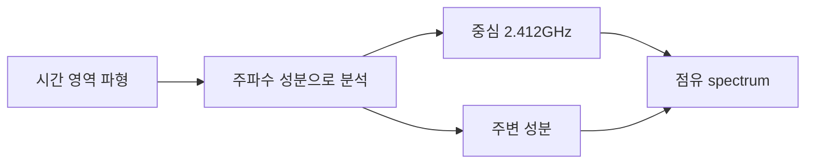

# 01. 파동·주파수·스펙트럼

[이 책 목차](README.md)

[← 이전: 전체 지도](00-map-and-first-connection.md) · [다음: 전력·dB·링크 버짓 →](02-power-db-and-link-budget.md)

## 파동을 먼저 그리기

파동은 위치와 시간에 따라 값이 변하는 현상이다.
radio에서는 전기장과 자기장의 변화가 공간으로 전파된다.
처음에는 삼각함수를 몰라도 된다.
같은 모양이 반복되는 시간과 높이를 읽으면 된다.

```mermaid
xychart-beta
    title "한 주기의 단순 파형"
    x-axis "시간(ms)" [0,1,2,3,4]
    y-axis "진폭" -1 --> 1
    line [0,1,0,-1,0]
```

진폭은 파형의 크기다.
주기 `T`는 같은 상태가 다시 나타날 때까지 시간이다.
주파수 `f`는 1초에 반복한 횟수다.

```text
f = 1 / T
T = 1 / f
```

주기가 1ms이면 `f=1/0.001=1,000Hz`다.
1kHz는 초당 1,000번 반복한다.

## 단위

| 표기 | 뜻 |
|---|---:|
| 1kHz | 1,000Hz |
| 1MHz | 1,000,000Hz |
| 1GHz | 1,000,000,000Hz |

2.4GHz는 초당 24억 번 반복하는 carrier 근처를 뜻한다.
초당 24억 bit를 뜻하지 않는다.

## 파장

파장 `λ`는 한 주기 동안 공간에서 차지하는 길이다.
전파 속도를 `c≈3×10^8m/s`로 단순화하면 `λ=c/f`다.

2.4GHz의 파장은 약 `3×10^8 / 2.4×10^9 = 0.125m`, 즉 12.5cm다.
5GHz에서는 약 6cm다.
주파수가 높을수록 같은 매질에서 파장이 짧다.

실내 반사와 안테나 크기를 생각할 때 파장이 중요하다.
그러나 높은 주파수면 항상 통신 거리가 정확히 절반이라는 식은 아니다.
출력, 안테나, 대역폭, 장애물, 규제가 함께 작용한다.

## 위상

위상은 반복 주기 안에서 현재 어느 위치인가를 말한다.
한 주기 전체를 360도로 표현할 수 있다.
180도 차이는 같은 크기의 반대 방향이다.

```text
파 A:  +1, 0, -1, 0
파 B:  -1, 0, +1, 0
합:     0, 0,  0, 0
```

두 파가 반대 위상과 같은 크기로 만나면 상쇄될 수 있다.
다른 위치에서는 더해질 수 있다.
무선 fading이 위치에 따라 달라지는 한 이유다.

## spectrum

시간 파형을 여러 주파수 성분의 합으로 보는 그림을 spectrum이라 한다.
복잡한 파형도 느린 반복과 빠른 반복 성분으로 나누어 생각할 수 있다.



중심 주파수는 channel이 놓인 중심이다.
대역폭은 신호가 차지하도록 설계한 주파수 폭이다.
중심 2.412GHz, 폭 20MHz라면 대략 중심 주변 20MHz를 쓴다고 읽는다.
정확한 spectral mask와 edge는 표준·필터 정의를 따른다.

## 대역폭과 data rate

대역폭 1MHz는 주파수 폭 100만Hz다.
data rate 1Mbit/s는 초당 정보 100만bit다.
단위부터 다르다.

symbol rate가 1Msymbol/s이고 symbol당 2coded bit면 raw mapping은 2Mbit/s다.
coding rate 1/2면 information bit는 이상적으로 1Mbit/s다.
header와 pilot을 빼면 payload rate는 더 낮다.

## 누가 spectrum을 만드는가

| 단계 | 입력 | 상태 변화 | 결과 |
|---|---|---|---|
| baseband | bit/symbol | pulse 모양 생성 | 낮은 주파수 I/Q |
| mixer | I/Q+local oscillator | carrier 주변으로 이동 | RF spectrum |
| filter | RF | 바깥 성분 억제 | spectral mask에 가까운 신호 |
| PA | filtered RF | 전력 증폭 | antenna 입력 |
| channel | RF | 반사·흡수·Doppler | 수신 spectrum |

## Doppler 입문

송신기와 수신기의 상대 이동은 관측 주파수를 조금 바꾼다.
구급차 음높이가 접근·이탈 때 달라지는 비유와 비슷하다.
무선에서는 carrier가 이동하고 빠른 이동일수록 변화가 커질 수 있다.
정확한 값은 속도, 방향, 파장으로 계산한다.

## 반례와 경계

완벽한 단일 주파수 파는 무한 시간 지속해야 하는 이상 모형이다.
실제 packet은 시작과 끝이 있어 주변 주파수 성분이 생긴다.
channel 폭이 넓다고 규제상 모든 출력이 허용되는 것은 아니다.
spectrum analyzer 화면의 peak만으로 data rate를 알 수 없다.

## 문제

## spectrum의 각 점은 어디에서 오는가

시간에 따라 sample 8개를 모았다고 하자.
분석기는 “이 8개가 느린 반복과 빠른 반복을 각각 얼마나 포함하는가”를 계산한다.
그 결과가 주파수별 크기와 위상이다.
송신 filter는 허용 대역 밖 성분을 줄이고, 수신 filter는 원하는 channel 주변을 남긴다.
packet 시작과 끝이 급하면 넓은 주파수 성분이 생길 수 있어 pulse shaping이 필요하다.
따라서 spectrum은 별도 신호가 아니라 같은 파형을 주파수 성분 관점으로 다시 표현한 결과다.

## 두 파를 더하는 위치별 사례

직접파 진폭 1, 반사파 진폭 0.8을 생각하자.
같은 phase면 합 진폭은 1.8이다.
반대 phase면 `1-0.8=0.2`다.
수신기가 파장의 1/2인 6.25cm 정도 이동하면 2.4GHz 자유공간 모형에서 phase 관계가 크게 바뀔 수 있다.

이 계산은 벽과 여러 경로를 생략한다.
실제 실내에는 많은 반사파가 더해진다.
작은 위치 변화로 RSSI와 error가 바뀌는 이유를 보여 주는 toy model이다.
반례로 넓은 대역 신호에서는 모든 주파수 성분이 같은 phase 변화로 움직이지 않는다.

1. 주기가 0.5ms인 파의 주파수는?
2. 3GHz의 자유공간 파장은 약 몇 cm인가?
3. 10MHz와 10Mbit/s를 각각 설명하라.

## 해설

1. `1/0.0005=2,000Hz`, 즉 2kHz다.
2. `3×10^8/3×10^9=0.1m=10cm`다.
3. 전자는 주파수 폭, 후자는 초당 정보 bit 수다.

## 공식 출처

- [MIT 6.450: Fourier, sampling, wireless channel notes](https://ocw.mit.edu/courses/6-450-principles-of-digital-communication-i-fall-2009/pages/lecture-notes/)
- [MIT 6.02: spectral representation](https://ocw.mit.edu/courses/6-02-introduction-to-eecs-ii-digital-communication-systems-fall-2012/resources/lecture-notes/)

[← 이전: 전체 지도](00-map-and-first-connection.md) · [다음: 전력·dB·링크 버짓 →](02-power-db-and-link-budget.md)
