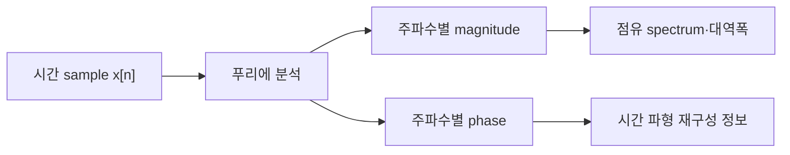
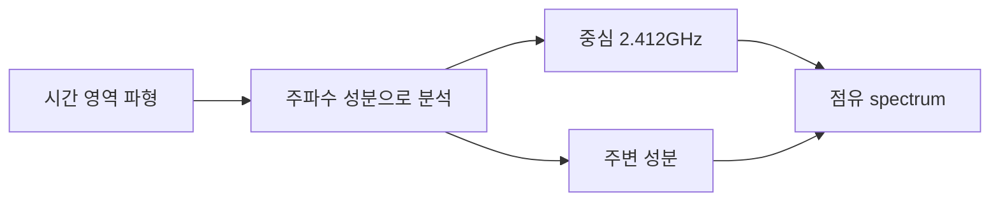

# 01. 파동·주파수·스펙트럼

## 시간에 따라 변하는 실제 양에서 시작한다

**파동**은 어떤 물리량의 변화가 시간과 공간으로 퍼지는 현상이다. 무선에서는 전기장과 자기장의 변화가 공간을 전파한다. 송신 회로에서 보는 전압 파형은 안테나 급전점의 시간 변화이고, 공간에서는 위치마다 전자기장의 크기와 방향이 달라진다.

**진폭**은 선택한 물리량의 크기다. 전압이면 volt, 전기장이면 V/m처럼 대상에 따라 단위가 다르다. 교재 그래프에서 정규화 진폭 1이라고 썼다면 1 V라고 자동 해석하지 않는다. 무엇을 측정했는지 먼저 확인한다.

**주기 T**는 같은 위상 상태가 다시 나타날 때까지 시간이며 second다. **주파수 f**는 1초당 반복 수이며 hertz다. `f=1/T`다. T=0.5 ms면 `f=1/0.0005=2,000 Hz=2 kHz`다.

**위상**은 한 반복 주기 안에서 현재 위치다. 같은 주파수 두 파가 0도 차이면 봉우리와 봉우리가 맞고, 180도 차이면 한쪽 봉우리와 다른 쪽 골이 맞는다. 위상은 “신호가 빠르다”는 뜻이 아니라 주기 안의 상대 위치다.

## 파장과 안테나 사이의 공간 관계

**파장 λ**는 파의 같은 위상 지점 사이 공간 거리다. 자유공간 전파 속도를 `c≈3×10^8 m/s`로 단순화하면 `λ=c/f`다.

| 주파수 | 계산 | 파장 |
|---:|---|---:|
| 1 GHz | `3×10^8/10^9` | 0.30 m |
| 2 GHz | `3×10^8/(2×10^9)` | 0.15 m |
| 3 GHz | `3×10^8/(3×10^9)` | 0.10 m |
| 6 GHz | `3×10^8/(6×10^9)` | 0.05 m |

2 GHz의 15 cm는 전파가 15 cm마다 사라지고 생긴다는 뜻이 아니다. 진행 방향에서 위상 한 바퀴가 반복되는 거리다. 안테나 요소 간격과 반사 경로 차이를 파장 단위로 보는 이유다.

직접파 진폭 1과 반사파 진폭 0.8이 같은 위상이면 단순 합 진폭은 1.8이다. 180도 반대 위상이면 `1-0.8=0.2`다. 수신 위치가 파장의 절반인 7.5 cm 정도 달라지면 2 GHz 단순 1차원 모형에서 위상 관계가 크게 바뀔 수 있다. 실제 실내에는 여러 경로와 각도, 넓은 대역이 있어 이 숫자만으로 RSSI를 예측하지 않는다.

## 시간 파형을 주파수 성분으로 다시 보는 이유

마이크로폰 녹음이 시간에 따른 압력 표본이라면 spectrum은 그 녹음에 낮은 음과 높은 음이 얼마나 들어 있는지 보여 주는 다른 관점이다. 무선 시간 파형도 여러 sinusoid 성분의 합으로 표현할 수 있다. **푸리에 변환**은 시간 함수에서 주파수별 복소 계수를 계산한다.

복소 계수에는 각 주파수 성분의 크기와 위상이 들어 있다. spectrum analyzer가 보여 주는 전력 spectrum은 이 정보 중 크기·전력 관점을 주로 표시한다. spectrum은 시간 파형과 별개로 존재하는 두 번째 신호가 아니라 같은 신호를 다른 좌표로 표현한 것이다.

길이가 유한한 packet은 시작과 끝이 있다. 완벽한 단일 주파수 sinusoid는 무한 시간 지속하는 이상 모형이므로, packet을 갑자기 켜고 끄면 carrier 주변으로 성분이 퍼진다. pulse shaping과 filter는 시간 변화와 대역 밖 방사를 조절한다. 시간 경계를 날카롭게 만들수록 넓은 주파수 성분이 필요하다는 trade-off가 있다.



## baseband I/Q에서 passband로 이동하기

**베이스밴드 I/Q**는 정보를 담는 느린 복소 envelope다. I(t)는 cosine 축 계수, Q(t)는 sine 축 계수다. carrier 주파수를 `f_c`라 하면 실제 passband 파형을 단순화해 다음처럼 쓸 수 있다.

`s(t)=I(t)cos(2πf_c t)-Q(t)sin(2πf_c t)`

I=1,Q=0이면 기준 cosine 방향이다. I=0,Q=1이면 -sine 방향이다. I와 Q가 함께 바뀌면 진폭 `sqrt(I²+Q²)`와 위상 `atan2(Q,I)`가 바뀐다.

QPSK 예에서 `(I,Q)=(1,1)`이면 위상은 약 45도, `(-1,1)`이면 135도다. 두 좌표는 서로 다른 2-bit symbol을 나타낼 수 있다. 실제 송신기는 pulse shaping된 I/Q sample을 DAC로 전압화하고 mixer가 2 GHz carrier 주변으로 옮긴다.

수신기는 안테나와 LNA 뒤 mixer에서 같은 기준 주파수의 cosine·sine과 곱해 저주파 I/Q를 얻는다. 송수신 oscillator 오차가 있으면 constellation이 시간에 따라 회전하므로 주파수·위상 동기 추정이 필요하다.

## 중심 주파수, 대역폭, 채널을 구분한다

**중심 주파수**는 신호 대역의 가운데 위치다. **대역폭**은 신호가 차지하도록 설계한 주파수 폭이다. **채널**은 중심 주파수·폭·접속 규칙을 묶어 여러 송수신자가 공통으로 사용하는 무선 자원 정의다.

중심 2.000 GHz, 폭 20 MHz라면 단순 직사각형 비유로 1.990~2.010 GHz 주변이다. 실제 경계는 filter와 spectral mask, 표준 정의를 따른다. 인접 채널 누설 때문에 수학적 경계 밖 성분이 완전히 0이 되지는 않는다.

20 MHz 채널과 20 Mbit/s는 단위와 대상이 다르다. 10 Msymbol/s에 QPSK 2 coded bit/symbol이면 20 M coded bit/s다. coding rate 1/2이면 information 후보는 10 Mbit/s다. 자원의 25%가 pilot·guard·control이면 payload 후보는 `10×0.75=7.5 Mbit/s`다.

| 단계 | 값 | 계산 결과 |
|---|---:|---:|
| symbol rate | 10 Msymbol/s | 10M symbol |
| QPSK | 2 coded bit/symbol | 20 M coded bit/s |
| coding rate | 1/2 | 10 M information bit/s |
| overhead | 25% | 7.5 M payload bit/s |

대역폭을 두 배로 해도 noise power, guard, scheduling, 단말 능력, 규제 출력, backhaul 병목이 달라지므로 payload가 정확히 두 배라는 보장은 없다.

## noise spectrum과 SNR의 측정 대역

noise는 시간 영역에서 불규칙하게 보이고 spectrum에서는 주파수별 전력 밀도로 볼 수 있다. 수신 filter 폭을 넓히면 더 넓은 주파수의 noise를 받아 총 noise 전력이 늘어난다. 그래서 SNR을 말할 때 어느 대역에서 측정했는지 필요하다.

원하는 신호 -70 dBm, 20 MHz 측정 대역의 noise -95 dBm이면 SNR은 25 dB다. 같은 수신 신호에서 대역을 넓혀 noise가 -92 dBm이 되면 SNR은 22 dB다. 이는 교육용 수치이고 실제 noise figure와 filter shape를 생략했다.

간섭은 다른 송신기의 구조 있는 신호일 수 있다. 수신 전력 -50 dBm이라는 큰 값도 간섭이 -48 dBm이면 원하는 신호가 상대적으로 약하다. RSSI 하나만으로 복호 가능성을 단정하지 않는 이유다.

## 송수신 chain에서 spectrum이 바뀌는 위치

| 위치 | 입력 | 담당 주체 | spectrum 변화 | 출력 |
|---|---|---|---|---|
| symbol mapper | coded bit | baseband | I/Q 점 선택 | symbol |
| pulse shaper | symbol | digital filter | 점유 대역 제어 | I/Q sample |
| mixer | I/Q+LO | RF 회로 | carrier 주변 이동 | passband |
| PA | 작은 RF | 전력 증폭기 | 비선형이면 왜곡 가능 | antenna RF |
| channel | 방사파 | 공간·물체 | 감쇠·다중경로·Doppler | 수신 RF |
| receive filter | 수신 RF | RF front-end | 원하는 channel 선택 | 제한 대역 |
| downconverter | RF+LO | mixer·ADC | baseband 이동·sample | 수신 I/Q |

PA를 포화에 가깝게 쓰면 시간 파형 peak가 잘리고 대역 밖 성분이 늘 수 있다. 높은 평균 출력과 spectral mask 준수 사이에 trade-off가 생긴다. OFDM처럼 peak-to-average ratio가 큰 파형에서 뒤 장과 연결된다.

## Doppler를 숫자로 연결한다

상대 속도의 진행 방향 성분을 v, 파장을 λ라 하면 작은 속도에서 Doppler 크기를 `f_D≈v/λ`로 볼 수 있다. 2 GHz에서 λ=0.15 m, 진행 방향 속도 15 m/s라면 `15/0.15=100 Hz`다.

속도가 30 m/s면 약 200 Hz다. 같은 속도에서 6 GHz 파장 0.05 m이면 `15/0.05=300 Hz`다. 실제 값의 부호와 크기는 이동 방향·각도에 달려 있다. 옆으로 움직여 radial component가 0이면 단순 Doppler도 0에 가까울 수 있다.

Doppler는 carrier offset과 channel 변화 속도에 영향을 준다. “주파수가 높으면 항상 통신이 세 배 나빠진다”는 결론은 틀리다. waveform, tracking, symbol duration, propagation, 안테나 이득을 함께 본다.

## 두 완전 추적 예

첫째, 2 GHz QPSK 송신이다. bit `10`을 한 symbol로 매핑해 `(I,Q)=(1,-1)`로 둔다. pulse shaper가 여러 sample로 만들고 mixer가 2 GHz passband로 옮긴다. channel이 진폭 0.5배, 위상 +30도로 바꾸면 수신점도 크기와 각도가 변한다. pilot로 0.5와 30도를 추정한 equalizer가 역보정하고 원래 사분면을 선택해 `10`을 추정한다.

둘째, 폭 20 MHz packet을 갑자기 사각 pulse로 켠 경우다. 시간 경계가 날카로워 spectrum sidelobe가 넓어진다. 완만한 pulse shaping을 쓰면 바깥 성분은 줄지만 symbol 사이 영향과 시간 길이를 설계해야 한다. filter는 “불필요한 bit를 삭제”하는 장치가 아니라 시간 파형을 바꾸어 주파수 분포를 조정한다.

## AI channel 연구를 spectrum 기초 위에서 읽기

cross-band channel prediction은 한 주파수 대역에서 관측한 channel과 물리 구조를 사용해 다른 대역 channel을 예측하는 문제다. 주파수가 달라지면 파장, 반사·회절, 안테나 응답이 달라져 단순 복사가 되지 않는다.

2026년 MobiSys Companion poster의 physics-guided deep unfolding 연구는 물리 모형을 신경망 구조에 결합한 cross-band 예측을 다룬다. 이는 [게시된 연구 원문](https://arxiv.org/abs/2605.31279)의 simulation과 평가 조건 안의 결과이며, 표준 기능이나 모든 현장 channel 성능 보장이 아니다. 모델 입력의 주파수, 환경, antenna 배열과 metric을 확인해야 한다.

## 추가 연습 문제와 완전 해설

### 1. 주기 0.25 ms의 주파수는?

`T=0.00025 s`이므로 `f=1/T=4,000 Hz=4 kHz`다.

### 2. 2 GHz와 6 GHz 자유공간 파장을 계산하라.

2 GHz는 `3×10^8/(2×10^9)=0.15 m`, 6 GHz는 `0.05 m`다. 후자가 3분의 1 파장이다.

### 3. I=3, Q=4인 복소 sample의 진폭은?

`sqrt(3²+4²)=5`다. 위상은 `atan2(4,3)`이며 약 53.1도다.

### 4. 8 Msymbol/s, 16-QAM, coding rate 3/4의 information rate 후보는?

16-QAM은 symbol당 4 coded bit이므로 32 M coded bit/s다. `32×3/4=24 Mbit/s`다. pilot·guard·재전송 전 값이다.

### 5. 2 GHz, 진행 방향 속도 30 m/s의 단순 Doppler 크기는?

파장 0.15 m이므로 `f_D≈30/0.15=200 Hz`다. 이동 각도가 있으면 radial speed를 사용한다.

[이 책 목차](README.md)

[← 이전: 전체 지도](00-map-and-first-connection.md) · [다음: 전력·dB·링크 버짓 →](02-power-db-and-link-budget.md)

## 파동을 먼저 그리기

파동은 위치와 시간에 따라 값이 변하는 현상이다.
radio에서는 전기장과 자기장의 변화가 공간으로 전파된다.
처음에는 삼각함수를 몰라도 된다.
같은 모양이 반복되는 시간과 높이를 읽으면 된다.

```mermaid
xychart-beta
    title "한 주기의 단순 파형"
    x-axis "시간(ms)" [0,1,2,3,4]
    y-axis "진폭" -1 --> 1
    line [0,1,0,-1,0]
```

진폭은 파형의 크기다.
주기 `T`는 같은 상태가 다시 나타날 때까지 시간이다.
주파수 `f`는 1초에 반복한 횟수다.

```text
f = 1 / T
T = 1 / f
```

주기가 1ms이면 `f=1/0.001=1,000Hz`다.
1kHz는 초당 1,000번 반복한다.

## 단위

| 표기 | 뜻 |
|---|---:|
| 1kHz | 1,000Hz |
| 1MHz | 1,000,000Hz |
| 1GHz | 1,000,000,000Hz |

2.4GHz는 초당 24억 번 반복하는 carrier 근처를 뜻한다.
초당 24억 bit를 뜻하지 않는다.

## 파장

파장 `λ`는 한 주기 동안 공간에서 차지하는 길이다.
전파 속도를 `c≈3×10^8m/s`로 단순화하면 `λ=c/f`다.

2.4GHz의 파장은 약 `3×10^8 / 2.4×10^9 = 0.125m`, 즉 12.5cm다.
5GHz에서는 약 6cm다.
주파수가 높을수록 같은 매질에서 파장이 짧다.

실내 반사와 안테나 크기를 생각할 때 파장이 중요하다.
그러나 높은 주파수면 항상 통신 거리가 정확히 절반이라는 식은 아니다.
출력, 안테나, 대역폭, 장애물, 규제가 함께 작용한다.

## 위상

위상은 반복 주기 안에서 현재 어느 위치인가를 말한다.
한 주기 전체를 360도로 표현할 수 있다.
180도 차이는 같은 크기의 반대 방향이다.

```text
파 A:  +1, 0, -1, 0
파 B:  -1, 0, +1, 0
합:     0, 0,  0, 0
```

두 파가 반대 위상과 같은 크기로 만나면 상쇄될 수 있다.
다른 위치에서는 더해질 수 있다.
무선 fading이 위치에 따라 달라지는 한 이유다.

## spectrum

시간 파형을 여러 주파수 성분의 합으로 보는 그림을 spectrum이라 한다.
복잡한 파형도 느린 반복과 빠른 반복 성분으로 나누어 생각할 수 있다.



중심 주파수는 channel이 놓인 중심이다.
대역폭은 신호가 차지하도록 설계한 주파수 폭이다.
중심 2.412GHz, 폭 20MHz라면 대략 중심 주변 20MHz를 쓴다고 읽는다.
정확한 spectral mask와 edge는 표준·필터 정의를 따른다.

## 대역폭과 data rate

대역폭 1MHz는 주파수 폭 100만Hz다.
data rate 1Mbit/s는 초당 정보 100만bit다.
단위부터 다르다.

symbol rate가 1Msymbol/s이고 symbol당 2coded bit면 raw mapping은 2Mbit/s다.
coding rate 1/2면 information bit는 이상적으로 1Mbit/s다.
header와 pilot을 빼면 payload rate는 더 낮다.

## 누가 spectrum을 만드는가

| 단계 | 입력 | 상태 변화 | 결과 |
|---|---|---|---|
| baseband | bit/symbol | pulse 모양 생성 | 낮은 주파수 I/Q |
| mixer | I/Q+local oscillator | carrier 주변으로 이동 | RF spectrum |
| filter | RF | 바깥 성분 억제 | spectral mask에 가까운 신호 |
| PA | filtered RF | 전력 증폭 | antenna 입력 |
| channel | RF | 반사·흡수·Doppler | 수신 spectrum |

## Doppler 입문

송신기와 수신기의 상대 이동은 관측 주파수를 조금 바꾼다.
구급차 음높이가 접근·이탈 때 달라지는 비유와 비슷하다.
무선에서는 carrier가 이동하고 빠른 이동일수록 변화가 커질 수 있다.
정확한 값은 속도, 방향, 파장으로 계산한다.

## 반례와 경계

완벽한 단일 주파수 파는 무한 시간 지속해야 하는 이상 모형이다.
실제 packet은 시작과 끝이 있어 주변 주파수 성분이 생긴다.
channel 폭이 넓다고 규제상 모든 출력이 허용되는 것은 아니다.
spectrum analyzer 화면의 peak만으로 data rate를 알 수 없다.

## 문제

## spectrum의 각 점은 어디에서 오는가

시간에 따라 sample 8개를 모았다고 하자.
분석기는 “이 8개가 느린 반복과 빠른 반복을 각각 얼마나 포함하는가”를 계산한다.
그 결과가 주파수별 크기와 위상이다.
송신 filter는 허용 대역 밖 성분을 줄이고, 수신 filter는 원하는 channel 주변을 남긴다.
packet 시작과 끝이 급하면 넓은 주파수 성분이 생길 수 있어 pulse shaping이 필요하다.
따라서 spectrum은 별도 신호가 아니라 같은 파형을 주파수 성분 관점으로 다시 표현한 결과다.

## 두 파를 더하는 위치별 사례

직접파 진폭 1, 반사파 진폭 0.8을 생각하자.
같은 phase면 합 진폭은 1.8이다.
반대 phase면 `1-0.8=0.2`다.
수신기가 파장의 1/2인 6.25cm 정도 이동하면 2.4GHz 자유공간 모형에서 phase 관계가 크게 바뀔 수 있다.

이 계산은 벽과 여러 경로를 생략한다.
실제 실내에는 많은 반사파가 더해진다.
작은 위치 변화로 RSSI와 error가 바뀌는 이유를 보여 주는 toy model이다.
반례로 넓은 대역 신호에서는 모든 주파수 성분이 같은 phase 변화로 움직이지 않는다.

1. 주기가 0.5ms인 파의 주파수는?
2. 3GHz의 자유공간 파장은 약 몇 cm인가?
3. 10MHz와 10Mbit/s를 각각 설명하라.

## 해설

1. `1/0.0005=2,000Hz`, 즉 2kHz다.
2. `3×10^8/3×10^9=0.1m=10cm`다.
3. 전자는 주파수 폭, 후자는 초당 정보 bit 수다.

## 공식 출처

- [MIT 6.450: Fourier, sampling, wireless channel notes](https://ocw.mit.edu/courses/6-450-principles-of-digital-communication-i-fall-2009/pages/lecture-notes/)
- [MIT 6.02: spectral representation](https://ocw.mit.edu/courses/6-02-introduction-to-eecs-ii-digital-communication-systems-fall-2012/resources/lecture-notes/)

[← 이전: 전체 지도](00-map-and-first-connection.md) · [다음: 전력·dB·링크 버짓 →](02-power-db-and-link-budget.md)
