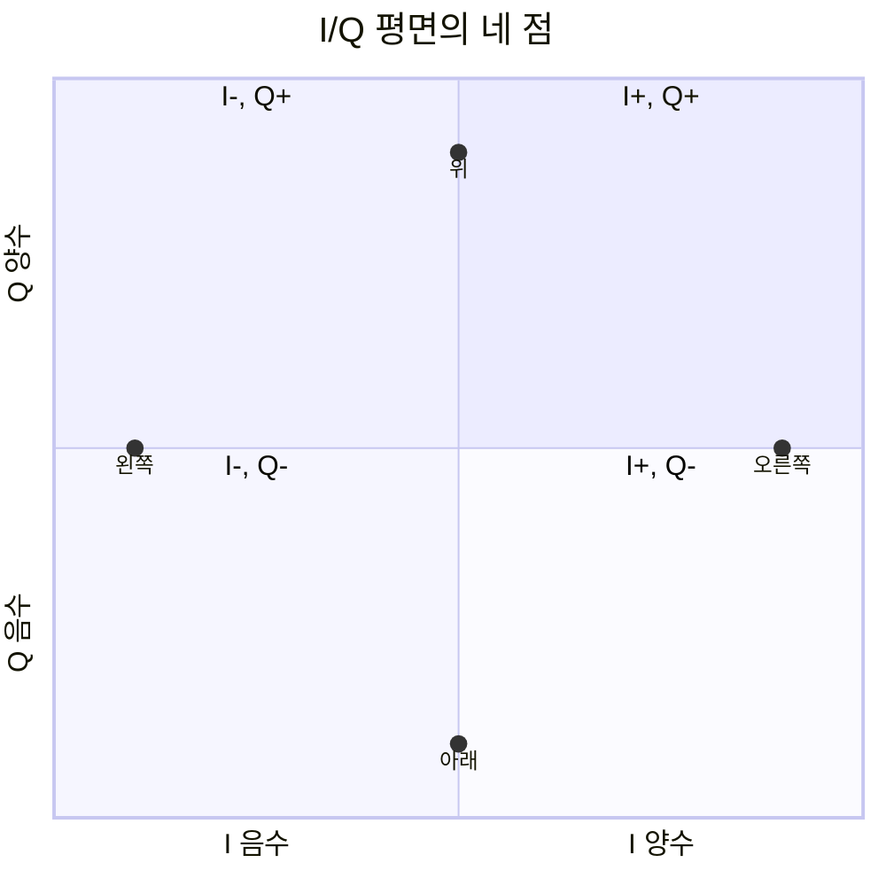
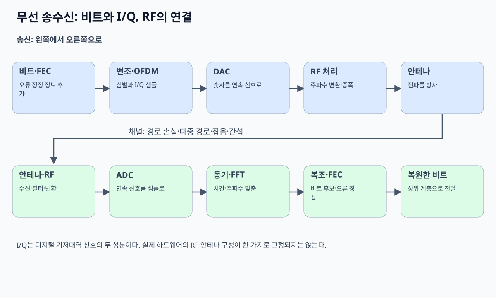

# 03. Sampling·I/Q·radio chain

[이 책 목차](README.md)

[← 이전: 전력과 링크 버짓](02-power-db-and-link-budget.md) · [다음: 변조·부호화·오류 →](04-modulation-coding-and-errors.md)

## 연속 파형을 숫자로 바꾸기

sampling은 일정한 시간 간격마다 파형 값을 기록하는 일이다.
sample rate는 초당 sample 수다.
1Msample/s이면 sample 간격은 1µs다.

```text
시간: 0, 1, 2, 3 µs
값:   0, 1, 0,-1
```

sample은 bit가 아니다.
각 sample을 몇 bit로 quantize하는지에 따라 저장 bit 수가 달라진다.

## Nyquist 입문

최고 주파수 성분이 B Hz인 baseband 신호를 손실 없이 표현하려면 이상 조건에서 sample rate가 2B보다 커야 한다.
이를 “RF carrier의 두 배로 ADC해야 한다”로 단순화하면 안 된다.
mixing으로 낮은 intermediate/baseband로 옮긴 뒤 sampling할 수 있다.

3kHz까지의 ideal low-pass 신호면 6ksample/s보다 큰 rate가 필요하다.
실제 filter transition과 clock 여유 때문에 더 높게 잡는다.

sample rate가 부족하면 서로 다른 주파수가 같은 sample처럼 보이는 aliasing이 생긴다.
anti-alias filter가 ADC 앞에서 바깥 성분을 줄인다.

## I와 Q를 직교 자로 이해하기

복소수를 몰라도 I/Q를 두 개의 자로 시작할 수 있다.
I는 기준 carrier와 같은 방향 성분이다.
Q는 quarter cycle, 즉 90도 돌아간 방향 성분이다.

| symbol | I | Q |
|---|---:|---:|
| 오른쪽 | +1 | 0 |
| 위 | 0 | +1 |
| 왼쪽 | -1 | 0 |
| 아래 | 0 | -1 |

I/Q 한 쌍은 평면의 점이다.
점의 거리는 크기, 각도는 위상과 연결된다.
복소 표기 `I+jQ`는 두 숫자를 한 묶음으로 계산하는 편리한 약속이다.
`j`는 새 물리 신호가 아니라 90도 축을 표시한다.



## radio chain



송신:

```text
bit → symbol → digital I/Q → DAC
→ low-pass filter → mixer+local oscillator
→ power amplifier → antenna
```

수신:

```text
antenna → low-noise amplifier → filter
→ mixer+local oscillator → I/Q baseband
→ ADC → timing/carrier recovery → symbol 추정
```

## mixer

mixer는 두 파형을 곱해 주파수 합과 차 성분을 만든다.
filter로 원하는 성분을 선택한다.
baseband 1MHz 성분과 2.4GHz local oscillator를 섞으면 carrier 주변으로 옮길 수 있다.
수신에서는 반대로 RF를 낮은 주파수 I/Q로 옮긴다.

## 작은 QPSK sample 추적

bit pair를 다음처럼 매핑한다고 하자.

```text
00 → I=+1, Q=+1
01 → I=-1, Q=+1
11 → I=-1, Q=-1
10 → I=+1, Q=-1
```

입력 `00 10 11`은 `(1,1), (1,-1), (-1,-1)` 세 symbol이 된다.
channel 뒤 두 번째가 `(0.8,-0.7)`로 오면 가장 가까운 `(1,-1)`을 선택해 `10`으로 추정할 수 있다.

경계에 가까운 `(0.05,0.02)`는 noise에 따라 결정이 쉽게 바뀐다.
수신기는 hard bit만 내기보다 각 후보의 확신도인 soft information을 decoder에 줄 수 있다.

## 동기

receiver는 symbol 경계를 알아야 한다.
carrier frequency/phase 차이도 추정해야 한다.
preamble과 pilot은 알려진 pattern으로 timing과 channel을 추정하게 돕는다.
동기가 틀리면 신호가 강해도 constellation이 회전하거나 퍼진다.

## 상태 표

| 단계 | 입력 | 내부 상태 | 출력 |
|---|---|---|---|
| ADC | analog I/Q | sample clock | digital sample |
| timing recovery | sample | symbol 경계 추정 | symbol sample |
| channel estimator | pilot | gain/phase 추정 | 보정값 |
| equalizer | data+보정 | channel 역보정 | 보정 symbol |
| detector | 보정 symbol | constellation 거리 | bit/LLR |

## 반례와 경계

sample rate가 높다고 quantization 정밀도가 자동으로 높지 않다.
I/Q imbalance가 있으면 두 축의 gain과 90도 관계가 틀어진다.
ADC가 포화되면 sample rate가 충분해도 파형이 잘린다.
direct-conversion과 superheterodyne radio는 chain 세부가 다르다.

## 문제

## quantization이 sample에 더하는 것

ADC가 -1V부터 +1V를 8단계로만 표현한다고 하자.
연속 입력 0.31V는 가장 가까운 단계인 0.25V나 0.375V로 기록된다.
원래 값과 기록값의 차이가 quantization error다.
sample rate는 시간축을 얼마나 촘촘히 보는지 정한다.
bit depth는 각 sample 높이를 얼마나 촘촘히 표현하는지 정한다.
둘은 서로 다른 축이며 sample rate를 높여도 bit depth 부족이 자동으로 해결되지 않는다.

## aliasing 숫자 추적

sample rate 8ksample/s에서 5kHz tone을 sampling한다고 하자.
5kHz는 Nyquist 4kHz를 넘는다.
sample에서는 `|5-8|=3kHz` 성분처럼 나타날 수 있다.
receiver는 sample만 보고 원래 5kHz인지 3kHz인지 구분하지 못한다.

ADC 앞 low-pass filter가 4kHz 밖 성분을 줄여야 하는 이유다.
반례로 intentional bandpass sampling은 알려진 band와 조건에서 alias를 이용할 수 있다.
입문 설계에서 anti-alias 조건 확인 없이 이를 일반화하지 않는다.

1. 2Msample/s의 sample 간격은?
2. 위 매핑에서 `01`의 I/Q는?
3. 4kHz까지 성분을 가진 ideal baseband의 이론 최소 sample rate 경계는?

## 해설

1. `1/2,000,000s=0.5µs`다.
2. `I=-1, Q=+1`이다.
3. 8ksample/s보다 커야 하며 실제 설계는 filter 여유를 둔다.

## 공식 출처

- [MIT 6.450 sampling and QAM notes](https://ocw.mit.edu/courses/6-450-principles-of-digital-communication-i-fall-2009/pages/lecture-notes/)
- [MIT 6.02 modulation notes](https://ocw.mit.edu/courses/6-02-introduction-to-eecs-ii-digital-communication-systems-fall-2012/resources/lecture-notes/)

[← 이전: 전력과 링크 버짓](02-power-db-and-link-budget.md) · [다음: 변조·부호화·오류 →](04-modulation-coding-and-errors.md)
