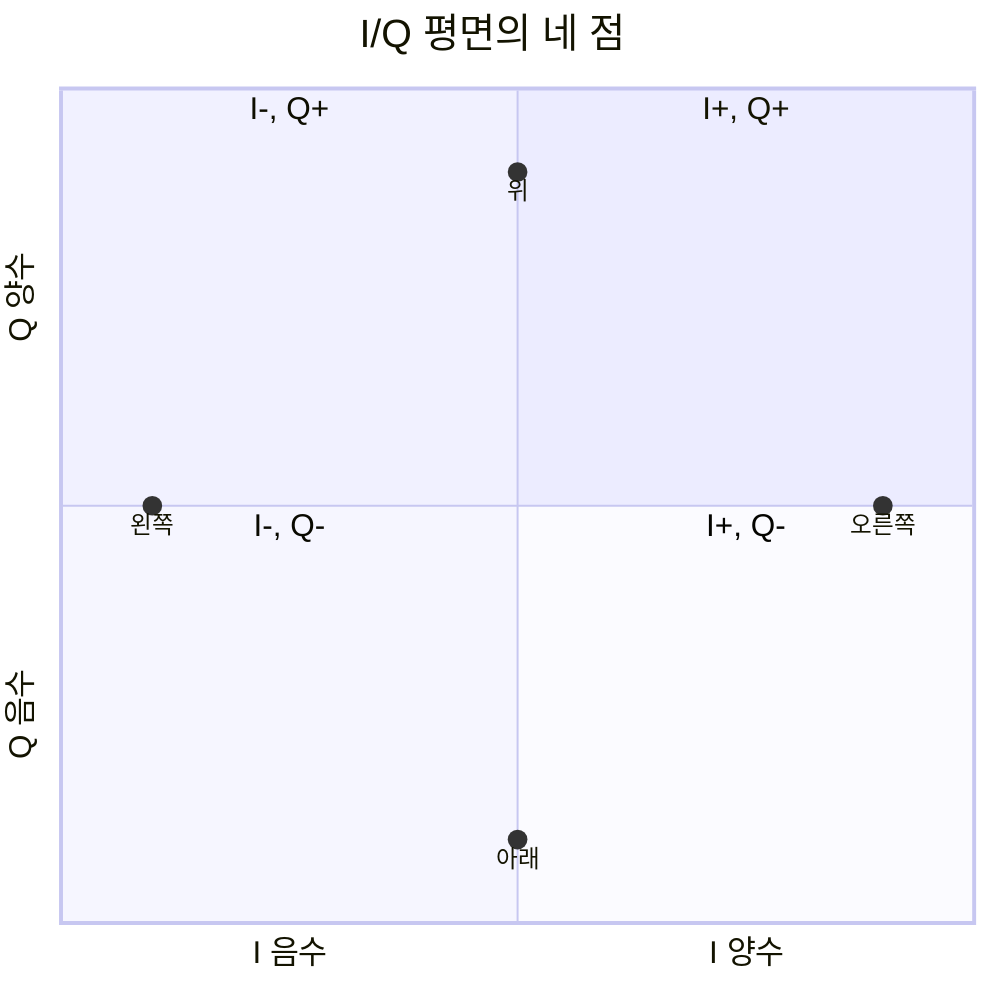

# 03. Sampling·I/Q·radio chain

## 실제 전압에서 디지털 표본으로

안테나와 **RF(Radio Frequency, 무선 주파수)** 회로의 신호는 시간에 연속인 전압이다. 컴퓨터의 베이스밴드는 이 파형을 유한한 숫자 열로 처리한다. **표본화(sampling)**는 일정한 시간 간격마다 파형 값을 읽는 과정이고, 표본율(sample rate)의 단위는 sample/s다.

```text
시간: 0, 1, 2, 3 µs
값:   0, 1, 0,-1
```

1 Msample/s이면 표본 간격은 `1/1,000,000=1 µs`다. 20 Msample/s이면 `1/20,000,000=50 ns`다. 표본은 bit와 다르다. 각 표본을 몇 bit로 표현하는지에 따라 저장해야 할 bit 수가 달라진다.

**양자화(quantization)**는 각 표본의 높이를 유한한 단계 가운데 하나로 바꾸는 과정이다. **ADC(Analog-to-Digital Converter, 아날로그-디지털 변환기)**가 이 표본화와 양자화를 수행한다. 8-bit ADC는 이상적으로 256 level, 12-bit ADC는 4,096 level을 표현한다. sample rate는 시간축의 촘촘함이고 bit depth는 높이축의 촘촘함이다.

입력 범위가 ±1 V인 이상적 8-bit ADC는 전체 폭 2 V를 256단계로 나누므로 한 단계가 약 `2/256=7.8125 mV`다. 0.303 V는 가장 가까운 level로 반올림되며 원래 값과 기록값의 차이가 양자화 오차(quantization error)다.

별도의 단순 예로 -1 V부터 +1 V까지를 8단계만으로 표현하는 ADC를 생각하면, 연속 입력 0.31 V는 단계 정의에 따라 가장 가까운 0.25 V 또는 0.375 V 같은 값으로 기록된다. 이 예의 8단계와 앞 예의 8-bit, 즉 256단계는 조건이 다르다. 둘 다 sample rate를 높인다고 높이축의 양자화 단계가 자동으로 촘촘해지지는 않는다는 점을 보여 준다.

입력이 +1 V 범위를 넘으면 ADC가 포화되어 파형 꼭대기가 잘린다. 표본율이 충분해도 포화나 낮은 bit depth 때문에 정보가 사라질 수 있다.

## Aliasing·Nyquist 조건·anti-alias filter

**Nyquist 표본화 조건**은 이상적인 저역통과(baseband) 신호가 최고 `B` Hz까지만 포함할 때 원래 파형을 유일하게 복원하려면 sample rate를 `2B`보다 크게 잡아야 한다는 조건이다. 3 kHz까지의 이상적 저역통과 신호라면 6 ksample/s보다 커야 한다. 4 MHz 성분이라면 8 Msample/s 경계보다 높게 잡는다. 실제 설계에서는 필터의 천이 대역과 clock 여유 때문에 이론 경계보다 높게 정한다.

sample rate가 부족하면 서로 다른 연속 주파수가 같은 표본열처럼 보이는 **앨리어싱(aliasing, 주파수 겹침)**이 생긴다. 8 ksample/s에서 5 kHz tone을 표본화하면 Nyquist 경계 4 kHz를 넘으므로 `|5-8|=3 kHz`처럼 나타날 수 있다. 수신기는 표본만 보고 원래 신호가 5 kHz였는지 3 kHz였는지 구별할 수 없다. ADC 앞의 anti-alias filter는 Nyquist 범위 밖 성분을 충분히 줄이는 역할을 한다.

원하는 0~4 MHz baseband에 7 MHz 간섭이 있고 sample rate가 10 Msample/s라면 Nyquist 경계는 5 MHz다. 필터가 7 MHz를 줄이지 못하면 표본에서 `|7-10|=3 MHz`처럼 원하는 대역 안에 접힌다.

| 위치 | 상태 | 결과 |
|---|---|---|
| mixer 출력 | 0~4 MHz + 7 MHz | analog baseband |
| filter | 7 MHz 잔류 | ADC 입력 오염 |
| ADC | 3 MHz alias | digital channel 내부 간섭 |
| detector | constellation 분산 | LLR 약화 |
| decoder | 증거 부족 | CRC 실패 가능 |

20 Msample/s로 올리면 이 조건에서 7 MHz alias는 피하지만 처리량과 전력이 늘고, channel 밖 간섭 자체를 제거하는 filter는 여전히 필요하다. 알려진 대역과 엄격한 조건에서 alias를 의도적으로 이용하는 bandpass sampling도 있지만, anti-alias 조건을 확인하지 않은 채 일반적인 해결책으로 쓸 수는 없다.

Nyquist 조건을 “2 GHz RF carrier는 반드시 4 Gsample/s보다 빠른 ADC로 직접 찍어야 한다”라고 단순화해서는 안 된다. 믹서가 원하는 20 MHz channel을 낮은 **IF(Intermediate Frequency, 중간 주파수)**나 복소 baseband로 옮긴 뒤 그 대역폭에 맞는 rate로 sampling할 수 있다.

## I/Q가 진폭과 위상을 담는 방법

**I/Q(In-phase/Quadrature, 동상/직교 성분)**는 90도 다른 두 기준 축이다. I는 기준 반송파와 같은 cosine 방향의 성분이고 Q는 quarter cycle, 즉 90도 돌아간 sine 방향의 성분이다. 한 쌍 `(I,Q)`는 평면의 점이며 점의 거리는 진폭, 각도는 위상과 연결된다.

| 방향 | I | Q |
|---|---:|---:|
| 오른쪽 | +1 | 0 |
| 위 | 0 | +1 |
| 왼쪽 | -1 | 0 |
| 아래 | 0 | -1 |

복소 표기 `I+jQ`는 두 숫자를 한 묶음으로 계산하기 위한 약속이다. `j`는 새 물리 전파가 아니라 90도 축을 표시한다.



반송파 주파수를 `f_c`라 하면 passband 파형은 다음처럼 표현할 수 있다.

`s(t)=I(t)cos(2πf_ct)-Q(t)sin(2πf_ct)`

한 표본의 진폭은 `sqrt(I²+Q²)`, 위상은 `atan2(Q,I)`다. I=3, Q=4이면 진폭은 5, 위상은 약 53.1도다. I=-3, Q=4이면 같은 방식으로 제2사분면의 약 126.9도가 된다.

## DAC·mixer와 송신 radio chain


송신 경로는 다음과 같다.

```text
bit → symbol → digital I/Q → DAC
→ low-pass filter → mixer+local oscillator
→ power amplifier → antenna
```

payload에 **FEC(Forward Error Correction, 순방향 오류 정정)**를 적용한 coded bit를 mapper가 성상도(constellation)의 심볼로 바꾼다. pulse shaping filter는 심볼 사이의 시간 파형과 점유 스펙트럼을 정한다. **DAC(Digital-to-Analog Converter, 디지털-아날로그 변환기)**가 digital I/Q를 analog 전압으로 만들고 low-pass filter가 변환 과정에서 생기는 image를 줄인다.

믹서는 두 파형을 곱해 주파수의 합과 차 성분을 만들며, filter가 필요한 성분을 선택한다. baseband 1 MHz 성분과 2.4 GHz **LO(Local Oscillator, 국부 발진기)**를 섞으면 2.4 GHz 반송파 주변으로 옮길 수 있다. 수신에서는 반대로 RF를 낮은 주파수 I/Q로 옮긴다.

**PA(Power Amplifier, 전력 증폭기)**가 작은 RF 신호를 증폭하고 안테나가 방사한다.

| 단계 | 입력 | 내부 상태·단위 | 출력 |
|---|---|---|---|
| mapper | coded bit | constellation table | symbol |
| pulse shaper | symbol | filter taps | sample/s I/Q |
| DAC | digital sample | bit depth·clock | volt |
| mixer | baseband+LO | carrier phase | RF |
| PA | 작은 RF | gain·linearity | watt RF |
| antenna | RF current | radiation pattern | field |

PA가 포화되면 sample rate가 충분해도 amplitude peak가 잘리고 constellation과 spectrum이 왜곡된다. 높은 출력만 추구하면 **EVM(Error Vector Magnitude, 이상 심볼점 대비 오차 크기)**과 대역 밖 방사가 나빠질 수 있다.

## 수신 radio chain과 동기

수신 경로는 다음과 같다.

```text
antenna → low-noise amplifier → filter
→ mixer+local oscillator → I/Q baseband
→ ADC → timing/carrier recovery → symbol 추정
```

수신 안테나의 작은 RF를 **LNA(Low-Noise Amplifier, 저잡음 증폭기)**가 잡음을 적게 더하면서 증폭한다. RF filter가 원하는 band를 남기고 mixer가 baseband I/Q로 내린다. ADC가 표본을 만들고 timing recovery가 심볼 중심을 찾는다. carrier recovery는 주파수·위상 offset을 추정한다. channel estimator는 알려진 pilot으로 gain, phase, multipath 영향을 계산한다. equalizer가 보정한 뒤 detector가 심볼별 soft information을 만든다.

| 단계 | 입력 | 내부 상태 | 출력 |
|---|---|---|---|
| ADC | analog I/Q | sample clock | digital sample |
| timing recovery | sample | symbol 경계 추정 | symbol sample |
| channel estimator | pilot | gain/phase 추정 | 보정값 |
| equalizer | data+보정 | channel 역보정 | 보정 symbol |
| detector | 보정 symbol | constellation 거리 | bit/LLR |

**LLR(Log-Likelihood Ratio, 로그 우도비)**은 각 bit 후보에 대한 상대적 확신도를 나타내며 decoder가 오류 정정을 할 때 사용한다. **CRC(Cyclic Redundancy Check, 순환 중복 검사)**는 복호된 packet의 오류 검출에 쓰인다. 한 packet의 처리 시각을 단순화하면 다음과 같다.

| 시각 | 주체 | 상태 |
|---:|---|---|
| 0 μs | preamble detector | packet 후보 발견 |
| 4 μs | timing recovery | sample offset 추정 |
| 8 μs | carrier recovery | +2 kHz offset 추정 |
| 12 μs | channel estimator | complex gain 저장 |
| 20 μs | detector | symbol LLR 생성 |
| 30 μs | decoder | CRC pass/fail |

receiver는 심볼 경계와 carrier frequency·phase 차이를 알아야 한다. preamble과 pilot은 알려진 pattern을 제공해 timing과 channel 추정을 돕는다. 신호 전력이 강해도 timing이 반 symbol 어긋나면 점이 퍼지고, oscillator offset을 보정하지 않으면 constellation이 시간에 따라 회전한다. radio chain의 각 블록은 서로 다른 오류 원인을 맡는다.

direct-conversion과 superheterodyne radio는 mixer와 IF 구성 등 세부가 다르다. I/Q imbalance가 있으면 두 축의 gain과 90도 관계가 틀어질 수 있다. 이 차이는 표본율 하나만으로 해결되지 않는다.

## 작은 QPSK 표본 추적

**QPSK(Quadrature Phase Shift Keying, 직교 위상 편이 변조)**에서 다음 매핑을 사용한다고 하자.

```text
00 → I=+1, Q=+1
01 → I=-1, Q=+1
11 → I=-1, Q=-1
10 → I=+1, Q=-1
```

입력 `00 10 11`은 `(1,1), (1,-1), (-1,-1)` 세 심볼이 된다. 채널 뒤 두 번째 점이 `(0.8,-0.7)`로 오면, 채널 보정이 된 조건에서 가장 가까운 `(1,-1)`을 선택해 `10`으로 추정할 수 있다. 경계에 가까운 `(0.05,0.02)`는 잡음에 따라 결정이 쉽게 바뀌므로 receiver는 hard bit만 내기보다 soft information을 decoder에 전달할 수 있다.

채널이 모든 점에 공통으로 진폭 0.5와 위상 +30도를 더하면 constellation 전체가 작아지고 회전한다. pilot으로 이 변화를 추정한 equalizer가 역보정한다. 이 공통 gain·phase 모형은 교육용 단순화이며, 실제 주파수 선택적 multipath에서는 성분별 보정이 필요할 수 있다.

## 표본 데이터율

30.72 Msample/s인 complex I/Q를 I 16-bit, Q 16-bit로 저장하면 표본당 32 bit다. 원시 bit rate는 `30.72M×32=983.04 Mbit/s`이고 초당 byte는 약 122.88 MB/s다. 두 antenna stream이면 약 245.76 MB/s다.

이 값은 payload data rate가 아니라 내부 표본 운반량이다. 압축, framing, control overhead를 넣으면 fronthaul 요구량이 달라진다. 같은 20 MHz 무선 channel에서도 oversampling과 antenna 수가 sample rate와 데이터량을 키운다.

## Doppler·발진기 오차·복호 실패

2 GHz, 속도 15 m/s의 진행 방향 도플러 편이는 파장 0.15 m에서 약 `15/0.15=100 Hz`다. 송신기와 수신기 oscillator가 각각 +1 **ppm(parts per million, 백만분율)**, -1 ppm 오차라면 상대 오차는 2 ppm이 될 수 있고, 2 GHz에서 `2×10^-6×2×10^9=4 kHz`다. 두 오차가 항상 이 부호로 더해지는 것은 아니며 이 예는 최종 상대 오차가 2 ppm인 조건이다. receiver는 Doppler와 oscillator offset을 함께 추정해야 한다.

표본율이 충분하다고 복호가 보장되지는 않는다. ADC 포화, 낮은 bit depth, I/Q imbalance, timing 오류, carrier offset, 낮은 **SNR(Signal-to-Noise Ratio, 신호 대 잡음비)**, alias 간섭은 서로 다른 단계에서 정보를 훼손한다. 앞의 7 MHz 간섭 예처럼 alias가 원하는 3 MHz 대역 안으로 접히면 detector의 constellation이 퍼지고 LLR의 확신도가 낮아지며 decoder에서 CRC가 실패할 수 있다.

## 연구 결과를 읽는 경계

physics-guided deep unfolding 기반 교차 대역 채널 예측(cross-band channel prediction) 연구는 한 band의 관측과 물리 구조로 다른 band의 channel을 예측한다. 입력 I/Q나 **CSI(Channel State Information, 채널 상태 정보)**가 radio chain의 어느 보정 단계 뒤에서 얻은 값인지가 중요하다. 2026 MobiSys Companion poster [원문](https://arxiv.org/abs/2605.31279)의 simulation·평가 조건을 실제 장비의 모든 band 성능 보장으로 확대해서는 안 된다.

## 문제와 해설

### 1. 25 Msample/s와 2 Msample/s의 표본 간격은 각각 얼마인가?

25 Msample/s는 `1/25,000,000=40 ns`다. 2 Msample/s는 `1/2,000,000 s=0.5 µs`다. sample rate의 역수가 표본 사이 시간이다.

### 2. ±1 V, 10-bit ADC의 이상적인 한 단계 크기는?

전체 입력 폭은 2 V이고 10-bit는 1,024 level이므로 `2/1024≈1.953 mV`다. 실제 ADC의 선형성, noise, 끝점 정의는 생략한 이상적 계산이다.

### 3. I=-4, Q=-3인 표본의 진폭과 사분면은?

진폭은 `sqrt((-4)²+(-3)²)=sqrt(25)=5`다. I와 Q가 모두 음수이므로 위상은 제3사분면에 있다. 정확한 각도는 `atan2(-3,-4)`로 구한다.

### 4. 15.36 Msample/s, complex I/Q가 각각 12-bit일 때 원시 rate는?

한 complex 표본은 `12+12=24 bit`다. 따라서 `15.36M×24=368.64 Mbit/s`다. 이는 payload 전송률이 아니며 framing이나 압축을 반영하지 않은 원시 표본율이다.

### 5. sample rate가 충분한데도 복호가 실패할 수 있는 이유 두 가지를 설명하라.

예를 들어 ADC 입력 포화는 파형 첨두를 잘라 진폭·위상 정보를 왜곡하고, carrier offset 미보정은 constellation을 시간에 따라 회전시킨다. 이 밖에도 낮은 bit depth, timing 오류, 낮은 SNR, I/Q imbalance가 있다. Nyquist 조건은 aliasing 방지 조건이지 radio chain 전체의 성공 조건이 아니다.

### 6. 위 QPSK 매핑에서 `01`의 I/Q는 무엇인가?

매핑 표에 따라 `I=-1, Q=+1`이다. 이는 제2사분면의 심볼점이다.

### 7. 4 kHz까지 성분을 가진 이상적 baseband의 이론적 최소 sample rate 경계는?

Nyquist 조건에서 `2B=8 ksample/s`가 경계이며, 고유 복원을 위해서는 8 ksample/s보다 크게 잡는다. 실제 설계에서는 anti-alias filter의 천이 대역과 clock 여유를 추가한다.

## 공식 출처

- [MIT 6.450 sampling and QAM notes](https://ocw.mit.edu/courses/6-450-principles-of-digital-communication-i-fall-2009/pages/lecture-notes/)
- [MIT 6.02 modulation notes](https://ocw.mit.edu/courses/6-02-introduction-to-eecs-ii-digital-communication-systems-fall-2012/resources/lecture-notes/)

[이 책 목차](README.md)

[← 이전: 전력과 링크 버짓](02-power-db-and-link-budget.md) · [다음: 변조·부호화·오류 →](04-modulation-coding-and-errors.md)
