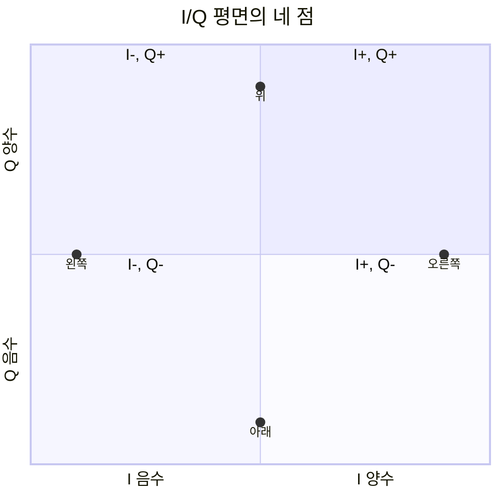

# 03. Sampling·I/Q·radio chain

## 연속 전압과 디지털 sample 사이의 경계

안테나와 RF 회로의 신호는 시간에 연속인 전압이다. 컴퓨터의 baseband는 이 파형을 유한한 숫자 열로 처리한다. **sampling**은 일정 시간 간격마다 값을 읽는 과정이고 sample rate의 단위는 sample/s다. 20 Msample/s이면 간격은 `1/20,000,000=50 ns`다.

**quantization**은 각 sample 높이를 유한 단계 중 하나로 바꾸는 과정이다. 8-bit ADC는 이상적으로 256 level, 12-bit는 4,096 level을 표현한다. sample rate는 시간축 촘촘함이고 bit depth는 높이축 촘촘함이다.

입력 범위 ±1 V인 이상적 8-bit ADC의 전체 폭은 2 V이므로 한 단계는 약 `2/256=7.8125 mV`다. 0.303 V는 가장 가까운 level로 반올림되며 차이가 quantization error다. 입력이 +1 V 범위를 넘으면 포화되어 파형 꼭대기가 잘린다.

## Nyquist 조건과 anti-alias filter

이상적인 baseband가 최고 B Hz까지만 포함하면 sample rate는 2B보다 커야 원래 파형을 유일하게 복원할 수 있다. 4 MHz 성분이면 8 Msample/s 경계보다 높게 잡고 실제 filter transition 여유를 둔다.

sample rate 8 ksample/s에서 5 kHz tone을 찍으면 3 kHz처럼 나타날 수 있다. `|5-8|=3 kHz`다. sample만 보고 원래 5 kHz인지 3 kHz인지 구별하지 못한다. ADC 앞 anti-alias filter가 Nyquist 밖 성분을 줄인다.

RF carrier 2 GHz 전체를 반드시 4 Gsample/s로 직접 찍어야 한다는 뜻은 아니다. mixer가 원하는 20 MHz channel을 낮은 intermediate frequency나 complex baseband로 옮긴 뒤 적절한 rate로 sampling할 수 있다.

## I/Q가 진폭과 위상을 담는 방법

I와 Q는 90도 다른 두 기준 축이다. passband를 `s(t)=I(t)cos(2πf_ct)-Q(t)sin(2πf_ct)`로 표현할 수 있다. 한 sample의 진폭은 `sqrt(I²+Q²)`, 위상은 `atan2(Q,I)`다.

I=3,Q=4이면 진폭 5, 위상 약 53.1도다. I=-3,Q=4면 제2사분면 약 126.9도다. `j`는 새 물리 전파가 아니라 Q축을 표시하는 계산 약속이다.

QPSK 매핑 `00→(1,1), 01→(-1,1), 11→(-1,-1), 10→(1,-1)`에서 bit `00 10 11`은 세 점이 된다. channel이 공통 진폭 0.5, 위상 +30도를 더하면 constellation 전체가 작아지고 회전한다. pilot로 이 변화를 추정해 equalizer가 역보정한다.

## 송신 radio chain 전체 추적

payload와 FEC를 거친 coded bit를 mapper가 constellation symbol로 바꾼다. pulse shaping filter는 symbol 사이 파형과 점유 spectrum을 정한다. digital I/Q를 DAC가 analog 전압으로 만들고 low-pass filter가 image를 줄인다. mixer는 local oscillator와 곱해 carrier 주변 passband로 옮긴다. PA가 증폭하고 antenna가 방사한다.

| 단계 | 입력 | 내부 상태·단위 | 출력 |
|---|---|---|---|
| mapper | coded bit | constellation table | symbol |
| pulse shaper | symbol | filter taps | sample/s I/Q |
| DAC | digital sample | bit depth·clock | volt |
| mixer | baseband+LO | carrier phase | RF |
| PA | 작은 RF | gain·linearity | watt RF |
| antenna | RF current | radiation pattern | field |

PA가 포화되면 sample rate가 충분해도 amplitude peak가 잘리고 constellation과 spectrum이 왜곡된다. 높은 출력만 추구하면 EVM과 대역 밖 방사가 나빠질 수 있다.

## 수신 radio chain 전체 추적

수신 antenna의 작은 RF를 LNA가 낮은 추가 noise로 증폭한다. RF filter가 원하는 band를 남기고 mixer가 baseband I/Q로 내린다. ADC가 sample을 만들고, timing recovery가 symbol 중심을 찾는다. carrier recovery는 주파수·위상 offset을 추정한다. channel estimator는 pilot로 gain·phase·multipath 영향을 계산한다. equalizer가 보정한 뒤 detector가 symbol별 soft information을 만든다.

| 시각 | 주체 | 상태 |
|---:|---|---|
| 0 μs | preamble detector | packet 후보 발견 |
| 4 μs | timing recovery | sample offset 추정 |
| 8 μs | carrier recovery | +2 kHz offset 추정 |
| 12 μs | channel estimator | complex gain 저장 |
| 20 μs | detector | symbol LLR 생성 |
| 30 μs | decoder | CRC pass/fail |

신호 전력이 강해도 timing이 반 symbol 어긋나면 점이 퍼진다. oscillator offset을 보정하지 않으면 constellation이 시간에 따라 회전한다. radio chain의 각 블록은 서로 다른 오류 원인을 맡는다.

## sample 데이터율 계산

30.72 Msample/s complex I/Q를 I 16-bit, Q 16-bit로 저장하면 sample당 32 bit다. 원시 bit rate는 `30.72M×32=983.04 Mbit/s`다. 초당 byte는 약 122.88 MB/s다. 두 antenna stream이면 약 245.76 MB/s다.

이는 payload data rate가 아니다. 내부 sample 운반량이다. 압축, framing, control overhead를 넣으면 fronthaul 요구량이 달라진다. 같은 20 MHz 무선 채널에서도 oversampling과 antenna 수가 sample rate를 키운다.

## Doppler와 oscillator offset

2 GHz, 속도 15 m/s의 진행 방향 Doppler는 파장 0.15 m에서 약 `15/0.15=100 Hz`다. transmitter와 receiver oscillator가 각각 +1 ppm, -1 ppm 오차라면 상대 오차 2 ppm이 될 수 있고 2 GHz에서 `2×10^-6×2×10^9=4 kHz`다. Doppler와 oscillator offset을 함께 추정해야 한다.

## AI channel prediction 연결

physics-guided deep unfolding 기반 cross-band channel prediction 연구는 한 band의 관측과 물리 구조로 다른 band channel을 예측한다. 입력 I/Q·CSI가 어느 radio-chain 보정 뒤 값인지 중요하다. 2026 MobiSys Companion poster [원문](https://arxiv.org/abs/2605.31279)의 simulation·평가 조건을 실제 장비 전 band 보장으로 확대하지 않는다.

## aliasing에서 복호 실패까지

원하는 0~4 MHz baseband에 7 MHz 간섭이 있고 sample rate가 10 Msps라면 Nyquist 경계는 5 MHz다. filter가 7 MHz를 줄이지 못하면 sample에서 `|7-10|=3 MHz`처럼 원하는 대역 안에 접힌다.

| 위치 | 상태 | 결과 |
|---|---|---|
| mixer 출력 | 0~4 MHz + 7 MHz | analog baseband |
| filter | 7 MHz 잔류 | ADC 입력 오염 |
| ADC | 3 MHz alias | digital channel 내부 간섭 |
| detector | constellation 분산 | LLR 약화 |
| decoder | 증거 부족 | CRC 실패 가능 |

20 Msps로 올리면 7 MHz alias는 피하지만 처리량과 전력이 늘고 channel 밖 간섭을 여전히 filter해야 한다.

## 추가 문제와 완전 해설

### 1. 25 Msample/s의 sample 간격은?
`1/25,000,000=40 ns`다.

### 2. ±1 V, 10-bit ADC의 이상적 step은?
전체 2 V를 1024로 나눠 약 1.953 mV다.

### 3. I=-4,Q=-3의 진폭은?
`sqrt(16+9)=5`다. 위상은 제3사분면이다.

### 4. 15.36 Msample/s, complex 12+12 bit의 원시 rate는?
sample당 24 bit이므로 `15.36M×24=368.64 Mbit/s`다.

### 5. sample rate가 충분한데도 복호가 실패하는 이유 두 가지는?
ADC 포화, 낮은 bit depth, timing·carrier 오류, 낮은 SNR 중 두 가지 이상을 들 수 있다.

[이 책 목차](README.md)

[← 이전: 전력과 링크 버짓](02-power-db-and-link-budget.md) · [다음: 변조·부호화·오류 →](04-modulation-coding-and-errors.md)

## 핵심 계산 복습: 연속 파형을 숫자로 바꾸기

sampling은 일정한 시간 간격마다 파형 값을 기록하는 일이다.
sample rate는 초당 sample 수다.
1Msample/s이면 sample 간격은 1µs다.

```text
시간: 0, 1, 2, 3 µs
값:   0, 1, 0,-1
```

sample은 bit가 아니다.
각 sample을 몇 bit로 quantize하는지에 따라 저장 bit 수가 달라진다.

## Nyquist 입문

최고 주파수 성분이 B Hz인 baseband 신호를 손실 없이 표현하려면 이상 조건에서 sample rate가 2B보다 커야 한다.
이를 “RF carrier의 두 배로 ADC해야 한다”로 단순화하면 안 된다.
mixing으로 낮은 intermediate/baseband로 옮긴 뒤 sampling할 수 있다.

3kHz까지의 ideal low-pass 신호면 6ksample/s보다 큰 rate가 필요하다.
실제 filter transition과 clock 여유 때문에 더 높게 잡는다.

sample rate가 부족하면 서로 다른 주파수가 같은 sample처럼 보이는 aliasing이 생긴다.
anti-alias filter가 ADC 앞에서 바깥 성분을 줄인다.

## I와 Q를 직교 자로 이해하기

복소수를 몰라도 I/Q를 두 개의 자로 시작할 수 있다.
I는 기준 carrier와 같은 방향 성분이다.
Q는 quarter cycle, 즉 90도 돌아간 방향 성분이다.

| symbol | I | Q |
|---|---:|---:|
| 오른쪽 | +1 | 0 |
| 위 | 0 | +1 |
| 왼쪽 | -1 | 0 |
| 아래 | 0 | -1 |

I/Q 한 쌍은 평면의 점이다.
점의 거리는 크기, 각도는 위상과 연결된다.
복소 표기 `I+jQ`는 두 숫자를 한 묶음으로 계산하는 편리한 약속이다.
`j`는 새 물리 신호가 아니라 90도 축을 표시한다.



## radio chain


송신:

```text
bit → symbol → digital I/Q → DAC
→ low-pass filter → mixer+local oscillator
→ power amplifier → antenna
```

수신:

```text
antenna → low-noise amplifier → filter
→ mixer+local oscillator → I/Q baseband
→ ADC → timing/carrier recovery → symbol 추정
```

## mixer

mixer는 두 파형을 곱해 주파수 합과 차 성분을 만든다.
filter로 원하는 성분을 선택한다.
baseband 1MHz 성분과 2.4GHz local oscillator를 섞으면 carrier 주변으로 옮길 수 있다.
수신에서는 반대로 RF를 낮은 주파수 I/Q로 옮긴다.

## 작은 QPSK sample 추적

bit pair를 다음처럼 매핑한다고 하자.

```text
00 → I=+1, Q=+1
01 → I=-1, Q=+1
11 → I=-1, Q=-1
10 → I=+1, Q=-1
```

입력 `00 10 11`은 `(1,1), (1,-1), (-1,-1)` 세 symbol이 된다.
channel 뒤 두 번째가 `(0.8,-0.7)`로 오면 가장 가까운 `(1,-1)`을 선택해 `10`으로 추정할 수 있다.

경계에 가까운 `(0.05,0.02)`는 noise에 따라 결정이 쉽게 바뀐다.
수신기는 hard bit만 내기보다 각 후보의 확신도인 soft information을 decoder에 줄 수 있다.

## 동기

receiver는 symbol 경계를 알아야 한다.
carrier frequency/phase 차이도 추정해야 한다.
preamble과 pilot은 알려진 pattern으로 timing과 channel을 추정하게 돕는다.
동기가 틀리면 신호가 강해도 constellation이 회전하거나 퍼진다.

## 상태 표

| 단계 | 입력 | 내부 상태 | 출력 |
|---|---|---|---|
| ADC | analog I/Q | sample clock | digital sample |
| timing recovery | sample | symbol 경계 추정 | symbol sample |
| channel estimator | pilot | gain/phase 추정 | 보정값 |
| equalizer | data+보정 | channel 역보정 | 보정 symbol |
| detector | 보정 symbol | constellation 거리 | bit/LLR |

## 반례와 경계

sample rate가 높다고 quantization 정밀도가 자동으로 높지 않다.
I/Q imbalance가 있으면 두 축의 gain과 90도 관계가 틀어진다.
ADC가 포화되면 sample rate가 충분해도 파형이 잘린다.
direct-conversion과 superheterodyne radio는 chain 세부가 다르다.

## 문제

## quantization이 sample에 더하는 것

ADC가 -1V부터 +1V를 8단계로만 표현한다고 하자.
연속 입력 0.31V는 가장 가까운 단계인 0.25V나 0.375V로 기록된다.
원래 값과 기록값의 차이가 quantization error다.
sample rate는 시간축을 얼마나 촘촘히 보는지 정한다.
bit depth는 각 sample 높이를 얼마나 촘촘히 표현하는지 정한다.
둘은 서로 다른 축이며 sample rate를 높여도 bit depth 부족이 자동으로 해결되지 않는다.

## aliasing 숫자 추적

sample rate 8ksample/s에서 5kHz tone을 sampling한다고 하자.
5kHz는 Nyquist 4kHz를 넘는다.
sample에서는 `|5-8|=3kHz` 성분처럼 나타날 수 있다.
receiver는 sample만 보고 원래 5kHz인지 3kHz인지 구분하지 못한다.

ADC 앞 low-pass filter가 4kHz 밖 성분을 줄여야 하는 이유다.
반례로 intentional bandpass sampling은 알려진 band와 조건에서 alias를 이용할 수 있다.
입문 설계에서 anti-alias 조건 확인 없이 이를 일반화하지 않는다.

1. 2Msample/s의 sample 간격은?
2. 위 매핑에서 `01`의 I/Q는?
3. 4kHz까지 성분을 가진 ideal baseband의 이론 최소 sample rate 경계는?

## 해설

1. `1/2,000,000s=0.5µs`다.
2. `I=-1, Q=+1`이다.
3. 8ksample/s보다 커야 하며 실제 설계는 filter 여유를 둔다.

## 공식 출처

- [MIT 6.450 sampling and QAM notes](https://ocw.mit.edu/courses/6-450-principles-of-digital-communication-i-fall-2009/pages/lecture-notes/)
- [MIT 6.02 modulation notes](https://ocw.mit.edu/courses/6-02-introduction-to-eecs-ii-digital-communication-systems-fall-2012/resources/lecture-notes/)

[← 이전: 전력과 링크 버짓](02-power-db-and-link-budget.md) · [다음: 변조·부호화·오류 →](04-modulation-coding-and-errors.md)
