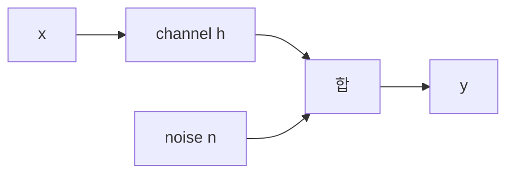
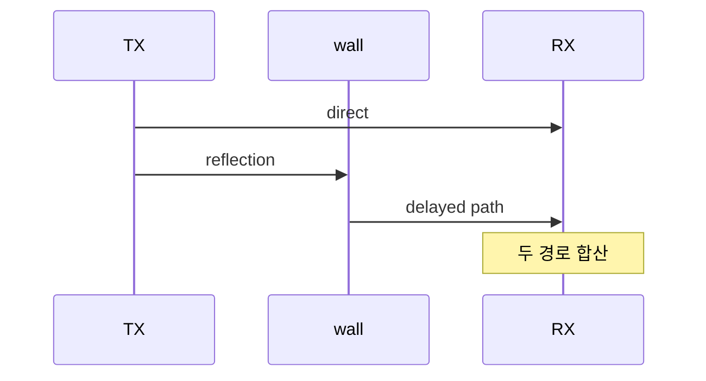

# 05. Channel·noise·capacity

## channel은 공기가 아니라 입력과 출력의 관계다

**채널**은 송신 파형이 수신 관측으로 바뀌는 물리·수학적 관계다. 자유공간, 벽, 반사체, 이동 물체, 다른 송신기, 수신 회로가 함께 결과를 만든다. 송신 I/Q sample이 입력이고 수신 I/Q sample이 출력이며, 중간 상태는 경로별 지연·감쇠·위상과 noise다.

단일 경로 모형은 `y=hx+n`으로 쓸 수 있다. x는 송신 symbol, h는 channel의 복소 gain, n은 noise, y는 수신 관측이다. h의 크기는 감쇠, 각도는 위상 회전을 나타낸다. receiver가 pilot로 h를 추정하면 `y/h`처럼 보정해 x에 가까운 값을 얻는다.

**noise**는 원하는 송신과 무관한 무작위 성분이고 **interference**는 다른 송신기의 구조 있는 신호다. SNR은 signal/noise, SINR은 signal/(interference+noise)다. dBm 값을 직접 더하지 않고 linear power로 합친다.

| 항목 | 전력 | linear mW |
|---|---:|---:|
| 원하는 signal | -70 dBm | `10^-7` |
| interference | -80 dBm | `10^-8` |
| noise | -90 dBm | `10^-9` |

분모는 `1.1×10^-8 mW`이고 signal 비는 약 9.09, dB로 `10log10(9.09)≈9.6 dB`다. noise만 보면 SNR 20 dB이지만 interference를 포함한 SINR은 약 9.6 dB다.

## multipath가 시간과 주파수에 만드는 문제

직접 경로가 0 μs에 진폭 1로, 반사 경로가 2 μs 뒤 진폭 0.5로 도착한다고 하자. symbol 길이가 1 μs라면 이전 symbol의 반사가 다음 symbol에 섞여 ISI가 생긴다. symbol 길이가 10 μs면 같은 2 μs 지연은 상대적으로 작지만 주파수별 위상 합은 여전히 다를 수 있다.

| 수신 시각 | 직접 경로 | 지연 경로 | 합에 섞이는 symbol |
|---:|---|---|---|
| 0 μs | S0 | 없음 | S0 |
| 1 μs | S1 | 없음 | S1 |
| 2 μs | S2 | 0.5·S0 | S2와 과거 S0 |
| 3 μs | S3 | 0.5·S1 | S3와 과거 S1 |

경로 위상이 같은 주파수에서는 더해지고 반대인 주파수에서는 상쇄되어 **frequency-selective fading**이 생긴다. 대역 전체가 함께 약해지는 flat fading과 다르다. equalizer는 pilot로 주파수별 channel을 추정해 보정한다.

**coherence time**은 channel이 비슷하게 유지되는 시간 규모이고 **coherence bandwidth**는 비슷한 gain을 보이는 주파수 폭의 규모다. 정확한 경계가 아니라 correlation 기준에 따른 값이다. 고속 이동이면 coherence time이 짧아져 오래된 CSI가 빨리 낡는다.

## noise bandwidth와 capacity를 조건부로 읽는다

thermal noise density를 -174 dBm/Hz로 단순화하고 bandwidth 20 MHz를 쓰면 `10log10(20,000,000)≈73 dB`이므로 thermal noise는 약 -101 dBm이다. receiver noise figure 5 dB를 더하면 약 -96 dBm이다. 이는 상온 근사와 평탄 noise, 특정 대역 조건의 모형이다.

Shannon 식 `C=B log2(1+SNR)`은 AWGN channel에서 임의로 긴 이상 code를 가정한 이론 상한이다. B=20 MHz, SNR=10(선형, 10 dB)이면 `log2(11)≈3.46`, C≈69.2 Mbit/s다. 실제 payload는 pilot, control, finite block, 구현 손실, 규제로 낮다.

bandwidth를 40 MHz로 두 배 늘릴 때 총 송신 전력이 고정이면 Hz당 signal power가 낮아지고 noise는 늘어난다. SNR을 그대로 둔 채 C만 두 배로 계산할 수 있는지는 전력 가정을 확인해야 한다.

## outage와 평균의 반례

100개 packet 중 90개가 SINR 15 dB, 10개가 deep fade -2 dB라고 하자. 평균 SINR 하나는 10개의 실패 구간을 숨긴다. outage probability는 요구 SINR 아래에 있는 시간·위치 비율을 본다.

AI channel 예측도 평균 MSE만 보지 않고 outage 구간, 이동 속도, 예측 horizon, 학습하지 않은 환경을 분리해야 한다. cross-band channel prediction 연구는 [원문](https://arxiv.org/abs/2605.31279)의 simulation·physics 가정 안에서 해석한다.

## 추가 문제와 완전 해설

### 1. signal -75 dBm, noise -95 dBm의 SNR은?
20 dB다. 같은 측정 대역 조건이다.

### 2. 10 MHz noise가 -99 dBm이면 20 MHz에서는?
같은 density 가정에서 +3 dB인 약 -96 dBm이다.

### 3. B=10 MHz, 선형 SNR=3이면 Shannon 상한은?
`10M×log2(4)=20 Mbit/s`다.

### 4. 지연 spread 3 μs인데 symbol 1 μs면?
여러 과거 symbol이 섞일 수 있어 단일 tap 보정이 부족하다.

### 5. 평균 RSSI가 좋은데 실패하는 이유는?
간섭, 짧은 deep fade, 주파수 선택적 null, 동기 오류가 평균에 숨을 수 있다.

[이 책 목차](README.md)

[← 이전](04-modulation-coding-and-errors.md) · [다음 →](06-ofdm-time-frequency-and-resources.md)

## 핵심 계산 복습: 기본 모형

channel은 송신 파형을 수신 파형으로 바꾸는 경로다.

```text
y = h x + n
```

`x`는 송신 symbol, `h`는 channel gain/phase, `n`은 noise, `y`는 관측이다.



## noise와 interference

noise는 thermal/electronic 불확실 성분이다.
interference는 다른 송신기의 구조 있는 신호일 수 있다.
receiver가 분리하지 못하면 둘 다 방해가 된다.

## SNR

`SNR=S/N`, dB에서는 signal dBm에서 noise dBm을 뺀다.
signal -60dBm, noise -90dBm이면 30dB다.
signal -80dBm이면 10dB다.
RSSI만으로 SNR을 알 수 없다.

## noise bandwidth

상온 ideal thermal noise density를 약 -174dBm/Hz로 시작한다.
1MHz는 1Hz보다 60dB 넓다.
ideal noise는 약 -114dBm이다.
noise figure 5dB receiver면 약 -109dBm 입력 환산 모형이다.
이는 측정값이 아니다.

## multipath

직접 경로와 반사 경로는 delay와 phase가 다르다.



같은 phase면 강해지고 반대면 약해질 수 있다.
delay가 symbol에 겹치면 ISI가 생긴다.

## delay 손 추적

symbol 길이 10µs, 반사 delay 2µs면 반사 성분이 같은 symbol 안에 들어올 수 있다.
delay 12µs면 이전 symbol tail이 다음 symbol에 겹친다.
equalizer나 OFDM CP가 이를 다룬다.

## coherence

coherence time은 channel이 비슷하게 유지되는 시간 규모다.
coherence bandwidth는 비슷한 응답을 보이는 주파수 폭이다.
빠른 이동은 Doppler를 키워 coherence time을 줄일 수 있다.
긴 delay spread는 주파수 선택성을 키울 수 있다.

## Shannon capacity

ideal AWGN 상한:

```text
C = B log2(1+SNR)
```

B=1MHz, 선형 SNR=10이면:

```text
C≈1,000,000×log2(11)≈3.46Mbit/s
```

특정 radio throughput 보장이 아니다.
무한히 긴 이상 code와 AWGN 조건의 상한이다.
header, pilot, guard, contention을 포함하지 않는다.

## bandwidth를 넓힐 때

총 송신 power가 고정이면 Hz당 signal power가 줄 수 있다.
noise power는 bandwidth와 함께 늘어난다.
B 두 배가 capacity 두 배라고 단정하지 않는다.
power constraint와 SNR 변화를 함께 넣는다.

## outage

fading으로 순간 SNR이 요구 rate를 못 받치는 상태가 생길 수 있다.
그 확률을 outage 관점으로 볼 수 있다.
평균 SNR만 좋다고 모든 packet이 성공하지 않는다.

## receiver 상태

| 단계 | 입력 | 상태 | 결과 |
|---|---|---|---|
| sync | preamble | timing/frequency | 정렬 |
| estimate | pilot | h | channel estimate |
| noise estimate | 관측 | variance | LLR scale |
| detector | y,h | 거리 | LLR |
| decoder | LLR | code | bit/fail |

## 작은 equalization

`x=1`, `h=0.5`, noise 없이 `y=0.5`다.
receiver가 h를 알면 `y/h=1`로 복구한다.
h를 0.4로 잘못 추정하면 1.25가 되어 constellation 판단이 흔들릴 수 있다.
channel estimate가 중요한 이유다.

## 반례

SNR이 높아도 sync가 틀리면 실패한다.
평균 SNR은 deep fade를 숨긴다.
capacity는 latency를 보장하지 않는다.
adjacent interference는 front-end를 포화시킬 수 있다.

## 문제

## AWGN·fading·SINR·Shannon의 조건

AWGN은 모든 주파수에 이상적으로 평탄한 Gaussian noise를 더하는 기준 모형이다.
fading은 multipath와 이동 때문에 channel gain `h`가 시간·주파수·위치에 따라 변하는 현상이다.
다른 송신기 interference까지 있으면 SNR 대신 `S/(I+N)`인 SINR을 본다.
Shannon 식은 일정 bandwidth와 평균 power, 정의된 noise channel에서 오류를 임의로 작게 만들 수 있는 점근 상한을 말한다.
finite packet, deadline, fading outage, pilot, MAC overhead는 직접 포함하지 않는다.
따라서 measured SINR 하나를 식에 넣은 값은 실제 application throughput 예측이 아니라 조건부 참고 상한이다.

1. -70dBm signal과 -95dBm noise의 SNR은?
2. 1Hz에서 1MHz로 noise bandwidth가 늘면 몇 dB 증가하는가?
3. capacity가 payload throughput이 아닌 이유는?

## 해설

1. 25dB다.
2. 60dB다.
3. 이상 channel/code 상한이며 protocol overhead와 fading을 생략한다.

## 공식 출처

- [MIT 6.450 wireless notes](https://ocw.mit.edu/courses/6-450-principles-of-digital-communication-i-fall-2009/pages/lecture-notes/)
- [MIT 6.451 AWGN](https://ocw.mit.edu/courses/6-451-principles-of-digital-communication-ii-spring-2005/resources/chap_2/)

[← 이전](04-modulation-coding-and-errors.md) · [다음 →](06-ofdm-time-frequency-and-resources.md)
