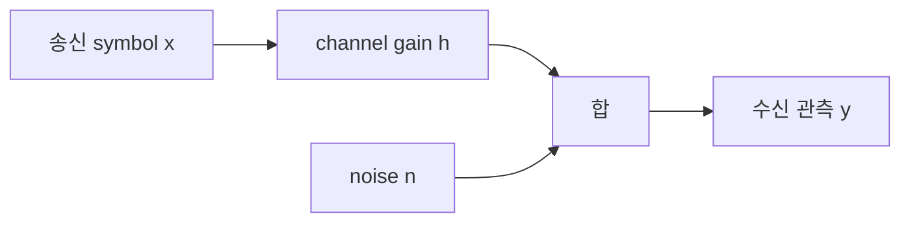
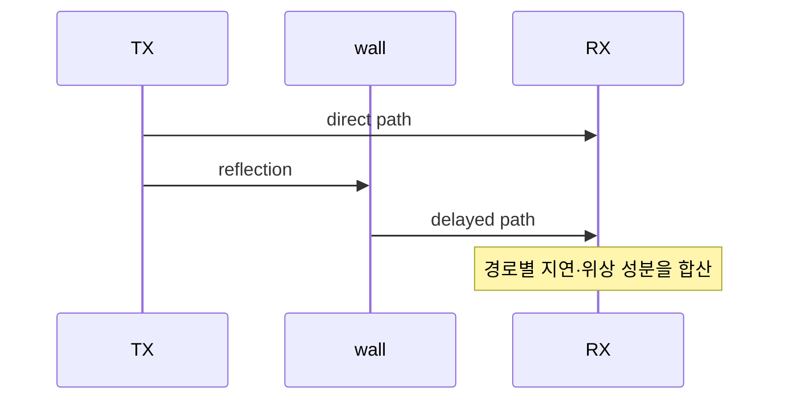

# 05. Channel·noise·capacity

[← 이전](04-modulation-coding-and-errors.md) · [다음 →](06-ofdm-time-frequency-and-resources.md)

**Channel(채널)**은 송신 파형이 수신 관측으로 바뀌는 물리·수학적 관계다. 공기만 가리키는 말이 아니며 자유공간, 벽, 반사체, 이동 물체, 다른 송신기와 수신 회로가 함께 결과를 만든다. 단일 경로의 가장 작은 모형은 `y=hx+n`이다. `x`는 송신 symbol, `h`는 감쇠와 위상 회전을 담은 복소 channel gain, `n`은 noise, `y`는 수신 관측이다.



**Noise(잡음)**는 원하는 송신과 무관한 무작위 성분이고 **interference(간섭)**는 다른 송신기의 구조 있는 신호다. **SNR(Signal-to-Noise Ratio, 신호 대 잡음비)**은 signal/noise, **SINR(Signal-to-Interference-plus-Noise Ratio, 신호 대 간섭·잡음비)**은 signal/(interference+noise)다.

## 1. 전압 파형과 channel impulse response

안테나 단자에서 송수신기가 다루는 물리량은 시간에 따라 변하는 전압과 전류다. Baseband는 이를 **I/Q(In-phase/Quadrature, 동상·직교) 복소수 sample**로 표현한다. 복소수 `a+jb`는 서로 90도 어긋난 두 실수 성분을 한 쌍으로 적은 것이며, 크기 `sqrt(a²+b²)`는 진폭, 각도는 **위상(phase)**을 나타낸다. 위상은 파형이 한 주기 안에서 어디에 있는지를 degree 또는 radian으로 나타낸다.

**Impulse response(임펄스 응답)**는 아주 짧은 입력을 보냈을 때 channel이 시간 지연별로 어떻게 되돌려 주는지를 나타낸 함수 `h(τ)`다. 실제로 무한히 짧은 pulse를 반드시 보내는 뜻이 아니라 pilot·상관 측정으로 경로의 지연과 복소 gain을 추정한다. 송신 sample열 `x`와 impulse response가 만나 각 지연 복사본을 더하는 연산을 **convolution(합성곱)**이라 한다.

직접 경로가 0 µs에 진폭 1로, 반사 경로가 2 µs 뒤 진폭 0.5로 도착한다고 하자. Symbol 길이가 1 µs라면 이전 symbol의 반사가 다음 symbol에 섞여 ISI가 생긴다. Symbol 길이가 10 µs면 같은 지연이 상대적으로 작지만 주파수별 위상 합은 여전히 달라질 수 있다.



| 수신 시각 | 직접 경로 | 지연 경로 | 합에 섞이는 symbol |
|---:|---|---|---|
| 0 µs | S0 | 없음 | S0 |
| 1 µs | S1 | 없음 | S1 |
| 2 µs | S2 | 0.5·S0 | S2와 과거 S0 |
| 3 µs | S3 | 0.5·S1 | S3와 과거 S1 |

경로가 같은 위상이면 더해지고 반대 위상이면 상쇄되어 주파수별 gain이 달라지는 **frequency-selective fading(주파수 선택적 페이딩)**이 생길 수 있다. 대역 전체가 비슷하게 약해지는 flat fading과 구분한다.

두 경로를 이산 시간으로 단순화하자.

```text
h[0] = 1
h[2] = 0.5
x = [1, 0, -1, 0]
noise = 0
```

출력은 `y[n]=x[n]+0.5x[n-2]`다.

| n | 직접 `x[n]` | 지연 `0.5x[n-2]` | y[n] |
|---:|---:|---:|---:|
| 0 | 1 | 0 | 1 |
| 1 | 0 | 0 | 0 |
| 2 | -1 | 0.5 | -0.5 |
| 3 | 0 | 0 | 0 |
| 4 | 0 | -0.5 | -0.5 |

입력은 4 sample이지만 channel memory 때문에 출력 꼬리는 n=4까지 산다. Symbol 경계를 잡지 않으면 과거 symbol 성분이 현재 symbol에 섞이는 **ISI(심벌 간 간섭)**가 된다. Impulse response는 위치·주파수·시간에 따라 바뀌며 receiver가 추정한 값은 다음 pilot까지 보관되는 상태다.

## 2. Power, dB, dBm과 SINR

**Power(전력)**는 단위 시간에 전달되는 에너지이고 watt로 잰다. dB는 두 power의 비를 로그로 표현하는 무차원 값이다. `10log10(P2/P1)`을 쓴다. dBm은 1 mW를 기준으로 한 절대 power라 `P[mW]=10^(dBm/10)`이다.

- `0 dBm=1 mW`
- `-30 dBm=0.001 mW=1 µW`
- power가 10배면 +10 dB, 2배면 약 +3 dB
- 같은 측정 대역의 signal -70 dBm과 noise -90 dBm 차이는 SNR 20 dB

Interference -80 dBm과 noise -90 dBm은 dBm끼리 더해 -170 dBm이 아니다. 각각 `10^-8 mW`, `10^-9 mW`로 바꿔 `1.1×10^-8 mW`를 만든다. Signal `10^-7 mW`와의 SINR은 약 9.09, 즉 9.6 dB다.

## 3. Bandwidth, noise와 Shannon 상한

**Bandwidth(대역폭)**는 전송에 사용하는 주파수 폭이며 hertz다. 20 MHz는 20,000,000 Hz다. 평탄한 thermal noise density를 -174 dBm/Hz, receiver noise figure를 5 dB로 가정하면 다음과 같다.

```text
10log10(20,000,000) ≈ 73.01 dB
thermal noise = -174 + 73.01 ≈ -100.99 dBm
receiver input-referred noise ≈ -95.99 dBm
```

Signal이 -76 dBm이면 SNR은 약 20 dB, 선형으로 100이다. **AWGN(Additive White Gaussian Noise, 가산 백색 가우시안 잡음)** channel에서 Shannon capacity 상한은

```text
C = B log2(1+SNR)
  = 20,000,000 × log2(101)
  ≈ 133.16 Mbit/s
```

이 값은 평균 power 제한, 정의된 bandwidth, Gaussian noise와 충분히 긴 이상 coding 아래에서 오류를 임의로 작게 할 수 있는 점근 상한이다. Pilot, guard, finite packet, decoder 복잡도, MAC 재전송, outage와 deadline은 직접 포함하지 않는다.

비교를 위해 다른 조건도 계산해 보자. B=20 MHz에서 선형 SNR=10, 즉 10 dB를 **그대로 주어진 값**으로 두면 `C=20M×log2(11)≈69.2 Mbit/s`다. 이 값과 앞의 133.16 Mbit/s가 다른 이유는 앞 예의 SNR이 100이고 여기서는 10이기 때문이다.

총 signal power를 고정한 채 bandwidth를 40 MHz로 늘리면 noise가 약 3 dB 늘고 signal spectral density가 낮아져 SNR이 절반인 50으로 내려간다는 단순 모형을 쓸 수 있다. Capacity는 `40M×log2(51)≈226.9 Mbit/s`로 늘지만 정확히 두 배는 아니다. Bandwidth와 SNR을 동시에 어떻게 고정했는지 써야 한다.

## 4. Fading, SINR과 outage

**Fading(페이딩)**은 multipath와 이동 때문에 channel gain이 시간·주파수·위치에 따라 달라지는 현상이다. **Outage**는 필요한 rate 또는 SINR 조건을 만족하지 못하는 사건이다.

100개 packet 중 90개가 SINR 15 dB, 10개가 -2 dB라고 하자. 목표 MCS가 최소 5 dB를 요구한다는 교육 가정에서는 10개가 outage라 경험 outage probability는 10%다. dB 평균 하나로 10개 실패를 숨기지 않는다. 실제 성공 조건은 coding, packet 길이, channel estimation과 구현에 달려 있다.

## 5. Pilot, channel estimation과 equalization

**Pilot(파일럿)**은 송신기와 수신기가 값을 알고 있는 기준 symbol이다. 송신기가 `x_p=1`을 보내고 수신 관측이 noise 없이 `y_p=0.5+j0.5`라면 channel 추정은 `h_hat=y_p/x_p=0.5+j0.5`다. 이 복소 gain의 크기는 `sqrt(0.5²+0.5²)≈0.707`, 위상은 45도다.

다음 data symbol `x=1-j`가 같은 channel을 지나면 다음처럼 계산된다.

```text
y = (0.5+j0.5)(1-j)
  = 1+j0
```

Receiver는 `x_hat=y/h_hat`으로 `1-j`를 복원한다. Noise가 `0.1+j0` 더해지면 관측은 `1.1+j0`이고 추정값은 정확히 constellation 점에 놓이지 않는다. **Detector(검출기)**는 가능한 symbol 가운데 거리와 noise 분산을 이용해 가장 그럴듯한 값 또는 bit별 신뢰도인 LLR을 만든다. Decoder는 여러 coded bit의 LLR을 결합한다.

수신 처리 상태는 다음처럼 이어진다.

| 단계 | 입력 | 저장·추정 상태 | 결과 |
|---|---|---|---|
| sync | preamble | timing·frequency | symbol 정렬 |
| channel estimate | pilot | h 또는 h_hat | channel 보정값 |
| noise estimate | 관측 | variance | LLR scale |
| detector | y, h_hat | 거리·확률 | LLR |
| decoder | LLR | code state | bit 또는 fail |

작은 반례로 실제 `x=1`, `h=0.5`, noise 0이면 `y=0.5`이고 정확한 h로는 `y/h=1`이다. Receiver가 h를 0.4로 잘못 추정하면 1.25가 되어 constellation 판단이 흔들릴 수 있다.

Channel estimate는 pilot 수신 뒤 receiver 메모리에 저장되어 인접 data RE나 다음 symbol에 재사용된다. Channel이 estimate보다 빨리 바뀌면 오래된 값으로 나누게 된다. Pilot을 촘촘히 두면 추적은 좋아지지만 payload 칸이 줄어든다. 이 trade-off가 pilot density를 정하는 이유다.

`h`가 매우 작은 deep fade에서는 `y/h`가 noise까지 크게 증폭한다. Zero-forcing 식이 존재한다는 이유만으로 reliable하다고 할 수 없다. MMSE 계열은 noise power를 고려해 무리한 역수를 완화하지만 bias와 복잡도가 생긴다.

## 6. 시간 변화, Doppler와 coherence 조건

송수신기의 상대 이동은 수신 주파수를 바꾸는 **Doppler shift**를 만든다. 단순 최대 크기 근사는 `f_D=v f_c/c`다. Carrier 3.5 GHz, 속도 30 m/s, 빛의 속도 `3×10^8 m/s`를 쓰면

```text
f_D = 30 × 3.5×10^9 / 3×10^8 ≈ 350 Hz
```

Coherence time은 정의에 따라 계수가 다르지만 `1/(2f_D)`라는 거친 규모를 쓰면 약 1.43 ms다. 이것을 정확한 만료 시각으로 쓰지 않는다. Correlation 기준, 산란 각도와 channel model에 따라 달라진다.

Pilot에서 5 ms 뒤의 **CSI(Channel State Information, 채널 상태 정보)**로 precoding하면 이 거친 coherence 규모보다 오래되어 channel이 많이 바뀌었을 가능성이 있다. 반대로 고정 단말과 안정 환경에서는 더 오래 쓸 수 있다. CSI age를 밀리초로 기록하고 이동 속도·carrier·예측 horizon과 함께 성능을 구간화한다.

**Coherence time(결맞음 시간)**은 channel이 비슷하게 유지되는 시간 규모이고 정확한 만료 시각은 아니다. 정의의 correlation 기준에 따라 값이 달라진다.

**Coherence bandwidth(결맞음 대역폭)**는 주파수에서 channel response가 비슷한 폭의 규모다. Delay spread가 길수록 주파수에 따라 phase 합이 빨리 바뀌어 coherence bandwidth가 좁아지는 경향이 있다. 전 대역에 pilot 하나만 두고 모든 주파수가 같다고 가정하면 frequency-selective null을 놓칠 수 있다.

## 7. Capacity와 실제 code rate 사이의 거리

Shannon capacity는 특정 QAM 이름이나 한 packet 길이를 정하지 않는다. 실제 송신기는 modulation order, code rate, pilot·header를 골라 **spectral efficiency**를 만든다. 20 MHz에서 data 자원 기준 4 bit/s/Hz를 달성해도 PHY gross 후보는 80 Mbit/s이며, 자원의 20%가 pilot·control이고 packet 성공률이 90%라면 교육용 payload 근사는 `80×0.8×0.9=57.6 Mbit/s`다.

이 계산은 contention, retransmission 시간, half-duplex와 application header를 생략한다. Capacity 133.16 Mbit/s와 57.6을 직접 “구현 손실 75.56” 하나로 부르기보다 coding gap, resource overhead, packet failure와 MAC airtime을 나눠 측정한다.


## 8. 평균값과 식을 오해하는 반례

- RSSI나 수신 power가 커도 interference가 더 크면 SINR과 복호 성능은 나쁠 수 있다.
- SNR이 높아도 timing·frequency synchronization이 틀리면 frame은 실패한다.
- 평균 SNR은 deep fade와 outage tail을 숨길 수 있다.
- Shannon capacity는 payload throughput, packet latency 또는 deadline을 보장하지 않는다.
- Bandwidth를 두 배로 늘릴 때 총 power와 SNR 조건을 함께 쓰지 않으면 capacity를 두 배라고 단정할 수 없다.
- Channel gain `h`가 매우 작은 deep fade에서는 단순한 `y/h`가 noise까지 증폭한다.
- 인접 대역 interference는 원하는 대역 SNR 계산 전에 RF front-end를 포화시킬 수도 있다.

## 9. AI-RAN 연구의 검증 층위

AI가 channel을 예측하거나 beam·resource를 고를 때 simulation 결과를 곧바로 field 성능으로 읽지 않는다.

| 층위 | channel과 시간 | 알 수 있는 것 | 아직 모르는 것 |
|---|---|---|---|
| Simulation | 정한 fading·mobility·traffic seed | 알고리즘 내부 비교 | RF 비선형, 실제 간섭 분포 |
| Testbed | 제한된 장치·방·거리·clock | 실제 waveform과 runtime | 도시·계절·단말 다양성 |
| Field | 운영 장소와 사용자 이동 | 배포 조건 성능·outage | 다른 지역·시간 일반화 |

AI-RAN Alliance는 AI-for-RAN, AI-on-RAN, AI-and-RAN이라는 연구 범주를 제시한다. 이것은 특정 학습 모델이 모든 channel에서 우월하다는 보장이 아니다. Cross-band channel prediction 결과도 [연구 원문](https://arxiv.org/abs/2605.31279)의 simulation과 physics 가정 안에서 읽는다. Channel prediction 연구는 예측 horizon, pilot 시각, 추론 deadline, 학습·평가 장소 분리, 기존 estimator 기준선과 outage tail을 공개해야 한다. 늦게 도착한 정확한 예측은 scheduler 결정에 쓸 수 없다.

## 10. 종합 문제와 완전 해설

### 10.1 dBm과 SNR

Signal -75 dBm, 같은 bandwidth의 noise -95 dBm이면 SNR은?

**해설.** dB 차이는 `-75-(-95)=20 dB`, 선형 비는 100이다. 서로 다른 filter bandwidth에서 잰 값이면 먼저 조건을 맞춘다.

### 10.2 SINR

Signal -70, interference -80, noise -90 dBm의 SINR은?

**해설.** 선형 mW는 `1e-7`, `1e-8`, `1e-9`다. `1e-7/(1.1e-8)=9.09`, dB는 약 9.6이다.

### 10.3 Noise bandwidth

10 MHz noise가 -99 dBm이면 같은 density의 20 MHz noise는?

**해설.** Bandwidth가 2배라 power는 2배, 약 +3.01 dB여서 -95.99 dBm이다.

### 10.4 Shannon 계산

B=10 MHz, 선형 SNR=3이면 상한은?

**해설.** `10M×log2(4)=20 Mbit/s`다. Payload throughput이나 latency 보장이 아니다.

### 10.5 Impulse response

`h[0]=1,h[2]=0.5`, 입력 `[1,0,-1]`일 때 y[2]는?

**해설.** `x[2]+0.5x[0]=-1+0.5=-0.5`다. 두 sample 전의 값이 현재 관측에 남는다.

### 10.6 CP 없는 짧은 symbol

Delay spread 3 µs인데 symbol이 1 µs면 어떤 문제가 생기는가?

**해설.** 여러 이전 symbol의 경로가 현재 symbol에 섞일 수 있다. 단일 복소 gain 보정만으로 부족해 equalization 또는 더 긴 symbol·guard가 필요하다.

### 10.7 Outage

100 packet 중 12개가 요구 SINR 아래면 경험 outage probability는?

**해설.** `12/100=12%`다. 평균 RSSI나 평균 SINR이 좋아도 이 tail 사건은 남는다.

### 10.8 AI channel 예측

Simulation에서 MSE가 20% 줄었다. Field outage도 20% 줄었다고 말할 수 있는가?

**해설.** 없다. Channel·mobility·interference 분포, prediction horizon과 runtime이 다르다. Testbed와 field에서 기존 estimator와 같은 packet·deadline 조건으로 outage와 tail을 다시 측정한다.

## 11. 공식 출처

- [MIT 6.450 wireless notes](https://ocw.mit.edu/courses/6-450-principles-of-digital-communication-i-fall-2009/pages/lecture-notes/)
- [MIT 6.451 AWGN](https://ocw.mit.edu/courses/6-451-principles-of-digital-communication-ii-spring-2005/resources/chap_2/)
- [Shannon, A Mathematical Theory of Communication, 1948](https://people.math.harvard.edu/~ctm/home/text/others/shannon/entropy/entropy.pdf)
- [AI-RAN Alliance Vision and Mission White Paper](https://ai-ran.org/wp-content/uploads/2024/12/AI-RAN_Alliance_Whitepaper.pdf)

[← 이전](04-modulation-coding-and-errors.md) · [다음 →](06-ofdm-time-frequency-and-resources.md)
