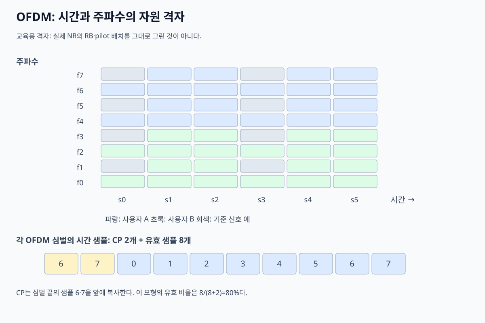

# 06. OFDM·시간·주파수·자원

## 긴 wideband symbol의 문제를 여러 좁은 subcarrier로 나눈다

넓은 대역 단일 carrier는 multipath 때문에 긴 equalizer가 필요할 수 있다. **OFDM**은 대역을 많은 좁은 subcarrier로 나누고 각 subcarrier에는 긴 symbol을 보낸다. 각 좁은 대역 안에서 channel이 거의 flat하다고 보고 간단한 복소 곱으로 보정한다.

**subcarrier**는 서로 다른 중심 주파수의 sinusoid 성분이다. 간격 Δf와 유효 symbol 시간 T가 `Δf=1/T` 관계를 가지면 한 symbol 구간 적분에서 다른 subcarrier가 0이 되는 **직교성**을 얻는다. spectrum이 겹쳐 보여도 FFT bin에서 구별된다.

Δf=15 kHz이면 유효 symbol 시간은 `1/15000≈66.67 μs`다. 30 kHz이면 약 33.33 μs다. 실제 symbol에는 cyclic prefix 시간이 추가된다.

## IFFT와 FFT가 하는 일

송신기는 각 subcarrier에 QAM symbol X[k]를 놓는다. IFFT는 이 주파수 bin 목록을 N개의 시간 sample x[n]으로 바꾼다. DAC와 RF chain이 시간 파형을 보낸다. 수신기는 symbol 경계를 맞춘 뒤 FFT로 다시 subcarrier별 Y[k]를 얻는다.

| 단계 | 입력 | 주체 | 출력 |
|---|---|---|---|
| mapping | coded bit | mapper | X[k] QAM 점 |
| IFFT | 주파수 bin | baseband | x[n] 시간 sample |
| CP 삽입 | x[n] 끝부분 | baseband | CP+x[n] |
| channel | 시간 파형 | 공간 | 지연 경로 합 |
| CP 제거·FFT | 수신 sample | receiver | Y[k] |
| equalization | Y[k], H[k] | receiver | X 추정 |

8-point toy에서 bin 1과 3에 symbol을 두고 IFFT하면 8개 시간이 생성된다. 수신 FFT는 동기가 맞고 channel이 이상적일 때 다시 bin 1과 3을 분리한다. IFFT는 여덟 radio를 만드는 것이 아니라 하나의 합성 시간 파형을 계산한다.

## cyclic prefix가 지연 경로를 흡수하는 조건

**CP**는 유효 OFDM symbol 끝부분을 앞에 복사한 guard 구간이다. 최대 의미 있는 channel 지연이 CP보다 짧고 FFT window가 맞으면 이전 symbol의 꼬리가 CP 안에 머물러 유효 구간을 보호한다. 선형 convolution을 FFT가 다루기 쉬운 circular convolution처럼 보이게 한다.

유효 symbol 66.67 μs, CP 4.7 μs라고 하자. 지연 spread 2 μs는 CP 안이지만 7 μs 경로는 유효 구간을 침범해 ISI와 직교성 손상을 만든다.

| 경로 | 지연 | CP 4.7 μs 안? | 결과 |
|---|---:|---|---|
| 직접 | 0 | 예 | 기준 |
| 반사 A | 2 μs | 예 | subcarrier별 H[k]로 보정 |
| 반사 B | 7 μs | 아니오 | 다음 symbol 침범 가능 |

CP는 매 symbol 반복되는 overhead다. `66.67/(66.67+4.7)≈93.4%`가 유효 시간 비율이다.

## resource grid와 payload 계산

**resource element(RE)** 는 한 subcarrier와 한 OFDM symbol의 교차 칸이다. **resource block(RB)** 은 주파수 방향 12 subcarrier 묶음이다. NR normal CP 조건의 한 slot에 14 OFDM symbol이 있다는 모형을 쓰면 한 RB의 raw RE는 `12×14=168`개다.

10 RB를 할당하면 1,680 RE다. 그중 pilot·control 280 RE를 빼면 data RE는 1,400개다. 16-QAM 4 coded bit/RE, code rate 3/4라면 information 후보는 `1400×4×0.75=4200 bit`, 약 525 byte다. layer 2개가 독립 전송 가능하면 이상 후보는 두 배지만 rank·power·overhead 조건이 필요하다.

## numerology와 시간 선택

subcarrier spacing을 키우면 symbol은 짧아져 빠른 시간 변화와 큰 Doppler에 유리할 수 있지만 같은 절대 CP 시간·overhead와 delay spread 조건이 달라진다. 좁은 spacing은 긴 symbol로 multipath 상대 영향이 줄 수 있으나 slot 시간과 phase noise 조건을 함께 본다.

frequency offset이 Δf의 큰 비율이면 FFT bin 사이 leakage가 생겨 직교성이 깨진다. timing, carrier recovery, phase noise가 OFDM에서 중요한 이유다.

## PAPR 반례와 AI-RAN 연결

여러 subcarrier가 같은 위상으로 더해지는 순간 peak가 커져 PAPR이 높다. PA backoff를 두지 않으면 clipping과 spectral regrowth가 생긴다. subcarrier 수가 많다는 사실만으로 전력 효율이 좋아지지 않는다.

AI scheduler가 RB를 할당할 때 입력 CSI가 오래됐거나 pilot 오염이 있으면 계산상 높은 rate 배치가 HARQ 실패를 만들 수 있다. 논문 simulation의 grid·channel·traffic 가정을 운영 보장으로 확대하지 않는다.

## 추가 문제와 완전 해설

### 1. Δf=60 kHz의 유효 symbol 시간은?
`1/60000≈16.67 μs`다.

### 2. 12 subcarrier×14 symbol×5 RB의 raw RE는?
`12×14×5=840 RE`다.

### 3. 840 RE 중 140 overhead, QPSK, rate 1/2면 정보 bit는?
data RE 700, `700×2×0.5=700 bit`다.

### 4. CP 4 μs, 지연 6 μs이면?
지연 꼬리가 유효 구간을 침범해 ISI·ICI가 생길 수 있다.

### 5. spectrum이 겹치는데 왜 분리되는가?
정확한 Δf와 T, 동기 조건에서 서로의 symbol 구간 내적이 0이기 때문이다.

[이 책 목차](README.md)

[← 이전: channel과 noise](05-channel-noise-and-capacity.md) · [다음: antenna·MIMO·beamforming →](07-antennas-mimo-and-beamforming.md)

## 핵심 계산 복습: 왜 여러 작은 subcarrier로 나누는가

넓은 대역 하나에서 빠른 symbol을 보내면 multipath delay가 symbol 사이를 쉽게 겹치게 한다.
OFDM은 bandwidth를 서로 직교하는 여러 좁은 subcarrier로 나눈다.
각 subcarrier는 더 느린 symbol을 보낸다.
주파수별 channel 차이를 작은 단위로 보정하기 쉬워진다.



## 직교의 뜻

직교는 한 OFDM symbol 구간에서 subcarrier들을 정해진 방식으로 관측하면 서로의 성분이 0으로 분리되는 성질이다.
주파수가 떨어져 있어야 한다는 말만으로 충분하지 않다.
subcarrier 간격과 symbol 유효시간이 맞아야 한다.

```text
유효 symbol 시간 Tu = 8µs
subcarrier 간격 Δf = 1/Tu = 125kHz
```

각 파는 구간 안에서 정수 번 회전해 다른 파와 내적하면 상쇄된다.
timing/frequency offset이 크면 직교성이 깨져 ICI가 생긴다.

## IFFT와 FFT

송신기는 subcarrier별 I/Q symbol들을 IFFT에 넣어 시간 sample 묶음을 만든다.
수신기는 FFT로 시간 sample을 subcarrier별 관측으로 되돌린다.


FFT가 channel과 noise를 없애는 것은 아니다.
주파수별 관측으로 나누고 pilot 기반 equalization이 뒤따른다.

## 8-subcarrier toy grid

subcarrier index 0~7, OFDM symbol time 0~3을 쓰자.

| time\\subcarrier | 0 | 1 | 2 | 3 | 4 | 5 | 6 | 7 |
|---:|---|---|---|---|---|---|---|---|
| 0 | guard | data | data | pilot | data | data | data | guard |
| 1 | guard | data | data | pilot | data | data | data | guard |
| 2 | guard | data | data | pilot | data | data | data | guard |
| 3 | guard | data | data | pilot | data | data | data | guard |

한 time에 data subcarrier는 5개다.
QPSK면 subcarrier당 2coded bit이므로 OFDM symbol당 10coded bit다.
4개 time이면 40coded bit다.
coding rate 1/2면 이상적 information bit는 20bit다.

guard와 pilot은 payload bit를 직접 싣지 않는다.
그래도 spectrum edge 보호와 channel 추정에 필요하다.

## CP

cyclic prefix(CP)는 OFDM symbol 끝 일부를 앞에 복사한 guard interval이다.
delay spread가 CP 안에 들어오고 동기가 맞으면 이전 symbol 영향이 FFT 유효 구간에 덜 들어오게 한다.
linear convolution을 subcarrier별 곱셈처럼 다루는 조건을 만든다.

```text
유효 sample 8개: [a b c d e f g h]
CP 길이 2:       [g h | a b c d e f g h]
```

전체 시간은 10 sample이고 payload 계산에 쓰는 새 유효 sample은 8개다.
CP overhead는 `2/10=20%`다.

CP가 delay spread보다 짧으면 ISI/ICI가 남을 수 있다.
CP를 무한히 길게 하면 보호는 늘지만 효율이 떨어진다.

## resource element와 resource unit

resource element는 특정 time과 subcarrier의 한 칸으로 생각할 수 있다.
여러 칸을 묶어 user나 signal에 할당한다.
표준마다 resource unit/block 이름과 크기가 다르다.
이 toy grid를 실제 Wi‑Fi/5G 숫자로 읽지 않는다.

## pilot

송신자와 수신자가 알고 있는 symbol을 pilot으로 보낸다.
수신기는 보낸 값 `x`와 받은 값 `y`를 비교해 channel `h≈y/x`를 추정한다.

pilot `x=1+j0`, 수신 `y=0.8+j0.2`이면 추정 `h≈0.8+j0.2`다.
data 관측을 이 channel로 보정한다.
pilot 사이에서 channel이 너무 빨리 바뀌면 interpolation이 틀릴 수 있다.

## PAPR

여러 subcarrier 파가 같은 순간 같은 방향으로 더해지면 peak가 커질 수 있다.
평균 대비 peak 비율을 PAPR로 본다.
power amplifier가 peak를 못 받으면 clipping과 spectrum regrowth가 생긴다.
출력 back-off는 선형성을 돕지만 전력 효율을 낮출 수 있다.

## 상태 추적

| 단계 | 입력 | 상태 | 출력 |
|---|---|---|---|
| mapper | coded bit | modulation | subcarrier I/Q |
| resource mapper | data/pilot | grid 위치 | grid |
| IFFT | grid 한 열 | phase 합 | time samples |
| CP | tail samples | 앞에 복사 | 전송 symbol |
| FFT | 수신 유효 구간 | 직교 분해 | subcarrier 관측 |
| equalizer | 관측+pilot | channel estimate | 보정 symbol |

## 반례

subcarrier 수가 많다고 항상 처리량이 증가하지 않는다.
FFT size, CP, pilot, guard, sampling 조건이 함께 바뀐다.
OFDM은 narrowband interference를 사라지게 하지 않는다.
frequency offset이 크면 인접 subcarrier 간섭이 생긴다.

## 문제

## FFT bin과 실제 subcarrier

수신기는 CP를 버린 뒤 정확히 유효 symbol 길이만큼 sample을 고른다.
FFT의 각 출력 bin은 그 구간에서 특정 회전수를 가진 파형과 얼마나 닮았는지 계산한 결과다.
timing이 한참 밀리면 이전 symbol이 섞이고, carrier offset이 있으면 energy가 이웃 bin으로 샌다.
pilot bin은 receiver가 이 회전·gain 오차를 추정할 기준을 제공한다.
equalizer는 bin마다 추정 channel로 data 관측을 보정한다.
FFT 출력 자체가 곧 bit는 아니며 detector와 decoder가 뒤따른다.

## 한 subcarrier deep fade 배치

8개 중 data subcarrier 1~6을 쓰고 index 3이 deep fade라고 하자.
uncoded이면 index 3의 bit가 집중적으로 틀릴 수 있다.
interleaver가 coded bit를 여러 subcarrier/time에 흩으면 한 codeword에 burst 오류가 분산된다.

| subcarrier | 1 | 2 | 3 | 4 | 5 | 6 |
|---|---|---|---|---|---|---|
| SNR | 20 | 18 | 2 | 19 | 17 | 20 dB |

receiver는 pilot/channel estimate로 index 3의 LLR 확신을 낮출 수 있다.
FEC decoder가 다른 강한 관측과 결합한다.
반례로 fade가 너무 넓거나 오래 지속되면 interleaving/FEC 능력을 넘는다.

1. Tu=4µs이면 Δf는?
2. 유효 12 sample, CP 3 sample의 CP overhead는?
3. data subcarrier 6개, 16-QAM, rate 3/4이면 한 OFDM symbol의 information bit 모형은?

## 해설

1. `1/4µs=250kHz`다.
2. 전체 15 중 3이므로 20%다.
3. `6×4×3/4=18bit`다.

## 공식 출처

- [MIT 6.450 signal space and modulation notes](https://ocw.mit.edu/courses/6-450-principles-of-digital-communication-i-fall-2009/pages/lecture-notes/)
- [3GPP specifications portal](https://www.3gpp.org/specifications-technologies/specifications-by-series)

[← 이전: channel과 noise](05-channel-noise-and-capacity.md) · [다음: antenna·MIMO·beamforming →](07-antennas-mimo-and-beamforming.md)
