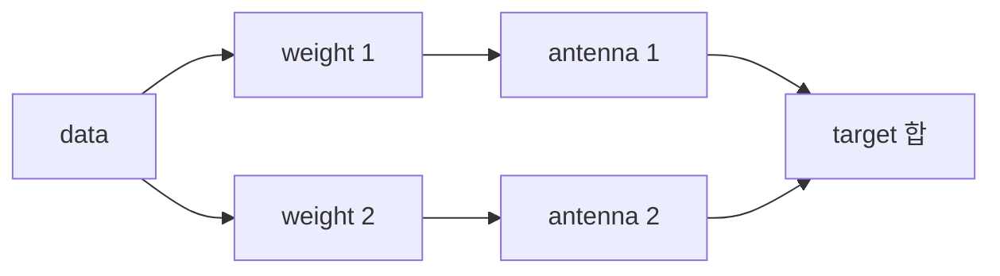

# 07. Antenna·MIMO·beamforming

[이 책 목차](README.md)

[← 이전](06-ofdm-time-frequency-and-resources.md) · [다음 →](08-wifi-and-medium-access.md)

## antenna

안테나는 전송선 전기 신호와 공간 전자기파를 연결한다.
gain은 특정 방향으로 energy를 집중한 정도다.
energy를 새로 만들지 않는다.
pattern은 방향별 gain, polarization은 전기장 방향 규칙이다.


## array와 beamforming

여러 element에 phase/amplitude weight를 주면 목표 방향에서 더해진다.



목표 방향에서 두 번째 경로가 quarter cycle 늦다면 송신에서 quarter cycle 먼저 줄 수 있다.
도착 때 phase가 맞아 더해진다.
다른 방향에서는 path 차이가 달라 상쇄될 수 있다.

## MIMO 세 목적

| 목적 | 보내는 것 | 결과 |
|---|---|---|
| diversity | 같은 정보의 여러 관측 | reliability |
| spatial multiplexing | 독립 layer | throughput |
| beamforming | layer에 antenna weight | 방향 gain |

같은 용어가 아니다.

## antenna와 layer

4Tx라고 layer 4가 보장되지 않는다.
Rx 수, channel rank, SNR, 구현이 제한한다.

```text
Tx=4, Rx=2, rank=2 → 최대 layer 모형 2
Tx=8, Rx=2, rank=1 → 최대 layer 모형 1
```

남는 antenna는 beamforming/diversity에 쓸 수 있다.

## 2×2 추적

`x1=1`, `x2=-1`.

```text
h11=1, h12=0.1
h21=0.1, h22=1
y1=1*1+0.1*(-1)=0.9
y2=0.1*1+1*(-1)=-0.9
```

receiver는 channel matrix로 layer를 분리한다.
두 column이 같아지면 두 layer가 같은 공간 signature로 보여 분리가 어렵다.

## CSI

pilot로 channel을 추정한다.
receiver feedback 또는 reciprocity로 transmitter에 CSI를 줄 수 있다.
측정과 전송 사이 channel이 바뀌면 CSI가 stale해진다.
reciprocity도 RF chain calibration 조건이 있다.

## 상태

| 주체 | 입력 | 상태 | 출력 |
|---|---|---|---|
| estimator | pilot | matrix H | CSI |
| rank selector | CSI/SNR | 후보 | layer 수 |
| precoder | layers+CSI | weights | antenna signal |
| channel | antenna signal | multipath | 혼합 |
| detector | 혼합+CSI | inverse/분리 | symbols |

## power split

총 1W를 두 layer에 균등 분할하면 layer당 0.5W다.
layer를 늘리면 각 layer SNR이 줄 수 있다.
rank만 높다고 layer를 최대 사용해야 하는 것은 아니다.

## beam search

방향성 link는 beam pair를 탐색한다.
측정하고 선택하고 이동·차폐에 따라 추적한다.
탐색 overhead와 data 시간의 trade-off가 있다.

## 반례

antenna 두 배가 throughput 두 배를 보장하지 않는다.
beam gain이 높아도 방향이 틀리면 약하다.
diversity는 새 payload layer가 아니다.
제품 MIMO 숫자가 순간 layer 수를 뜻하지 않는다.

## 두 신호가 섞여도 다시 찾을 수 있는 숫자 예제

**행렬(matrix)**은 숫자를 행과 열로 배열해 여러 관계를 함께 적는 표현이다. 여기서는 송신 안테나 두 개에서 보낸 값이 수신 안테나 두 개에 얼마나 섞이는지 기록한다. 실제 신호의 복소수 계수·잡음·시간 변화는 잠시 생략하고 실수만 사용하는 교육 모형이다.

송신 값이 `x1=1`, `x2=-1`이고 채널이 아래와 같다고 하자. 첫 수신 안테나는 두 값을 더해 받고, 둘째는 첫 값을 더하고 둘째 값을 빼서 받는다.

```text
채널 H = [[1,  1],
          [1, -1]]

y1 = 1×x1 + 1×x2 = 0
y2 = 1×x1 - 1×x2 = 2
```

수신기는 `y1=0`, `y2=2`를 알고 있다. 채널 H도 정확히 알고 있다면 두 식을 더하고 빼서 원래 값을 복원한다.

```text
x1 = (y1+y2)/2 = (0+2)/2 = 1
x2 = (y1-y2)/2 = (0-2)/2 = -1
```

왜 가능한가? 두 수신 값이 서로 다른 정보를 주기 때문이다. 첫 식은 합이고 둘째 식은 차이다. 합 하나만 알면 `1+(-1)`, `2+(-2)`, `0+0`을 구별할 수 없지만 합과 차이를 함께 알면 이 모형의 두 미지수를 결정할 수 있다.

이번에는 채널을 바꾼다.

```text
H = [[1, 1],
     [1, 1]]
y1 = x1+x2
y2 = x1+x2
```

수신 안테나는 여전히 두 개지만 두 값이 같은 정보만 준다. 독립된 정보를 주는 관계의 수를 이 문맥에서 채널의 **rank**로 이해한다. 첫 H는 rank 2, 둘째 H는 rank 1이다. 안테나 두 개를 설치했다는 사실만으로 독립된 데이터 계층 두 개를 복원할 수 없는 이유다.

실제 수신기는 기준 신호로 채널을 추정하고, 잡음이 섞인 값에서 원래 심벌을 추정한다. **추정**은 정답을 직접 보는 일이 아니라 관측과 채널 모형으로 가장 그럴듯한 값을 고르는 일이다. 채널의 두 관계가 거의 같아지면 작은 잡음도 복원 과정에서 크게 증폭될 수 있다. 수학적으로 역행렬이 존재한다는 것만으로 높은 전송률이 보장되지 않는다.

## 네 안테나로 한 계층을 보내는 빔 예제

**가중치(weight)**는 각 안테나가 같은 심벌을 어느 크기·위상으로 보낼지 정하는 계수다. 안테나 네 개가 있다고 새 데이터 네 개를 반드시 보내는 것은 아니다. 하나의 심벌을 네 안테나에 나눠 보낼 수도 있다.

전체 송신 전력의 기준을 맞추려고 가중치를 `[0.5,0.5,0.5,0.5]`로 놓는다. 제곱의 합은 `4×0.5²=1`이다. 네 안테나의 경로가 원하는 방향에서 같은 위상과 크기로 더해지는 모형이면 수신 진폭은 `4×0.5=2`다. 한 안테나 진폭 1과 비교하면 수신 전력은 진폭 제곱의 비율인 4배가 될 수 있다.

다른 방향에서 경로의 부호가 `[1,-1,1,-1]`이라면 `0.5-0.5+0.5-0.5=0`으로 상쇄된다. 이것은 에너지가 새로 생겼다는 뜻이 아니라 방향별로 신호가 더해지거나 상쇄되는 모형이다. 실제 빔은 안테나 간격·주파수·소자 특성·추정 오차에 따라 달라진다.

이 예제는 **안테나 네 개, 데이터 한 계층, 방향을 조절한 빔**이다. 공간 다중화로 독립 심벌 여러 개를 보내는 예제와 목적을 나눠 읽는다.

## 문제

## rank·layer·matrix·복소수·beam을 처음부터 연결하기

matrix는 여러 입력이 여러 출력에 섞이는 계수를 표로 적은 것이다.
각 계수가 복소수라는 말은 경로가 크기뿐 아니라 phase도 바꾼다는 뜻이다.
layer는 동시에 보내려는 독립 data stream이다.
rank는 현재 channel matrix가 서로 구분 가능한 공간 방향을 몇 개 제공하는지 나타낸다.
2×2에서 두 송신 신호가 수신 antenna에 서로 다른 비율로 섞이면 두 방정식을 풀어 복원할 수 있다.
두 열이 같으면 두 신호가 똑같이 섞여 어느 layer가 원인인지 구분하지 못한다.
beamforming은 layer를 antenna별 weight로 복사·조합해 원하는 방향에서 합치게 한다.
antenna 수는 물리 element 수, layer 수는 독립 정보 수, rank는 channel이 허용한 분리 가능 수다.

1. 4Tx·2Rx·rank1의 layer 상한은?
2. diversity와 multiplexing 차이는?
3. stale CSI가 문제인 이유는?

## 해설

1. 1 layer다.
2. 전자는 신뢰성, 후자는 독립 정보 동시 전송이 목적이다.
3. 실제 phase/amplitude가 달라 weight와 detector가 틀릴 수 있다.

## 공식 출처

- [MIT 6.450 wireless notes](https://ocw.mit.edu/courses/6-450-principles-of-digital-communication-i-fall-2009/pages/lecture-notes/)
- [3GPP specifications](https://www.3gpp.org/specifications-technologies)

[← 이전](06-ofdm-time-frequency-and-resources.md) · [다음 →](08-wifi-and-medium-access.md)
