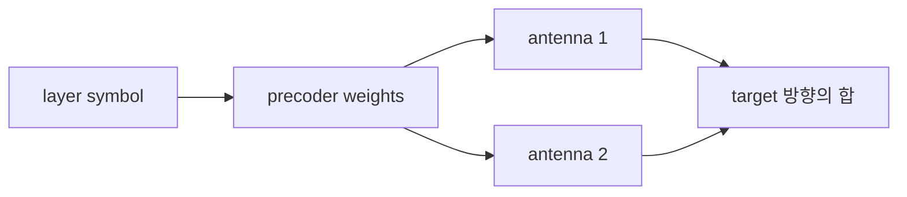

# 07. Antenna·MIMO·beamforming

## Antenna element, port, layer를 먼저 구분한다

**Antenna element(안테나 소자)**는 RF 전류와 공간 전자기파를 결합하는 물리 도체 구조 하나다. 여러 element를 일정 간격으로 배치한 것이 array다. **Antenna port(안테나 포트)**는 receiver가 하나의 기준 신호로 channel을 정의할 수 있는 논리 송신 단위다. 하나의 port가 여러 물리 element의 합성 빔으로 구현될 수 있으므로 connector나 element와 1:1일 필요가 없다. **Layer(계층)**는 동시에 전달하려는 독립 data stream이다.

**Precoder(프리코더)**는 layer symbol vector에 복소 weight matrix를 곱해 port·element별 송신 신호로 바꾼다. Element 네 개로 layer 하나를 서로 다른 위상과 진폭으로 보내면 beamforming이다. 두 layer를 보내려면 receiver가 공중 channel을 거친 두 성분을 구별할 수 있어야 한다. Element 수가 곧 layer 수는 아니다.

```text
Tx=4, Rx=2, channel rank=2 → 독립 layer 상한 모형 2
Tx=8, Rx=2, channel rank=1 → 독립 layer 상한 모형 1
```

남는 antenna는 beamforming이나 diversity에 쓸 수 있다. Port mapping은 baseband와 RF 구성에 따라 정해지며 설정이 바뀌면 논리적 의미도 바뀐다.


## 2×2 channel matrix와 rank로 분리 가능성을 본다

두 송신 신호를 `x1,x2`, 두 수신 관측을 `y1,y2`라 하면 `y=Hx+n`으로 쓸 수 있다. **Matrix(행렬)**는 각 송신 입력이 각 수신 출력에 얼마나 섞이는지를 행과 열에 적은 표현이다. `H`의 각 원소는 특정 송신→수신 경로의 크기와 위상을 가진 복소 gain이고 `n`은 noise다.

Noise를 생략하고 다음 실수 교육 모형을 보자.

```text
H = [[1,  1],
     [1, -1]]
x = [1, -1]

y1 = 1×1 + 1×(-1) = 0
y2 = 1×1 - 1×(-1) = 2
```

Channel `H`를 정확히 안다면 `x1=(y1+y2)/2=1`, `x2=(y1-y2)/2=-1`로 복원한다. 첫 관측은 합, 둘째는 차라는 서로 다른 정보를 주기 때문이다. **추정**은 정답을 직접 보는 일이 아니라 관측과 channel 모형으로 가장 그럴듯한 symbol을 고르는 일이다.

다른 full 계산에서

```text
H = [[1,   0.5],
     [0.5, 1  ]]
x = [2, 4]

y1 = 1×2 + 0.5×4 = 4
y2 = 0.5×2 + 1×4 = 5
```

첫 식의 두 배에서 둘째를 빼면 `1.5x1=3`이므로 `x1=2`, `x2=4`다. 두 column이 서로 다른 혼합 pattern이라 구분할 수 있다.

반대로 `H=[[1,1],[0.5,0.5]]`이면 두 column이 같고 관측은 `x1+x2`에만 의존한다. `[2,4]`와 `[3,3]`은 둘 다 `y=[6,3]`을 만들어 개별 stream을 분리할 수 없다. **Rank(랭크)**는 독립적인 column·공간 방향의 수이며 이 행렬은 rank 1이다. `H=[[1,1],[1,1]]`도 두 수신 antenna가 같은 합만 보는 rank 1 반례다.

| H 모형 | rank·조건 | layer 의미 |
|---|---|---|
| `[[1,0],[0,1]]` | rank 2 | 두 stream을 쉽게 분리 |
| `[[1,1],[1,1]]` | rank 1 | 한 독립 방향만 관측 |
| 한 열이 다른 열의 0.9배 | 거의 종속 | noise에서 분리 불안정 |

Column이 완전히 같지 않아 역행렬이 존재해도 거의 평행하면 작은 noise가 복원 과정에서 크게 증폭된다. Rank뿐 아니라 singular value, condition과 SINR을 함께 봐야 한다. 별도 약결합 예 `H=[[1,0.1],[0.1,1]]`, `x=[1,-1]`에서는 `y=[0.9,-0.9]`이며 receiver가 channel matrix를 이용해 두 layer를 분리한다. 이 예제는 위 두 full 계산보다 cross-coupling이 작은 조건이다.

## Beamforming은 weight로 방향별 합을 만든다

**Beam(빔)**은 element별 전파가 특정 방향에서 더해지고 다른 방향에서 상쇄되는 공간 pattern이다. 경계가 잘린 레이저가 아니라 main lobe와 side lobe를 가진다. **Weight(가중치)**는 각 antenna가 같은 symbol을 어느 크기와 위상으로 보낼지 정하는 계수이며, 원하는 방향에서 coherent하게 합치고 간섭 방향에서 줄이기 위해 필요하다.



목표 방향의 네 경로 위상이 `[0°,90°,180°,270°]`라면 송신 weight에 반대 위상 `[0°,-90°,-180°,-270°]`를 넣어 같은 위상으로 도착하게 할 수 있다. 이때 전체 송신 power를 유지하도록 normalization해야 한다.

네 element로 symbol `s=1` 하나를 보내고 weight를 `[0.5,0.5,0.5,0.5]`로 두면 weight power 합은 `4×0.5²=1`이다. 목표 방향 channel이 `[1,1,1,1]`이면 수신 진폭은 `4×0.5=2`, 기준 한 element 진폭 1에 대한 power는 4배다. 다른 방향의 경로 부호가 `[1,-1,1,-1]`이면 `0.5-0.5+0.5-0.5=0`으로 상쇄된다. 에너지가 생긴 것이 아니라 방향별 합이 달라진 것이다.

총 송신 power를 100 mW로 잡은 별도 물리 단위 조건에서는 네 antenna에 각각 25 mW를 배분한다. 목표 방향의 field 합은 단순한 100 mW 전력 분산과 같지 않고 antenna gain과 array factor로 계산한다. 두 예제는 하나는 정규화된 진폭, 다른 하나는 실제 전력 배분을 설명한다.

두 layer의 digital precoder를 다음처럼 둘 수도 있다.

```text
w1 = [1, 1]/sqrt(2)
w2 = [1,-1]/sqrt(2)
```

두 weight vector의 내적은 0이지만 공중 channel이 이 방향을 다르게 보존하지 않으면 receiver에서는 orthogonal하지 않을 수 있다. Digital weight만 직교한다고 end-to-end layer 분리가 보장되지 않는다. Antenna pattern, quantized phase shifter, calibration과 PA 제한도 이상적인 합을 바꾼다.

## CSI의 생성·수명과 power 선택을 함께 추적한다

**CSI(Channel State Information, 채널 상태 정보)**는 시간·주파수·antenna pair별 복소 channel의 추정 상태다. Precoder, layer 수, MCS와 beam을 현재 channel에 맞추는 데 필요하며 정답을 직접 아는 값이 아니다.

1. 송신기가 알려진 pilot 또는 reference signal을 보낸다.
2. 수신기가 관측에서 복소 channel과 noise를 추정한다.
3. TDD에서는 RF chain calibration 조건 아래 uplink 추정으로 downlink를 추론할 수 있다.
4. FDD나 codebook 방식에서는 UE가 channel quality, rank, precoder index 등을 양자화해 feedback한다.
5. Scheduler와 precoder가 timestamp가 붙은 CSI를 사용한다.
6. 이동·차폐·간섭 변화로 CSI가 stale해지면 새 측정으로 교체한다.

| 시각 | 주체 | 상태 |
|---:|---|---|
| 0 ms | UE | pilot 측정 |
| 2 ms | UE | CSI quantize·feedback |
| 6 ms | gNB | CSI 수신 |
| 10 ms | scheduler | precoder 선택 |
| 20 ms | gNB | 실제 전송, channel 변화 가능 |

UE가 15 m/s로 움직이고 coherence time이 5 ms인 조건에서 20 ms 된 CSI는 네 coherence interval이 지나 낡았을 수 있다. 오래된 precoder는 원하는 UE에서 상쇄되고 다른 UE에 간섭을 줄 수 있다.

더 짧은 별도 시간표에서 측정 `t=0`, feedback 1 ms, scheduler 대기 0.5 ms, 전송 시작 2 ms이면 CSI age는 2 ms다. Coherence 규모가 1 ms인 고속 환경에서는 이 CSI도 이미 맞지 않을 수 있다. Feedback bit를 늘리면 표현은 세밀해지지만 uplink overhead와 지연이 늘어난다.

총 1 W를 두 layer에 균등 분배하면 layer당 0.5 W다. Layer 수를 늘리면 각 layer SNR이 줄 수 있으므로 rank가 높다고 최대 layer를 항상 쓰는 것은 아니다. Scheduler는 CSI age, 목표 BLER, queue와 SNR 조건에서 layer·MCS·beam·power를 함께 고른다.

## Diversity, spatial multiplexing과 array gain은 목적이 다르다

| 목적 | 보내는 것 | 필요한 역할 | 기대 효과 |
|---|---|---|---|
| **Diversity(다이버시티)** | 같은 정보의 여러 독립 관측 | deep fade 실패 감소 | 신뢰성 향상 |
| **Spatial multiplexing(공간 다중화)** | 독립 layer | channel이 stream을 분리 | peak rate 향상 |
| **Array gain(배열 이득)** | 여러 element의 coherent 합 | 원하는 방향에 power 집중 | SNR 향상 |

2Tx×2Rx라고 세 효과를 동시에 최대화할 수는 없다. SNR이 낮고 rank 1이면 두 layer multiplexing보다 한 layer beamforming이 나을 수 있다. 높은 SNR과 rank 2 channel이면 두 layer가 throughput을 높일 수 있다. Diversity는 새 payload layer가 아니며 제품의 “4×4 MIMO” 숫자도 순간 layer 수나 4배 throughput을 보장하지 않는다.

방향성 link는 beam pair를 탐색하고 이동·차폐에 따라 추적한다. Beam sweep은 후보를 찾지만 data 전송 시간을 소비하므로 탐색 overhead와 stale beam 위험을 함께 본다.

## Element spacing과 grating lobe 조건

**Wavelength(파장)**은 파동이 같은 위상으로 한 주기 진행한 거리이며 `λ=c/f`다. Array element 간격을 파장과 비교해야 같은 위상차가 어느 방향을 뜻하는지 정할 수 있다. 3 GHz에서는 파장이 약 10 cm라 반 파장은 약 5 cm이고, 30 GHz에서는 파장이 약 1 cm다. 같은 물리 간격 5 cm가 각각 반 파장과 다섯 파장이므로 pattern은 전혀 다르다.

Element spacing이 너무 크면 서로 다른 방향이 같은 element별 위상차를 만드는 **grating lobe(격자 로브)**가 나타날 수 있다. 의도하지 않은 강한 방향과 목표 방향을 모호하게 만들기 때문에 피해야 한다. 반 파장 이하는 넓은 scan 범위에서 모호한 lobe를 줄이는 흔한 기준이지만 모든 설계의 만능 답은 아니다. Element coupling, enclosure, calibration과 bandwidth도 영향을 준다.

Wideband에서는 한 phase-shifter weight가 모든 subcarrier에서 정확히 같은 방향을 가리키지 않는 beam squint가 생길 수 있다. Narrowband simulation 결과를 큰 bandwidth에 그대로 일반화하지 말고 subcarrier별 gain과 band edge 성능을 측정한다.

## AI beam 연구의 조건과 증거 경계

AI beam predictor가 위치·과거 CSI로 다음 beam을 고를 때 입력의 수명, band, antenna geometry, codebook과 inference deadline을 명시해야 한다. 다른 band의 channel 예측은 파장과 산란이 달라 단순 복사가 아니다. [Physics-guided cross-band 연구](https://arxiv.org/abs/2605.31279)는 그 simulation과 평가 조건에서의 연구이며 표준 beam 성능 보장이 아니다.

증거 단계도 구분한다.

- simulation: ideal array, 정한 blockage trace와 종종 inference time 0
- testbed: 제한된 RF chain·room·codebook과 실제 interface
- field: 실제 이동·날씨·간섭·handover와 장소·시간·단말 변화

Top-1 beam accuracy만 보고하지 않는다. Sweep overhead, 선택까지 걸린 시간, stale rate, outage, fallback sweep과 일반화를 기록한다. 100 µs 결정 deadline에 inference가 150 µs 걸리면 accuracy가 높아도 그 시간 조건에서는 쓸 수 없다. AI-RAN shared compute에서는 다른 workload가 deadline을 흔드는지도 측정한다.

## 종합 문제와 완전 해설

### 문제 1. Matrix shape

4개 송신 port와 2개 수신 antenna의 channel matrix 크기는?

**해설.** `2×4`다. Row는 수신 관측, column은 송신 입력에 대응한다.

### 문제 2. Rank와 layer

4Tx·2Rx지만 channel rank가 1이면 독립 layer 상한은?

**해설.** 이 channel realization에서는 1 layer다. 물리 antenna 수만으로 layer 수를 정하지 않는다.

### 문제 3. 두 식 복원

`y1=x1+0.5x2=4`, `y2=0.5x1+x2=5`이면 x는?

**해설.** 첫 식 두 배에서 둘째를 빼 `1.5x1=3`, `x1=2`, `x2=4`다.

### 문제 4. Rank 1 반례

`H=[[1,1],[0.5,0.5]]`에서 `[2,4]`와 `[3,3]`을 구분할 수 있는가?

**해설.** 없다. 두 vector 모두 합 6이라 같은 `y=[6,3]`을 만든다.

### 문제 5. Beam power

네 weight가 모두 0.5면 제곱합과 같은 위상 방향의 수신 진폭은?

**해설.** 제곱합은 1이고 channel gain이 모두 1이면 진폭 합은 2다. Power는 기준 한 element 진폭 1보다 4배다.

### 문제 6. CSI age

측정 `t=0`, 전송 `t=2 ms`이고 coherence 규모가 1 ms면 무슨 위험이 있는가?

**해설.** Channel이 이미 크게 바뀌어 beam·precoder와 detector가 부정확할 수 있다. CSI age별 outage를 측정하고 새 측정이나 robust fallback을 둔다.

### 문제 7. Diversity와 multiplexing

같은 bit를 두 경로로 보내는 것과 다른 bit stream 두 개를 보내는 목적은?

**해설.** 전자는 실패 확률을 줄이는 diversity, 후자는 rate를 높이는 multiplexing이다. Channel rank와 SNR에 따라 선택한다.

### 문제 8. AI beam 결과

Simulation top-1 정확도 95%, inference 150 µs인데 결정 deadline이 100 µs다. 배포 가능한가?

**해설.** 그 시간 조건에서는 늦다. Deadline miss fallback을 포함한 goodput·outage를 testbed와 field에서 재평가해야 한다.

## 공식 출처

- [MIT 6.450 wireless notes](https://ocw.mit.edu/courses/6-450-principles-of-digital-communication-i-fall-2009/pages/lecture-notes/)
- [3GPP specifications](https://www.3gpp.org/specifications-technologies)
- [AI-RAN: Transforming RAN with AI-driven Computing Infrastructure](https://arxiv.org/abs/2501.09007)

[← 이전](06-ofdm-time-frequency-and-resources.md) · [다음 →](08-wifi-and-medium-access.md)
