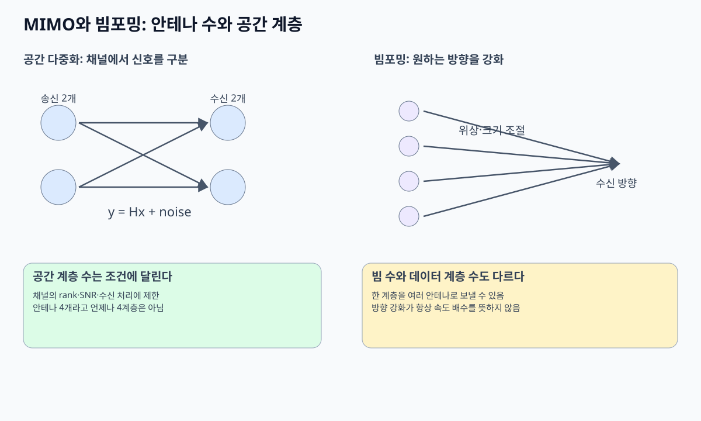
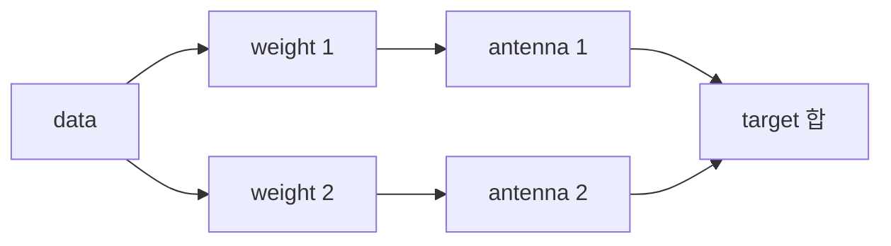

# 07. Antenna·MIMO·beamforming

## antenna element, port, layer를 구분한다

**antenna element**는 RF 전류와 공간 field를 결합하는 물리 구조 하나다. **antenna port**는 receiver가 같은 channel 특성으로 추정하는 논리 신호 기준이며 물리 element와 1:1일 필요가 없다. **layer**는 독립적으로 전달하려는 데이터 stream이다.

element 네 개로 layer 하나를 서로 다른 위상·진폭으로 보내면 beamforming이다. 두 layer를 보내려면 receiver가 channel에서 두 독립 성분을 구별할 수 있어야 한다. element 수가 곧 layer 수는 아니다.

## channel matrix와 rank

2개 송신 antenna, 2개 수신 antenna면 `y=Hx+n`으로 쓸 수 있다. x는 두 송신 신호, y는 두 수신 관측, H의 각 원소는 특정 송신→수신 경로의 복소 gain이다.

`H=[[1,0],[0,1]]`이면 y1=x1, y2=x2라 두 layer를 쉽게 분리한다. `H=[[1,1],[1,1]]`이면 두 수신 antenna가 같은 합 `x1+x2`만 보므로 두 원래 값을 유일하게 찾기 어렵고 rank가 1이다.

| H 모형 | rank | 가능한 독립 layer 의미 |
|---|---:|---|
| `[[1,0],[0,1]]` | 2 | 두 stream 분리 가능 |
| `[[1,1],[1,1]]` | 1 | 한 독립 방향 |
| 한 열이 다른 열의 0.9배 | 거의 종속 | noise에서 분리 불안정 |

rank는 matrix의 독립 열·행 수다. antenna 수가 많아도 경로가 강하게 correlated하면 rank가 낮다.

## precoding과 beamforming

**precoding**은 layer vector에 weight matrix W를 곱해 antenna별 송신 신호를 만든다. 목적은 원하는 방향에서 더해지고 다른 방향 간섭을 줄이거나, receiver가 layer를 분리하기 좋게 만드는 것이다.

네 element가 한 layer를 보낼 때 목표 방향의 경로 위상을 `[0°,90°,180°,270°]`로 관측했다면 송신 weight에 반대 위상 `[0°,-90°,-180°,-270°]`를 넣어 목표에서 같은 위상으로 도착하게 할 수 있다. 각 element power를 1/4로 나눠 전체 power를 유지한다는 조건도 필요하다.

weight를 바꿔도 antenna pattern, quantized phase shifter, calibration, PA 제한 때문에 이상 합과 다를 수 있다. beam은 레이저처럼 경계가 딱 잘린 선이 아니라 main lobe와 side lobe가 있는 방향 패턴이다.

## CSI의 생성과 수명

**CSI(Channel State Information)** 는 주파수·antenna 쌍의 complex channel 추정이다. receiver가 pilot를 측정하고 추정하며, TDD reciprocity calibration이나 feedback으로 transmitter가 사용한다. CSI에는 측정 시간, 주파수, beam, UE 위치 조건이 붙는다.

UE가 15 m/s로 움직이고 channel coherence time이 5 ms인 환경에서 CSI가 20 ms 늦게 도착하면 이미 네 coherence interval이 지나 낡았을 수 있다. 오래된 CSI precoder는 원하는 UE에서 상쇄되고 다른 UE에 간섭을 줄 수 있다.

| 시각 | 주체 | 상태 |
|---:|---|---|
| 0 ms | UE | pilot 측정 |
| 2 ms | UE | CSI quantize·feedback |
| 6 ms | gNB | CSI 수신 |
| 10 ms | scheduler | precoder 선택 |
| 20 ms | gNB | 실제 전송, channel 변화 가능 |

## MIMO 세 목적의 조건

spatial diversity는 같은 정보를 여러 경로로 보내 신뢰성을 높인다. spatial multiplexing은 독립 layer로 rate를 높인다. beamforming은 특정 방향에 에너지를 집중하거나 간섭을 제어한다. 같은 antenna array가 상황에 따라 세 목적 중 하나나 조합으로 쓰인다.

SNR이 낮고 rank 1이면 두 layer multiplexing보다 한 layer beamforming이 낫다. 높은 SNR과 rank 2 channel이면 두 layer가 throughput을 높일 수 있다. “4×4 MIMO=항상 4배”가 아닌 이유다.

## 두 수치 추적

첫째 H가 identity이고 x=[1,-1]이면 y=[1,-1]이다. receiver가 그대로 두 layer를 얻는다. H가 all-ones면 y=[0,0]이 되어 이 x 조합은 완전히 상쇄된다.

둘째 총 송신 power 100 mW를 layer 하나의 네 antenna에 균등 분배하면 element당 25 mW다. 네 신호가 목표에서 coherent하게 더해지는 이상 조건의 field 합과 다른 방향 결과는 단순 전력 100 mW 분산과 같지 않으며 antenna gain·array factor로 계산해야 한다.

## AI beam 연구 조건

AI가 beam을 선택해도 입력 CSI·위치·과거 beam의 수명과 codebook을 명시해야 한다. 다른 band channel 예측은 파장과 산란 차이 때문에 단순 복사가 아니다. [physics-guided cross-band 연구](https://arxiv.org/abs/2605.31279)는 해당 simulation과 평가 조건의 연구이며 표준 beam 성능 보장이 아니다.

## 핵심 계산 복습: antenna

안테나는 전송선 전기 신호와 공간 전자기파를 연결한다.
gain은 특정 방향으로 energy를 집중한 정도다.
energy를 새로 만들지 않는다.
pattern은 방향별 gain, polarization은 전기장 방향 규칙이다.



## array와 beamforming

여러 element에 phase/amplitude weight를 주면 목표 방향에서 더해진다.



목표 방향에서 두 번째 경로가 quarter cycle 늦다면 송신에서 quarter cycle 먼저 줄 수 있다.
도착 때 phase가 맞아 더해진다.
다른 방향에서는 path 차이가 달라 상쇄될 수 있다.

## MIMO 세 목적

| 목적 | 보내는 것 | 결과 |
|---|---|---|
| diversity | 같은 정보의 여러 관측 | reliability |
| spatial multiplexing | 독립 layer | throughput |
| beamforming | layer에 antenna weight | 방향 gain |

같은 용어가 아니다.

## antenna와 layer

4Tx라고 layer 4가 보장되지 않는다.
Rx 수, channel rank, SNR, 구현이 제한한다.

```text
Tx=4, Rx=2, rank=2 → 최대 layer 모형 2
Tx=8, Rx=2, rank=1 → 최대 layer 모형 1
```

남는 antenna는 beamforming/diversity에 쓸 수 있다.

## 2×2 추적

`x1=1`, `x2=-1`.

```text
h11=1, h12=0.1
h21=0.1, h22=1
y1=1*1+0.1*(-1)=0.9
y2=0.1*1+1*(-1)=-0.9
```

receiver는 channel matrix로 layer를 분리한다.
두 column이 같아지면 두 layer가 같은 공간 signature로 보여 분리가 어렵다.

## CSI

pilot로 channel을 추정한다.
receiver feedback 또는 reciprocity로 transmitter에 CSI를 줄 수 있다.
측정과 전송 사이 channel이 바뀌면 CSI가 stale해진다.
reciprocity도 RF chain calibration 조건이 있다.

## 상태

| 주체 | 입력 | 상태 | 출력 |
|---|---|---|---|
| estimator | pilot | matrix H | CSI |
| rank selector | CSI/SNR | 후보 | layer 수 |
| precoder | layers+CSI | weights | antenna signal |
| channel | antenna signal | multipath | 혼합 |
| detector | 혼합+CSI | inverse/분리 | symbols |

## power split

총 1W를 두 layer에 균등 분할하면 layer당 0.5W다.
layer를 늘리면 각 layer SNR이 줄 수 있다.
rank만 높다고 layer를 최대 사용해야 하는 것은 아니다.

## beam search

방향성 link는 beam pair를 탐색한다.
측정하고 선택하고 이동·차폐에 따라 추적한다.
탐색 overhead와 data 시간의 trade-off가 있다.

## 반례

antenna 두 배가 throughput 두 배를 보장하지 않는다.
beam gain이 높아도 방향이 틀리면 약하다.
diversity는 새 payload layer가 아니다.
제품 MIMO 숫자가 순간 layer 수를 뜻하지 않는다.

## 두 신호가 섞여도 다시 찾을 수 있는 숫자 예제

**행렬(matrix)**은 숫자를 행과 열로 배열해 여러 관계를 함께 적는 표현이다. 여기서는 송신 안테나 두 개에서 보낸 값이 수신 안테나 두 개에 얼마나 섞이는지 기록한다. 실제 신호의 복소수 계수·잡음·시간 변화는 잠시 생략하고 실수만 사용하는 교육 모형이다.

송신 값이 `x1=1`, `x2=-1`이고 채널이 아래와 같다고 하자. 첫 수신 안테나는 두 값을 더해 받고, 둘째는 첫 값을 더하고 둘째 값을 빼서 받는다.

```text
채널 H = [[1,  1],
          [1, -1]]

y1 = 1×x1 + 1×x2 = 0
y2 = 1×x1 - 1×x2 = 2
```

수신기는 `y1=0`, `y2=2`를 알고 있다. 채널 H도 정확히 알고 있다면 두 식을 더하고 빼서 원래 값을 복원한다.

```text
x1 = (y1+y2)/2 = (0+2)/2 = 1
x2 = (y1-y2)/2 = (0-2)/2 = -1
```

왜 가능한가? 두 수신 값이 서로 다른 정보를 주기 때문이다. 첫 식은 합이고 둘째 식은 차이다. 합 하나만 알면 `1+(-1)`, `2+(-2)`, `0+0`을 구별할 수 없지만 합과 차이를 함께 알면 이 모형의 두 미지수를 결정할 수 있다.

이번에는 채널을 바꾼다.

```text
H = [[1, 1],
     [1, 1]]
y1 = x1+x2
y2 = x1+x2
```

수신 안테나는 여전히 두 개지만 두 값이 같은 정보만 준다. 독립된 정보를 주는 관계의 수를 이 문맥에서 채널의 **rank**로 이해한다. 첫 H는 rank 2, 둘째 H는 rank 1이다. 안테나 두 개를 설치했다는 사실만으로 독립된 데이터 계층 두 개를 복원할 수 없는 이유다.

실제 수신기는 기준 신호로 채널을 추정하고, 잡음이 섞인 값에서 원래 심벌을 추정한다. **추정**은 정답을 직접 보는 일이 아니라 관측과 채널 모형으로 가장 그럴듯한 값을 고르는 일이다. 채널의 두 관계가 거의 같아지면 작은 잡음도 복원 과정에서 크게 증폭될 수 있다. 수학적으로 역행렬이 존재한다는 것만으로 높은 전송률이 보장되지 않는다.

## 네 안테나로 한 계층을 보내는 빔 예제

**가중치(weight)**는 각 안테나가 같은 심벌을 어느 크기·위상으로 보낼지 정하는 계수다. 안테나 네 개가 있다고 새 데이터 네 개를 반드시 보내는 것은 아니다. 하나의 심벌을 네 안테나에 나눠 보낼 수도 있다.

전체 송신 전력의 기준을 맞추려고 가중치를 `[0.5,0.5,0.5,0.5]`로 놓는다. 제곱의 합은 `4×0.5²=1`이다. 네 안테나의 경로가 원하는 방향에서 같은 위상과 크기로 더해지는 모형이면 수신 진폭은 `4×0.5=2`다. 한 안테나 진폭 1과 비교하면 수신 전력은 진폭 제곱의 비율인 4배가 될 수 있다.

다른 방향에서 경로의 부호가 `[1,-1,1,-1]`이라면 `0.5-0.5+0.5-0.5=0`으로 상쇄된다. 이것은 에너지가 새로 생겼다는 뜻이 아니라 방향별로 신호가 더해지거나 상쇄되는 모형이다. 실제 빔은 안테나 간격·주파수·소자 특성·추정 오차에 따라 달라진다.

이 예제는 **안테나 네 개, 데이터 한 계층, 방향을 조절한 빔**이다. 공간 다중화로 독립 심벌 여러 개를 보내는 예제와 목적을 나눠 읽는다.

## Element, antenna port와 layer의 실제 위치

**Antenna element(안테나 소자)**는 전류가 흘러 전자기파를 방사하거나 수신하는 물리 도체 구조다. Array는 여러 element를 일정 간격으로 배치한다. Element 간격은 wavelength와 비교하며, carrier 3 GHz의 wavelength는 `c/f≈0.1 m`이므로 반 wavelength는 약 5 cm다.

**Antenna port(안테나 포트)**는 receiver가 하나의 기준 신호로 channel을 정의할 수 있는 논리 송신 단위다. 하나의 port가 여러 물리 element의 합성 빔으로 구현될 수 있고, 물리 connector 하나와 같은 뜻이 아니다. Port mapping은 baseband와 RF 구성 동안 유지되고 설정이 바뀌면 의미도 바뀐다.

**Layer(계층)**는 동시에 보내려는 독립 data stream이다. Precoder가 layer symbol을 port·element 신호로 바꾼다. Element 8개라고 layer 8개가 자동으로 생기지 않는다. 수신 antenna 수, channel rank, SNR, codebook과 receiver가 layer 수를 제한한다.

## Channel matrix와 두 신호 복원 전체 계산

송신 두 신호를 `x1,x2`, 수신 두 관측을 `y1,y2`라 하면 `y=Hx+n`이다. **Matrix(행렬)**는 각 송신 입력이 각 수신 출력에 얼마만큼 섞이는지 계수를 표로 적은 것이다. 계수는 크기와 위상을 함께 가진 복소수일 수 있다.

Noise가 없고

```text
H = [[1, 0.5],
     [0.5, 1]]
x = [2, 4]
```

이면

```text
y1 = 1×2 + 0.5×4 = 4
y2 = 0.5×2 + 1×4 = 5
```

두 식을 풀면 `x1=2,x2=4`를 복원한다. 첫 식의 두 배에서 둘째를 빼 `1.5x1=3`, 따라서 x1=2이고 x2=4다. 두 column이 서로 다른 혼합 패턴이라 구분할 수 있다.

반대로 `H=[[1,1],[0.5,0.5]]`이면 두 column이 같고 `y`는 x1+x2의 합에만 의존한다. `[2,4]`와 `[3,3]`이 같은 관측을 만들 수 있어 개별 stream을 분리할 수 없다. **Rank(랭크)**는 독립적인 column·공간 방향 수이며 이 행렬은 rank 1이다.

Column이 완전히 같지 않아 역행렬이 존재해도 거의 평행하면 작은 noise가 크게 증폭될 수 있다. Rank만 아니라 singular value·condition과 SINR을 함께 보는 이유다.

## Beam, precoder와 power normalization

**Beam(빔)**은 element별 전파가 특정 방향에서 더해지고 다른 방향에서 상쇄되는 공간 pattern이다. **Precoder(프리코더)**는 layer symbol vector를 antenna port 신호로 바꾸는 복소 weight matrix다. Beamforming은 한 layer를 여러 element에 보낼 수도 있고, spatial multiplexing은 여러 layer를 서로 다른 공간 방향으로 보낼 수 있다.

네 element로 symbol `s=1` 하나를 보내고 weight를 `[0.5,0.5,0.5,0.5]`로 두면 weight power 합은 `4×0.25=1`이라 총 기준 power를 유지한다. 원하는 방향 channel이 `[1,1,1,1]`이면 수신 진폭은 2, power는 4다. 반대 부호 경로 `[1,-1,1,-1]`에서는 합이 0이다. 에너지가 생성된 것이 아니라 방향별 합이 달라진 것이다.

두 layer의 precoder를 다음처럼 둘 수 있다.

```text
w1 = [1, 1]/sqrt(2)
w2 = [1,-1]/sqrt(2)
```

두 vector의 내적은 0이다. 그러나 공중 channel이 이 두 방향을 다르게 보존하지 않으면 receiver에서 orthogonal하지 않을 수 있다. Digital weight만 직교한다고 end-to-end layer가 분리되는 것은 아니다.

## Wavelength, spacing과 grating lobe 조건

**Wavelength(파장)**은 파동이 같은 위상으로 한 주기를 진행한 거리이며 `λ=c/f`다. 3 GHz에서는 약 10 cm, 30 GHz에서는 약 1 cm다. 같은 물리 간격 5 cm는 3 GHz에서 반 파장, 30 GHz에서는 다섯 파장이라 array pattern이 전혀 다르다.

Element spacing이 너무 크면 서로 다른 방향이 같은 element별 위상차를 만들어 의도하지 않은 강한 **grating lobe**가 나타날 수 있다. 반 파장 이하는 모든 설계의 만능 정답은 아니지만 넓은 scan 범위에서 모호한 lobe를 피하는 흔한 기준이다. 실제 array는 element coupling, enclosure, calibration과 bandwidth 영향을 받는다.

Wideband 신호에서는 한 phase-shifter weight가 모든 subcarrier에서 정확히 같은 방향을 가리키지 않는 beam squint가 생길 수 있다. Narrowband simulation beam을 큰 bandwidth에 그대로 일반화하지 않고 subcarrier별 gain과 edge 성능을 본다.


## CSI가 생성되고 낡는 전체 수명

**CSI(Channel State Information)**는 시간·주파수·antenna pair별 channel을 나타내는 추정 상태다. 송신기가 정답을 직접 아는 것이 아니다.

1. 송신기가 알려진 pilot 또는 reference signal을 보낸다.
2. 수신기가 관측에서 복소 channel과 noise를 추정한다.
3. TDD reciprocity를 쓰는 장비는 calibration 조건 아래 uplink 추정으로 downlink를 추론할 수 있다.
4. FDD나 codebook 방식에서는 수신기가 channel quality, rank, precoder index 같은 양자화 정보를 feedback한다.
5. Scheduler와 precoder는 timestamp가 붙은 CSI를 사용한다.
6. 이동·차폐·간섭이 바뀌면 CSI가 stale해지고 새 측정으로 교체한다.

측정 t=0, feedback 1 ms, scheduler 대기 0.5 ms, 전송 시작 2 ms라면 CSI age는 2 ms다. Channel coherence 규모가 1 ms인 고속 환경이면 선택한 beam이 이미 맞지 않을 수 있다. Feedback bit를 늘리면 표현은 세밀해지지만 uplink overhead와 지연이 늘어난다.

## Diversity, multiplexing와 array gain

- **Diversity**는 같은 정보를 여러 독립 경로로 보내 deep fade 실패 확률을 줄인다.
- **Spatial multiplexing**은 독립 layer를 동시에 보내 peak rate를 높인다.
- **Array gain**은 여러 element의 power를 원하는 방향에 coherently 모아 SNR을 높인다.

2Tx×2Rx라고 세 효과를 동시에 최대화할 수 있는 것은 아니다. 두 layer에 power를 나누면 layer당 SNR이 낮아질 수 있고, channel rank가 1이면 multiplexing 이득이 없다. Scheduler는 목표 BLER, queue와 CSI 조건에서 layer·MCS·beam을 함께 고른다.

## AI beam 연구의 증거 단계

AI beam predictor가 위치·과거 CSI로 다음 beam을 고를 수 있다. Simulation에서는 ideal array와 정한 blockage trace, inference time 0을 쓰기 쉽다. Testbed는 제한된 RF chain·room·codebook을 포함하고, field는 실제 이동·날씨·간섭과 handover를 포함한다.

연구 계획은 top-1 beam accuracy만 보고하지 않는다. Beam sweep overhead, 선택까지 걸린 시간, stale rate, outage, fallback sweep, 다른 장소·시간·단말에서의 일반화를 기록한다. 100 µs slot 결정에 inference가 150 µs 걸리면 accuracy가 높아도 사용 불가능하다. AI-RAN의 shared compute에서는 다른 AI workload 간섭으로 deadline이 흔들리는지도 측정한다.

## 종합 문제와 완전 해설

### 문제 1. Matrix shape

4개 송신 port와 2개 수신 antenna의 channel matrix 크기는?

**해설.** `2×4`다. Row는 수신 관측, column은 송신 입력에 대응한다.

### 문제 2. Rank와 layer

4Tx·2Rx지만 channel rank가 1이면 독립 layer 상한은?

**해설.** 이 channel realization에서는 1 layer다. 물리 antenna 수만으로 layer 수를 정하지 않는다.

### 문제 3. 두 식 복원

`y1=x1+0.5x2=4`, `y2=0.5x1+x2=5`이면 x는?

**해설.** 첫 식 두 배에서 둘째를 빼 `1.5x1=3`, x1=2, x2=4다.

### 문제 4. Rank 1 반례

`H=[[1,1],[0.5,0.5]]`에서 `[2,4]`와 `[3,3]`을 구분할 수 있는가?

**해설.** 없다. 두 vector 모두 합 6이라 같은 y `[6,3]`을 만든다.

### 문제 5. Beam power

네 weight가 모두 0.5면 제곱합과 같은 위상 방향의 수신 진폭은?

**해설.** 제곱합은 1, channel gain이 모두 1이면 진폭 합은 2다. Power는 기준 한 element 진폭 1보다 4배다.

### 문제 6. CSI age

측정 t=0, 전송 t=2 ms이고 coherence 규모가 1 ms면 무슨 위험이 있는가?

**해설.** Channel이 이미 크게 바뀌어 beam·precoder와 detector가 부정확할 수 있다. CSI age별 outage를 측정하고 새 측정이나 robust fallback을 둔다.

### 문제 7. Diversity와 multiplexing

같은 bit를 두 경로로 보내는 것과 다른 bit stream 두 개를 보내는 목적은?

**해설.** 전자는 실패 확률을 줄이는 diversity, 후자는 rate를 높이는 multiplexing이다. Channel rank와 SNR에 따라 선택한다.

### 문제 8. AI beam 결과

Simulation top-1 정확도 95%, inference 150 µs인데 결정 deadline 100 µs다. 배포 가능한가?

**해설.** 그 시간 조건에서는 늦다. Deadline miss 시 fallback을 포함한 goodput·outage를 testbed와 field에서 재평가해야 한다.

## 공식 출처

- [MIT 6.450 wireless notes](https://ocw.mit.edu/courses/6-450-principles-of-digital-communication-i-fall-2009/pages/lecture-notes/)
- [3GPP specifications](https://www.3gpp.org/specifications-technologies)
- [AI-RAN: Transforming RAN with AI-driven Computing Infrastructure](https://arxiv.org/abs/2501.09007)

[← 이전](06-ofdm-time-frequency-and-resources.md) · [다음 →](08-wifi-and-medium-access.md)
