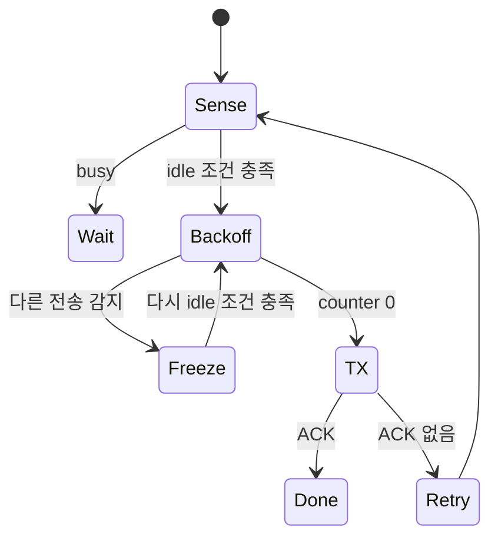

# 08. Wi‑Fi와 medium access

[← 이전](07-antennas-mimo-and-beamforming.md) · [다음 →](09-cellular-generations-and-architecture.md)


이 장은 한 Wi-Fi frame이 station queue에 들어온 순간부터 channel 경쟁, 수신 ACK, 재시도와 goodput 계산까지 한 흐름으로 추적한다. 수치는 원리를 위한 교육 조건이며 특정 장비의 timing 측정값이 아니다.

## 1. STA, AP, PHY와 MAC

**Station(STA, 스테이션)**은 IEEE 802.11 무선 LAN(Local Area Network, 근거리 통신망)에 참여하는 장치다. 노트북과 전화뿐 아니라 AP도 station 기능을 가진다. **Access Point(AP, 무선 접속점)**는 infrastructure network에서 STA를 연결하고 유선 distribution system으로 중계하는 역할을 한다.

**PHY(Physical Layer, 물리 계층)**는 bit와 symbol을 RF(Radio Frequency, 무선 주파수) 파형으로 보내고 수신 파형에서 정보를 복호한다. **MAC(Medium Access Control, 매체 접근 제어)**은 frame 주소와 sequence, queue, channel 접근, 수신 확인과 재전송을 관리한다. RF 파형을 송신했다는 사실은 상대 MAC의 frame 수신 성공을 뜻하지 않으며, MAC ACK는 애플리케이션 저장 완료를 뜻하지 않는다.

Application packet은 OS network stack과 Wi-Fi driver를 지나 MAC frame이 되어 송신 station의 queue에 저장된다. Frame에는 송수신 주소, sequence, 제어 정보와 오류 검사용 **FCS(Frame Check Sequence, 프레임 검사값)**가 붙는다. 수신 측이 받은 바이트로 다시 계산한 값과 FCS를 비교해 손상을 발견한다. Queue record는 성공 ACK, retry limit 초과, lifetime 만료 또는 연결 종료까지 산다.

**Airtime(공중 점유 시간)**은 preamble부터 frame·간격·ACK·재전송까지 channel을 사용하는 시간이다. Byte가 작은 관리 frame도 고정 preamble과 contention 비용을 낸다. PHY rate 숫자만으로 application goodput을 계산할 수 없는 이유다.

## 2. CSMA/CA와 두 STA의 backoff

**CSMA/CA(Carrier Sense Multiple Access with Collision Avoidance, 반송파 감지 다중 접속과 충돌 회피)**는 여러 STA가 같은 channel을 공유할 때 송신 전에 channel이 비었는지 듣고 충돌 가능성을 줄이는 Wi-Fi medium access 절차다. 유선 Ethernet처럼 송신 중 충돌을 확실히 검출하기 어려워 collision avoidance를 쓴다. **Carrier sense**는 receiver가 energy와 알려진 Wi-Fi 신호를 감지해 busy/idle을 정한다.

동작은 다음 상태 흐름으로 읽을 수 있다.



기본 시간표에서는 A와 B가 같은 AP에 frame을 갖고 있고 contention window에서 **A=2, B=4 slot**을 뽑았다고 하자. 뒤의 통합 문제에서는 B만 5로 바꾸어 결과를 다시 계산한다. 둘을 같은 시간표의 서로 다른 값으로 읽지 않는다. 둘 다 정해진 idle 간격 뒤 매 idle slot마다 counter를 1 줄인다.

| slot | channel 시작 | A counter | B counter | 사건 |
|---:|---|---:|---:|---|
| 0 | idle | 2→1 | 4→3 | 둘 다 대기 |
| 1 | idle | 1→0 | 3→2 | A 전송 자격 |
| 2..5 | busy | 0, 송신 | 2, freeze | A frame |
| 6 | ACK·간격 | 완료 | 2, freeze | B는 세지 않음 |
| 7 | idle | - | 2→1 | B 재개 |
| 8 | idle | - | 1→0 | B 전송 |
| 이후 | ACK | - | 완료 | queue 해제 |

**Backoff(무작위 후퇴)**는 충돌 뒤뿐 아니라 경쟁 시작에서 무작위 slot 수를 기다리는 상태다. Busy 중에는 counter를 새로 뽑지 않고 freeze했다가 적절한 idle 뒤 계속 센다. A와 B가 같은 숫자를 골라 함께 송신하면 AP에서 collision이 날 수 있다. ACK가 없으면 retry count와 contention window를 갱신해 재경쟁한다.

실제 표준은 frame 종류, access category와 PHY에 따라 간격·window·TXOP 규칙이 다르다. 위 표는 원리 모형이며 설치 장치의 정확한 microsecond 값을 만들지 않는다.

## 3. ACK와 retry의 성공 경계

송신 함수가 frame bytes를 driver에 넘겼다고 성공이 아니다. Receiver는 preamble로 동기를 잡고 header와 payload를 복호한 뒤 FCS가 맞을 때 **ACK(Acknowledgment, 수신 확인 응답)**를 보낸다. Sender는 정해진 ACK 대기 timer 안에 응답을 받아야 성공으로 확정한다.

```text
queue → carrier sense → random backoff → DATA 전송
      → ACK 대기 → ACK 수신: buffer 해제
                 → timeout: retry count 증가, 재경쟁 또는 drop
```

ACK 자체가 다른 모든 station까지 data를 받았음을 뜻하지 않는다. 해당 unicast 교환의 receiver가 frame을 올바르게 받았다는 link-layer 확인이다. Broadcast·multicast와 block ACK에는 다른 계약이 있을 수 있다. 실측에서는 retry counter가 증가한 시각과 application 재전송을 구분한다.


## 4. Hidden node와 RTS/CTS

Station A와 C가 서로 멀거나 가려져 상대 신호를 감지하지 못하지만 둘 다 가운데 AP B에 닿는다고 하자.

```mermaid
flowchart LR
    A["STA A"] --> B["AP B"]
    C["STA C"] --> B
    A -. "서로 감지하지 못함" .- C
``` A는 channel idle, C도 idle이라고 판단해 동시에 B로 보내 충돌한다. 이것이 **hidden node(숨은 노드)** 문제다. Carrier sense는 자신이 들을 수 있는 범위만 알기 때문에 생긴다.

**RTS(Request To Send)**와 **CTS(Clear To Send)**는 긴 data 전에 짧은 예약 frame을 교환하는 선택 절차다.

```text
A → B: RTS, 필요한 duration
B → 주변: CTS, duration
C: A의 RTS를 못 들어도 B의 CTS를 들으면 NAV 설정 후 대기
A → B: DATA
B → A: ACK
```

**NAV(Network Allocation Vector)**는 수신한 duration으로 medium이 예약됐다고 보는 가상 carrier-sense timer다. RTS/CTS도 airtime을 쓰며 CTS가 C에 들리지 않거나 매우 짧은 frame이면 이득보다 overhead가 클 수 있다. Hidden node를 항상 완전히 제거하는 마법이 아니다.

## 5. OFDM, OFDMA와 MU-MIMO

**OFDM(Orthogonal Frequency Division Multiplexing, 직교 주파수 분할 다중화)**은 한 전송 파형을 여러 직교 subcarrier로 구성한다. 한 사용자에게 전체 channel을 줄 수도 있다. **OFDMA(Orthogonal Frequency Division Multiple Access, 직교 주파수 분할 다중 접속)**는 subcarrier 묶음인 **RU(Resource Unit, 자원 단위)**를 같은 시간에 여러 사용자에게 할당하는 medium access 방법이다. AP scheduler가 어느 STA에 어느 RU와 **MCS(Modulation and Coding Scheme, 변조·부호화 조합)**를 줄지 정하고, uplink에서는 trigger frame으로 동시 송신 시각과 자원을 알릴 수 있다.

20 MHz 교육 격자에서 data 가능한 tone 묶음을 A 106-tone, B 52-tone, C 26-tone으로 줬다고 하자. 각자 다른 modulation·code rate를 쓸 수 있다. 동시 종료를 맞추면 작은 packet 여러 개가 차례로 전체 channel을 경쟁하는 고정 비용을 줄일 수 있다. 그러나 trigger, pilot, padding과 scheduler overhead가 있고 모든 client가 같은 기능을 지원해야 한다.

다른 교육 가정으로 20 MHz의 data 자원 가운데 STA A에 40%, B에 30%, pilot·control·guard에 30%를 쓴다고 하자. 전체 raw PHY가 100 Mbit/s 상당이어도 A의 비율 후보는 40 Mbit/s, B는 30 Mbit/s이며 각 STA의 MCS와 재전송 때문에 실제 goodput은 더 낮아진다.

**MU-MIMO(Multi-User Multiple-Input Multiple-Output, 다중 사용자 다중 안테나)**는 같은 time·frequency 자원에서 서로 구분 가능한 공간 channel을 이용해 여러 사용자 layer를 보낸다. OFDMA는 주파수 분할, MU-MIMO는 공간 분리를 중심으로 한다. 함께 쓸 수 있지만 동일 개념은 아니다. **CSI(Channel State Information, 채널 상태 정보)**가 낡거나 사용자 channel이 비슷하면 spatial separation이 실패할 수 있다.

## 6. Airtime과 goodput 계산

서로 다른 airtime 숫자는 포함 항목부터 비교해야 한다. 먼저 header를 별도 항목으로 떼지 않는 단순 예에서는 payload 12,000 bit, PHY payload rate 120 Mbit/s, data 100 µs, preamble 40 µs, contention 80 µs, ACK 관련 30 µs로 둔다.

| 250 µs 단순 예의 요소 | 시간 |
|---|---:|
| contention | 80 µs |
| preamble | 40 µs |
| data | 100 µs |
| ACK 관련 | 30 µs |
| **합계** | **250 µs** |

이 가정의 goodput 후보는 `12,000 bit / 250 µs = 48 Mbit/s`다. 같은 250 µs 교환을 한 번 재전송하면 500 µs에 12,000 bit이므로 24 Mbit/s다.

다음 280 µs 예는 ACK를 40 µs로 두고 MAC·PHY header 전송 20 µs를 별도로 더하는 **다른 가정**이다. 250 µs 표에 header 20 µs만 더해 얻은 값이 아니다. Payload 12,000 bit를 PHY 120 Mbit/s로 보내는 순수 payload 시간은 100 µs다. Preamble 40 µs, contention·간격 80 µs, MAC·PHY header 전송 20 µs, ACK 40 µs라면 성공 1회의 총 airtime은 280 µs다.

```text
application goodput = 12,000 bit / 280 µs
                    ≈ 42.86 Mbit/s
```

첫 시도가 충돌해 180 µs를 쓰고 두 번째 280 µs에 성공하면 같은 payload의 총 airtime은 460 µs, goodput은 약 26.09 Mbit/s다. PHY 120 Mbit/s는 payload 전송 구간의 modulation·coding rate이고 contention·실패를 포함하지 않는다.

여러 station의 fairness도 byte가 아니라 airtime으로 볼 필요가 있다. 느린 legacy station이 긴 airtime을 쓰면 빠른 station의 전송 기회도 줄 수 있다. Packet aggregation은 여러 payload를 한 전송에 묶어 preamble·ACK 고정 비용을 나누지만 한 번 실패할 때 영향과 지연이 커질 수 있다.

## 7. Load, collision, queue와 fairness

도착률이 service 능력에 가까워지면 station queue가 길어지고 동시에 경쟁할 station 수도 늘어 collision과 backoff가 증가할 수 있다. 재전송이 airtime을 더 먹어 service가 더 느려지는 양의 feedback이 생긴다. 평균 PHY rate가 그대로여도 application latency p99가 급격히 나빠질 수 있다.

AP queue, station queue, driver queue와 application socket buffer는 서로 다른 위치다. **Fairness(공정성)**는 각 STA가 받은 byte만이 아니라 airtime, 지연, starvation 여부를 함께 봐야 한다. 한 queue 길이만 보고 전체 대기를 설명하지 않는다. Packet timestamp를 enqueue, first contention, transmit, ACK와 delivery에서 연결한다.

## 8. Wi-Fi 세대 이름과 band 조건

Wi-Fi 세대 이름은 지원 가능한 기능 묶음을 가리키며 실제 단말·AP·국가 규제·channel 폭·동시 사용자에 따라 결과가 달라진다. 2.4 GHz, 5 GHz, 6 GHz는 spectrum band이고 Wi-Fi 6, 7, 8은 세대 이름이므로 숫자가 비슷해도 같은 축이 아니다.

| 이름 | IEEE 기반 | 상태·뜻 |
|---|---|---|
| Wi-Fi 6 | 802.11ax-2021 | 2.4/5 GHz 중심의 ax 기능군과 인증 |
| Wi-Fi 6E | 802.11ax | Wi-Fi 6의 6 GHz 확장; 별도 PHY 규격이 아님 |
| Wi-Fi 7 | 802.11be-2024 | be 기반 기능과 Alliance 인증 program |
| Wi-Fi 8 | P802.11bn | 2026-10-11 현재 IEEE project·draft 단계 |

6E의 E는 별도 PHY를 뜻하지 않는다. AP가 6E여도 client와 지역 규제가 6 GHz를 지원해야 한다. IEEE 표준 publication, Wi-Fi Alliance 인증 program, 제품 출시는 서로 다른 시점이며, draft 기능을 완성 표준의 보장처럼 쓰지 않는다.

## 9. AI medium access 연구의 경계

AI가 contention window, RU, user grouping이나 MCS를 고를 수 있다. Simulation에서는 perfect queue·CSI, 고정 traffic와 즉시 inference를 가정하기 쉽다. Testbed는 실제 chipset·driver와 제한된 방·client 조합을 포함한다. Field는 이웃 BSS, hidden node, legacy client, radar·규제, 이동과 시간대 변화를 포함한다.

연구 결과는 aggregate throughput만 보고하지 않는다. Per-station airtime, p50/p99 latency, packet drop, collision/retry, energy, inference deadline과 fallback을 본다. 학습 traffic과 평가 traffic을 분리하고 FIFO·표준 scheduler 같은 기준선을 같은 장치·load에서 비교한다. 정책 inference가 scheduling deadline보다 늦거나 관측에 없던 client에서 starvation을 만들면 평균 개선만으로 배포하지 않는다.

IEEE 802.11-2024는 WLAN MAC과 PHY 규격의 현재 revision이며, Wi-Fi Alliance 세대 인증 이름과 IEEE amendment 이름을 섞지 않는다. Draft 기능은 최종 표준·인증 지원처럼 단정하지 않는다.

## 10. 종합 문제와 완전 해설

### 10.1 Backoff freeze

Counter 4에서 idle 두 slot 뒤 busy가 되었다. 남은 값은?

**해설.** 2다. Busy 중 freeze하고 필요한 idle 간격 뒤 2부터 계속 센다. 새 값을 즉시 뽑지 않는다.

### 10.2 조건 변경: A=2, B=5

2절의 기본 시간표에서 B의 시작 counter만 4에서 5로 바꾸면 A가 송신할 때 B의 남은 counter는 얼마이며, 이후 어떻게 동작하는가?

**해설.** 두 idle slot 뒤 A가 0에 도달할 때 B는 3이다. A의 DATA·ACK 동안 3에서 freeze하고, 필요한 idle 간격 뒤 3부터 다시 세어 0에서 송신한다. 이것은 본문 A=2, B=4 시간표와 다른 입력 조건이다.

### 10.3 같은 backoff

두 station이 같은 counter 0에 도달하면 어떻게 되는가?

**해설.** 둘 다 송신해 receiver에서 collision할 수 있다. ACK가 없으면 retry와 더 넓은 contention window 정책으로 재경쟁한다.

### 10.4 Hidden node

A와 C가 서로 못 듣고 AP B는 둘 다 듣는다. Carrier sense만으로 충돌을 막을 수 있는가?

**해설.** 없다. 각 station은 상대를 idle로 본다. B의 CTS를 둘 다 들을 수 있는 조건에서는 RTS/CTS가 예약 정보를 전달할 수 있다.

### 10.5 Airtime goodput

12,000 bit를 성공 전달하는 전체 airtime이 300 µs면 goodput은?

**해설.** `12000/0.0003=40 Mbit/s`다. PHY rate와 다르다.

### 10.6 Retry goodput

성공 airtime 280 µs 전에 실패 180 µs가 있었다. 12,000 bit goodput은?

**해설.** 총 460 µs라 `12000/0.00046≈26.09 Mbit/s`다.

### 10.7 OFDM과 OFDMA

둘의 차이는?

**해설.** OFDM은 subcarrier로 파형을 구성하는 방식, OFDMA는 RU를 여러 사용자에게 배분하는 access 방식이다.

### 10.8 OFDMA와 MU-MIMO

A와 B를 서로 다른 RU에 두는 것과 같은 RU에서 spatial layer로 나누는 것은?

**해설.** 전자는 주파수 자원 분할, 후자는 공간 channel 분리다. 후자는 충분히 다른 CSI와 rank가 필요하다.

### 10.9 AI scheduler

Simulation 평균 throughput 20% 개선인데 한 station p99가 3배가 됐다. 성공인가?

**해설.** Fairness·latency SLO에 따라 실패일 수 있다. Per-station goodput·airtime·starvation과 field deadline을 포함해 판정한다.

## 11. 공식 출처

- [IEEE 802.11 standard page](https://standards.ieee.org/ieee/802.11/10548/)
- [Wi‑Fi Alliance Wi‑Fi 7 announcement, 2024-01-08](https://www.wi-fi.org/news-events/newsroom/wi-fi-alliance-introduces-wi-fi-certified-7)
- [IEEE 802.11 Working Group](https://www.ieee802.org/11/)
- [IEEE 802.11-2024 standard page](https://standards.ieee.org/ieee/802.11/10548/)

[← 이전](07-antennas-mimo-and-beamforming.md) · [다음 →](09-cellular-generations-and-architecture.md)
