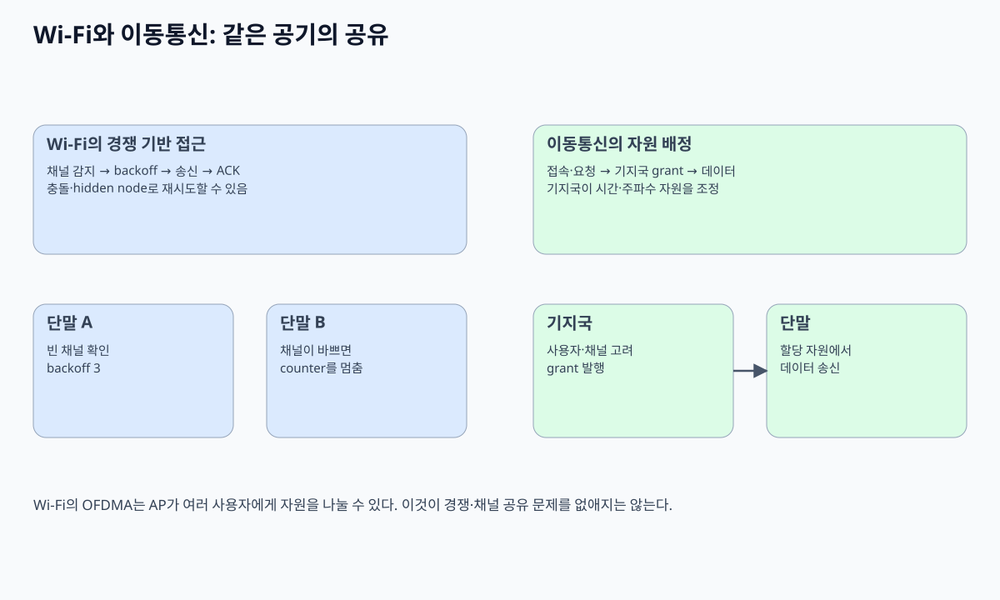
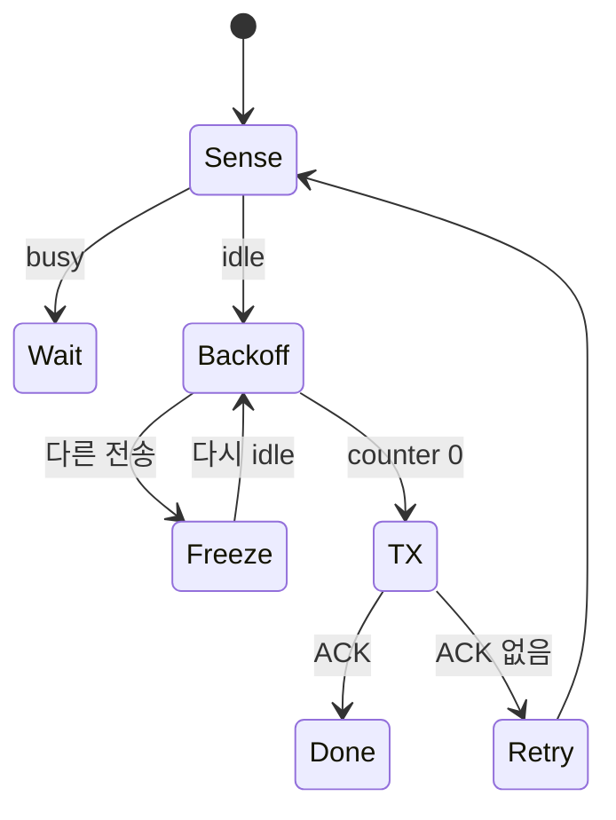
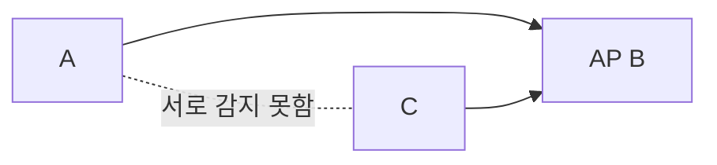

# 08. Wi‑Fi와 medium access

## 공유 공기에서 누가 먼저 말할지 정하는 문제

Wi-Fi UE와 AP는 같은 channel을 공유한다. 유선 switch처럼 동시에 송신하며 충돌을 직접 감지하기 어렵다. 자기 송신 전력이 수신하려는 약한 신호를 덮기 때문이다. 그래서 **CSMA/CA**는 송신 전에 channel을 듣고, 비어 있는 시간을 확인하고, 무작위 backoff를 사용해 충돌 가능성을 줄인다.

PHY는 bit를 RF symbol로 보내고 복호한다. MAC은 frame 주소, sequence, 재전송, medium access를 관리한다. RF 송신 성공은 상대 MAC 수신 성공이 아니며, MAC ACK는 애플리케이션 저장 성공이 아니다.

## 두 station backoff 전체 추적

A와 B가 동시에 frame을 준비하고 contention window 0~7 slot에서 각각 2와 5를 뽑았다고 하자. channel이 정해진 간격 동안 idle이면 둘 다 counter를 줄인다. A가 0이 되면 송신하고 B는 counter 3에서 멈춘다. ACK 뒤 channel이 다시 idle 조건을 만족하면 B가 3부터 재개한다.

| slot | channel | A counter | B counter | 사건 |
|---:|---|---:|---:|---|
| 0 | idle | 2 | 5 | 시작 |
| 1 | idle | 1 | 4 | 감소 |
| 2 | idle | 0 | 3 | A 송신 |
| 3~5 | busy | - | 3 | B freeze |
| 6 | ACK·idle 대기 | - | 3 | 재개 준비 |
| 9 | idle | - | 0 | B 송신 |

둘이 같은 숫자 2를 뽑으면 동시에 송신해 receiver에서 충돌할 수 있다. ACK가 없으면 contention window를 키우고 다시 시도한다. 충돌이 없어도 channel error나 ACK 유실로 재전송할 수 있다.

## hidden node 문제

A와 C는 서로 신호를 못 듣지만 둘 다 AP B에는 닿을 수 있다. A가 듣기에 channel이 비어 있고 C도 같아서 동시에 B에 보내면 B에서 충돌한다. carrier sense만으로 해결되지 않는 반례다.

RTS/CTS는 송신 예정과 수신 허가를 주변에 알려 hidden node 충돌을 줄일 수 있지만 짧은 frame에는 overhead가 더 클 수 있다. 모든 간섭원이 제어 frame을 듣는다는 보장도 없다.

## OFDM과 OFDMA 자원 배치

OFDM은 한 송신이 여러 subcarrier로 symbol을 보낸다. OFDMA는 AP가 한 전송 기회에서 서로 다른 resource unit을 여러 UE에 배정할 수 있게 한다. UE가 임의로 동시에 subcarrier를 고르는 것이 아니라 trigger와 scheduling·동기가 필요하다.

20 MHz 자원에서 교육용으로 UE A에 40%, B에 30%, pilot/control/guard에 30%를 쓴다고 하자. raw PHY가 100 Mbit/s 상당이라도 A 후보는 40, B는 30 Mbit/s이며 각자 MCS·재전송에 따라 goodput이 낮아진다.

## payload airtime과 goodput

payload 1,500 byte는 12,000 bit다. PHY payload rate 120 Mbit/s이면 순수 data 시간은 `12000/120M=100 μs`다. preamble 40 μs, contention 80 μs, ACK 관련 30 μs면 총 250 μs다. goodput 후보는 `12000/250 μs=48 Mbit/s`다.

재전송 한 번이 같은 250 μs를 더 쓰면 payload 12,000 bit에 500 μs로 24 Mbit/s가 된다. PHY 표기 rate와 애플리케이션 goodput이 다른 이유다.

| 요소 | 시간 |
|---|---:|
| contention | 80 μs |
| preamble | 40 μs |
| data | 100 μs |
| ACK | 30 μs |
| 합계 | 250 μs |

## 세대 이름과 band 조건

Wi-Fi 세대 이름은 지원 가능한 기능 묶음을 가리키며 실제 단말·AP·국가 규제·channel 폭·동시 사용자에 따라 결과가 달라진다. 6E는 6 GHz band 사용 가능성을 연결한 이름이지 모든 지역에서 같은 채널을 쓴다는 뜻이 아니다.

## AI medium access 연구 경계

AI가 contention, scheduling, MCS를 고를 때 traffic 분포와 hidden node, 이동 조건이 학습과 달라질 수 있다. simulation throughput 상승을 실제 혼잡 주택·기업망 보장으로 쓰지 않는다. 안전 fallback과 공정성, 다른 UE에 준 airtime을 함께 평가한다.

## 추가 문제와 완전 해설

### 1. counter 4에서 다른 송신을 들으면?
감소를 멈추고 channel이 다시 idle 조건을 만족한 뒤 4에서 재개한다.

### 2. 같은 backoff를 뽑으면?
동시 송신·충돌 가능성이 있어 ACK 부재 뒤 재시도한다.

### 3. hidden node는 왜 carrier sense로 안 보이나?
두 station이 서로의 신호 범위 밖이지만 AP에서는 신호가 겹치기 때문이다.

### 4. 12,000 bit를 총 300 μs에 성공 전달한 goodput은?
`12000/0.0003=40 Mbit/s`다.

### 5. PHY 1 Gbit/s면 앱도 1 Gbit/s인가?
아니다. contention, preamble, ACK, header, pilot, 재전송, 다른 UE airtime이 빠진다.

[이 책 목차](README.md)

[← 이전](07-antennas-mimo-and-beamforming.md) · [다음 →](09-cellular-generations-and-architecture.md)

## 핵심 계산 복습: PHY와 MAC

PHY는 bit/symbol과 radio 파형을 연결한다.
MAC은 여러 station이 channel을 언제 쓰고 ACK를 어떻게 다룰지 정한다.

## CSMA/CA

carrier sense로 channel을 듣는다.
idle 조건 뒤 random backoff를 센다.
0이면 전송하고 ACK를 기다린다.

무선은 송신 중 collision detection이 어렵다.
collision avoidance도 collision zero 보장이 아니다.

## backoff 추적

A=2slot, B=5slot을 뽑았다.

| idle slot | A | B | 사건 |
|---:|---:|---:|---|
| 시작 | 2 | 5 | 대기 |
| 1 | 1 | 4 | idle |
| 2 | 0 | 3 | A 전송 |
| A 송신 | - | 3 freeze | busy |
| 재개 | - | 2→1→0 | B 전송 |

B는 busy 동안 counter를 줄이지 않는다.
같은 값을 뽑으면 collision할 수 있다.

## ACK

ACK 없음은 data collision, fading, ACK loss 중 어느 것인지 바로 구분하지 못할 수 있다.
sender는 retry와 contention window를 조정한다.
MAC ACK는 application 처리나 저장 완료가 아니다.

## hidden node

A와 C가 서로 못 듣지만 둘 다 AP B에 도달하면 각각 idle로 판단할 수 있다.

B에서 신호가 겹친다.
RTS/CTS가 receiver 주변 예약에 도움을 줄 수 있다.
control overhead가 있어 항상 이득은 아니다.

## OFDM과 OFDMA

OFDM은 한 전송을 직교 subcarrier로 구성한다.
OFDMA는 subcarrier 묶음인 RU를 여러 user에게 할당한다.

| 항목 | OFDM | OFDMA |
|---|---|---|
| 질문 | 파형을 어떻게 나누나 | user에게 무엇을 주나 |
| 동시 user | 필수 아님 | 여러 user 가능 |
| 추가 상태 | FFT·CP·pilot | scheduler·RU·trigger |

OFDMA도 synchronization과 control overhead가 필요하다.

## 세대와 표준

| 이름 | IEEE 기반 | 상태/뜻 |
|---|---|---|
| Wi‑Fi 6 | 802.11ax-2021 | 2.4/5GHz 중심의 ax 기능군과 인증 |
| Wi‑Fi 6E | 802.11ax | Wi‑Fi 6의 6GHz 확장; 별도 PHY 규격이 아님 |
| Wi‑Fi 7 | 802.11be-2024 | be 기반 기능과 Alliance 인증 program |
| Wi‑Fi 8 | P802.11bn | 2026-10-11 현재 IEEE project/draft 단계 |

표준 publication, Wi‑Fi Alliance 인증 program, 제품 출시는 서로 다른 시점이다.
draft 기능을 완성 표준 보장처럼 쓰지 않는다.
6GHz 사용 가능 범위는 국가 규제와 device 인증에 달린다.

## 6E를 읽는 법

6E의 E는 802.11ax와 별개 PHY를 뜻하지 않는다.
Wi‑Fi 6(ax) 기능을 6GHz band로 확장한 생태계 이름이다.
AP가 6E여도 client와 지역 규제가 6GHz를 지원해야 한다.

## Wi‑Fi 7/8 경계

802.11be-2024와 Wi‑Fi 7 인증 program은 관련되지만 동일 문서가 아니다.
Wi‑Fi 8은 P802.11bn project의 draft 진행 상태다.
최종 기능과 인증 요구는 확정 문서를 확인한다.

## band와 세대

2.4GHz, 5GHz, 6GHz는 spectrum band다.
Wi‑Fi 6, 7, 8은 세대 이름이다.
숫자가 비슷해도 같은 축이 아니다.

## 상태표

| 주체 | 입력 | 상태 | 결과 |
|---|---|---|---|
| station | queued frame | carrier sense | busy/idle |
| backoff | random counter | freeze/count | TX 시점 |
| AP scheduler | queue/channel | RU allocation | OFDMA trigger |
| receiver | frame | CRC/FEC | ACK/무응답 |
| sender | ACK | retry state | 성공/재경쟁 |

## goodput

PHY rate에는 preamble, pilot, coding, MAC header, contention, ACK가 포함되지 않은 방식이 많다.
1Gbit/s PHY 표기가 1Gbit/s application goodput을 보장하지 않는다.
retry와 여러 station 경쟁이 airtime을 쓴다.

## 반례

RSSI가 강해도 hidden collision이 가능하다.
넓은 channel은 peak rate를 높여도 간섭 선택지를 줄일 수 있다.
OFDMA 지원 장치도 모든 frame에 OFDMA를 쓰지 않는다.
최신 세대 AP만 바꾸고 client가 옛 세대면 새 기능을 못 쓸 수 있다.

## 문제

## 한 packet의 MAC 수명

application packet은 station queue에서 MAC frame이 된다.
station은 carrier sense와 backoff가 끝날 때까지 frame을 보관한다.
전송 뒤에는 ACK timer가 동작한다.
ACK가 오면 retry state와 buffer를 해제한다.
ACK가 없으면 retry count를 늘리고 새 contention 절차로 돌아간다.
여러 실패 뒤에는 frame을 버리고 상위 계층에 손실로 보일 수 있다.
OFDMA trigger를 받은 경우에는 AP가 지정한 RU와 시간에 맞춰 송신하지만, frame 수명과 ACK 확인 필요가 사라지는 것은 아니다.

1. backoff 4에서 idle 두 slot 뒤 busy면 남은 값은?
2. 6E가 별도 PHY 규격이 아닌 이유는?
3. OFDM과 OFDMA 차이는?

## 해설

1. 2에서 freeze하고 다시 idle일 때 계속 센다.
2. 802.11ax 기능을 6GHz로 확장한 이름이기 때문이다.
3. OFDM은 파형 구성, OFDMA는 RU를 여러 user에게 할당하는 access다.

## 공식 출처

- [IEEE 802.11 standard page](https://standards.ieee.org/ieee/802.11/10548/)
- [Wi‑Fi Alliance Wi‑Fi 7 announcement, 2024-01-08](https://www.wi-fi.org/news-events/newsroom/wi-fi-alliance-introduces-wi-fi-certified-7)
- [IEEE 802.11 Working Group](https://www.ieee802.org/11/)

[← 이전](07-antennas-mimo-and-beamforming.md) · [다음 →](09-cellular-generations-and-architecture.md)
