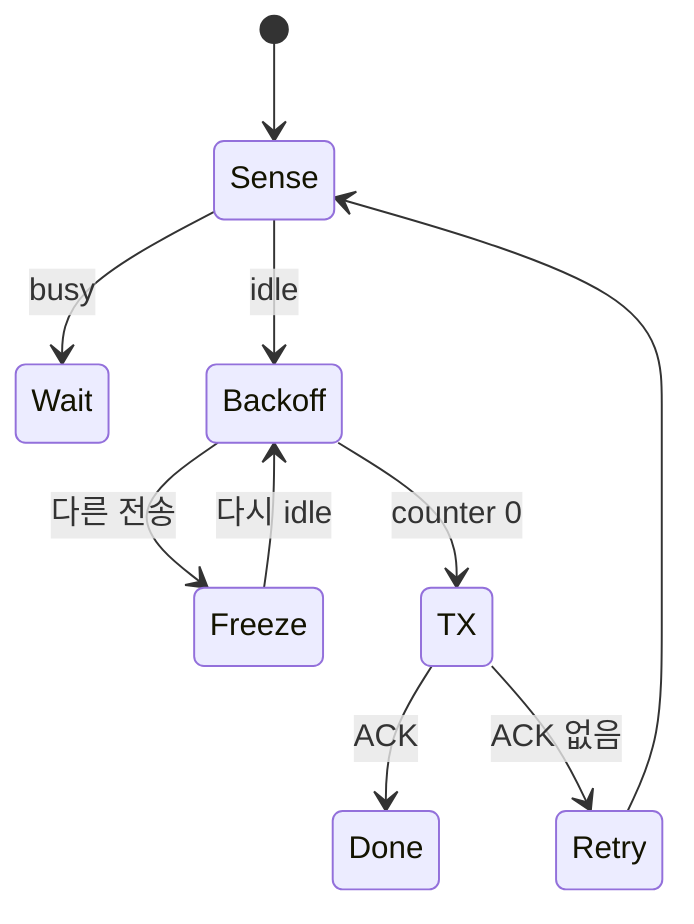
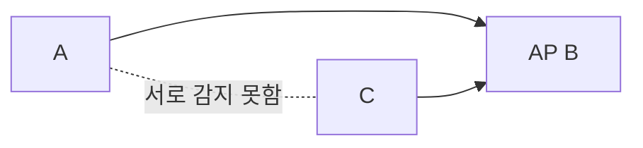

# 08. Wi‑Fi와 medium access

[이 책 목차](README.md)

[← 이전](07-antennas-mimo-and-beamforming.md) · [다음 →](09-cellular-generations-and-architecture.md)

## PHY와 MAC

PHY는 bit/symbol과 radio 파형을 연결한다.
MAC은 여러 station이 channel을 언제 쓰고 ACK를 어떻게 다룰지 정한다.

## CSMA/CA

carrier sense로 channel을 듣는다.
idle 조건 뒤 random backoff를 센다.
0이면 전송하고 ACK를 기다린다.

무선은 송신 중 collision detection이 어렵다.
collision avoidance도 collision zero 보장이 아니다.

## backoff 추적

A=2slot, B=5slot을 뽑았다.

| idle slot | A | B | 사건 |
|---:|---:|---:|---|
| 시작 | 2 | 5 | 대기 |
| 1 | 1 | 4 | idle |
| 2 | 0 | 3 | A 전송 |
| A 송신 | - | 3 freeze | busy |
| 재개 | - | 2→1→0 | B 전송 |

B는 busy 동안 counter를 줄이지 않는다.
같은 값을 뽑으면 collision할 수 있다.

## ACK

ACK 없음은 data collision, fading, ACK loss 중 어느 것인지 바로 구분하지 못할 수 있다.
sender는 retry와 contention window를 조정한다.
MAC ACK는 application 처리나 저장 완료가 아니다.

## hidden node

A와 C가 서로 못 듣지만 둘 다 AP B에 도달하면 각각 idle로 판단할 수 있다.

B에서 신호가 겹친다.
RTS/CTS가 receiver 주변 예약에 도움을 줄 수 있다.
control overhead가 있어 항상 이득은 아니다.

## OFDM과 OFDMA

OFDM은 한 전송을 직교 subcarrier로 구성한다.
OFDMA는 subcarrier 묶음인 RU를 여러 user에게 할당한다.

| 항목 | OFDM | OFDMA |
|---|---|---|
| 질문 | 파형을 어떻게 나누나 | user에게 무엇을 주나 |
| 동시 user | 필수 아님 | 여러 user 가능 |
| 추가 상태 | FFT·CP·pilot | scheduler·RU·trigger |

OFDMA도 synchronization과 control overhead가 필요하다.

## 세대와 표준

| 이름 | IEEE 기반 | 상태/뜻 |
|---|---|---|
| Wi‑Fi 6 | 802.11ax-2021 | 2.4/5GHz 중심의 ax 기능군과 인증 |
| Wi‑Fi 6E | 802.11ax | Wi‑Fi 6의 6GHz 확장; 별도 PHY 규격이 아님 |
| Wi‑Fi 7 | 802.11be-2024 | be 기반 기능과 Alliance 인증 program |
| Wi‑Fi 8 | P802.11bn | 2026-10-11 현재 IEEE project/draft 단계 |

표준 publication, Wi‑Fi Alliance 인증 program, 제품 출시는 서로 다른 시점이다.
draft 기능을 완성 표준 보장처럼 쓰지 않는다.
6GHz 사용 가능 범위는 국가 규제와 device 인증에 달린다.

## 6E를 읽는 법

6E의 E는 802.11ax와 별개 PHY를 뜻하지 않는다.
Wi‑Fi 6(ax) 기능을 6GHz band로 확장한 생태계 이름이다.
AP가 6E여도 client와 지역 규제가 6GHz를 지원해야 한다.

## Wi‑Fi 7/8 경계

802.11be-2024와 Wi‑Fi 7 인증 program은 관련되지만 동일 문서가 아니다.
Wi‑Fi 8은 P802.11bn project의 draft 진행 상태다.
최종 기능과 인증 요구는 확정 문서를 확인한다.

## band와 세대

2.4GHz, 5GHz, 6GHz는 spectrum band다.
Wi‑Fi 6, 7, 8은 세대 이름이다.
숫자가 비슷해도 같은 축이 아니다.

## 상태표

| 주체 | 입력 | 상태 | 결과 |
|---|---|---|---|
| station | queued frame | carrier sense | busy/idle |
| backoff | random counter | freeze/count | TX 시점 |
| AP scheduler | queue/channel | RU allocation | OFDMA trigger |
| receiver | frame | CRC/FEC | ACK/무응답 |
| sender | ACK | retry state | 성공/재경쟁 |

## goodput

PHY rate에는 preamble, pilot, coding, MAC header, contention, ACK가 포함되지 않은 방식이 많다.
1Gbit/s PHY 표기가 1Gbit/s application goodput을 보장하지 않는다.
retry와 여러 station 경쟁이 airtime을 쓴다.

## 반례

RSSI가 강해도 hidden collision이 가능하다.
넓은 channel은 peak rate를 높여도 간섭 선택지를 줄일 수 있다.
OFDMA 지원 장치도 모든 frame에 OFDMA를 쓰지 않는다.
최신 세대 AP만 바꾸고 client가 옛 세대면 새 기능을 못 쓸 수 있다.

## 문제

## 한 packet의 MAC 수명

application packet은 station queue에서 MAC frame이 된다.
station은 carrier sense와 backoff가 끝날 때까지 frame을 보관한다.
전송 뒤에는 ACK timer가 동작한다.
ACK가 오면 retry state와 buffer를 해제한다.
ACK가 없으면 retry count를 늘리고 새 contention 절차로 돌아간다.
여러 실패 뒤에는 frame을 버리고 상위 계층에 손실로 보일 수 있다.
OFDMA trigger를 받은 경우에는 AP가 지정한 RU와 시간에 맞춰 송신하지만, frame 수명과 ACK 확인 필요가 사라지는 것은 아니다.

1. backoff 4에서 idle 두 slot 뒤 busy면 남은 값은?
2. 6E가 별도 PHY 규격이 아닌 이유는?
3. OFDM과 OFDMA 차이는?

## 해설

1. 2에서 freeze하고 다시 idle일 때 계속 센다.
2. 802.11ax 기능을 6GHz로 확장한 이름이기 때문이다.
3. OFDM은 파형 구성, OFDMA는 RU를 여러 user에게 할당하는 access다.

## 공식 출처

- [IEEE 802.11 standard page](https://standards.ieee.org/ieee/802.11/10548/)
- [Wi‑Fi Alliance Wi‑Fi 7 announcement, 2024-01-08](https://www.wi-fi.org/news-events/newsroom/wi-fi-alliance-introduces-wi-fi-certified-7)
- [IEEE 802.11 Working Group](https://www.ieee802.org/11/)

[← 이전](07-antennas-mimo-and-beamforming.md) · [다음 →](09-cellular-generations-and-architecture.md)
