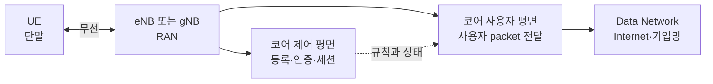
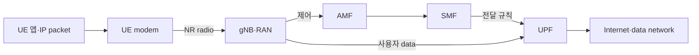

# 09. 이동통신 세대와 전체 구조

자료 확인일: **2026-10-11**

이 장은 휴대전화의 애플리케이션 바이트가 기지국과 코어망을 지나 외부 데이터망으로 가는 큰 지도를 만든다. 제품 설정이나 상용망 수치를 외우는 대신 **누가 단말을 등록하고, 누가 무선 자원을 배정하며, 실제 사용자 패킷은 어느 경로로 흐르는가**를 구분한다.

## 1. 먼저 주체와 용어를 구분한다

| 이름 | 풀어 쓴 말 | 하는 일 |
| --- | --- | --- |
| UE | User Equipment, 사용자 장비 | 스마트폰·모뎀처럼 가입자와 함께 움직이며 무선 접속하는 단말 |
| eNB | evolved Node B | LTE의 무선 기지국 |
| gNB | next generation Node B | 5G NR의 무선 기지국 |
| RAN | Radio Access Network, 무선 접속망 | UE와 코어망 사이의 무선·기지국 구간 |
| Core | Core Network, 코어망 | 인증, 세션, 이동성, 외부망 연결 정책 담당 |

UE 안의 애플리케이션이 IP packet을 만들면 운영체제 network stack과 cellular modem이 이를 무선 전송 단위로 바꾼다. 기지국은 안테나 철탑만 뜻하지 않는다. 무선 신호 송수신, 여러 UE의 시간·주파수 자원 배정, 무선 protocol 상태, core 연결을 담당하는 논리 기능을 포함한다. 코어망은 모든 무선 sample을 처리하지 않고 가입자 인증과 session을 관리하며 사용자 packet이 갈 data network를 연결한다.

5G core에서 **AMF(Access and Mobility Management Function)** 는 registration과 접근·이동성 제어, **SMF(Session Management Function)** 는 PDU session과 UPF 선택·전달 규칙, **UPF(User Plane Function)** 는 실제 사용자 IP packet 전달을 맡는다.

**Cell**은 기지국 장비 자체가 아니라 특정 radio 설정과 antenna가 서비스를 제공하는 논리적 무선 영역이다. 같은 철탑의 gNB 하나가 방향과 주파수가 다른 여러 cell을 만들 수 있고, 실내 small cell은 장비 하나가 좁은 cell 하나를 제공할 수 있다. UE는 cell 신호를 찾고 방송 식별자와 기본 설정을 읽으며, gNB는 붙은 UE의 무선 연결 상태를 관리한다.

~~~text
입력: UE가 antenna로 받은 radio samples
담당: UE PHY와 RRC
중간 상태: 후보 주파수, cell identity, 신호 세기·품질
결과: 접속을 시도할 serving cell 선택
조건: 가입자 등록과 IP session은 아직 만들어지지 않음
~~~

신호 막대는 UE가 cell을 발견했다는 근거에 가깝다. 인증, 사용자 packet 경로, Internet 접속 성공까지 뜻하지 않는다.

## 2. 세대와 배치 구조

| 세대 | 대표 무선·망 | 구조 변화의 핵심 |
| --- | --- | --- |
| 2G | GSM 계열 | 디지털 음성 중심, 회선 교환과 패킷 기능의 출발 |
| 3G | UMTS 계열 | 이동 데이터 사용 확대 |
| 4G | LTE + EPC | IP packet 중심의 all-IP 구조 |
| 5G | NR + 5GC | 서비스 기반 코어, slicing·edge·다양한 무선 운용 확장 |

EPC는 Evolved Packet Core, LTE의 패킷 코어이고 5GC는 5G Core Network다. 세대 전환은 주파수나 속도 숫자만 바꾸는 일이 아니라 무선 파형, 기지국 기능, 코어 인터페이스, 인증·세션 모델이 함께 바뀌는 일이다.

LTE에서 UE는 eNB를 거쳐 EPC에 연결된다. MME(Mobility Management Entity)는 LTE 제어 평면에서 접속과 이동성 상태를 담당하고 Serving Gateway와 Packet Data Network Gateway는 사용자 packet 전달에 참여한다. 물리 장비 수는 기능 통합과 가상화에 따라 달라질 수 있다.

~~~text
사용자 쪽: UE → eNB → Serving/Packet Gateway 계열 → 외부 IP network
제어 쪽:   UE → eNB → MME와 가입자 인증·이동성 상태
~~~

5G SA(Standalone)는 NR과 5GC를 함께 쓰는 독립 구조다.

~~~text
UE → gNB → UPF → Data Network
       │
       └→ AMF·SMF 등 5GC 제어 기능
~~~

NSA(Non-Standalone)는 NR radio를 LTE/EPC의 기존 제어 구조 또는 LTE anchor와 결합하는 배치 범주다. SA는 NR과 5GC가 직접 결합한다.

| 항목 | NSA의 대표적 감각 | SA의 대표적 감각 |
| --- | --- | --- |
| 제어 anchor | LTE 쪽을 활용 | 5GC와 NR 중심 |
| 빠른 도입 | 기존 LTE 자산 활용 가능 | 5GC 준비 필요 |
| 5G core 기능 | 제한될 수 있음 | 5GC 기능을 직접 활용 |
| 의미 | “가짜 5G”가 아님 | “항상 더 빠름”을 자동 보장하지 않음 |

NSA/SA에는 여러 3GPP deployment option이 있고 사업자 구성도 다르다. 화면의 5G 아이콘만으로 SA인지, 어떤 core와 session을 쓰는지 확정할 수 없다.

## 3. 제어 평면과 사용자 평면

**제어 평면(control plane)**은 누가 접속할 수 있는지, 어떤 보안·session·경로를 쓸지 상태를 만들고 유지한다. 등록, 인증, 위치 갱신, bearer 또는 PDU session 생성, handover 판단이 여기에 가깝다. **사용자 평면(user plane)**은 준비된 상태를 사용해 영상·웹·게임 같은 실제 애플리케이션 packet을 운반한다. 중요도의 구분이 아니라 역할 구분이다.

| 질문 | 주로 보는 평면 |
| --- | --- |
| 이 SIM과 UE가 가입자인가? | 제어 평면 |
| UE가 어느 기지국에 붙어 있는가? | 제어 평면 |
| 이 앱의 IP packet을 어디로 보낼까? | 사용자 평면 |
| QoS 규칙을 어느 flow에 적용할까? | 제어가 규칙을 만들고 사용자가 집행 |

Plane은 물리 판이나 별도 cable이 아니다. 같은 server나 link에서 두 plane의 traffic이 함께 흐를 수 있다. 인증이 성공해도 사용자 tunnel이나 외부 경로가 실패할 수 있고, 기존 사용자 경로가 잠시 살아 있어도 제어 상태가 만료되면 새 session을 만들지 못할 수 있다.

**PDU session**은 UE와 data network 사이의 사용자 plane 연결 문맥으로, UE 주소, QoS flow, UPF 경로 같은 상태를 묶는다. **Bearer**는 특정 QoS·보안·순서 처리 규칙을 공유하는 논리 운반 경로이며 물리 전용선이 아니다. 여러 bearer가 같은 radio resource를 시간에 따라 나눠 쓸 수 있다. **PDU(Protocol Data Unit)** 는 각 protocol 계층이 header와 payload를 합쳐 처리하는 단위다. **QoS(Quality of Service)** 는 지연, 손실, 우선순위, 보장 bit rate 같은 처리 목표이며 channel과 cell 부하가 나쁘면 목표를 충족하지 못할 수 있다.

~~~text
제어 평면이 만드는 상태:
  UE 등록됨
  PDU session S1 존재
  QoS flow Q1은 radio bearer B1 사용
  UPF 경로와 tunnel endpoint 선택

사용자 평면이 소비하는 상태:
  앱 IP packet
  → Q1로 분류
  → B1의 protocol 규칙 적용
  → gNB와 UPF 경로로 전달
~~~

## 4. 전원 켜기부터 첫 packet까지

UE는 cell을 찾고 gNB와 RRC 연결을 만든다. NAS registration 메시지는 gNB가 의미를 종단 처리하지 않고 AMF로 전달한다. 인증과 security context가 준비되면 SMF가 PDU session을 만들고 UPF 전달 상태를 설치한다. 그 뒤 앱 packet이 gNB→UPF→data network로 흐른다.

| 시각 | 주체 | 제어 상태 | 사용자 packet 가능? |
|---:|---|---|---|
| 0 ms | UE | cell 미선택 | 아니오 |
| 40 ms | UE·gNB | RRC 연결 | 아직 core session 없음 |
| 90 ms | UE·AMF | registration·security | session 준비 전 |
| 130 ms | SMF·UPF | PDU session·rule 설치 | 가능 |
| 150 ms | UE app | 첫 IP packet | gNB→UPF 전달 |

시간은 교육용 모형이며 표준 성능 보장이 아니다.

이미 무선 연결과 PDU session이 준비된 UE `10.10.0.7`이 server `203.0.113.20`으로 웹 요청을 보낸다고 하자.

| 시간 | 입력 | 처리 주체 | 중간 상태 | 결과 |
| --- | --- | --- | --- | --- |
| T0 | 앱의 IP packet | UE protocol stack | QoS flow와 radio bearer 선택 | 무선 전송 준비 |
| T1 | 전송할 data | gNB scheduler | UE에 시간·주파수 자원 grant | 해당 slot에서 송신 |
| T2 | 무선 block | gNB | 오류 검사·재조립 | 사용자 packet 복원 |
| T3 | 사용자 packet | gNB와 UPF | 사용자 평면 tunnel/forwarding | 외부망 방향 전달 |
| T4 | IP packet | Data Network | 일반 routing | server 도착 |

제어 평면은 T0 전에 등록, 인증, session, QoS 규칙을 준비했다. 매 사용자 byte가 AMF나 SMF를 통과하지는 않는다.

## 5. 주소와 식별자

| 값 | 목적 |
| --- | --- |
| 가입자 identity | 인증·과금 관계 |
| 임시 무선 identity | 현재 cell과 무선 절차에서 UE 구별 |
| IP address | 사용자 packet routing |
| tunnel endpoint | RAN과 core 사이 사용자 평면 전달 |

Handover 뒤 무선 identity와 기지국은 바뀌어도 UE IP session은 유지될 수 있다. 반대로 PDU session을 새로 만들면 IP가 바뀔 수 있다.

## 6. Wi-Fi AP와 gNB의 차이

둘 다 무선 접속을 제공하지만 제어 구조와 이동성·가입자 관리가 다르다. Wi-Fi AP는 보통 Ethernet LAN과 802.11 접속을 잇고, cellular RAN은 면허 주파수, cell 이동성, 가입자 인증, core session과 강하게 결합한다. 가정집 AP 하나를 전국 이동통신망의 gNB와 그대로 비교할 수 없지만 private 5G처럼 작은 범위의 이동통신망도 있으므로 cellular가 항상 전국망인 것도 아니다.

## 7. 실패 위치와 조건이 달라지는 경우

| 증상 | 먼저 나눌 질문 |
| --- | --- |
| 망 표시가 없음 | cell 탐색·동기·접속 가능 여부 |
| 등록 거절 | 가입자·인증·제어 평면 |
| 등록됐지만 인터넷 안 됨 | PDU session·UPF·DNS·외부 route |
| 이동 중 끊김 | 측정·handover·target 자원·사용자 경로 전환 |
| 특정 앱만 느림 | QoS, transport, server, radio scheduling |

RF 신호가 강해도 가입자 인증이나 정책이 거부될 수 있다. Core 상태가 정상이어도 scheduler 자원이 없거나 radio channel이 나쁘면 packet이 지연된다.

- UE가 idle이면 사용자 packet 전에 연결 재개가 필요할 수 있다.
- Emergency service는 일반 가입자 session과 다른 정책을 쓸 수 있다.
- Private 5G는 Internet 대신 공장 내부 data network로 연결할 수 있다.
- 로밍에서는 방문망과 홈망의 제어·사용자 경로가 나뉠 수 있다.
- Satellite access를 포함한 비지상망은 propagation delay와 cell 이동 모델이 다르다.

## 8. AI-RAN closed loop와 최신 연구를 읽는 조건

AI 모델은 RAN 측정값으로 cell parameter, scheduling 후보, traffic 예측을 만들 수 있다. 모델 출력이 곧바로 RF를 바꾸지는 않는다. 권한 있는 controller가 표준·제품 interface가 허용한 control knob로 변환하고, RAN node가 검증·적용하며, 후속 측정으로 결과를 확인한다.

표준은 data·interface 계약을 정의하고 연구는 특정 dataset·simulation·metric에서 방법을 평가한다. 현재 proposal의 정확도를 모든 상용 gNB 구현 성능으로 일반화하지 않는다. 지원 interface, 권한, 검증, rollback 조건이 있어야 실제 적용할 수 있다.

## 9. 통합 확인 문제와 해설

### 문제 1
5G 아이콘이 보이면 반드시 5G SA인가?

**해설:** 아니다. NSA에서도 NR radio를 사용할 수 있다. LTE anchor, core 구조와 signaling을 확인해야 한다.

### 문제 2
AMF가 모든 영상 packet을 직접 전달하는가?

**해설:** 아니다. AMF는 접근·이동성 제어 상태를 맡고 사용자 packet은 gNB와 UPF 경로로 흐른다.

### 문제 3
등록 성공이면 Internet packet도 즉시 가능한가?

**해설:** 아니다. 등록은 가입자와 접근 제어 절차 일부의 성공이다. PDU session, UPF 전달 상태, radio resource, DNS, 외부 route와 server 상태가 추가로 필요하다.

### 문제 4
Bearer는 물리 전용선인가?

**해설:** 아니다. QoS·보안·순서 같은 전달 처리를 묶은 논리 경로다.

### 문제 5
AI 모델 출력이 곧 표준 제어인가?

**해설:** 아니다. 지원 interface와 control knob, 권한, 검증, fallback·rollback이 필요하다.

## 10. 공식 출처

- 3GPP, [5G System Overview](https://www.3gpp.org/technologies/5g-system-overview)
- 3GPP TS 23.501, *System architecture for the 5G System*
- 3GPP TS 23.401, *GPRS enhancements for E-UTRAN access*
- ITU, [IMT systems and generations](https://www.itu.int/itu-r/)

다음 장에서는 gNB 안팎의 큰 지도를 PHY, MAC, RLC, PDCP, SDAP, RRC, NAS 계층으로 내려가며 읽는다.

[이전: Wi-Fi와 무선 LAN](08-wifi-and-medium-access.md) · [목차](README.md) · [다음: NR 무선과 프로토콜 스택](10-nr-radio-and-protocol-stack.md)
