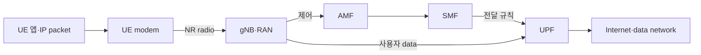
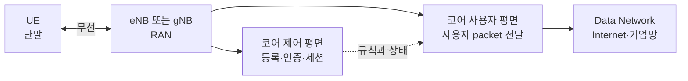

# 09. 이동통신 세대와 전체 구조

## 스마트폰과 인터넷 사이에 실제로 놓인 주체

**UE(User Equipment)** 는 스마트폰·모뎀처럼 가입자와 함께 움직이며 무선 접속을 수행하는 장비다. UE 안의 애플리케이션이 IP packet을 만들면 운영체제 network stack과 cellular modem이 이를 무선 전송 단위로 바꾼다.

**eNB(evolved Node B)** 는 LTE 무선 접속 기지국이고 **gNB(next generation Node B)** 는 5G NR 무선 접속 기지국이다. 둘은 안테나 철탑만 뜻하지 않는다. 무선 scheduling, protocol 처리, core 연결을 담당하는 논리 기능을 포함한다.

**RAN(Radio Access Network)** 은 UE와 core 사이의 무선 접속망이다. **core network**는 가입자 인증, 이동성 상태, session, 외부 data network 연결을 맡는다. 5G core에서 **AMF(Access and Mobility Management Function)** 는 registration과 접근·이동성 제어, **SMF(Session Management Function)** 는 PDU session과 UPF 선택·전달 규칙, **UPF(User Plane Function)** 는 실제 사용자 IP packet 전달을 맡는다.

## control plane과 user plane을 한 생애로 연결한다

**control plane**은 누가 접속할 수 있는지, 어떤 보안·session·경로를 쓸지 상태를 만든다. **user plane**은 그 상태를 사용해 앱 packet을 운반한다. 제어 메시지가 “중요하고 사용자 data가 덜 중요하다”는 구분이 아니라 역할 구분이다.

UE가 켜지면 cell을 탐색하고 gNB와 RRC 연결을 만든다. NAS registration 메시지는 gNB가 종단 처리하지 않고 AMF로 전달한다. 인증과 security context가 준비된 뒤 SMF가 PDU session을 만들고 UPF 전달 상태를 설치한다. 그 후 앱 packet이 gNB→UPF→data network로 흐른다.

**PDU session**은 UE와 data network 사이의 사용자 plane 연결 문맥이다. UE 주소, QoS flow, UPF 경로 같은 상태를 묶는다. **bearer**는 특정 전달 특성을 가진 논리 운반 경로를 가리키는 용어이며 물리 cable 한 가닥이 아니다.

| 시각 | 주체 | 제어 상태 | 사용자 packet 가능? |
|---:|---|---|---|
| 0 ms | UE | cell 미선택 | 아니오 |
| 40 ms | UE·gNB | RRC 연결 | 아직 core session 없음 |
| 90 ms | UE·AMF | registration·security | session 준비 전 |
| 130 ms | SMF·UPF | PDU session·rule 설치 | 가능 |
| 150 ms | UE app | 첫 IP packet | gNB→UPF 전달 |

시간은 교육용 모형이며 표준 성능 보장이 아니다.

## 4G, 5G NSA, 5G SA의 구조 차이

LTE의 EPC에서는 MME가 이동성·session 제어의 큰 역할을 맡고 S-GW/P-GW가 사용자 data 경로에 참여한다. 5G SA는 5G core의 service-based 기능과 NR 접속을 사용한다.

**NSA(Non-Standalone)** 는 5G NR radio를 쓰면서 기존 LTE·EPC 또는 LTE anchor에 제어 의존이 남는 배치 범주다. **SA(Standalone)** 는 NR과 5G core를 중심으로 동작한다. 화면에 5G 아이콘이 보인다는 사실만으로 SA인지, 어떤 core와 session을 쓰는지 확정할 수 없다.

## packet과 제어가 실패하는 위치

registration이 성공해도 PDU session 생성이 실패하면 UE는 망에 등록됐지만 일반 IP data를 못 보낼 수 있다. RF 신호가 강해도 가입자 인증이나 정책이 거부될 수 있다. 반대로 core 상태가 정상이어도 scheduler 자원이 없거나 radio channel이 나쁘면 packet이 지연된다.

## AI-RAN closed loop를 현재 조건으로 읽기

AI 모델은 RAN 측정값을 입력으로 받아 cell parameter, scheduling 후보, traffic 예측을 만들 수 있다. 그러나 모델 출력이 곧바로 RF를 바꾸는 것은 아니다. 권한 있는 controller가 표준·제품 인터페이스가 허용한 control knob로 변환하고, RAN 노드가 검증·적용하며, 후속 측정으로 결과를 확인한다.

표준은 데이터·인터페이스 계약을 정의하고 연구는 특정 dataset·simulation·metric에서 방법을 평가한다. 현재 proposal의 정확도를 모든 상용 gNB 구현 성능으로 일반화하지 않는다.

## 추가 문제와 완전 해설

### 1. registration 성공이면 인터넷 packet도 즉시 가능한가?
아니다. PDU session과 UPF 전달 상태, radio resource가 추가로 필요하다.

### 2. AMF와 UPF의 차이는?
AMF는 접근·이동성 제어 상태, UPF는 실제 사용자 packet 전달을 맡는다.

### 3. bearer가 물리 전용선인가?
아니다. QoS·전달 처리를 묶은 논리 경로다.

### 4. NSA와 SA를 아이콘만으로 구분할 수 있는가?
없다. LTE anchor와 core 구조·signaling을 확인해야 한다.

### 5. AI 모델 출력이 곧 표준 제어인가?
아니다. 지원 인터페이스, 권한, 검증, rollback 조건이 있어야 실제 적용된다.

[이전: Wi-Fi와 무선 LAN](08-wifi-and-medium-access.md) · [목차](README.md) · [다음: NR 무선과 프로토콜 스택](10-nr-radio-and-protocol-stack.md)

자료 확인일: **2026-10-11**

이 장은 휴대전화의 애플리케이션 바이트가 기지국과 코어망을 지나 외부 데이터망으로 가는 큰 지도를 만든다. 제품 설정이나 상용망 수치를 외우는 대신 **누가 단말을 등록하고, 누가 무선 자원을 배정하며, 실제 사용자 패킷은 어느 경로로 흐르는가**를 구분한다.

## 1. 먼저 다섯 주체를 구분한다

| 이름 | 풀어 쓴 말 | 하는 일 |
| --- | --- | --- |
| UE | User Equipment, 사용자 장비 | 휴대전화·모뎀처럼 망에 접속하는 단말 |
| eNB | evolved Node B | LTE의 무선 기지국 |
| gNB | next generation Node B | 5G NR의 무선 기지국 |
| RAN | Radio Access Network, 무선 접속망 | UE와 코어망 사이의 무선·기지국 구간 |
| Core | Core Network, 코어망 | 인증, 세션, 이동성, 외부망 연결 정책을 담당 |

기지국은 단순 안테나가 아니다. 무선 신호를 송수신하고, 여러 UE의 시간·주파수 자원을 배정하며, 무선 프로토콜 상태를 관리한다. 코어망은 모든 무선 샘플을 처리하지 않는다. 가입자 인증과 세션을 관리하고 사용자 패킷이 갈 데이터망을 연결한다.

## 2. 세대는 속도 숫자만 바뀐 이름이 아니다

### UE, cell, gNB를 실제 공간에 놓아 본다

**Cell**은 한 기지국 장비 자체의 이름이 아니라, 특정 radio 설정과 antenna가 서비스를 제공하는 논리적 무선 영역이다. 같은 철탑의 gNB 하나가 서로 다른 방향을 보는 antenna와 주파수 설정으로 여러 cell을 만들 수 있다. 반대로 실내 small cell은 작은 장비 하나가 좁은 cell 하나를 제공할 수 있다.

UE는 cell의 신호를 찾고 그 cell이 방송하는 식별자와 기본 설정을 읽는다. gNB는 자기 cell에 붙은 UE들의 무선 연결 상태를 관리한다.

~~~text
입력: UE가 antenna로 받은 radio samples
담당: UE PHY와 RRC
중간 상태: 후보 주파수, cell identity, 신호 세기·품질
결과: 접속을 시도할 serving cell 선택
조건: 가입자 등록과 IP session은 아직 만들어지지 않음
~~~

따라서 화면에 신호 막대가 보인다는 사실은 UE가 cell을 발견했다는 근거에 가깝다. 가입자 인증, 사용자 packet 경로, Internet 접속까지 성공했다는 뜻은 아니다.

| 세대 | 대표 무선·망 | 구조 변화의 핵심 |
| --- | --- | --- |
| 2G | GSM 계열 | 디지털 음성 중심, 회선 교환과 패킷 기능의 출발 |
| 3G | UMTS 계열 | 이동 데이터 사용 확대 |
| 4G | LTE + EPC | IP packet 중심의 all-IP 구조 |
| 5G | NR + 5GC | 서비스 기반 코어, slicing·edge·다양한 무선 운용 확장 |

EPC는 Evolved Packet Core, LTE의 패킷 코어다. 5GC는 5G Core Network다. 세대 전환은 주파수만 바꾸는 일이 아니다. 무선 파형, 기지국 기능, 코어 인터페이스, 인증·세션 모델이 함께 바뀐다.

## 3. 제어 평면과 사용자 평면

**제어 평면(control plane)**은 연결을 준비하고 유지하는 신호를 처리한다. 등록, 인증, 위치 갱신, bearer 또는 PDU session 생성, handover 판단이 여기에 가깝다.

**사용자 평면(user plane)**은 준비된 경로로 실제 애플리케이션 packet을 운반한다. 영상, 웹, 게임 데이터가 여기에 해당한다.

| 질문 | 주로 보는 평면 |
| --- | --- |
| 이 SIM과 UE가 가입자인가? | 제어 평면 |
| UE가 어느 기지국에 붙어 있는가? | 제어 평면 |
| 이 앱의 IP packet을 어디로 보낼까? | 사용자 평면 |
| QoS 규칙을 어느 flow에 적용할까? | 제어가 규칙을 만들고 사용자가 집행 |

두 평면은 협력하지만 같은 packet이 아니다. 인증이 성공해도 사용자 평면 터널이나 외부 경로가 실패할 수 있다. 반대로 기존 사용자 경로가 잠시 살아 있어도 제어 상태가 만료되면 새 세션을 만들지 못할 수 있다.

**Plane**은 물리적인 판이나 별도 cable 이름이 아니다. 서로 다른 책임의 message와 상태를 논리적으로 나눈 말이다. 같은 server나 같은 network link에서 두 plane의 traffic이 함께 흐를 수도 있다.

**Bearer**는 일정한 처리 규칙을 공유하는 논리적 전달 경로다. Radio bearer는 UE와 RAN 사이에서 protocol configuration, QoS, 보안·순서 처리 규칙을 묶는다. 물리 전용선이 아니며 여러 bearer가 같은 radio resource를 시간에 따라 나눠 쓸 수 있다.

**PDU**는 Protocol Data Unit이다. 한 protocol 계층이 header와 payload를 합쳐 자기 규칙으로 처리하는 단위다. IP packet이 PDCP로 들어가면 PDCP header가 붙은 PDCP PDU가 되고, 아래 RLC에서는 그 PDCP PDU가 payload가 된다.

**QoS**는 Quality of Service다. 지연, 손실, 우선순위, 보장 bit rate처럼 traffic 처리 목표를 나타낸다. QoS rule은 “항상 이 속도가 나온다”는 물리적 보증서가 아니다. Radio 품질과 cell 부하가 나쁘면 목표를 충족하지 못할 수 있다.

~~~text
제어 평면이 만드는 상태:
  UE 등록됨
  PDU session S1 존재
  QoS flow Q1은 radio bearer B1 사용
  UPF 경로와 tunnel endpoint 선택

사용자 평면이 소비하는 상태:
  앱 IP packet
  → Q1로 분류
  → B1의 protocol 규칙 적용
  → gNB와 UPF 경로로 전달
~~~

## 4. LTE의 큰 지도

LTE에서 UE는 eNB와 무선으로 연결된다. eNB는 EPC와 연결된다.

~~~text
UE
  → eNB
  → Serving/Packet Gateway 계열
  → 외부 IP network

제어 쪽:
  UE → eNB → MME와 가입자 인증·이동성 상태
~~~

MME는 Mobility Management Entity다. LTE 제어 평면에서 접속과 이동성 상태를 담당한다. Serving Gateway와 Packet Data Network Gateway는 사용자 packet 전달에 참여한다. 실제 배포는 기능 통합과 가상화에 따라 물리 장비 수가 달라질 수 있다.

## 5. 5G SA의 큰 지도

SA는 Standalone, 5G NR과 5GC를 함께 쓰는 독립 구조다.

~~~text
UE → gNB → UPF → Data Network
       │
       └→ AMF·SMF 등 5GC 제어 기능
~~~

AMF는 Access and Mobility Management Function이다. 등록과 접근·이동성 상태를 담당한다. SMF는 Session Management Function으로 PDU session과 사용자 평면 선택·규칙을 관리한다. UPF는 User Plane Function으로 실제 사용자 packet을 전달한다.

## 6. NSA와 SA를 구분한다

NSA는 Non-Standalone이다. 초기 5G 배포에서 NR 무선을 LTE/EPC의 기존 제어 구조와 결합하는 선택지다. SA는 NR과 5GC가 직접 결합한다.

| 항목 | NSA의 대표적 감각 | SA의 대표적 감각 |
| --- | --- | --- |
| 제어 anchor | LTE 쪽을 활용 | 5GC와 NR 중심 |
| 빠른 도입 | 기존 LTE 자산 활용 가능 | 5GC 준비 필요 |
| 5G core 기능 | 제한될 수 있음 | 5GC 기능을 직접 활용 |
| 의미 | “가짜 5G”가 아님 | “항상 더 빠름”을 자동 보장하지 않음 |

NSA/SA는 한 가지 옵션만 있는 단순 이분법이 아니다. 3GPP가 정의한 여러 deployment option이 있고 사업자 구성도 다르다. 입문 단계에서는 **NR 표시만 보고 코어 구조를 단정하지 않는다**는 점이 중요하다.

## 7. 한 웹 요청을 끝까지 추적한다

조건은 교육용이다.

~~~text
UE IP: 10.10.0.7
Server IP: 203.0.113.20
RAN: gNB
Core: 5GC
PDU session과 무선 연결은 이미 준비됨
~~~

| 시간 | 입력 | 처리 주체 | 중간 상태 | 결과 |
| --- | --- | --- | --- | --- |
| T0 | 앱의 IP packet | UE protocol stack | QoS flow와 radio bearer 선택 | 무선 전송 준비 |
| T1 | 전송할 data | gNB scheduler | UE에 시간·주파수 자원 grant | 해당 slot에서 송신 |
| T2 | 무선 block | gNB | 오류 검사·재조립 | 사용자 packet 복원 |
| T3 | 사용자 packet | gNB와 UPF | 사용자 평면 tunnel/forwarding | 외부망 방향 전달 |
| T4 | IP packet | Data Network | 일반 routing | server 도착 |

제어 평면은 T0 전에 UE 등록, 인증, 세션, QoS 규칙을 준비했다. 매 사용자 byte가 AMF나 SMF를 통과하는 것은 아니다.

## 8. 주소도 계층마다 다르다

UE에는 가입자·장비를 식별하는 값, 무선 연결 식별자, IP 주소가 각각 있을 수 있다. 이들을 모두 “휴대전화 주소”라고 부르면 장애 분석이 어려워진다.

| 값 | 목적 |
| --- | --- |
| 가입자 identity | 인증·과금 관계 |
| 임시 무선 identity | 현재 cell과 무선 절차에서 UE 구별 |
| IP address | 사용자 packet routing |
| tunnel endpoint | RAN과 core 사이 사용자 평면 전달 |

Handover 뒤 무선 identity와 기지국은 바뀌어도 UE IP session은 유지될 수 있다. 반대로 PDU session을 새로 만들면 IP가 바뀔 수 있다.

## 9. Wi-Fi AP와 gNB가 같은가?

둘 다 무선 접속을 제공하지만 제어 구조와 이동성·가입자 관리가 다르다. Wi-Fi AP는 보통 Ethernet LAN과 802.11 접속을 잇는다. Cellular RAN은 면허 주파수, cell 이동성, 가입자 인증, 코어 세션과 강하게 결합한다.

가정집 AP 하나의 구조를 전국 이동통신망의 gNB와 그대로 비교하면 안 된다. 반대로 5G private network처럼 작은 범위의 이동통신망도 있으므로 “cellular는 항상 전국망”도 반례가 있다.

## 10. 장애를 평면별로 읽는다

| 증상 | 먼저 나눌 질문 |
| --- | --- |
| 망 표시가 없음 | cell 탐색·동기·접속 가능 여부 |
| 등록 거절 | 가입자·인증·제어 평면 |
| 등록됐지만 인터넷 안 됨 | PDU session·UPF·DNS·외부 route |
| 이동 중 끊김 | 측정·handover·target 자원·사용자 경로 전환 |
| 특정 앱만 느림 | QoS, transport, server, radio scheduling |

## 11. 조건이 달라지는 반례

- UE가 idle이면 사용자 packet 전에 연결 재개 절차가 필요할 수 있다.
- Emergency service는 일반 가입자 세션과 다른 정책을 쓸 수 있다.
- Private 5G는 외부 Internet 대신 공장 내부 data network로 연결할 수 있다.
- 로밍에서는 방문망과 홈망의 제어·사용자 경로가 나뉠 수 있다.
- Satellite access를 포함하는 비지상망은 propagation delay와 cell 이동 모델이 다르다.

## 12. 확인 문제

### 문제 1

5G 아이콘이 보이면 반드시 5G SA인가?

**해설:** 아니다. NSA에서 NR radio를 사용해도 5G 표시가 가능하다. 코어와 제어 anchor를 별도로 확인해야 한다.

### 문제 2

AMF가 모든 영상 packet을 직접 전달하는가?

**해설:** 아니다. AMF는 접근·이동성 제어 기능이다. 사용자 packet은 gNB와 UPF 같은 사용자 평면 경로로 흐른다.

### 문제 3

등록 성공 뒤 웹 접속이 실패했다. 등록 성공으로 무엇까지 확인했는가?

**해설:** 가입자와 접근 제어 절차 일부가 성공했다. PDU session, DNS, 사용자 평면 route, 외부 server 상태는 별도다.

## 13. 공식 출처

- 3GPP, [5G System Overview](https://www.3gpp.org/technologies/5g-system-overview)
- 3GPP TS 23.501, *System architecture for the 5G System*
- 3GPP TS 23.401, *GPRS enhancements for E-UTRAN access*
- ITU, [IMT systems and generations](https://www.itu.int/itu-r/)

다음 장에서는 gNB 안팎의 큰 지도를 PHY, MAC, RLC, PDCP, SDAP, RRC, NAS 계층으로 내려가며 읽는다.
